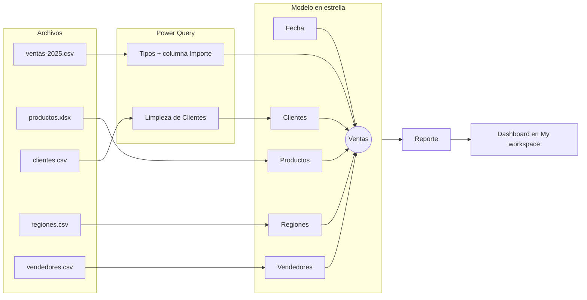

# Lab 116 — Power BI en un día: del archivo al dashboard

## Objetivo

En una sola sesión larga harás el recorrido completo de un analista: traer cinco archivos a Power BI Desktop, limpiarlos en Power Query, armar un modelo en estrella con tabla de fechas, escribir cuatro medidas, construir un reporte de una página y publicarlo con un dashboard. Es el primer lab de la **Ruta Pro Power BI**: los siguientes (117 a 127) profundizan cada uno de estos pasos hasta el nivel del examen PL-300.

## Escenario de negocio

**Empresa ficticia:** Servicios Integrados Tecnológicos S.A. (SIT), que vende licencias, servicios y capacitación en Colombia, México, Perú y Chile.

**Problema a resolver:** la gerente comercial recibe cada mes cinco archivos exportados de distintos sistemas (ventas, productos, clientes, regiones y vendedores) y arma el resumen a mano en Excel. Tarda dos días y los números no siempre cuadran, porque el archivo de clientes trae nombres escritos de varias formas y filas repetidas. Quiere un reporte de 2025 que responda en un vistazo: cuánto vendimos, en cuántos pedidos, en qué país, de qué categoría y quiénes son los mejores clientes.

**Por qué Power BI:** Power Query repite la limpieza sola cada vez que llegan archivos nuevos, el modelo une las tablas sin fórmulas de búsqueda y las medidas se recalculan con cada filtro.

## Lo que vas a construir

- Un archivo `lab116-sit-ventas-2025.pbix` con cinco tablas cargadas desde archivos y una tabla de fechas creada con DAX
- Una limpieza de `Clientes` que deja **150** clientes únicos con nombres e industrias escritos de una sola forma
- Un modelo en estrella: `Ventas` en el centro y `Fecha`, `Productos`, `Clientes`, `Regiones` y `Vendedores` alrededor
- Cuatro medidas: `Ventas Totales`, `Pedidos`, `Ticket Promedio` y `% Ventas Licencias`
- Una página `Resumen comercial 2025` con tarjetas, gráficos, un slicer por país y una tabla de mejores clientes
- El reporte publicado en tu **My workspace** y un dashboard con tres tarjetas ancladas

## Relación con la Ruta Pro y con el Módulo 6

La teoría básica está en el [Módulo 6](/nivel/basico/modulo/power-bi-reportes-y-dashboards-basicos) y aquí no se repite. La diferencia con el Módulo 6 y el Lab 06 es el tipo de datos: aquí trabajas con **archivos sucios de varios sistemas**, que es como llegan los datos en la mayoría de los proyectos reales.

| En este lab lo haces una vez, en versión mínima | Lo profundizas en |
|---|---|
| Conectar archivos y revisar su calidad | Lab 117 (perfilado, carpetas, parámetros, JSON) |
| Limpiar texto y quitar duplicados | Lab 117 (formatos de fecha por región, perfilado) y Lab 118 (unpivot, merge, append) |
| Modelo en estrella y tabla de fechas | Lab 119 (dimensión de rol) y Lab 122 (rendimiento) |
| Medidas con `SUM`, `DIVIDE` y `CALCULATE` | Labs 120 y 121 (contexto de filtro, inteligencia de tiempo) |
| Una página de reporte | Labs 123 y 124 (diseño, accesibilidad, storytelling) |
| Publicar y anclar en un dashboard | Lab 126 (actualización, seguridad por filas, distribución) |

> **Fuente del esqueleto:** el orden de este lab sigue el taller oficial "Dashboard in a Day" y los labs 1 a 4, 8 y 12 del curso oficial PL-300 de Microsoft Learning ([GitHub, licencia MIT](https://github.com/MicrosoftLearning/PL-300-Microsoft-Power-BI-Data-Analyst)). El caso, los datos y el texto son propios del curso.

## Duración estimada

| Ejercicio | Tiempo estimado |
|---|---|
| Ejercicio 1 — Descargar los datos y abrir Power BI Desktop | 15 min |
| Ejercicio 2 — Conectar los cinco archivos | 25 min |
| Ejercicio 3 — Limpiar en Power Query | 45 min |
| Ejercicio 4 — Modelo en estrella y tabla de fechas | 40 min |
| Ejercicio 5 — Medidas | 30 min |
| Ejercicio 6 — Reporte de una página | 60 min |
| Ejercicio 7 — Publicar y crear el dashboard | 30 min |
| **Total** | **unas 4 horas (4 a 5 con pausas)** |

> Pensado para hacerse en un día con pausas, como los talleres "in a Day". Si es tu primera vez con Power Query, cuenta entre 5 y 6 horas. El Ejercicio 7 puede quedar para otra sesión.

## Nivel

**N1 Básico** (primer lab de la ruta) — Certificación objetivo de la ruta: **PL-300** (Power BI Data Analyst, vigente)

## Tecnologías utilizadas

- Power BI Desktop: Power Query, Model view, Table view, Report view y DAX
- Power BI service, [app.powerbi.com](https://app.powerbi.com) (solo para publicar y crear el dashboard)

## Prerrequisitos

### Entorno

- [ ] Windows 10 o posterior con **Power BI Desktop** instalado. Learn recomienda instalarlo desde Microsoft Store porque no pide permisos de administrador; la descarga directa sí los pide ([Learn: Get Power BI Desktop](https://learn.microsoft.com/power-bi/fundamentals/desktop-get-the-desktop)). Si no tienes Windows, mira la [Variante sin Windows](#variante-sin-windows)
- [ ] Para el Ejercicio 7: tu cuenta de trabajo del curso (la misma de Power Apps). Con licencia gratuita puedes publicar en tu **My workspace** y crear ahí dashboards ([Learn: features for free users](https://learn.microsoft.com/power-bi/fundamentals/end-user-features))

### Conocimiento previo

- Haber hecho el primer reporte del Módulo 6: sabes qué es una tabla, un visual, una relación y una medida
- No necesitas saber Power Query ni DAX más allá del Módulo 6: aquí escribes cada fórmula completa

### Idioma de Power BI Desktop

Este lab nombra los botones en inglés. Si tu Power BI Desktop se abrió en español (pasa al instalarlo en un Windows en español), tienes dos opciones:

- **Cambiarlo a inglés mientras haces el lab** (recomendado): **File** > **Options and settings** > **Options**, sección **Global** > **Regional Settings**, y elige el idioma de la aplicación; se aplica al reiniciar Power BI Desktop ([Learn: idiomas y regiones de Power BI](https://learn.microsoft.com/power-bi/fundamentals/supported-languages-countries-regions)).
- **Dejarlo en español** y buscar el equivalente de cada botón: suelen ser traducciones directas (**Get data** = *Obtener datos*, **Transform data** = *Transformar datos*, **Close & Apply** = *Cerrar y aplicar*).

### Verificación rápida antes de empezar

- [ ] Power BI Desktop abre y muestra la pantalla de inicio
- [ ] Tienes unos 5 MB libres para los datos y el archivo `.pbix`

## Variante sin Windows

Power BI Desktop solo existe para Windows; en Mac, Learn lo admite únicamente dentro de un escritorio virtual de Windows (Azure Virtual Desktop o Windows 365) ([Learn: Get Power BI Desktop](https://learn.microsoft.com/power-bi/fundamentals/desktop-get-the-desktop)). Sin acceso a Windows puedes hacer los Ejercicios 1 y 3 en **Excel** (pestaña **Data** > **Get Data**), que usa el mismo motor de Power Query, y comprobar las cifras de limpieza del Ejercicio 3. El modelo, las medidas y el reporte necesitan Power BI Desktop: guarda este lab para cuando tengas un equipo con Windows.

## Datos de apoyo

Descarga el paquete **[sit-ventas.zip](/practice-assets/powerbi/sit-ventas/sit-ventas.zip)** (unos 320 KB). Son datos **ficticios** generados para el curso: empresas, personas, correos y precios son inventados. Lo usarás en todos los labs de la ruta.

| Archivo | Qué usarás en este lab |
|---|---|
| `ventas-2025.csv` | Las 1.438 líneas de pedido de 2025 |
| `productos.xlsx` | Los 18 productos con su categoría |
| `clientes.csv` | Los clientes (vienen sucios a propósito) |
| `regiones.csv` | País, región y ciudad |
| `vendedores.csv` | Los vendedores |

Los demás archivos del paquete (2024, 2026, objetivos, tipos de cambio) son para los labs siguientes. El paquete trae también `expected/metricas-esperadas.json` con las cifras correctas, por si quieres comprobar tu trabajo sin mirar este enunciado.

**Cómo se calcula el importe de una línea:** `Cantidad × PrecioUnitario × (1 − DescuentoPct / 100)`. El descuento viene como porcentaje entero (0, 5, 10 o 15), así que no depende del separador decimal de tu Windows. Importes en dólares (USD).

## Arquitectura del laboratorio



---

## Ejercicio 1 — Descargar los datos y abrir Power BI Desktop

**Objetivo:** tener los cinco archivos en una carpeta fija, porque Power BI guarda la ruta de cada archivo y la usa al actualizar.

### Tarea 1.1 — Preparar la carpeta

1. Descarga [sit-ventas.zip](/practice-assets/powerbi/sit-ventas/sit-ventas.zip).
2. Clic derecho sobre el zip > **Extraer todo** y escribe como destino exactamente `C:\PowerBI` (el zip ya trae dentro la carpeta `sit-ventas`). Quedará `C:\PowerBI\sit-ventas\` con los archivos. Si te queda `C:\PowerBI\sit-ventas\sit-ventas\`, no pasa nada: usa esa ruta en todo el lab.
3. Abre `ventas-2025.csv` con el Bloc de notas (clic derecho > **Abrir con** > **Bloc de notas**; no con Excel, que cambia formatos al abrir) y mira las dos primeras líneas: los encabezados y una línea de pedido.

### Tarea 1.2 — Archivo nuevo

1. Abre Power BI Desktop y crea un reporte en blanco.
2. Guárdalo enseguida como `lab116-sit-ventas-2025.pbix` en `C:\PowerBI\` (**File** > **Save**). Guarda de nuevo al final de cada ejercicio.

### Resultado esperado del Ejercicio 1

La carpeta `C:\PowerBI\sit-ventas\` con los archivos, y un `.pbix` vacío guardado junto a ella.

### Validación del Ejercicio 1

| Campo | Tu valor |
|---|---|
| Ruta de la carpeta de datos | ___ |
| Encabezados de `ventas-2025.csv` (primera línea, tal como la ves en el Bloc de notas) | ___ |

---

## Ejercicio 2 — Conectar los cinco archivos

**Objetivo:** traer los archivos a Power Query sin cargarlos todavía al modelo, para limpiarlos antes.

### Tarea 2.1 — El archivo de ventas

1. En la pestaña **Home** selecciona **Get data** y, en la lista, **Text/CSV** ([Learn: Text/CSV](https://learn.microsoft.com/power-bi/connect-data/desktop-connect-csv)).
2. Elige `ventas-2025.csv` y selecciona **Open**. Se abre una vista previa.
3. Comprueba en la vista previa que **Delimiter** dice **Comma** y que los acentos se ven bien. Si ves caracteres raros en lugar de tildes, cambia **File Origin** a **65001: Unicode (UTF-8)**.
4. Selecciona **Transform Data** (no **Load**): así se abre Power Query y nada llega al modelo hasta que lo apruebes.

### Tarea 2.2 — Los otros cuatro archivos

Ya dentro de Power Query, en la pestaña **Home** usa **New Source** para traer el resto sin salir del editor:

1. **New Source** > **Excel Workbook** ([Learn: Excel](https://learn.microsoft.com/power-bi/connect-data/desktop-connect-excel)) > `productos.xlsx`. En el **Navigator** marca la hoja **Productos** y pulsa **OK**.
2. **New Source** > **Text/CSV** > `clientes.csv` > **OK**.
3. Repite con `regiones.csv` y `vendedores.csv`.

> Si no ves **New Source** en tu versión, cierra Power Query con **Close & Apply** y vuelve a **Get data** desde Power BI Desktop; luego entra otra vez con **Transform data**. Que se carguen datos aún sin limpiar no es un problema: la limpieza del Ejercicio 3 se aplica igual al volver a **Close & Apply**.

### Tarea 2.3 — Nombres de las consultas

En el panel **Queries** (izquierda), haz clic derecho sobre cada consulta > **Rename** y déjalas así:

| Nombre que trae | Nombre nuevo |
|---|---|
| `ventas-2025` | `Ventas` |
| `Productos` | `Productos` (ya está) |
| `clientes` | `Clientes` |
| `regiones` | `Regiones` |
| `vendedores` | `Vendedores` |

El nombre de la consulta será el nombre de la tabla en el modelo y en todas las fórmulas DAX.

### Resultado esperado del Ejercicio 2

Cinco consultas en el panel **Queries** con los nombres de la tabla de arriba, todas con encabezados en la primera fila (Power BI los detecta solo en los CSV de este paquete).

### Validación del Ejercicio 2

| Campo | Tu valor |
|---|---|
| Número de consultas en el panel **Queries** | ___ (esperado: 5) |
| En `Ventas`, ícono del tipo de dato de la columna `FechaPedido` (calendario, `ABC` o `123`) | ___ |

---

## Ejercicio 3 — Limpiar en Power Query

**Objetivo:** dejar cada tabla con los tipos correctos y quitar los problemas del archivo de clientes **antes** de que lleguen al modelo.

### Tarea 3.1 — Mirar la calidad antes de tocar nada

1. Selecciona la consulta `Clientes`.
2. En la pestaña **View**, grupo **Data preview**, activa **Column quality**, **Column distribution** y **Column profile** ([Learn: data profiling tools](https://learn.microsoft.com/power-query/data-profiling-tools)).
3. Abajo a la izquierda verás **Column profiling based on top 1000 rows**. Haz clic y cámbialo a **Column profiling based on entire data set**, para que cuente todas las filas.
4. Selecciona la columna `Industria` y mira el **Column profile**: verás `Retail` y `retail` como valores distintos, y algunas filas vacías.

**Anota** (te servirá para comprobar la limpieza):

| Campo | Tu valor |
|---|---|
| Filas de `Clientes` antes de limpiar (en **Column profile**, el conteo **Count** de cualquier columna) | ___ (esperado: 153) |
| Valores distintos de `Industria` antes de limpiar (**Distinct**) | ___ |

### Tarea 3.2 — Tipos de dato de `Ventas`

1. Selecciona `Ventas` y mira el ícono a la izquierda de cada encabezado.
2. Power BI ya detecta los tipos al conectar un CSV, así que lo normal es que coincidan con la tabla. Si alguno no coincide, haz clic en su ícono y elige el tipo ([Learn: data types](https://learn.microsoft.com/power-query/data-types)). Si aparece un diálogo preguntando si reemplazar el paso o agregar uno nuevo, elige **Replace current**:

| Columna | Tipo |
|---|---|
| `PedidoID`, `ClienteID`, `ProductoID`, `VendedorID`, `RegionID` | **Text** |
| `Linea`, `Cantidad`, `PrecioUnitario`, `DescuentoPct` | **Whole number** |
| `FechaPedido`, `FechaEntrega` | **Date** |

### Tarea 3.3 — La columna `Importe`

1. Con `Ventas` seleccionada, en la pestaña **Add column** selecciona **Custom column** ([Learn: add a custom column](https://learn.microsoft.com/power-query/add-custom-column)).
2. En **New column name** escribe `Importe`.
3. En **Custom column formula** escribe (puedes insertar cada columna con doble clic en **Available columns**):

```m
[Cantidad] * [PrecioUnitario] * (1 - [DescuentoPct] / 100)
```

4. Pulsa **OK**. La columna nueva aparece con el ícono `ABC123` (tipo sin definir): en Power BI Desktop el tipo se pone después. (Si tu versión trae en el diálogo una lista de tipo de dato, puedes elegir ahí **Fixed decimal number** y saltarte el paso 5.)
5. Haz clic en ese ícono y elige **Fixed decimal number**, el tipo pensado para importes de dinero (Learn también lo llama *Currency*).

> **Por qué una columna y no una medida:** el importe es un dato de cada línea, que no cambia con los filtros; lo que sí cambia con los filtros (la suma) será una medida en el Ejercicio 5.

### Tarea 3.4 — Limpiar `Clientes`

El archivo trae los nombres con espacios sobrantes y mayúsculas mezcladas (`  clínica horizonte s.a. de c.v. `, `CONSTRUCTORA CUMBRE S.A.`), la industria escrita de varias formas o vacía, y tres filas repetidas. Lo resuelves con dos columnas personalizadas y un quitar duplicados.

1. Selecciona `Clientes`. **Add column** > **Custom column**:
   - **New column name:** `Cliente limpio`
   - **Custom column formula:**

     ```m
     Text.Proper(Text.Trim([Cliente]))
     ```

   `Text.Trim` quita los espacios del principio y del final ([Learn: Text.Trim](https://learn.microsoft.com/powerquery-m/text-trim)) y `Text.Proper` pone en mayúscula la primera letra de cada palabra ([Learn: Text.Proper](https://learn.microsoft.com/powerquery-m/text-proper)).
2. Otra **Custom column**:
   - **New column name:** `Industria limpia`
   - **Custom column formula:**

     ```m
     if [Industria] = null or Text.Trim([Industria]) = "" then "Sin dato" else Text.Proper(Text.Trim([Industria]))
     ```

   Una industria vacía pasa a `Sin dato`: así se ve en los gráficos en lugar de un hueco.
3. Pon tipo **Text** a las dos columnas nuevas (ícono `ABC123` > **Text**).
4. Quita las columnas viejas y las que repiten datos de `Regiones`: en la pestaña **Home** selecciona **Choose columns** y deja marcadas solo `ClienteID`, `Cliente limpio`, `Industria limpia`, `Segmento`, `Ciudad` y `FechaAlta`. Quitas `RegionID` y `Pais` a propósito: la región de cada venta ya viene en `Ventas`, y dejarla también aquí crearía dos caminos entre tablas en el Ejercicio 4.
5. Renombra `Cliente limpio` a `Cliente` e `Industria limpia` a `Industria` (doble clic en el encabezado).
6. Selecciona la columna `ClienteID`. En la pestaña **Home**, grupo **Reduce rows**, selecciona **Remove rows** > **Remove duplicates** ([Learn: working with duplicates](https://learn.microsoft.com/power-query/working-with-duplicates)).
7. Revisa en **Applied Steps** (derecha) que están todos los pasos, en orden. Si te equivocas en uno, puedes borrarlo con la **X** y rehacerlo.

### Tarea 3.5 — Cargar

En la pestaña **Home** selecciona **Close & Apply**. Power BI carga las cinco tablas al modelo.

### Resultado esperado del Ejercicio 3

- `Clientes` con **150** filas, sin espacios sobrantes y con 10 industrias: `Construcción`, `Educación`, `Energía`, `Gobierno`, `Logística`, `Manufactura`, `Retail`, `Salud`, `Servicios Financieros` y `Sin dato` (8 clientes)
- `Ventas` con **1.438** filas y la columna `Importe`

> Comprobado en el motor de Power Query con estos mismos archivos. Fíjate en cómo queda un nombre con sufijo: `Clínica Horizonte S.A. De C.V.`. `Text.Proper` pone en mayúscula la "d" de "de", porque trata cada palabra igual. Es aceptable para este reporte. Si te molesta, en el Lab 118 verás cómo corregir excepciones con **Replace values**.

### Validación del Ejercicio 3

| Campo | Tu valor |
|---|---|
| Filas de `Clientes` después de limpiar (en **Table view**, abajo a la izquierda) | ___ (esperado: 150) |
| Valores distintos de `Industria` después de limpiar | ___ (esperado: 10) |
| Cómo queda escrito el cliente `C0004` | ___ |
| Filas de `Ventas` | ___ (esperado: 1.438) |

---

## Ejercicio 4 — Modelo en estrella y tabla de fechas

**Objetivo:** unir las tablas en estrella (una tabla de hechos en el centro y las dimensiones alrededor) y añadir una tabla de fechas para analizar por mes.

### Tarea 4.1 — Revisar las relaciones

1. Abre **Model view** (tercer ícono de la barra izquierda).
2. Es posible que Power BI ya haya creado relaciones entre columnas con el mismo nombre. Abre **Manage relationships** (pestaña **Home**) y deja exactamente estas cuatro. Las que falten, créalas con **New relationship**; las que sobren, elimínalas con **Delete**:

| Desde (muchos) | Hacia (uno) | Cardinality | Cross filter direction |
|---|---|---|---|
| `Ventas[ProductoID]` | `Productos[ProductoID]` | **Many to one (\*:1)** | **Single** |
| `Ventas[ClienteID]` | `Clientes[ClienteID]` | **Many to one (\*:1)** | **Single** |
| `Ventas[RegionID]` | `Regiones[RegionID]` | **Many to one (\*:1)** | **Single** |
| `Ventas[VendedorID]` | `Vendedores[VendedorID]` | **Many to one (\*:1)** | **Single** |

> Si Power BI no te deja crear `Ventas[ClienteID]` → `Clientes[ClienteID]` como **Many to one**, es que `Clientes` aún tiene un `ClienteID` repetido: vuelve a la Tarea 3.4, paso 6.

### Tarea 4.2 — La tabla `Fecha`

1. Abre **Table view** (segundo ícono de la barra izquierda). En la pestaña **Home** selecciona **New table** y escribe:

```dax
Fecha =
ADDCOLUMNS (
    CALENDAR ( DATE ( 2025, 1, 1 ), DATE ( 2025, 12, 31 ) ),  // todo 2025, sin huecos
    "Año", YEAR ( [Date] ),
    "MesNum", MONTH ( [Date] ),
    "Mes", FORMAT ( [Date], "MMM" ),                           // abreviatura del mes
    "Trimestre", "T" & QUARTER ( [Date] )
)
```

2. Pulsa **Enter**. La tabla tiene 365 filas.

   > **Escribir fórmulas de varias líneas:** pega la fórmula entera, o usa **Shift+Enter** para saltar de línea; **Enter** solo confirma la fórmula. **Si da error de sintaxis en las comas**, tu Power BI Desktop usa los separadores de tu configuración regional: cambia `,` por `;` entre argumentos (igual que en el Módulo 12). Si no ves **New table** en **Home**, está también en la cinta **Table tools**.
3. Márcala como tabla de fechas: clic derecho sobre `Fecha` en el panel **Data** > **Mark as date table** (si se abre un submenú, vuelve a elegir **Mark as date table**; la misma opción está en la cinta **Table tools**). En **Date table settings** elige la columna `Date` y confirma ([Learn: date tables](https://learn.microsoft.com/power-bi/transform-model/desktop-date-tables)). Power BI comprueba que no haya fechas repetidas, ni vacías, ni huecos.
4. Ordena los meses por su número, no alfabéticamente: en **Report view**, selecciona la columna `Mes` en el panel **Data** y, en la cinta **Column tools**, elige **Sort by Column** > `MesNum` ([Learn: sort by column](https://learn.microsoft.com/power-bi/create-reports/desktop-sort-by-column)).
5. Vuelve a **Model view** y crea la relación `Ventas[FechaPedido]` → `Fecha[Date]`, **Many to one (\*:1)**, **Single**.

> **Si en lugar de "Mark as date table" ves "Calendar options":** tienes activada la versión preliminar de inteligencia de tiempo con calendarios. La opción para marcar la tabla está dentro de esa pantalla.
>
> **El texto de `Mes` sale en inglés o en español** según el idioma del modelo. Cualquiera de los dos sirve.

### Resultado esperado del Ejercicio 4

En **Model view**, `Ventas` en el centro con cinco relaciones hacia `Fecha`, `Productos`, `Clientes`, `Regiones` y `Vendedores`, todas de muchos a uno y con una sola flecha de filtro hacia `Ventas`.

### Validación del Ejercicio 4

| Campo | Tu valor |
|---|---|
| Número de relaciones en **Manage relationships** | ___ (esperado: 5) |
| Filas de `Fecha` | ___ (esperado: 365) |
| Orden en que aparecen los meses al poner `Mes` en un visual **Table** | ___ (esperado: de enero a diciembre) |

---

## Ejercicio 5 — Medidas

**Objetivo:** escribir las cuatro cifras que pide la gerente como medidas, para que respondan a cualquier filtro.

Crea cada medida con clic derecho sobre la tabla `Ventas` en el panel **Data** > **New measure**. Después de crearla, en la cinta **Measure tools**, pon el formato indicado.

```dax
Ventas Totales = SUM ( Ventas[Importe] )
```

```dax
Pedidos = DISTINCTCOUNT ( Ventas[PedidoID] )   // un pedido tiene 1 a 4 líneas: se cuentan pedidos, no líneas
```

```dax
Ticket Promedio = DIVIDE ( [Ventas Totales], [Pedidos] )   // DIVIDE devuelve vacío si no hay pedidos
```

```dax
% Ventas Licencias =
DIVIDE (
    CALCULATE ( [Ventas Totales], Productos[Categoria] = "Licencias" ),  // misma suma, filtrada a una categoría
    [Ventas Totales]
)
```

| Medida | Formato |
|---|---|
| `Ventas Totales`, `Ticket Promedio` | **Decimal number** con 2 decimales y el separador de miles activado (botón de separador de miles en **Measure tools**). Si prefieres **Currency**, elige el dólar estadounidense: los importes están en USD y con Windows en español la moneda por defecto puede ser otra |
| `Pedidos` | **Whole number** |
| `% Ventas Licencias` | **Percentage** |

### Tarea 5.1 — Comprobar con tarjetas

1. En **Report view**, inserta un visual **Card** y arrastra `Ventas Totales` a su campo ([Learn: card visuals](https://learn.microsoft.com/power-bi/visuals/power-bi-visualization-card)).
2. Por defecto la tarjeta abrevia (`20.84M`). Para ver la cifra exacta, en el panel **Format** busca las unidades de visualización (**Display units**) del valor y elige **None**. Si no la encuentras, escribe "display units" en el buscador de la parte de arriba del panel **Format**.
3. Repite con las otras tres medidas. Esta página de comprobación la borrarás en el Ejercicio 6.

### Resultado esperado del Ejercicio 5

| Medida | Valor sin filtros |
|---|---|
| `Ventas Totales` | **20.840.961,90** |
| `Pedidos` | **748** |
| `Ticket Promedio` | **27.862,25** |
| `% Ventas Licencias` | **66,22 %** |

> El separador de miles y de decimales depende del idioma de tu Windows: `20,840,961.90` y `20.840.961,90` son la misma cifra.

### Validación del Ejercicio 5

| Campo | Tu valor |
|---|---|
| `Ventas Totales` | ___ |
| `Pedidos` | ___ |
| `% Ventas Licencias` | ___ |
| Si alguna no coincide, qué encontraste (ver [Diagnóstico](#-diagnóstico-y-reparación)) | ___ |

---

## Ejercicio 6 — Reporte de una página

**Objetivo:** una página que la gerente entienda en diez segundos: arriba las cifras, en medio la evolución y la distribución, abajo el detalle.

### Tarea 6.1 — Página y tema

1. Renombra la página a `Resumen comercial 2025` (doble clic en la pestaña de abajo). Borra las tarjetas de prueba del Ejercicio 5.
2. Aplica un tema: en la cinta **Design**, galería **Themes**, elige uno sobrio ([Learn: report themes](https://learn.microsoft.com/power-bi/create-reports/desktop-report-themes)). En versiones anteriores de Power BI Desktop la galería estaba en la cinta **View**.

### Tarea 6.2 — Visuales

Arma la página con este esquema:

| Zona | Visual | Campos |
|---|---|---|
| Fila de arriba | 4 × **Card** | `Ventas Totales`, `Pedidos`, `Ticket Promedio`, `% Ventas Licencias` |
| Centro izquierda | **Clustered column chart** | **X-axis:** `Fecha[Mes]` · **Y-axis:** `Ventas Totales` |
| Centro derecha | **Donut chart** | **Legend:** `Productos[Categoria]` · **Values:** `Ventas Totales` |
| Abajo izquierda | Gráfico de barras (**Clustered bar chart**) | **Y-axis:** `Regiones[Region]` · **X-axis:** `Ventas Totales` |
| Abajo derecha | **Table** | `Clientes[Cliente]`, `Ventas Totales`, `Pedidos` |
| Lateral | **Slicer** | `Regiones[Pais]` |

1. En la **Table**, ordena por `Ventas Totales` de mayor a menor (clic en el encabezado de la columna).
2. El gráfico por mes se ordena por defecto por el valor, de mayor a menor. Para verlo en orden de calendario: **More options (...)** del visual > **Sort axis** > `Mes`, y luego **Sort ascending**.
3. Pon a cada visual un título que diga qué pregunta responde (panel **Format** > **General** > **Title**), por ejemplo "¿En qué mes vendimos más?".

### Tarea 6.3 — Probar el slicer

1. Sin filtros, la tabla de clientes debe empezar por **Seguros Horizonte S.A.S.**, con **436.582,20**.
2. En el slicer elige **Colombia**. Las tarjetas deben mostrar `Ventas Totales` = **9.208.289,00** y `Pedidos` = **337**, y el gráfico de barras debe mostrar solo Andina, Antioquia y Caribe.
3. Quita la selección del slicer.

### Resultado esperado del Ejercicio 6

| Pregunta de la gerente | Respuesta que da tu reporte |
|---|---|
| ¿Mes con más ventas? | Noviembre (**2.399.347,80**) |
| ¿País con más ventas? | Colombia (**9.208.289,00**) |
| ¿Categoría que más vende? | Licencias (**13.799.948,40**, el 66,22 %) |
| ¿Mejor cliente? | Seguros Horizonte S.A.S. (**436.582,20**) |

### Validación del Ejercicio 6

| Campo | Tu valor |
|---|---|
| Mes con más ventas y su valor | ___ |
| `Ventas Totales` con Colombia elegida en el slicer | ___ |
| Segundo mejor cliente y su valor | ___ |

---

## Ejercicio 7 — Publicar y crear el dashboard

**Objetivo:** llevar el reporte al servicio de Power BI y armar un dashboard con las cifras clave.

**Licencia:** con licencia gratuita publicas en tu **My workspace** y ahí puedes crear dashboards y anclar visuales; no puedes compartirlos ni publicar en workspaces de otras personas ([Learn: features for free users](https://learn.microsoft.com/power-bi/fundamentals/end-user-features)). Para este lab basta.

### Tarea 7.1 — Publicar

1. Guarda el `.pbix`. En la pestaña **Home** selecciona **Publish** e inicia sesión con tu cuenta de trabajo si te lo pide.
2. Elige **My workspace** como destino ([Learn: publish from Power BI Desktop](https://learn.microsoft.com/power-bi/create-reports/desktop-upload-desktop-files)).
3. Al terminar, abre el enlace al reporte. En tu workspace verás dos elementos con el nombre del archivo: el **reporte** y el **semantic model** (los datos y las medidas).

### Tarea 7.2 — Anclar al dashboard

Los dashboards solo se crean en el servicio, no en Power BI Desktop ([Learn: pin a tile from a report](https://learn.microsoft.com/power-bi/create-reports/service-dashboard-pin-tile-from-report)).

1. En el reporte publicado, pasa el puntero sobre la tarjeta `Ventas Totales` y selecciona el ícono de pin.
2. Elige **New dashboard**, escribe `SIT Comercial` y confirma con **Pin**. Power BI crea el dashboard en el workspace actual.
3. Ancla también la tarjeta `Pedidos` y el gráfico por mes, esta vez en **Existing dashboard** > `SIT Comercial`.
4. Abre el dashboard desde tu **My workspace** y selecciona un mosaico: te lleva a la página del reporte de donde salió.

### Resultado esperado del Ejercicio 7

En **My workspace**: el reporte, el semantic model y el dashboard `SIT Comercial` con tres mosaicos.

### Validación del Ejercicio 7

| Campo | Tu valor |
|---|---|
| Elementos que ves en **My workspace** | ___ |
| Qué pasa al seleccionar un mosaico del dashboard | ___ |
| *(Si no pudiste publicar)* qué mensaje viste | ___ |

> **Si no puedes iniciar sesión en el servicio** (por ejemplo, tu cuenta no tiene acceso a Power BI): deja el lab aquí. El `.pbix` del Ejercicio 6 es la evidencia principal; el Lab 126 retoma la publicación con más detalle.

---

## Errores frecuentes

| Error | Causa probable | Solución |
|---|---|---|
| Las tildes se ven como `é` | El CSV se leyó con otra codificación | En la vista previa del CSV, **File Origin** = **65001: Unicode (UTF-8)**, o en el paso **Source** de la consulta |
| `Importe` sale como texto o con error | `Cantidad`, `PrecioUnitario` o `DescuentoPct` quedaron como texto | Tarea 3.2: pon **Whole number** a esas columnas **antes** del paso de la columna personalizada |
| `Clientes` sigue con 153 filas | Se quitaron duplicados sobre otra columna o antes de limpiar | Selecciona solo `ClienteID` al hacer **Remove duplicates** |
| La relación con `Clientes` sale **Many to many** | Hay `ClienteID` repetidos | Revisa el paso de quitar duplicados |
| Los meses salen en orden alfabético | Falta **Sort by Column** | Tarea 4.2, paso 4 |
| El gráfico por mes sale de mayor a menor venta | El visual se ordena por el valor | **More options (...)** > **Sort axis** > `Mes` y **Sort ascending** (Tarea 6.2) |
| Error de sintaxis en una fórmula DAX con comas | Separadores de la configuración regional | Cambia `,` por `;` entre argumentos |
| La tarjeta muestra `20.84M` | Unidades automáticas | **Display units** = **None** |

## 🔧 Diagnóstico y reparación

### `Ventas Totales` no da 20.840.961,90

1. **Mira el número de filas de `Ventas`.** Si no es 1.438, cargaste otro archivo (¿`ventas-2024.csv`?) o una vista previa parcial.
2. **Revisa la fórmula de `Importe`.** El error típico es `[DescuentoPct] / 100` sin paréntesis alrededor de `1 - ...`: sin ellos, restas el descuento al precio en lugar de aplicarlo como porcentaje.
3. **Revisa si la tarjeta suma u otra cosa.** Si arrastraste la columna `Importe` en lugar de la medida, el visual puede estar usando **Count** o **Average**: usa la medida `Ventas Totales`.

### El slicer de país no filtra las tarjetas

1. **Comprueba que el campo del slicer es `Regiones[Pais]`**, y no la columna `Pais` de `Clientes`, que quitaste en la Tarea 3.4.
2. **Comprueba la relación `Ventas[RegionID]` → `Regiones[RegionID]`** en **Manage relationships**: debe estar activa (casilla **Active** marcada).

### `% Ventas Licencias` da 100 % o vacío

1. **Si da 100 %:** el visual está filtrado por categoría (por ejemplo, la tarjeta está dentro de un filtro de página). Quita los filtros del panel **Filters**.
2. **Si da vacío:** el texto `"Licencias"` no coincide con el valor de la columna. Pon `Productos[Categoria]` en una tabla y copia el valor exacto.

## Checklist final

- [ ] Las cinco consultas tienen el nombre correcto y los tipos de la Tarea 3.2
- [ ] `Clientes` tiene 150 filas y 10 industrias
- [ ] El modelo tiene 5 relaciones de muchos a uno con filtro **Single**
- [ ] `Fecha` está marcada como tabla de fechas y `Mes` se ordena por `MesNum`
- [ ] Las 4 medidas devuelven los valores esperados
- [ ] La página `Resumen comercial 2025` responde las 4 preguntas de la gerente
- [ ] *(Opcional)* Reporte publicado en **My workspace** y dashboard `SIT Comercial` con 3 mosaicos

## Evidencia esperada

- Captura de **Applied Steps** de `Clientes` con todos los pasos de la Tarea 3.4
- Captura de **Model view** con el modelo en estrella
- Captura de la página `Resumen comercial 2025` sin filtros y otra con **Colombia** elegido en el slicer
- El archivo `lab116-sit-ventas-2025.pbix`
- *(Si publicaste)* captura del dashboard `SIT Comercial`

## Criterios de aprobación

- Las tablas se cargan desde los archivos del paquete con Power Query, sin editarlos a mano
- La limpieza de `Clientes` deja 150 clientes únicos con una sola forma de escribir cada industria
- El modelo está en estrella y la tabla `Fecha` está marcada como tabla de fechas
- Las medidas devuelven los valores esperados (o explicas con evidencia la diferencia)
- El reporte responde las cuatro preguntas de la gerente

## Competencias desarrolladas

- Conectar archivos CSV y Excel y revisar su calidad con las herramientas de perfilado
- Limpiar texto, crear columnas personalizadas y quitar duplicados en Power Query
- Armar un modelo en estrella con una tabla de fechas marcada
- Escribir medidas con `SUM`, `DISTINCTCOUNT`, `DIVIDE` y `CALCULATE`

## Reto adicional

**Reto básico:** añade un gráfico de barras por `Vendedores[Vendedor]`. ¿Quién vendió más en 2025? Fíjate en que los dos gerentes no aparecen: en este paquete las ventas se registran a nombre de los ejecutivos de cuenta.

**Reto intermedio:** crea la medida `Ventas Servicios` (como `% Ventas Licencias`, pero sin dividir y con la categoría `Servicios`) y comprueba que da **5.941.370,00**.

**Reto avanzado (anticipo del Lab 117):** conecta `ventas-2024.csv` con **Text/CSV** y mira las fechas en Power Query. ¿Por qué con tu configuración regional las fechas salen bien, mal o con error? Sin arreglarlo todavía, escribe tu hipótesis.

## Preguntas de repaso

1. ¿Por qué `Importe` es una columna de Power Query y `Ventas Totales` es una medida?
2. ¿Qué pasaría con la relación `Ventas` → `Clientes` si no quitaras los duplicados?
3. ¿Por qué quitaste `RegionID` de `Clientes` si es un dato correcto?
4. ¿Qué tres condiciones comprueba Power BI al marcar `Fecha` como tabla de fechas?

## Limpieza del laboratorio

No borres nada: los Labs 117 a 127 usan la misma carpeta `sit-ventas`. Si publicaste y no quieres conservarlo, en **My workspace** borra el dashboard, el reporte y el semantic model con **More options** (**...**) > **Delete**.

## Siguiente laboratorio recomendado

[**Lab 117 — Obtener y perfilar datos**](/labs/lab-117-power-bi-obtener-y-perfilar-datos): conectar la carpeta `ventas-2026` completa, usar parámetros para la ruta, leer el JSON de tipos de cambio y diagnosticar la fila `TOTAL MARZO`, que no da error pero descuadra marzo.
