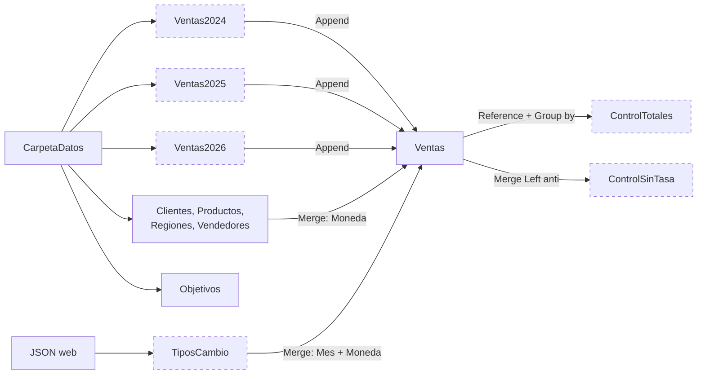

# Lab 118 — Power BI: transformar y cargar

## Objetivo

Convertir las consultas del Lab 117 en las tablas que necesita un buen modelo: una sola tabla de ventas con tres años, una tabla de objetivos en formato largo, los importes también en moneda local y unas dimensiones limpias. Practicarás append, merge con dos columnas, unpivot, consultas de referencia, la combinación anti-join para encontrar huérfanos, el agrupado para cuadrar totales y la decisión de qué se carga al modelo. Cubre "Transform and load the data" del examen PL-300.

## Escenario de negocio

**Empresa ficticia:** Servicios Integrados Tecnológicos S.A. (SIT) — continuación del Lab 117.

**Problema a resolver:** la gerente comercial quiere tres cosas para el comité del lunes: las ventas de 2024 a 2026 en una sola vista, el cumplimiento de cada vendedor contra su objetivo mensual y, para los directores de cada país, los importes también en su moneda. Los objetivos llegan en un Excel con un mes por columna, y el tipo de cambio en el JSON de finanzas.

**Por qué en Power Query:** cada una de estas operaciones se repite sola en cada actualización. Hacerlas en Excel cada mes es lo que le cuesta dos días a la gerente.

## Lo que vas a construir

- La tabla `Ventas` con **3.995** líneas (2024 + 2025 + 2026, sin la fila de total), con `Importe`, `Mes`, `Moneda`, `Tasa` e `ImporteLocal`
- La tabla `Objetivos` con **288** filas: un objetivo por vendedor y mes, con su fecha
- Las dimensiones `Clientes`, `Productos`, `Regiones` y `Vendedores`, todas leídas con el parámetro `CarpetaDatos`
- Dos consultas de control que no se cargan: una que cuadra los totales por año y otra que demuestra que ninguna venta se quedó sin tipo de cambio

## Relación con la Ruta Pro

| Viene de | En este lab | Lo usa |
|---|---|---|
| Lab 117: `Ventas2024`, `Ventas2026`, `TiposCambio` y el parámetro | Append, merge, unpivot, referencia, anti-join, agrupar, **Enable load** | Lab 119 relaciona estas tablas en un modelo en estrella |

> **Fuente del esqueleto:** lab 2 del curso oficial PL-300 de Microsoft Learning ([GitHub, licencia MIT](https://github.com/MicrosoftLearning/PL-300-Microsoft-Power-BI-Data-Analyst)) y la sección "Transform and load the data" de su [guía de estudio](https://learn.microsoft.com/credentials/certifications/resources/study-guides/pl-300). El caso, los datos y el texto son propios del curso.

## Duración estimada

| Ejercicio | Tiempo estimado |
|---|---|
| Ejercicio 1 — Dimensiones y 2025 con el parámetro | 35 min |
| Ejercicio 2 — Limpiar 2026 en origen | 15 min |
| Ejercicio 3 — Una sola tabla de ventas (append) | 20 min |
| Ejercicio 4 — Tipos de cambio en formato largo (unpivot) | 15 min |
| Ejercicio 5 — Moneda y tipo de cambio (merge) | 35 min |
| Ejercicio 6 — Objetivos en formato largo | 25 min |
| Ejercicio 7 — Cuadrar y decidir qué se carga | 30 min |
| Ejercicio 8 — Una excepción en los nombres de clientes | 10 min |
| **Total** | **unas 3 h 15 min** |

## Nivel

**N2 Intermedio** — Certificación objetivo de la ruta: **PL-300**

## Tecnologías utilizadas

- Power BI Desktop: Power Query (**Append queries**, **Merge queries**, **Unpivot**, **Group by**, **Reference**, **Enable load**)

## Prerrequisitos

### Entorno

- [ ] El archivo `ruta-pro-sit-ventas.pbix` del Lab 117 y la carpeta de datos a la que apunta `CarpetaDatos`
- [ ] Niveles de privacidad definidos como en el Lab 117, Tarea 5.2 (archivos **Organizational**, web **Public**)

### Conocimiento previo

- Lab 116: columnas personalizadas, quitar duplicados, limpieza de `Clientes`
- Lab 117: parámetro `CarpetaDatos`, **Advanced Editor**, **Using locale**, la fila `TOTAL MARZO`

### Verificación rápida antes de empezar

- [ ] En Power Query ves `CarpetaDatos`, `Ventas2024` (1.199 filas), `Ventas2026` (1.359 filas) y `TiposCambio` (34 filas). Si hiciste el reto básico del Lab 117 y no borraste su filtro, `Ventas2026` tendrá 1.358: quita ese paso de **Transform Sample file** para seguir este lab tal como está escrito.

## Datos de apoyo

Los mismos archivos del paquete [sit-ventas.zip](/practice-assets/powerbi/sit-ventas/sit-ventas.zip). Nuevos en este archivo `.pbix` (algunos ya los usaste en el Lab 116): `ventas-2025.csv`, `objetivos.xlsx`, `clientes.csv`, `productos.xlsx`, `regiones.csv` y `vendedores.csv`.

Los importes (`Importe`) están en **USD**, que es la moneda base del JSON de tipos de cambio: por eso `Importe × Tasa` da el importe en moneda local.

## Arquitectura del laboratorio



Las consultas con borde discontinuo son de paso o de control: existen en Power Query, pero **no se cargan** al modelo (Ejercicio 7).

---

## Ejercicio 1 — Dimensiones y 2025 con el parámetro

**Objetivo:** traer el resto de los archivos, todos con la ruta del parámetro.

### Tarea 1.1 — Conectar

En Power Query, con **New Source**, conecta estos archivos de tu carpeta de datos (**Text/CSV** para los `.csv`; **Excel Workbook** para los `.xlsx`, eligiendo la hoja que se indica):

| Archivo | Nombre de la consulta |
|---|---|
| `ventas-2025.csv` | `Ventas2025` |
| `clientes.csv` | `Clientes` |
| `productos.xlsx` (hoja **Productos**) | `Productos` |
| `regiones.csv` | `Regiones` |
| `vendedores.csv` | `Vendedores` |
| `objetivos.xlsx` (hoja **Objetivos**) | `Objetivos` |

### Tarea 1.2 — Ruta desde el parámetro

En cada una, abre **Advanced Editor** y cambia la ruta escrita en el paso `Source` por el parámetro:

- En los CSV: `File.Contents(CarpetaDatos & "ventas-2025.csv")` (cambiando el nombre del archivo en cada caso)
- En los Excel: `File.Contents(CarpetaDatos & "productos.xlsx")` dentro de `Excel.Workbook(...)`

### Tarea 1.3 — Tipos y limpieza

1. **`Ventas2025`**: las fechas vienen como `2025-01-21`, un formato que se lee igual en cualquier idioma, así que basta comprobar que quedan los tipos del Lab 116 (Tarea 3.2).
2. **`Clientes`**: la misma limpieza del [Lab 116, Tarea 3.4](/labs/lab-116-power-bi-en-un-dia#tarea-34--limpiar-clientes):
   - **Add column** > **Custom column** `Cliente limpio` = `Text.Proper(Text.Trim([Cliente]))`
   - **Custom column** `Industria limpia` = `if [Industria] = null or Text.Trim([Industria]) = "" then "Sin dato" else Text.Proper(Text.Trim([Industria]))`
   - Tipo **Text** para las dos
   - **Home** > **Choose columns**: deja solo `ClienteID`, `Cliente limpio`, `Industria limpia`, `Segmento`, `Ciudad` y `FechaAlta`
   - Renombra `Cliente limpio` a `Cliente` e `Industria limpia` a `Industria`
   - Selecciona `ClienteID` > **Home** > **Remove rows** > **Remove duplicates** (quedan 150 filas)
3. **`Regiones`**, **`Vendedores`** y **`Productos`**: comprueba que los tipos son **Text** salvo `PrecioLista` (**Whole number**) y `FechaIngreso` (**Date**).
4. **`Objetivos`**: `VendedorID` **Text**; `Anio` y los doce meses **Whole number**. El Ejercicio 6 necesita que `Anio` sea un número.

### Tarea 1.4 — Niveles de privacidad de los archivos nuevos

Cada archivo nuevo es un origen nuevo, sin nivel de privacidad. Antes del Ejercicio 5, en la pestaña **Home** de Power Query, **Data source settings**: a cada archivo nuevo, **Edit Permissions** > **Organizational** (como en el Lab 117, Tarea 5.2). Si se te pasa, al hacer el primer merge Power BI mostrará un aviso pidiendo información de privacidad: pulsa **Continue** y elige **Organizational** para cada archivo.

### Validación del Ejercicio 1

| Campo | Tu valor |
|---|---|
| Filas de `Ventas2025` | ___ (esperado: 1.438) |
| Filas de `Clientes` después de limpiar | ___ (esperado: 150) |

---

## Ejercicio 2 — Limpiar 2026 en origen

**Objetivo:** quitar la fila `TOTAL MARZO` en la consulta que lee la carpeta, para que nunca llegue a ninguna tabla.

1. Selecciona `Ventas2026`. En `PedidoID`, abre el filtro del encabezado, escribe `TOTAL` en su cuadro de búsqueda, desmarca `TOTAL MARZO` y pulsa **OK**.
2. Quita la columna `Source.Name`: ya cumplió su función (el Lab 117) y las otras dos consultas de ventas no la tienen. Selecciónala y, en la pestaña **Home**, **Remove columns**.
3. Comprueba que la consulta tiene **1.358** filas.

> **Un filtro mejor:** desmarcar un valor concreto solo quita `TOTAL MARZO`. Si el mes que viene alguien escribe `TOTAL ABRIL`, se colaría. Una regla más robusta es quedarse con las filas cuyo `PedidoID` empieza por `PED-`. Con una columna personalizada lo puedes comprobar: `Text.StartsWith([PedidoID], "PED-")`. Pruébalo en el **Reto intermedio**.

### Validación del Ejercicio 2

| Campo | Tu valor |
|---|---|
| Filas de `Ventas2026` | ___ (esperado: 1.358) |

---

## Ejercicio 3 — Una sola tabla de ventas (append)

**Objetivo:** apilar los tres años en una consulta nueva, sin tocar las de origen.

1. En la pestaña **Home**, grupo **Combine**, despliega **Append queries** y elige **Append queries as new** ([Learn: append queries](https://learn.microsoft.com/power-query/append-queries)).
2. Elige **Three or more tables** y pasa `Ventas2024`, `Ventas2025` y `Ventas2026` a la lista de la derecha. **OK**.
3. Renombra la consulta nueva (se llama `Append1`) a `Ventas`.
4. Comprueba que tiene **3.995** filas y las 11 columnas de siempre. Si aparece una columna de más, es que una de las tres consultas tiene una columna que las otras no (por ejemplo, si no quitaste `Source.Name`): el append la conserva y la deja vacía en las demás filas.
5. Añade la columna `Importe` como en el Lab 116 (**Add column** > **Custom column**, fórmula `[Cantidad] * [PrecioUnitario] * (1 - [DescuentoPct] / 100)`, tipo **Fixed decimal number**).
6. Añade la columna `Mes`, que servirá de clave para el tipo de cambio: **Custom column**, nombre `Mes`, fórmula `Date.ToText([FechaPedido], "yyyy-MM")`, tipo **Text**. En la primera fila de 2024 debe decir `2024-01`.

> **Append queries vs. Append queries as new:** la primera opción añade los pasos a la consulta seleccionada; la segunda crea una consulta nueva que **referencia** a las demás. Con la segunda, cada consulta de origen sigue siendo responsable de su archivo, y `Ventas` no lee ningún archivo directamente. Por eso no choca con la regla de privacidad del Lab 117.

### Validación del Ejercicio 3

| Campo | Tu valor |
|---|---|
| Filas de `Ventas` | ___ (esperado: 3.995) |
| `Mes` de la primera fila | ___ |

---

## Ejercicio 4 — Tipos de cambio en formato largo (unpivot)

**Objetivo:** pasar de una columna por moneda a una fila por mes y moneda, que es la forma en que se puede cruzar con las ventas.

1. Selecciona `TiposCambio`. Selecciona la columna `mes`.
2. Clic derecho en su encabezado > **Unpivot other columns** ([Learn: unpivot columns](https://learn.microsoft.com/power-query/unpivot-column)). Las cuatro columnas de moneda se convierten en dos: **Attribute** (el nombre de la columna) y **Value** (la tasa).
3. Renombra `mes` a `Mes`, `Attribute` a `Moneda` y `Value` a `Tasa`. Tipo **Decimal number** para `Tasa`.

**Resultado:** **136** filas (34 meses × 4 monedas).

> **Unpivot other columns vs. Unpivot columns:** con **other columns** marcas lo que **se queda** (`Mes`): cualquier columna de moneda que llegue a este paso se despivota, aunque no existiera al escribir la consulta. Con **Unpivot columns** marcas las que se despivotan, y una columna nueva quedaría fuera sin avisar. Ojo: si finanzas añadiera una moneda (por ejemplo `ARS`) al JSON, primero tendrías que incluirla en la expansión de `tasas` del Lab 117, que fija las columnas por nombre; a partir de ahí, este paso la recogería sola.

### Validación del Ejercicio 4

| Campo | Tu valor |
|---|---|
| Filas de `TiposCambio` tras el unpivot | ___ (esperado: 136) |

---

## Ejercicio 5 — Moneda y tipo de cambio (merge)

**Objetivo:** añadir a cada venta su moneda local y su tasa, y comprobar que ninguna se quedó sin tasa.

### Tarea 5.1 — La moneda, desde `Regiones`

1. Selecciona `Ventas`. En la pestaña **Home**, grupo **Combine**, **Merge queries** ([Learn: merge queries](https://learn.microsoft.com/power-query/merge-queries-overview)).
2. Arriba está `Ventas`; abajo elige `Regiones`. Selecciona `RegionID` en las dos tablas.
3. **Join kind**: **Left outer** (todas las ventas, con lo que coincida de regiones). Abajo, Power Query dice cuántas filas coinciden: deben ser **3.995 de 3.995**. **OK**.
4. Aparece una columna nueva con tablas anidadas. Haz clic en el botón de expandir de su encabezado (dos flechas), marca solo `Moneda` y desmarca **Use original column name as prefix**. **OK**.

### Tarea 5.2 — La tasa, con una clave de dos columnas

1. Con `Ventas` seleccionada, **Merge queries** otra vez, ahora con `TiposCambio`.
2. En `Ventas` selecciona `Mes` y, manteniendo **Ctrl**, `Moneda`. En `TiposCambio` selecciona, en el mismo orden, `Mes` y `Moneda`. Los números junto a los encabezados (1 y 2) indican el emparejamiento.
3. **Left outer**. Coincidencias esperadas: **3.995 de 3.995**. **OK**.
4. Expande y quédate solo con `Tasa` (sin prefijo).
5. **Custom column** `ImporteLocal` con la fórmula `[Importe] * [Tasa]`, tipo **Decimal number**.

### Tarea 5.3 — Probar que nadie se quedó sin tasa (anti-join)

"Coinciden 3.995 de 3.995" lo dice el diálogo hoy. Una consulta de control lo comprobará en cada actualización:

1. **Home** > **Merge queries** > **Merge queries as new**. Arriba `Ventas`, abajo `TiposCambio`, columnas `Mes` + `Moneda` como en la Tarea 5.2.
2. **Join kind**: **Left anti** (solo las filas de `Ventas` que **no** tienen pareja). **OK**.
3. Renombra la consulta a `ControlSinTasa`. Debe tener **0** filas. Si un día tiene alguna, faltan tipos de cambio de ese mes.

### Resultado esperado del Ejercicio 5

`Ventas` con las columnas nuevas `Moneda`, `Tasa` e `ImporteLocal`, y `ControlSinTasa` vacía. Comprobado con el motor de Power Query: ninguna de las 3.995 líneas queda sin tasa.

### Validación del Ejercicio 5

| Campo | Tu valor |
|---|---|
| Filas que coincidieron en cada merge | ___ |
| Filas de `ControlSinTasa` | ___ (esperado: 0) |
| Qué pasaría con las ventas si hubieras elegido **Inner** en vez de **Left outer** y faltara una tasa | ___ |

---

## Ejercicio 6 — Objetivos en formato largo

**Objetivo:** convertir el Excel de objetivos (un mes por columna) en una tabla con una fila por vendedor y mes, con una fecha que se pueda relacionar con el calendario.

1. Selecciona `Objetivos`. Comprueba que la primera fila son los encabezados (`VendedorID`, `Anio`, `Ene` … `Dic`). Si en cambio ves `Column1`, `Column2`…, usa **Home** > **Use First Row as Headers**.
2. Selecciona `VendedorID` y, con **Ctrl**, `Anio`. Clic derecho > **Unpivot other columns**.
3. Renombra `Attribute` a `MesNombre` y `Value` a `Objetivo`.
4. **Custom column** `Fecha`, que calcula el primer día del mes:

```m
#date(
    [Anio],
    List.PositionOf({"Ene", "Feb", "Mar", "Abr", "May", "Jun", "Jul", "Ago", "Sep", "Oct", "Nov", "Dic"}, [MesNombre]) + 1,  // posición del mes, de 1 a 12
    1
)
```

5. Tipo **Date** para `Fecha` y **Fixed decimal number** para `Objetivo`. Quita `Anio` y `MesNombre` (**Remove columns**): la fecha ya contiene los dos.

> Si `Fecha` sale con error en alguna fila, `MesNombre` tiene un valor que no está en la lista (por ejemplo, un espacio de más) y `List.PositionOf` devolvió −1. Revisa la lista de la fórmula.

### Resultado esperado del Ejercicio 6

`Objetivos` con **288** filas (8 ejecutivos × 3 años × 12 meses) y tres columnas: `VendedorID`, `Objetivo` y `Fecha`. La suma de los objetivos de 2025 es **19.884.000** (lo comprobarás en el Ejercicio 7).

### Validación del Ejercicio 6

| Campo | Tu valor |
|---|---|
| Filas de `Objetivos` | ___ (esperado: 288) |
| Objetivo de `V03` para marzo de 2025 | ___ (esperado: 453.000) |

---

## Ejercicio 7 — Cuadrar y decidir qué se carga

**Objetivo:** demostrar que los totales cuadran y cargar al modelo solo lo que el modelo necesita.

### Tarea 7.1 — Una consulta de control con Reference y Group by

1. Clic derecho sobre `Ventas` en el panel **Queries** > **Reference** ([Learn: Power Query UI](https://learn.microsoft.com/power-query/power-query-ui)). Se crea una consulta cuyo único paso es "usar el resultado de `Ventas`". Renómbrala a `ControlTotales`.
2. **Custom column** `Anio` con la fórmula `Date.Year([FechaPedido])`, tipo **Whole number**.
3. Pestaña **Home**, **Group by** ([Learn: group by](https://learn.microsoft.com/power-query/group-by)). Deja **Basic**, agrupa por `Anio`, nombre de la columna nueva `Total`, operación **Sum**, columna `Importe`. **OK**.

**Resultado esperado** (comprobado con el motor de Power Query; con Power BI en inglés verás `17714901`, sin separadores, porque Power Query no aplica formato):

| Anio | Total |
|---|---|
| 2024 | **17.714.901,00** |
| 2025 | **20.840.961,90** (el mismo total del Lab 116) |
| 2026 | **18.936.520,50** |

4. Haz lo mismo para los objetivos: **Reference** sobre `Objetivos`, columna `Anio` = `Date.Year([Fecha])`, **Group by** `Anio` con **Sum** de `Objetivo`. Renómbrala `ControlObjetivos`. Debe dar 2024 = **17.762.000**, 2025 = **19.884.000** y 2026 = **23.363.000** (el objetivo de 2026 es del año completo, aunque las ventas lleguen hasta octubre).

> **Reference vs. Duplicate:** **Reference** crea una consulta que parte del **resultado** de otra; si corriges `Ventas`, el control lo hereda. **Duplicate** copia todos los pasos: a partir de ahí son dos consultas independientes, y una corrección en una no llega a la otra.

### Tarea 7.2 — Qué se carga al modelo

Cada consulta tiene la opción **Enable load**: si está desmarcada, la consulta se calcula (y otras pueden usarla), pero no crea una tabla en el modelo ([Learn: Power Query UI](https://learn.microsoft.com/power-query/power-query-ui)).

1. Para cada consulta de la tabla, clic derecho en el panel **Queries** y deja **Enable load** como se indica:

| Consulta | Enable load | Por qué |
|---|---|---|
| `Ventas`, `Objetivos`, `Clientes`, `Productos`, `Regiones`, `Vendedores` | ✅ | Son las tablas del modelo |
| `Ventas2024`, `Ventas2025`, `Ventas2026` | ❌ | Son de paso: su contenido ya está en `Ventas` |
| `TiposCambio` | ❌ | Su dato útil (`Tasa`) ya está en `Ventas` |
| `ControlTotales`, `ControlObjetivos`, `ControlSinTasa` | ❌ | Son para que tú compruebes, no para el reporte |

2. Como `Ventas2024`, `Ventas2026` y `TiposCambio` ya se cargaron en el Lab 117, al desmarcar su carga Power BI puede avisarte de que se quitarán sus tablas del modelo: acéptalo. Las consultas auxiliares de **Combine files** y el parámetro `CarpetaDatos` ya vienen sin carga.
3. Las consultas sin carga aparecen en cursiva en el panel **Queries**.
4. **Close & Apply**. En el panel **Data** de Power BI Desktop deben quedar **6 tablas**.

> **Por qué importa:** cada tabla cargada ocupa memoria y aparece en el panel **Data**, donde confunde a quien construya reportes. Cargar las tres de paso duplicaría las ventas en el modelo.

### Validación del Ejercicio 7

| Campo | Tu valor |
|---|---|
| Totales de `ControlTotales` por año | ___ |
| Objetivos 2025 en `ControlObjetivos` | ___ |
| Tablas en el panel **Data** | ___ (esperado: 6) |

---

## Ejercicio 8 — Una excepción en los nombres de clientes

**Objetivo:** corregir lo que `Text.Proper` hizo de más en el Ejercicio 1, igual que pasaba en el Lab 116 (`S.A. De C.V.`).

1. **Transform data**, selecciona `Clientes`, columna `Cliente`.
2. Pestaña **Transform**, grupo **Any column**, **Replace values** ([Learn: replace values](https://learn.microsoft.com/power-query/replace-values)).
3. **Value to find**: `De C.V.` · **Replace with**: `de C.V.` · **OK**.
4. Comprueba que `C0004` queda como **Clínica Horizonte S.A. de C.V.**
5. **Close & Apply**.

> Power Query distingue mayúsculas de minúsculas: `de c.v.` no habría encontrado nada. Y como **Replace values** en una columna de texto reemplaza también dentro del texto (no solo celdas completas), una sola regla corrige todos los clientes mexicanos.

### Validación del Ejercicio 8

| Campo | Tu valor |
|---|---|
| Cómo queda `C0004` | ___ |

---

## Errores frecuentes

| Error | Causa probable | Solución |
|---|---|---|
| `Ventas` tiene 3.996 filas | La fila `TOTAL MARZO` sigue en `Ventas2026` | Ejercicio 2, paso 1 |
| `Ventas` tiene una columna `Source.Name` medio vacía | No la quitaste de `Ventas2026` antes del append | Ejercicio 2, paso 2 |
| El merge con `TiposCambio` no encuentra coincidencias | `Mes` de `Ventas` en otro formato (por ejemplo `2025-1`), o tipos distintos (texto contra fecha) | Fórmula exacta `Date.ToText([FechaPedido], "yyyy-MM")`, ambas columnas **Text** |
| "Formula.Firewall" o aviso de privacidad al hacer el merge | Niveles de privacidad sin definir, o una consulta que lee un archivo y además referencia otra | Lab 117, Tarea 5.2; los merges van en consultas que solo referencian |
| `Objetivos` da error en `Fecha` | `MesNombre` no coincide con la lista (mayúsculas, espacios) | Revisa los valores con el filtro del encabezado |
| El modelo muestra más de 6 tablas | No desmarcaste **Enable load** en las de paso y control | Tarea 7.2 |

## 🔧 Diagnóstico y reparación

### `ControlTotales` no cuadra con la tabla esperada

1. **Mira primero el recuento de filas de `Ventas`** (3.995). Si es distinto, el problema está en el append o en el filtro de 2026, no en el total.
2. **Si `ControlTotales` tiene una fila con `Anio` vacío**, la fila `TOTAL MARZO` llegó a `Ventas`: no suma dinero (no tiene cantidad, así que su `Importe` es nulo), pero sí cuenta como línea y como pedido. En ese caso también verás 1 fila en `ControlSinTasa`. Vuelve al Ejercicio 2.
3. **Si 2024 da muy distinto**, revisa las fechas: si se leyeron en inglés, muchas cayeron en otros meses o dieron error (Lab 117, Ejercicio 4).

### `ControlSinTasa` tiene filas

1. **Mira el `Mes` y la `Moneda` de esas filas.** Si el mes es posterior a octubre de 2026, faltan tasas en el JSON: es un problema de datos, no de la consulta.
2. **Si la `Moneda` está vacía**, el primer merge (con `Regiones`) no encontró la región: revisa que `RegionID` sea **Text** en las dos tablas.

## Checklist final

- [ ] Todas las consultas de archivo usan `CarpetaDatos`
- [ ] `Ventas` tiene 3.995 filas y las columnas `Importe`, `Mes`, `Moneda`, `Tasa` e `ImporteLocal`
- [ ] `TiposCambio` está en formato largo (136 filas)
- [ ] `Objetivos` tiene 288 filas con `VendedorID`, `Objetivo` y `Fecha`
- [ ] `ControlTotales` cuadra por año, `ControlObjetivos` da 19.884.000 en 2025 y `ControlSinTasa` está vacía
- [ ] Solo 6 tablas cargadas al modelo
- [ ] `C0004` dice `S.A. de C.V.`

## Evidencia esperada

- Captura del panel **Queries** con las consultas sin carga en cursiva
- Captura de `ControlTotales` con los tres años
- Captura del diálogo de **Merge** con la clave de dos columnas y el mensaje de coincidencias
- Captura de `Objetivos` después del unpivot
- El archivo `ruta-pro-sit-ventas.pbix`

## Criterios de aprobación

- Las ventas de los tres años están en una sola tabla sin filas de total y con los totales esperados
- Los objetivos y los tipos de cambio están en formato largo
- El tipo de cambio se cruza con una clave de dos columnas y hay un control que detecta ventas sin tasa
- Solo se cargan al modelo las tablas que el modelo necesita

## Competencias desarrolladas

- Combinar consultas con append y merge, incluida una clave de varias columnas
- Pasar datos de formato ancho a largo con unpivot
- Usar consultas de referencia y de control para comprobar resultados
- Decidir qué consultas se cargan al modelo

## Reto adicional

**Reto básico:** añade a `ControlTotales` una segunda agregación en el mismo **Group by** (opción **Advanced**): **Count rows**. ¿Cuántas líneas tiene cada año?

**Reto intermedio:** sustituye el filtro del Ejercicio 2 por una regla robusta: columna personalizada `EsPedido` = `Text.StartsWith([PedidoID], "PED-")`, filtra a `TRUE` y quita la columna. Razona: si el mes que viene alguien escribe una fila `TOTAL ABRIL`, ¿la detendría tu regla? ¿Y una fila `PED-TOTAL`?

**Reto avanzado:** los importes de 2025 en moneda local, según el motor de Power Query, son COP **39.090.789.874,73**, MXN **105.918.817,64**, PEN **9.949.338,21** y CLP **3.317.528.043,15**. Crea una consulta de control que los calcule (**Reference** de `Ventas`, filtro de año, **Group by** por `Moneda` con **Sum** de `ImporteLocal`) y explica por qué sumar `ImporteLocal` de todas las monedas juntas no tiene sentido.

## Preguntas de repaso

1. ¿Qué diferencia práctica hay entre **Append queries** y **Append queries as new**?
2. ¿Por qué se eligió **Unpivot other columns** y no **Unpivot columns** para los tipos de cambio?
3. ¿Para qué sirve un merge **Left anti** si el diálogo ya dice cuántas filas coinciden?
4. ¿Qué pasaría en el modelo si cargaras también `Ventas2024`, `Ventas2025` y `Ventas2026`?

## Limpieza del laboratorio

No borres nada: el Lab 119 construye el modelo sobre este archivo.

## Siguiente laboratorio recomendado

**[Lab 119 — Modelo semántico en estrella](/labs/lab-119-power-bi-modelo-semantico-estrella):** la tabla de fechas de tres años, dos tablas de hechos (ventas y objetivos) que comparten dimensiones, la fecha de entrega como dimensión de rol con `USERELATIONSHIP`, y las propiedades que hacen el modelo fácil de usar.
