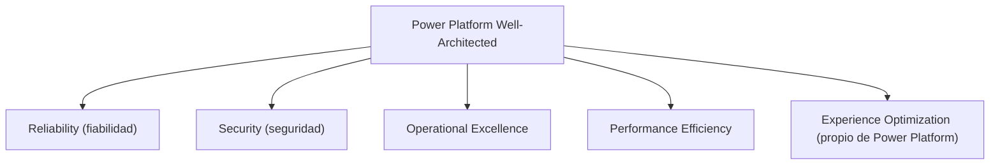

> **📌 Primer módulo de Arquitecto.** Asume Básico, Intermedio y Avanzado ya completos — aquí el foco pasa de "construir una solución" a "gobernar muchas soluciones a la vez en una organización grande". Si algún término de gobernanza/framework se siente nuevo, no es porque te falte inteligencia — es la primera vez que el curso lo introduce.

### 📚 Mini-glosario antes de empezar

| Término | En una frase |
|---|---|
| **Gobernanza** | Las reglas que decides de antemano (quién puede crear qué, dónde) para que la plataforma no crezca sin control. |
| **Framework** | Una estructura ya pensada por otros (Microsoft, TOGAF) que puedes seguir en vez de inventar tu propio proceso desde cero. |
| **Stakeholder** | Cualquier persona con interés o poder de decisión sobre el proyecto — no solo quien lo usa, también quien lo paga o lo aprueba. |
| **SLA (Service Level Agreement)** | Un compromiso medible de qué tan bien/rápido debe funcionar algo (ej. "el sistema responde en menos de 2 segundos"). |
| **Auditoría** | Revisar después de los hechos qué pasó realmente, para confirmar que se siguieron las reglas. |
| **Data policy** (antes "DLP policy") | La política del admin center que decide qué conectores pueden usarse juntos en apps, flujos y agentes. Microsoft hoy la llama *data policy*; verás "DLP" en documentos y herramientas más antiguas. |

### 🎯 Objetivo
Diseñar y comunicar la arquitectura enterprise de Power Platform para organizaciones de 1,000+ usuarios: estrategia de gobernanza, políticas de adopción, marcos de decisión arquitectónica, y alineación con estándares como TOGAF y Power Platform Well-Architected de Microsoft. Al terminar, cada regla de tu marco de gobernanza tiene un control técnico que la hace cumplir (o una razón escrita de por qué no lo tiene).

> **Cómo está organizado este módulo:** en Arquitecto el "construir sin pasos" se convierte en **decidir y defender**. Cada microlección tiene un concepto breve, una micropráctica para decidir bien, una exploración en el **Power Platform admin center** con una tabla de **evidencia** (el dato exacto que viste, no un "sí/no") y un entregable escrito. Después viene un **diagnóstico síntoma primero** y el cierre es un **reto de transferencia**: otro cliente, otras restricciones, y tu decisión escrita contrastada con una rúbrica. En los retos de decisión **no hay una sola respuesta correcta**: se evalúa que la decisión cumpla los criterios y que sus trade-offs estén escritos.
>
> **Antes de empezar:**
> - **Rol de administrador:** las microlecciones 2 y 3 leen y cambian configuración de inquilino. Necesitas el rol **Power Platform Administrator** (o Global Administrator) en un tenant **de práctica**, nunca en el de tu empresa. Si no tienes uno, crea tu propio tenant con la prueba gratuita de Microsoft 365: serás su administrador ([Entornos y trials](/recursos/entornos-y-trials)).
> - **Ruta B (sin rol de admin):** haz las decisiones y los entregables con los datos del Caso Real y de las microprácticas; en las tablas de evidencia escribe "ruta B" y qué habrías mirado. La microlección 3 (script) se entrega como script revisado, sin ejecutarlo.
> - **Duración realista:** unas 5 horas, repartidas en dos o tres sesiones.

### 📖 Conceptos Clave
- **TOGAF (referencia contextual):** framework de arquitectura empresarial de The Open Group compuesto por el ADM (Architecture Development Method) de 9 fases. En Power Platform se aplica principalmente la fase *Architecture Vision* para definir el alcance y los principios, y la fase *Technology Architecture* para seleccionar componentes. Para el día a día usa **Power Platform Well-Architected**, diseñado específicamente para workloads construidos con Power Platform.
- **Power Platform Well-Architected:** conjunto de buenas prácticas, guía de arquitectura y herramientas de revisión de Microsoft, construido sobre **5 pilares**: **Reliability** (fiabilidad: disponibilidad, recuperación, reintentos), **Security** (seguridad: identidad, data policies, protección de datos), **Operational Excellence** (excelencia operacional: CI/CD, monitoreo, automatización), **Performance Efficiency** (eficiencia de rendimiento: escalar con la demanda, probar antes de producción) y **Experience Optimization** (optimización de la experiencia: experiencias útiles que aseguren el resultado de negocio). Los cuatro primeros vienen del Azure Well-Architected Framework; **Experience Optimization es propio de Power Platform** y sustituye al pilar de costos de Azure. Cada pilar trae principios de diseño, una lista de revisión, guías de recomendación y **trade-offs** (compromisos aceptados entre pilares). Microsoft publica una herramienta de evaluación (*Assessment*) en [aka.ms/powa/assessment](https://aka.ms/powa/assessment) para ver dónde enfocar el esfuerzo ([Learn: Power Platform Well-Architected](https://learn.microsoft.com/power-platform/well-architected/what-is-power-well-architected)).
- **Governance Framework:** conjunto documentado de políticas, procesos y controles técnicos que definen cómo se usa Power Platform en la organización. Debe cubrir: quién puede crear ambientes, qué conectores están permitidos por tipo de ambiente, el ciclo de vida de una aplicación (DEV→TEST→PROD), y el proceso de excepción cuando una regla no puede cumplirse. Sin sponsor ejecutivo (CTO o CIO), el framework queda en papel y no se cumple. Una regla sin control técnico depende solo de la buena voluntad de cada maker.
- **Controles nativos de gobernanza (admin center):** las piezas con las que una regla escrita se vuelve obligatoria. **Tenant settings** (por ejemplo, quién puede crear ambientes), **data policies** (qué conectores conviven), **Managed Environments** (un conjunto de capacidades premium: limitar el uso compartido, *solution checker* obligatorio, contenido de bienvenida para makers, IP firewall, informes de uso…), **environment groups** (carpetas de ambientes administrados con **reglas** que se publican y quedan bloqueadas en cada ambiente del grupo) y el **default environment routing** (cada maker nuevo recibe su propio ambiente Developer en lugar de construir en el Default). La microlección 2 los recorre uno por uno.
- **Fusion Teams:** modelo de trabajo donde equipos mixtos colaboran en el mismo proyecto: desarrolladores ciudadanos (makers) aportan conocimiento del proceso de negocio, desarrolladores pro aportan capacidades técnicas avanzadas (plugins, PCF, integraciones), e IT aporta gobernanza y operaciones. Microsoft documenta este modelo como la clave para escalar Power Platform sin bloquear a IT ni crear shadow IT.
- **Landing Zone:** ambiente de Power Platform pre-configurado con todas las políticas de seguridad (data policies, grupo de seguridad de Microsoft Entra ID, roles base), pipelines CI/CD y documentación de bienvenida listos antes de que el primer desarrollador escriba una línea de código. Análogo al concepto de Azure Landing Zone del Cloud Adoption Framework. Provisionar una Landing Zone como código con Power Platform CLI (`pac admin`) hace el setup repetible y consistente entre proyectos (microlección 3).
- **Platform Engineering:** disciplina de tratar la plataforma tecnológica (Power Platform, Azure) como un producto interno con SLAs propios, roadmap, equipo dedicado y métricas de satisfacción de los equipos que la consumen. El Platform Engineering team publica "golden paths" — guías y plantillas para que los equipos de producto puedan adoptar la plataforma rápidamente sin reinventar la rueda.
- **FinOps para Power Platform:** práctica de gestión de costos que incluye: mapeo de licencias por usuario (Per App vs Per User vs Pay-as-you-go), monitoreo de consumo de storage de Dataverse (la capacidad adicional tiene costo), control de API calls (límites de solicitudes de la plataforma) y eliminación periódica de ambientes sandbox ociosos. Las licencias asignadas a usuarios que ya no usan la plataforma son la fuga más común en tenants grandes. Ojo: en Power Platform Well-Architected el costo no es un pilar propio; se trata como trade-off dentro de los otros pilares y en la gestión de capacidad.
- **Risk Register:** inventario estructurado de riesgos del proyecto con columnas: ID, descripción del riesgo, probabilidad (1-5), impacto (1-5), score (probabilidad × impacto), estado (activo/mitigado/aceptado), plan de mitigación y dueño. En Power Platform los riesgos más frecuentes son: integración con sistemas legacy sin API documentada, timelines agresivos para cumplimiento regulatorio, y cambios en el modelo de licenciamiento de Microsoft a mitad del proyecto.
- **Capability Map:** mapa visual que cruza capacidades de negocio (filas) contra el nivel de cobertura actual de la plataforma (columnas: no implementado / en progreso / implementado). Permite identificar gaps de alto impacto que se convierten en propuestas de proyectos. Ejemplo: una empresa de logística puede tener "Seguimiento de carga en tiempo real" como capacidad no cubierta, lo que se traduce en un proyecto de Canvas App + Azure IoT Hub.
- **Reference Architecture:** plantilla de arquitectura validada y documentada para un caso de uso recurrente, que incluye decisiones de diseño justificadas (ADRs), configuraciones de seguridad mínimas, y código de ejemplo reutilizable. Microsoft publica guía de arquitectura en el [Power Platform and Copilot Studio Architecture Center](https://learn.microsoft.com/power-platform/architecture); las organizaciones maduras crean las suyas propias para sus patrones específicos (portal de clientes, gestión de aprobaciones, integración con ERP).
- **Nota de vigencia — CoE Starter Kit:** Learn indica que el CoE Starter Kit **ya no tiene mantenimiento activo** y que sus capacidades centrales forman parte del **Power Platform admin center**; el punto de partida recomendado son las capacidades nativas del admin center y **Managed Environments** ([Learn: CoE Starter Kit](https://learn.microsoft.com/power-platform/guidance/coe/overview)). El Módulo 32 decide cuándo el kit todavía aporta algo.

**Diagrama: los 5 pilares de Power Platform Well-Architected**



---

## 🧩 Microlección 1 — Well-Architected review: hallazgos con criterio (≈60 min)

**El concepto:** una revisión Well-Architected no es una lista de "tenemos / no tenemos". Cada hallazgo se asigna a un pilar, se le pone un riesgo y se decide qué hacer, sabiendo que mejorar un pilar puede empeorar otro (más controles de seguridad = más fricción para el maker = peor experiencia). Por eso cada pilar documenta sus *trade-offs*.

**Ahora haz algo (10 min):** clasifica estos seis hallazgos del banco del Caso Real en su pilar antes de abrir la herramienta: (a) "los flujos de integración no tienen reintentos ni Scope Try/Catch", (b) "200 makers con acceso a conectores externos sin data policy", (c) "no hay pipeline: las soluciones se importan a mano", (d) "la galería de clientes tarda 9 segundos en cargar", (e) "los usuarios de sucursal abandonan la app porque el formulario tiene 40 campos", (f) "no hay RTO/RPO documentado para el sistema de créditos". Compara con la clave al final de la microlección.

**Haz la revisión (40 min):**

1. Elige **un workload** que conozcas de punta a punta: el sistema de soporte del Módulo 30 o la app de solicitudes de los niveles anteriores.
2. Abre la herramienta de evaluación de Power Platform Well-Architected en [aka.ms/powa/assessment](https://aka.ms/powa/assessment) y respóndela para ese workload. Si la herramienta te pide iniciar sesión o no carga, usa la lista de revisión (*checklist*) de cada pilar en [Learn: pilares](https://learn.microsoft.com/power-platform/well-architected/pillars).
3. Para cada pilar anota el hallazgo más importante y conviértelo en una línea del plan de remediación con dueño y fecha. Usa estas preguntas guía:

```markdown
Reliability: ¿backup y restore de soluciones? ¿RTO/RPO por sistema crítico? ¿reintentos y Try/Catch en flujos?
Security: ¿data policy en TODOS los ambientes (no solo producción)? ¿MFA para administradores?
          ¿datos sensibles clasificados? ¿quién puede crear ambientes?
Operational Excellence: ¿CI/CD para todo lo que llega a producción? ¿runbook de incidentes?
          ¿alertas de flujos fallidos? ¿change management?
Performance Efficiency: ¿delegación y paginación en galerías? ¿pruebas de carga antes de producción?
Experience Optimization: ¿el usuario termina su tarea sin ayuda? ¿la app se diseñó con usuarios reales?
```

4. Escribe **un trade-off** que aceptas a propósito (por ejemplo: "bloqueamos HTTP en producción aunque obliga a crear un conector personalizado aprobado para cada integración").

**Evidencia a reportar:**

| Campo | Tu valor |
|---|---|
| Workload evaluado y si usaste la herramienta o el checklist | ___ |
| Hallazgo principal de cada uno de los 5 pilares (una línea cada uno) | ___ |
| Las 3 remediaciones de mayor prioridad, con dueño y fecha | ___ |
| Un trade-off aceptado y qué pilar sale perdiendo | ___ |

**Clave del ejercicio inicial:** (a) Reliability, (b) Security, (c) Operational Excellence, (d) Performance Efficiency, (e) Experience Optimization, (f) Reliability. Si pusiste (e) en "costos", es el error que este módulo corrige: el quinto pilar de Power Platform es la experiencia.

---

## 🧩 Microlección 2 — Del documento al control: cada regla con su enforcement (≈90 min)

**El concepto:** el error número uno del Caso Real (un framework "en papel") se evita escribiendo, junto a cada regla, **qué control técnico la hace cumplir**. Estos son los controles nativos que usarás (verificados en Learn):

| Regla del framework | Control nativo | Dónde está |
|---|---|---|
| Solo IT crea ambientes (producción, trial y Developer) | **Tenant settings** > **Environment assignments: Production** / **Developer** / **Trial** > **Only specific admins** (solo Global admins, Dynamics 365 admins y Power Platform admins) ([Learn](https://learn.microsoft.com/power-platform/admin/control-environment-creation)) | **Manage** > **Tenant settings** |
| Qué conectores conviven | **Data policy** con los grupos **Business**, **Non-business** y **Blocked**; las de nivel inquilino las crea un Power Platform Administrator, y una política de ambiente **no puede** anular una de inquilino ([Learn](https://learn.microsoft.com/power-platform/admin/prevent-data-loss)) | **Security** > **Data and privacy** > **Data policy** |
| La misma configuración en decenas de ambientes | **Environment group** con **rules** publicadas: la configuración queda bloqueada (solo lectura) en cada ambiente del grupo. Solo admite ambientes **administrados**, cada ambiente está en **un solo** grupo, los grupos no se anidan y **no hay excepciones por ambiente** ([Learn](https://learn.microsoft.com/power-platform/admin/environment-groups)) | **Manage** > **Environment groups** |
| Ningún maker construye en el ambiente Default | **Default environment routing** hacia un grupo (por ejemplo *Personal Productivity*): el ambiente Developer de cada maker nace administrado y con las reglas del grupo | **Manage** > **Environment groups** > **Environment Routing** |
| Una app no se comparte con toda la empresa | **Managed Environments** > límite de uso compartido (regla *Sharing controls for canvas apps* en un grupo) ([Learn](https://learn.microsoft.com/power-platform/admin/managed-environment-overview)) | Menú **…** del ambiente > **Edit Managed Environments**, o la regla del grupo |
| Nada llega a producción sin revisión de calidad | Regla **Solution checker enforcement** en el grupo de producción | **Rules** del grupo |

Dos matices de vigencia: (1) **Advanced connector policies** (ACP) son la nueva generación de control de conectores: una lista de permitidos donde todo lo que no está permitido queda bloqueado, configurable por ambiente o como regla de un environment group; hoy solo cubren conectores certificados (los conectores personalizados y HTTP siguen con data policies clásicas) y conviven con ellas en modo mixto, donde gana lo más restrictivo ([Learn](https://learn.microsoft.com/power-platform/admin/advanced-connector-policies)). (2) Los ambientes Developer **no administrados** están en desuso: desde el 15 de noviembre de 2026 ya no se crean, y el ajuste **Environment assignments: Developer** controla quién crea los administrados ([Learn](https://learn.microsoft.com/power-platform/admin/control-environment-creation)).

**Ahora haz algo — micropráctica (8 min):** elige el control que hace cumplir cada regla del banco → **[Qué control nativo hace cumplir cada regla](/practica/ip-arq-010-que-control-hace-cumplir-cada-regla)**.

**Explora tu tenant (solo lectura, 30 min).** En el [Power Platform admin center](https://admin.powerplatform.microsoft.com/), con tu usuario Power Platform Administrator:

1. **Manage** > **Tenant settings**. Busca los tres ajustes **Environment assignments: Developer**, **Environment assignments: Production** y **Environment assignments: Trial** y anota el valor de cada uno. Si dice que cualquiera puede crear, eso es un hallazgo de Security.
2. **Security** > **Data and privacy** > **Data policy**. Anota cuántas políticas hay y, de cada una, las columnas **Scope** (inquilino o ambiente) y **Applied to** ("All environments", "All environments, except (n)", "(n) environments" o un ambiente). Si no hay ninguna de inquilino, el admin center lo marca como recomendación de seguridad.
3. **Manage** > **Environments**. Abre el menú **…** de dos ambientes: si ves **Enable Managed Environments** no es administrado; si ves **Edit Managed Environments**, sí ([Learn](https://learn.microsoft.com/power-platform/admin/managed-environment-enable)). No lo actives aquí, en tus ambientes reales: es una capacidad premium y, una vez activa, todos los usuarios que ejecutan apps o flujos del ambiente necesitan licencia premium. En el Módulo 33 (microlección 3) lo activarás en un ambiente de prueba (un Sandbox o un Developer), con sus advertencias de licencia y una variante en papel.
4. **Manage** > **Environment groups**. Anota si hay grupos y, si hay, abre uno y mira la pestaña **Rules**: qué reglas están configuradas y si están publicadas (las modificadas sin publicar aparecen en negrita con asterisco).
5. **Security** > **Overview**. Si el tenant tiene activada la analítica de inquilino, verás el **security score** (en preview) en escala **Low**, **Medium** o **High** y recomendaciones; si no, verás "Calculating security score" o un aviso para activarla ([Learn](https://learn.microsoft.com/power-platform/admin/security/security-overview)).

**Evidencia a reportar:**

| Campo | Tu valor |
|---|---|
| Valor de los 3 ajustes **Environment assignments** | ___ |
| Número de data policies y el **Applied to** de cada una | ___ |
| Cuántos de tus ambientes son administrados (y cómo lo comprobaste) | ___ |
| Grupos de ambientes y reglas publicadas (o "ninguno") | ___ |
| Security score o el mensaje que viste en **Security** > **Overview** | ___ |

**Entregable — `GOVERNANCE_FRAMEWORK.md`:** completa la plantilla. En la sección 3 escribe **al menos 8 reglas**: las 6 de la tabla de controles de arriba y 2 propias que salgan del Caso Real (por ejemplo, sobre apps sin owner o conectores a servicios externos). La columna nueva **Control técnico** es obligatoria: si una regla no tiene control nativo, escribe por qué y cómo se audita.

```markdown
# Power Platform Governance Framework — [Empresa]
Versión: 1.0 | Aprobado por: CTO | Fecha: 2026-11

## 1. Principios de Gobernanza
1. **Seguridad primero:** Ningún proyecto se despliega sin pasar revisión de data policy
2. **ALM obligatorio:** DEV → TEST → PROD para todo lo que va a producción
3. **Mínimo privilegio:** Security Roles con los permisos mínimos necesarios
4. **Auditabilidad:** Toda acción crítica debe tener audit trail

## 2. Modelo de Ambientes
| Tipo | Propósito | Quién tiene acceso | Data policy | Grupo de ambientes |
|------|-----------|-------------------|-------------|--------------------|
| Personal Dev | Exploración individual | Solo el maker | Mínima | Personal Productivity (routing) |
| Project Dev | Desarrollo del equipo | Dev team (grupo de Entra ID) | Moderada | Dev/Test |
| Test/QA | Pruebas formales | Dev + QA | Igual a producción | Dev/Test |
| UAT | Validación del cliente | Dev + Business users | Producción | Producción |
| Production | Sistema en vivo | Usuarios finales; despliegue solo por service principal | Estricta | Producción |

## 3. Reglas y su control técnico
| Regla | Control técnico | Cómo se audita |
|-------|-----------------|----------------|
| Solo IT crea ambientes de producción | Tenant settings > Environment assignments: Production = Only specific admins | Revisión trimestral del ajuste |
| ... | ... | ... |

## 4. Criterios de Entrega (Definition of Done)
- [ ] Solution Checker: 0 errores críticos
- [ ] CI/CD pipeline verde
- [ ] Security review completado
- [ ] Documentación de usuario actualizada
- [ ] Runbook de operaciones creado
- [ ] Aprobación del arquitecto responsable

## 5. Proceso de Excepción
1. Arquitecto documenta el riesgo y la mitigación
2. Aprobación del CISO y CTO
3. Como los grupos de ambientes no admiten excepciones por ambiente, la excepción se implementa
   moviendo el ambiente a otro grupo (o sacándolo) y se registra con fecha de fin
4. Revisión en 90 días para eliminar la excepción

## 6. Métricas de Salud de la Plataforma
- Flujos fallidos en 7 días: < 0.5% del total
- Tiempo de disponibilidad: > 99.5%
- Soluciones sin pipeline: 0 en producción
- Apps sin owner identificado: 0
- Ambientes sin data policy de inquilino: 0
```

---

## 🧩 Microlección 3 — Landing Zone como código (≈60 min)

**El concepto:** una Landing Zone es la respuesta a "cada proyecto nuevo arranca ya gobernado". La forma más robusta en Power Platform combina tres cosas: un **script** que crea el ambiente, una **data policy de inquilino** cuyo alcance cubre los ambientes nuevos sin tocarla, y un **environment group** cuyas reglas el ambiente hereda al entrar. Si el alcance de la data policy es **Add multiple environments** (una lista), cada ambiente nuevo queda fuera hasta que alguien lo añada; si es **Exclude certain environments**, el ambiente nuevo queda dentro desde el primer día ([Learn](https://learn.microsoft.com/power-platform/admin/prevent-data-loss)).

**Construye (con rol de admin y capacidad disponible):** un ambiente Sandbox necesita al menos 1 GB de capacidad de base de datos libre. Instala Power Platform CLI y autentícate con `pac auth create`, e instala el módulo de Microsoft Graph PowerShell (`Install-Module Microsoft.Graph.Groups`). Todos los comandos `pac admin` del script están en [Learn: pac admin](https://learn.microsoft.com/power-platform/developer/cli/reference/admin):

```powershell
# Landing Zone de un proyecto nuevo: grupo de Entra ID + ambiente DEV administrado dentro de un grupo de ambientes
param(
    [Parameter(Mandatory)] [string]$ProjectName,     # p. ej. "Solicitudes"
    [Parameter(Mandatory)] [string]$Domain,          # parte de la URL: solo letras, números y '-'
    [Parameter(Mandatory)] [string]$EnvironmentGroup, # el grupo tal como lo muestra: pac admin list-groups
    [Parameter(Mandatory)] [string]$OwnerUpn         # dueño técnico del proyecto
)

# 1. Grupo de seguridad de Microsoft Entra ID para el equipo (Microsoft Graph PowerShell)
Connect-MgGraph -Scopes "Group.ReadWrite.All"
$grupo = New-MgGroup -DisplayName "PP-$ProjectName-Developers" -MailEnabled:$false `
    -MailNickname "pp-$($ProjectName.ToLower())-devs" -SecurityEnabled

# 2. Ambiente DEV de tipo Sandbox, restringido a los miembros de ese grupo
pac admin create --name "$ProjectName-DEV" --type Sandbox --region unitedstates --currency USD `
    --domain $Domain --security-group-id $grupo.Id

# Región unitedstates → *.crm.dynamics.com. Si el dominio ya estaba en uso, pac le añade un número:
# confirma la URL real en la salida del paso 2 antes de seguir.
$envUrl = "https://$Domain.crm.dynamics.com"

# 3. Convertirlo en Managed Environment ('Standard' activa, 'Basic' desactiva)
pac admin set-governance-config --environment $envUrl --protection-level Standard

# 4. Meterlo en el grupo de ambientes: hereda las reglas publicadas del grupo
pac admin add-group --environment-group $EnvironmentGroup --environment $envUrl

# 5. Equipo de Dataverse ligado al grupo de Entra ID, con un rol base
pac admin assign-group --environment $envUrl --group $grupo.Id --group-name "PP-$ProjectName-Developers" `
    --team-type AadSecurityGroup --membership-type Members --role "System Customizer"

# 6. El dueño técnico como System Administrator
pac admin assign-user --environment $envUrl --user $OwnerUpn --role "System Administrator"

Write-Host "Landing Zone lista: $envUrl"
Write-Host "Data policy: la cubre la política de inquilino si su alcance es 'Exclude certain environments'."
```

La data policy **no** se aplica desde el script: `pac admin dlp-policy` solo tiene `list` y `show`. Comprueba en **Security** > **Data and privacy** > **Data policy** que la política de inquilino cubre el ambiente nuevo (por su **Applied to**). Si no tienes capacidad o rol, entrega el script revisado (ruta B) y explica qué pasaría en cada paso.

**Evidencia a reportar:**

| Campo | Tu valor |
|---|---|
| URL real del ambiente creado (o "ruta B") | ___ |
| Opción del menú **…** del ambiente tras el paso 3 (**Edit Managed Environments**) | ___ |
| Grupo de ambientes en el que quedó y una regla que heredó | ___ |
| **Applied to** de la data policy de inquilino que cubre el ambiente | ___ |
| Qué cambiarías del script para crear también TEST | ___ |

---

## 🧩 Microlección 4 — Capability Map, Risk Register y qué construir primero (≈45 min)

**El concepto:** el arquitecto no decide "qué es técnicamente posible", sino **qué capacidad de negocio cubrir primero** y con qué riesgo. El Capability Map muestra los huecos; el Risk Register dice cuáles son peligrosos de dejar abiertos.

**Construye sin pasos:** mapea las capacidades del banco del Caso Real (o de tu propia organización) contra la cobertura actual de la plataforma, identifica al menos 3 gaps y prioriza uno con un ADR corto (contexto, opciones, decisión, consecuencias). El mapa de abajo es solo un ejemplo del formato:

```
Dominio: Ventas y CRM
  Gestión de leads          → D365 Sales (✅ implementado)
  Cotizaciones              → Canvas App (✅)
  Contrato electrónico      → Power Pages + Adobe Sign (🔄 en progreso)
  Comisiones                → ❌ GAP — oportunidad de proyecto

Dominio: Operaciones
  Gestión de proyectos      → D365 Project Operations (❌ no implementado)
  Timesheets                → Canvas App (✅)
  Facturación               → Integración ERP (✅)

Dominio: RRHH
  Onboarding                → Power Apps + Teams (✅)
  Evaluación desempeño      → ❌ GAP
  Solicitudes de vacaciones  → Power Automate (✅)
```

Para el gap elegido, abre su línea en el Risk Register (probabilidad × impacto, mitigación, dueño) y escribe qué **Fusion Team** lo construiría (quién del negocio, qué pro developer, qué aporta IT). Contrasta tu trabajo con esta rúbrica:

| Criterio | Qué demuestra que lo cumples |
|---|---|
| Gap ligado a un riesgo puntuado | El gap priorizado tiene su línea en el Risk Register con probabilidad, impacto y score, y es el de mayor score o explicas por qué no |
| Opción descartada | El ADR nombra al menos una opción que no elegiste y por qué |
| Consecuencia negativa | El ADR escribe al menos una consecuencia negativa de la decisión (costo, deuda, dependencia) |
| Fusion Team concreto | Cada parte del Fusion Team tiene un rol y una responsabilidad, no solo "negocio + IT" |

**Evidencia a reportar:**

| Campo | Tu valor |
|---|---|
| Los 3 gaps y por qué cada uno importa al negocio | ___ |
| Gap priorizado y la decisión del ADR en una frase | ___ |
| Línea del Risk Register del gap (P × I = score, mitigación, dueño) | ___ |
| Composición del Fusion Team | ___ |

---

## 🔧 Diagnosticar — "la gobernanza existe, pero un maker la esquivó"

Seis meses después de aprobar el framework, Seguridad detecta un flujo que copia datos de clientes de SharePoint a un endpoint externo por HTTP. El framework dice que eso está bloqueado. Antes de abrir nada, escribe **dos hipótesis** (una sobre quién pudo crear el ambiente, otra sobre el alcance de la política) y qué evidencia del admin center confirmaría cada una. Después resuelve el caso:

**[Diagnosticar: el maker esquivó la data policy](/practica/ip-arq-011-maker-esquivo-la-data-policy)**

| Campo | Tu valor |
|---|---|
| Tus dos hipótesis y la evidencia que revisarías | ___ |
| La primera evidencia que contradice "la política lo bloquea" | ___ |
| Las dos correcciones (alcance y creación de ambientes) y una medida que lo detecte la próxima vez | ___ |

---

## 🔁 Reto de transferencia — Otro cliente, otras restricciones: decide y defiende

**Requisito nuevo:** una red de clínicas con operación en la **Unión Europea** y en **Latinoamérica** pide su modelo de gobernanza. Restricciones: los datos de pacientes de la UE solo en ambientes de región europea; los makers no pueden construir en el ambiente Default; las funciones de Copilot solo en un piloto de dos sandbox; en producción nada entra sin *solution checker* y las apps no se comparten con más de 20 personas; y el equipo de IT son **dos personas**, así que no puede configurar ambiente por ambiente.

**Micropráctica de transferencia (8 min):** **[Transferir: gobernanza para una red de clínicas en dos regiones](/practica/ip-arq-012-transferir-gobernanza-clinicas-dos-regiones)**.

**Después, sin pasos:** escribe **ADR-GOV-001 "Estructura de grupos de ambientes"** (una página) con: los grupos que creas y qué ambientes entran en cada uno, qué reglas publicas en cada grupo, el alcance de la data policy de inquilino, a dónde enruta el default environment routing y cómo resuelves una excepción (un ambiente de producción que necesita un conector que el resto no). No hay una sola respuesta correcta: contrasta tu decisión con esta rúbrica.

| Criterio | Qué demuestra que lo cumples |
|---|---|
| Residencia de datos | Ningún ambiente con datos de pacientes de la UE fuera de región europea, y lo dices explícitamente |
| Escala con 2 personas | Las reglas se publican por grupo, no ambiente por ambiente; el routing gobierna los ambientes nuevos sin intervención |
| Coherencia con las limitaciones | Cada ambiente está en un solo grupo, los grupos no se anidan y todos son administrados |
| Excepción sin romper la regla general | La excepción se resuelve con otro grupo o con la política adecuada, con fecha de fin, no "desbloqueando" a mano un ambiente del grupo |
| Trade-off escrito | Nombras qué empeora con tu diseño (más grupos que mantener, más fricción para makers…) y por qué lo aceptas |

| Campo | Tu valor |
|---|---|
| Lista de grupos y ambientes de cada uno | ___ |
| Reglas publicadas en el grupo de producción | ___ |
| Alcance de la data policy de inquilino y por qué | ___ |
| Cómo resolviste la excepción | ___ |
| Tu trade-off principal | ___ |

---

### 💼 Caso Real de Negocio
**Empresa:** Banco con 200 makers de Power Platform sin gobernanza  
**Problema:** 800 apps en el tenant, 60% sin owner identificado, datos financieros de clientes en apps con connectors a servicios externos sin aprobación. Un incident de seguridad expuso datos de 5,000 clientes por un conector no aprobado.  
**Solución:** Well-Architected Review reveló los gaps. Governance Framework implementado. DLP policies en todos los ambientes. CoE Starter Kit para visibilidad. Landing Zones automatizadas para nuevos proyectos. Proceso de excepción formal.  
**Resultado:** De 800 apps sin control a 340 apps auditadas. Incident de seguridad similar: 0 en 18 meses.

### ✅ Buenas Prácticas
- El Governance Framework debe tener aprobación del C-suite — sin sponsor ejecutivo, no se cumple
- Cada regla del framework con su control técnico escrito al lado; las que no tienen control, con su forma de auditoría
- Una data policy de **inquilino** que cubra todos los ambientes (alcance **Exclude certain environments**), y las de ambiente solo para endurecer: nunca pueden relajar la de inquilino
- Restringir la creación de ambientes (ajustes **Environment assignments**) a admins, y dar a cada maker su propio ambiente con default environment routing hacia un grupo gobernado
- Agrupar ambientes por una sola dimensión combinada (por ejemplo región + ciclo de vida) porque un ambiente solo puede estar en un grupo
- Landing Zones como código permiten consistencia y velocidad para nuevos proyectos
- Revisar Power Platform Well-Architected cada 6 meses — la plataforma evoluciona
- Medir la salud de gobernanza con métricas concretas (% de apps sin owner, % con CI/CD, ambientes sin data policy)

### ⚠️ Errores Comunes
| Error | Causa | Solución |
|-------|-------|----------|
| Governance Framework en papel pero no en práctica | Sin enforcement técnico | Data policies, tenant settings y reglas de grupos hacen cumplir las políticas técnicamente; el resto requiere cultura y auditoría |
| Data policy demasiado restrictiva bloquea casos legítimos | Políticas creadas sin consultar a los teams | Proceso de consulta con business antes de definir la data policy, y proceso de excepción con fecha de fin |
| Makers evaden el proceso creando ambientes propios | La creación de ambientes no está restringida | **Manage** > **Tenant settings** > **Environment assignments: Production** / **Developer** / **Trial** > **Only specific admins**. Los ambientes creados antes siguen siendo gestionables por su creador: revísalos aparte |
| Un ambiente nuevo queda sin data policy | La política de inquilino tiene alcance **Add multiple environments** (una lista fija) | Cambiar el alcance a **Exclude certain environments** o añadir el ambiente; comprobarlo en la columna **Applied to** |
| Un admin de ambiente no puede cambiar un ajuste ("está bloqueado") | Lo fija una regla publicada del environment group | Cambiarlo en la regla del grupo y volver a publicar, o sacar el ambiente del grupo si de verdad necesita otra gobernanza |
| No se puede añadir un ambiente a un grupo | Los grupos solo admiten ambientes administrados (y con Dataverse) | Activar Managed Environments en el ambiente; desde el selector del grupo se puede convertir al añadirlo |
| Se calcula el costo como "quinto pilar" | Se confundió el Azure Well-Architected Framework con el de Power Platform | En Power Platform el quinto pilar es Experience Optimization; el costo se trata como trade-off y en FinOps |

### 🧪 Criterios de Validación
- [ ] Well-Architected Review completado con un hallazgo por cada uno de los 5 pilares (incluido Experience Optimization), 3 remediaciones priorizadas y un trade-off aceptado
- [ ] Tabla de evidencia del tenant con los ajustes **Environment assignments**, las data policies y su **Applied to**, los ambientes administrados y los grupos (o ruta B justificada)
- [ ] Governance Framework document con políticas, modelo de ambientes, Definition of Done y la columna **Control técnico** completa
- [ ] Script de Landing Zone que crea el ambiente administrado dentro de un grupo de ambientes con su grupo de Entra ID y roles (ejecutado, o revisado en la ruta B)
- [ ] Capability Map identificando 3+ gaps como oportunidades de proyecto, con un ADR y su línea en el Risk Register
- [ ] Diagnóstico del maker que esquivó la data policy, con las dos correcciones y una medida de detección
- [ ] ADR-GOV-001 del reto de transferencia contrastado con la rúbrica, con el trade-off escrito

---
