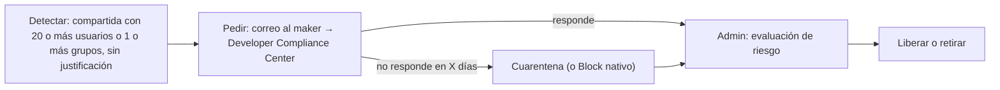

### 🎯 Objetivo
Obtener visibilidad completa del tenant, gestionar el inventario de apps, flujos y agentes, aplicar procesos de cumplimiento y habilitar al equipo de gobernanza para tomar decisiones basadas en datos. Hoy eso empieza en el **Power Platform admin center** y **Managed Environments**; al terminar sabrás decidir, y defender por escrito, qué partes del Center of Excellence (CoE) Starter Kit de Microsoft todavía aportan algo en tu organización, instalar su núcleo si lo decides y operar sus procesos de gobierno.

> **📌 Nota de vigencia (verificada el 2026-11):** Learn indica que el **CoE Starter Kit ya no tiene mantenimiento activo**, que sus capacidades centrales forman parte del **Power Platform admin center** y que sus issues ya no se revisan ni se corrigen ([Learn: CoE Starter Kit](https://learn.microsoft.com/power-platform/guidance/coe/overview)). La misma página recomienda **empezar por las capacidades nativas** del admin center y de Managed Environments ("robustas y con soporte completo") y mirar el kit solo si necesitas algo más. Lo que el kit todavía ofrece y lo nativo no cubre, según Learn: **actualizar permisos en bloque, limpiar recursos abandonados, encuestar a los makers y calcular el ROI de ideas**. El kit sigue descargable y funcional, pero es una implementación de ejemplo: sus componentes (Dataverse, APIs y conectores de administración) tienen soporte; el kit en sí, no.

> **Cómo está organizado este módulo:** como en el Módulo 31, aquí **decides y defiendes**. Primero exploras lo nativo en tu tenant con **evidencia** (el dato exacto que viste), después decides qué del kit necesitas, lo instalas solo si tu decisión lo justifica (el [LAB-32](/labs/lab-32-coe-starter-kit) es la práctica completa), diagnosticas un incidente síntoma primero y cierras con un **reto de transferencia** contrastado con una rúbrica.
>
> **Antes de empezar:**
> - **Rol:** **Power Platform Administrator** (o Global Administrator) en un tenant **de práctica** ([Entornos y trials](/recursos/entornos-y-trials)). Para ver el inventario nativo bastan roles como Power Platform administrator o Global reader.
> - **Licencias para instalar el kit (microlección 3):** la identidad que lo instala necesita licencias **no trial** de Power Apps Per User y de Power Automate Per User (o Per Flow), una licencia de Microsoft 365 con buzón, y Power BI Pro para compartir el informe ([Learn: requisitos](https://learn.microsoft.com/power-platform/guidance/coe/setup)). En un tenant de prueba normalmente no las tendrás: sigue la **ruta B** (decisión documentada y lectura guiada del kit) y deja la instalación para cuando tengas esas licencias.
> - **Duración realista:** unas 5,5 horas sin contar la espera del primer inventario del kit (varias horas).

### 📖 Conceptos Clave
- **Power Platform inventory (nativo):** vista unificada de todos los agentes, apps (canvas, model-driven, code…) y flujos del tenant, además de ambientes, grupos de ambientes y, en preview, conectores. Está en **Manage** > **Inventory**; permite filtrar y ordenar por cualquier columna, buscar, **Download** a CSV y **Block** de agentes o canvas apps publicados (reversible). Los cambios aparecen en unos 15 minutos y también se consulta por API, por el conector **Power Platform for Admins V2** o con Azure Resource Graph ([Learn: inventory](https://learn.microsoft.com/power-platform/admin/power-platform-inventory)).
- **Actions (antes Power Platform Advisor):** página del admin center con recomendaciones semanales de seguridad, eficiencia operativa, licencias y capacidad, y rendimiento, con acciones en línea o automatizadas con las acciones **Get recommendations**, **Get recommendation resources** y **Execute recommendation action** del conector Power Platform for Admins V2. El detalle de los recursos afectados solo está disponible para **ambientes administrados** ([Learn: Actions](https://learn.microsoft.com/power-platform/admin/power-platform-advisor)).
- **Managed Environments:** suite de capacidades premium para administrar a escala (grupos de ambientes, límite de uso compartido, informes de uso semanales, data policies, pipelines, contenido de bienvenida para makers, *solution checker* obligatorio, IP firewall, catálogo, default environment routing, entre otras). Está incluida como derecho en licencias independientes de Power Apps, Power Automate, Copilot Studio, Power Pages y Dynamics 365 ([Learn: Managed Environments](https://learn.microsoft.com/power-platform/admin/managed-environment-overview)). El Módulo 31 cubre grupos y reglas.
- **CoE Starter Kit:** colección de soluciones de Power Platform (descarga en aka.ms/CoeStarterKitDownload) que inventaría el tenant en tablas de Dataverse y construye apps, flujos y un informe de Power BI encima. Paquetes: **Core components** (inventario, apps de administración y gestión de solicitudes de ambiente; dependencia de todo lo demás), **Governance components** (auditoría y cumplimiento), **Nurture components** (comunidad y formación) e **Innovation Backlog** (ideas). Se instala en ambientes propios, nunca en el Default.
- **Core components:** su inventario lo hacen flujos programados; el principal es **Admin | Sync Template v4 (Driver)**, que dispara los flujos de sincronización por tipo de recurso. Incluye las apps **CoE Setup and Upgrade Wizard**, **CoE Admin Command Center**, **Power Platform Admin View**, **DLP Impact Analysis**, **Manage Permissions** y **App Catalog**, el flujo **Admin | Welcome Email v3** y los componentes de solicitud de ambientes ([Learn: core components](https://learn.microsoft.com/power-platform/guidance/coe/core-components)). El primer inventario puede tardar varias horas; los siguientes solo revisan lo nuevo o modificado.
- **Governance components:** procesos de cumplimiento. El **compliance process** (flujo **Admin | Compliance Detail request v3**) escribe al maker cuando una app está compartida con 20 o más usuarios o con 1 o más grupos sin justificación de negocio, cuando no se publica en 60 días o le falta descripción, o cuando tiene alto impacto sin plan de mitigación; el maker responde en la app **Developer Compliance Center**. Los **inactivity processes** piden al dueño, con aprobaciones, confirmar si borrar apps y flujos sin modificar ni usar en seis meses (configurable) y avisan a su manager si ignora la solicitud. La **limpieza de recursos huérfanos** pide al manager del antiguo dueño que reasigne o borre ([Learn: governance components](https://learn.microsoft.com/power-platform/guidance/coe/governance-components)).
- **App Quarantine:** el flujo **Admin | Quarantine non-compliant apps** pone en cuarentena (la app ya no se puede abrir) las apps con detalles de cumplimiento pedidos y no entregados en más días de los que fija la variable **Quarantine Apps after x days of noncompliance** (7 por defecto). Se libera desde **Power Platform Admin View** (campo **Quarantine App** = **No** y la evaluación de riesgo completada). El equivalente nativo más cercano es **Block** en el inventario.
- **Nurture components:** **Video hub**, **Training in a day**, componentes de **Maker assessment** (una evaluación que pregunta al maker por el público, los datos y el soporte de la solución que planea, y le explica las consideraciones de gobierno, soporte y licencias antes de construir), **Pulse survey** (encuesta a makers en Teams), un catálogo de plantillas y el boletín **Admin | Newsletter with Product Updates** ([Learn: nurture components](https://learn.microsoft.com/power-platform/guidance/coe/nurture-components)). El **App Catalog** pertenece a Core.
- **Innovation Backlog:** componente opcional que da un proceso formal para que cualquier empleado proponga ideas de automatización o apps, y el equipo de Platform Engineering las evalúe, priorice y asigne. Sustituye el proceso informal de "el jefe pide una app por Teams" por un pipeline transparente con scoring de impacto vs esfuerzo.
- **Power BI CoE Dashboard:** plantillas `.pbit` distribuidas con el kit (`Production_CoEDashboard_MMMYYYY.pbit` para el inventario y `PowerPlatformGovernance_CoEDashboard_MMMYYYY.pbit` para gobierno y cumplimiento) que cruzan el inventario con datos de la organización (departamento, ciudad, país) ([Learn: setup](https://learn.microsoft.com/power-platform/guidance/coe/setup)). Las métricas de lanzamientos y usuarios únicos de apps necesitan además la solución de Audit Log.
- **Environment Request Process:** en el kit es parte de Core: el maker pide un ambiente (y la data policy que necesita) desde **CoE Maker Command Center**, el admin aprueba o rechaza en **CoE Admin Environment Request**, el flujo **Env Request | Create approved environment** lo aprovisiona y **Env Request | Clean up** borra los ambientes cuya solicitud expiró. La alternativa nativa para ambientes personales es el **default environment routing** hacia un grupo de ambientes (Módulo 31).
- **Ritmo de versiones del kit:** Learn recomienda actualizar el kit al menos **cada tres meses**, probar cada actualización en un ambiente de prueba con la variable **ProductionEnvironment** = **No** (así no se envían correos a makers) y no personalizarlo en exceso para poder seguir actualizándolo.

---

## 🧩 Microlección 1 — Lo nativo primero: inventario y Actions (≈60 min)

**El concepto:** la pregunta del Caso Real ("¿cuántas apps hay y quién las mantiene?") hoy se responde en el admin center sin instalar nada. El inventario nativo responde **qué existe y de quién es**; la página **Actions** responde **qué deberías hacer**.

**Ahora haz algo — micropráctica (8 min):** antes de abrir el tenant, decide qué herramienta cubre cada necesidad → **[Nativo o CoE Starter Kit: qué usar para cada necesidad](/practica/ip-arq-013-nativo-o-coe-starter-kit)**.

**Explora tu tenant (30 min).** En el [Power Platform admin center](https://admin.powerplatform.microsoft.com/):

1. **Manage** > **Inventory**. Anota el número total de recursos que aparece arriba a la izquierda de la tabla.
2. Selecciona la columna **Environment type** y filtra por **Default**: ¿cuántos recursos viven en el ambiente Default? Después selecciona la columna **Owner** y escribe tu nombre: el contador se actualiza con los filtros combinados. Para quitar los filtros, selecciona cualquier columna > **Clear all filters**.
3. Selecciona el icono **Add or remove columns** (junto al cuadro **Search**) y muestra una columna que no estaba (por ejemplo, la de conectores si tu tenant la tiene, en preview).
4. Selecciona **Download** en la barra de comandos: se descarga un CSV con **todo** el inventario, no solo lo que se ve.
5. Abre **Actions** en el panel de navegación > pestaña **Recommendations**. Abre una recomendación y lee **Why is this important**, **What can I do** y **Affected Resources**. Si ves un candado o un banner, la recomendación afecta a ambientes **no administrados**: el detalle solo está disponible en ambientes administrados.

Si el inventario no carga y tu organización exige MFA por acceso condicional para Azure Resource Manager, Learn indica que el administrador de Entra ID debe incluir la aplicación del admin center en esa política. Si el tenant es nuevo, verás pocos recursos: crea una app y un flujo de prueba y vuelve en 15 minutos.

**Evidencia a reportar:**

| Campo | Tu valor |
|---|---|
| Total de recursos del inventario y cuántos están en el ambiente Default | ___ |
| Cuántos recursos son tuyos (filtro **Owner**) | ___ |
| Columnas que trae el CSV descargado (las 5 primeras) | ___ |
| Una recomendación de **Actions**: título, categoría y número de recursos afectados (o "bloqueada: ambiente no administrado") | ___ |

---

## 🧩 Microlección 2 — Decidir si el kit aporta algo (≈45 min)

**El concepto:** "instalamos el CoE Starter Kit" ya no es una decisión por defecto. Es un trade-off: el kit da procesos que lo nativo no tiene, a cambio de mantener una solución sin soporte, licencias premium para la identidad que lo ejecuta y para los usuarios de sus apps, y actualizaciones cada tres meses. Este mapa resume, con Learn, qué cubre cada lado:

| Necesidad | Nativo (admin center / Managed Environments) | CoE Starter Kit |
|---|---|---|
| Inventario de apps, flujos y agentes | **Inventory** (unificado, CSV, API) | Tablas de Dataverse + informe de Power BI con datos de la organización |
| Limitar con quién se comparte una app | **Limit sharing** (proactivo) | No limita; el compliance process detecta apps muy compartidas *después* |
| Recursos inactivos | **Weekly digest** / informes de uso los destaca | **Inactivity processes**: el dueño aprueba o rechaza el borrado |
| Bienvenida a makers nuevos | **Maker welcome content** al entrar a Power Apps | **Admin \| Welcome Email v3** tras crear su primer recurso |
| Ver qué data policies aplican a un ambiente | Detalle de data policies del ambiente administrado | **DLP Impact Analysis**: además, qué apps y flujos romperían |
| Bloquear una app o un agente | **Block** desde el inventario | Cuarentena tras el compliance process |
| Permisos en bloque, recursos abandonados, encuestas, ROI de ideas | Sin equivalente directo | **Manage Permissions**, limpieza de huérfanos, **Pulse survey**, Innovation Backlog |

**Ahora decide (sin pasos):** con la evidencia de la microlección 1 y los datos del Caso Real, escribe **ADR-COE-001 "Nativo, kit o ambos"**. Para cada necesidad de la tabla elige una opción y justifícala. Contrasta tu ADR con estos criterios:

| Criterio | Qué demuestra que lo cumples |
|---|---|
| Lo nativo primero | Cada necesidad que lo nativo cubre se resuelve con lo nativo, y lo dices |
| El kit, solo por un hueco real | Cada componente del kit que eliges cubre algo de la última fila de la tabla (u otro hueco que nombras) |
| Costo de operación visible | Escribes quién actualiza el kit cada tres meses, con qué licencias y en qué ambiente de prueba |
| Riesgo de soporte aceptado | Reconoces que el kit no tiene mantenimiento activo y qué harías si un flujo deja de funcionar |

| Campo | Tu valor |
|---|---|
| Decisión del ADR en una frase | ___ |
| Componentes del kit que eliges (o "ninguno") y el hueco que cubre cada uno | ___ |
| Quién mantiene el kit, cada cuánto y en qué ambiente de prueba | ___ |

---

## 🧩 Microlección 3 — Si lo decides: instalar el núcleo del kit (≈90 min + espera del inventario)

**El concepto:** el kit se apoya en flujos que leen el tenant con conectores de administración. Casi todos los fallos de instalación vienen de tres sitios: la identidad (rol y licencias), la data policy del ambiente y las conexiones. La práctica completa está en el [LAB-32](/labs/lab-32-coe-starter-kit); aquí tienes los pasos esenciales verificados en Learn ([setup](https://learn.microsoft.com/power-platform/guidance/coe/setup) y [setup de core components](https://learn.microsoft.com/power-platform/guidance/coe/setup-core-components)).

1. **Identidad:** Power Platform Administrator (o Global admin; el rol Dynamics 365 admin **no** sirve), asignado de forma directa y permanente, con las licencias no trial de la sección "Antes de empezar" y MFA configurada.
2. **Ambientes:** Learn recomienda **dos ambientes de tipo Production con Dataverse**, uno de prueba y otro de producción, en inglés como idioma por defecto, sin apps ni datos de ejemplo y con **None** como grupo de seguridad (algunos procesos usan aprobaciones y los makers deben poder interactuar).
3. **Data policy:** la que aplique a esos ambientes debe permitir **juntos en el grupo Business** los conectores que lista Learn: **Approvals**, **Azure Resource Manager**, **HTTP**, **HTTP with Microsoft Entra ID (preauthorized)**, **Microsoft Dataverse**, **Microsoft Dataverse (legacy)**, **Microsoft Teams**, **Office 365 Groups**, **Office 365 Outlook**, **Office 365 Users**, **Power Apps for Admins**, **Power Apps for Makers**, **Power Automate for Admins**, **Power Automate Management**, **Power Platform for Admins**, **Power Platform for Admins V2**, **Power Query Dataflows** y **RSS**. Comprueba que ninguna otra política aplica a esos ambientes.
4. **Creator Kit:** instálalo antes en el mismo ambiente; es un requisito del CoE Starter Kit. Según [Learn: Install the Creator Kit](https://learn.microsoft.com/power-platform/guidance/creator-kit/setup): activa **Power Apps code components for canvas apps** en la configuración del ambiente (**Settings** > **Product** > **Features**), descarga **CreatorKitCore** desde aka.ms/creatorkitdownload e impórtala en **Solutions** > **Import solution** (o `pac application install --environment <URL del ambiente> --application-name CreatorKitCore`). El [LAB-32](/labs/lab-32-coe-starter-kit), Tarea 1.4, tiene los pasos clic a clic.
5. **Conexión previa:** en [Power Automate](https://make.powerautomate.com/), con el ambiente del CoE seleccionado, **Data** > **Connections** > **+ New connection** > **HTTP with Microsoft Entra ID (preauthorized)**, con **Base Resource URL** y **Microsoft Entra ID Resource URI (Application ID URI)** = `https://graph.microsoft.com` (tenants comerciales).
6. **Importa** `CenterofExcellenceCoreComponents_x.xx_managed.zip` (del archivo descargado y extraído; `x.xx` es la versión, y Learn lo escribe de dos formas, así que busca el archivo que empieza por `CenterofExcellenceCoreComponents` y termina en `_managed.zip`). En la nube comercial deja vacías las variables de entorno. La importación puede tardar hasta una hora; Learn indica que el aviso *Flow client error returned with status code Bad Request* se puede ignorar.
7. Abre la solución **Center of Excellence - Core Components** > app **CoE Setup and Upgrade Wizard** y sigue sus pasos. En la fuente de datos del inventario elige **Cloud flows** (la opción por defecto y recomendada; **Data export** es una preview experimental que Learn pide probar solo en un ambiente de prueba). Si el asistente muestra *Error Loading Control*, enciende a mano los flujos **SetupWizard > GetCurrentEnvironment**, **SetupWizard > GetTenantID** y **SetupWizard > GetUserDetails**.
8. **Espera** a que terminen los flujos de sincronización y revisa **Admin | Sync Template v4 (Driver)** > **Runs**.

Un dato que cambia la decisión: Learn advierte que el inventario por cloud flows sirve para tenants pequeños y medianos, pero **puede dar problemas de rendimiento por encima de 10.000 objetos** (ambientes, apps y flujos sumados).

**Evidencia a reportar (o "ruta B" con lo que habrías comprobado):**

| Campo | Tu valor |
|---|---|
| Tipo de los dos ambientes del CoE y su idioma por defecto | ___ |
| Data policy que aplica al ambiente del CoE y grupo de **HTTP with Microsoft Entra ID (preauthorized)** | ___ |
| Duración de la importación de Core components y avisos que mostró | ___ |
| Fuente de inventario elegida en el asistente y por qué | ___ |
| Duración y estado de la primera ejecución de **Admin \| Sync Template v4 (Driver)** | ___ |

---

## 🧩 Microlección 4 — Operar los procesos de gobierno con umbrales propios (≈45 min)

**El concepto:** los procesos del kit (o los que construyas sobre **Actions** y el conector Power Platform for Admins V2) solo funcionan si sus umbrales encajan con tu organización: un umbral demasiado bajo inunda a los makers de correos y genera fricción; uno demasiado alto deja pasar el riesgo. El ciclo de cumplimiento es: detectar → pedir información al dueño → escalar → aislar (cuarentena o **Block**) → liberar o retirar.

**Decide (sin pasos):** completa la tabla con el umbral por defecto (de Learn), el tuyo y la razón. Usa los datos del Caso Real (5.000 empleados, 1.200 apps).

| Proceso | Umbral por defecto | Tu umbral | Por qué |
|---|---|---|---|
| Compliance: app compartida sin justificación | 20 o más usuarios, o 1 o más grupos | ___ | ___ |
| Compliance: app sin publicar | 60 días | ___ | ___ |
| Inactividad: apps y flujos sin modificar ni usar | 6 meses | ___ | ___ |
| Inactividad: borrar lo aprobado | Más de 3 semanas después de aprobar | ___ | ___ |
| Cuarentena por no entregar detalles | 7 días (**Quarantine Apps after x days of noncompliance**) | ___ | ___ |

Contrasta tu tabla con esta rúbrica:

| Criterio | Qué demuestra que lo cumples |
|---|---|
| Umbral ligado al dato | Cada umbral propio cita un dato del Caso Real (5.000 empleados, 1.200 apps) o de tu inventario, no una cifra redonda sin más |
| Carga para los makers estimada | Dices cuántas apps, aproximadamente, recibirían el correo con tu umbral de uso compartido |
| Coherencia entre procesos | La cuarentena no llega antes de que el maker haya tenido tiempo de responder, y el borrado por inactividad deja margen para recuperar |
| Sin copiar los valores por defecto | Si dejas un valor por defecto, explicas por qué sirve en este caso |

Y escribe en tres líneas: (1) cómo funciona la **apelación** (quién puede sacar una app de cuarentena y con qué evidencia); (2) cómo pedirá un maker un ambiente nuevo (Environment Request del kit o default environment routing nativo); (3) qué harás para la comunidad de makers: canal de Teams `Power Platform Community`, "App of the Month", rutas de formación con insignias (por ejemplo, PL-900 completado o primera app publicada) o los componentes de Nurture.

**Evidencia a reportar:**

| Campo | Tu valor |
|---|---|
| Tabla de umbrales completa | ___ |
| Proceso de apelación en una frase | ___ |
| Mecanismo de solicitud de ambientes elegido y por qué | ___ |
| Acción de comunidad elegida y cómo medirás si funciona | ___ |

---

## 🔧 Diagnosticar — "el CoE Dashboard dejó de actualizarse"

El CIO del Caso Real abre el CoE Dashboard en su reunión mensual y ve que los datos son de hace 9 días. Nadie tocó el kit. Antes de abrir nada, escribe **dos hipótesis** (una sobre los flujos de sincronización y otra sobre algo que cambió fuera del kit) y qué evidencia confirmaría cada una. Después resuelve el caso:

**[Diagnosticar: el inventario del CoE dejó de sincronizar](/practica/ip-arq-014-inventario-coe-dejo-de-sincronizar)**

| Campo | Tu valor |
|---|---|
| Tus dos hipótesis y la evidencia que revisarías | ___ |
| La primera evidencia que contradice "nadie tocó nada" | ___ |
| Causa raíz, corrección y la alerta que pondrías para enterarte antes que el CIO | ___ |

---

## 🔁 Reto de transferencia — Otra empresa, otro tamaño: decide y defiende

**Requisito nuevo:** una aseguradora de 800 empleados te pide gobernanza a escala. Datos: el tenant tiene unos **15.000 objetos** entre ambientes, apps y flujos; **no** hay presupuesto para Power BI Premium ni para licencias Per User de una cuenta de servicio; quieren (1) inventario con dueño de cada recurso, (2) que los dueños confirmen o borren lo inactivo antes de que IT lo elimine, (3) que ninguna app se comparta con más de 20 personas, y (4) que los makers nuevos no construyan en el ambiente Default.

**Micropráctica de transferencia (8 min):** **[Transferir: gobernanza a escala para una aseguradora](/practica/ip-arq-015-transferir-gobernanza-aseguradora)**.

**Después, sin pasos:** escribe **ADR-COE-002** (una página) con qué herramienta resuelve cada requisito y por qué, y, para el requisito 2, el diseño del flujo (disparador, acciones del conector Power Platform for Admins V2, a quién avisa, cuánto espera y qué hace si no hay respuesta). Rúbrica:

| Criterio | Qué demuestra que lo cumples |
|---|---|
| Tamaño del tenant | Tu inventario no depende de flujos que recorran 15.000 objetos (o justificas por qué sí) |
| Restricción de licencias | Ninguna pieza exige Power BI Premium ni licencias Per User que no hay |
| Proactivo frente a reactivo | El límite de 20 personas se impone antes de compartir, no se detecta después |
| El dueño decide antes del borrado | El flujo del requisito 2 avisa al dueño y espera su respuesta antes de borrar |
| Trade-off escrito | Nombras qué pierdes por no instalar el kit completo (por ejemplo, el informe de Power BI por departamento) y por qué lo aceptas |

| Campo | Tu valor |
|---|---|
| Herramienta elegida para cada uno de los 4 requisitos | ___ |
| Diseño del flujo del requisito 2 | ___ |
| Tu trade-off principal | ___ |

---

### 💼 Caso Real de Negocio
**Empresa:** Multinacional con 5,000 empleados y Power Platform sin CoE  
**Problema:** El IT director no sabía cuántas apps existían ni quién las mantenía. Cada mes aparecían nuevas apps en producción que nadie había aprobado, con datos de clientes en SharePoint externo.  
**Solución:** CoE Core Components instalados → primer sync reveló 1,200 apps (el IT esperaba 200). Compliance Process archivó 340 apps sin uso. Environment Request Process formalizó el proceso de nuevos ambientes. CoE Dashboard ahora es el primer dashboard que revisa el CIO en su reunión mensual de IT.  
**Resultado:** Visibilidad 100% del tenant. Número de apps sin owner: de 600 a 12. Requests de nuevos ambientes procesados en < 2 días (antes tardaban semanas).

### ✅ Buenas Prácticas
- Empezar por el inventario, **Actions** y Managed Environments del admin center; instalar componentes del kit solo para huecos concretos y escritos en un ADR
- Si instalas el kit: dos ambientes de tipo Production (prueba y producción), **ProductionEnvironment** = **No** en el de prueba y actualización al menos cada tres meses, probada antes en prueba
- No personalizar el CoE Starter Kit excesivamente — las actualizaciones serían imposibles de aplicar; si necesitas cambiar un flujo, guarda una copia
- El ambiente del CoE también se gobierna: su propia data policy con los conectores que el kit necesita en Business, una identidad dedicada con MFA y backup
- El compliance process debe tener un "nodo de apelación" — los makers pueden disputar el archivado o la cuarentena
- Publicar métricas de gobierno mensualmente — transparencia genera confianza con el negocio

### ⚠️ Errores Comunes
| Error | Causa | Solución |
|-------|-------|----------|
| Sync inicial nunca termina o el tenant sufre throttling | Tenant grande inventariado con cloud flows (Learn advierte problemas por encima de 10.000 objetos) o **FullInventory** = **Yes** | Dejar **FullInventory** en **No** (solo cambios), poner **DelayObjectInventory** en **Yes** si hay throttling, y valorar el inventario nativo |
| Los flujos del kit aparecen suspendidos | Una data policy nueva separa conectores que el kit necesita juntos en Business | Excluir los ambientes del CoE de esa política o darles una con todos los conectores requeridos en Business; volver a encender los flujos |
| Compliance emails generan fricción | Tono demasiado agresivo o umbrales demasiado bajos | Personalizar el correo (tabla **Customized Email** del kit) con el nombre del maker y contexto claro, y revisar los umbrales |
| CoE Dashboard no muestra datos recientes | Sync deshabilitado o flujo con error | Revisar **Admin \| Sync Template v4 (Driver)** > **Runs** y el correo diario de **Admin \| Sync Template v3 (Sync Flow Errors)** |
| El informe no muestra lanzamientos ni usuarios únicos de las apps | No se configuró la solución de Audit Log | Configurarla (solo si el inventario es por cloud flows) |
| Se elige el kit para limitar con quién se comparten las apps | El kit no limita el uso compartido; solo lo detecta después | Usar **Limit sharing** de Managed Environments (o la regla del grupo de ambientes) |
| Se adopta el ALM Accelerator del kit para los despliegues | Está en desuso y ya no se revisan sus issues | Usar Pipelines in Power Platform o Build Tools/GitHub Actions (Módulo 19) |

### 🧪 Criterios de Validación
- [ ] Evidencia del inventario nativo: total, recursos en Default, filtro por dueño y CSV descargado
- [ ] Una recomendación de **Actions** analizada (o explicado por qué está bloqueada)
- [ ] ADR-COE-001 "Nativo, kit o ambos" contrastado con sus criterios
- [ ] Núcleo del kit instalado con su primer inventario completo, o ruta B con la evidencia de lo que habrías comprobado
- [ ] Tabla de umbrales de los procesos de gobierno con razones, proceso de apelación y mecanismo de solicitud de ambientes
- [ ] Diagnóstico del inventario que dejó de sincronizar, con causa raíz, corrección y alerta
- [ ] ADR-COE-002 del reto de transferencia contrastado con la rúbrica, con el trade-off escrito

---
