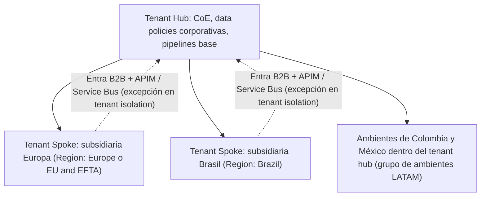

*Lectura: 20-25 min · Con práctica: unos 150 min, mejor en dos sesiones (la primera hasta la Microlección 2; la segunda, de la 3 al final). La primera vez, cuenta entre una vez y media y el doble.*

### 🎯 Objetivo
Diseñar estrategias de implementación para organizaciones multinacionales con múltiples tenants, requisitos de residencia de datos (GDPR, LGPD, Ley 1581), y modelos de gobierno distribuido donde subsidiarias tienen autonomía pero se alinean con políticas corporativas.

> **Cómo está organizado este módulo:** es un módulo de decisión, así que aquí "construir sin pasos" significa **decidir y defender**: ante un caso con restricciones eliges una topología (cuántos tenants, qué ambientes, en qué región), escribes por qué y la contrastas con criterios explícitos. No hay una única respuesta correcta; la evidencia es tu decisión escrita con sus razones. Cada microlección trae un concepto breve, una micropráctica con feedback inmediato y una práctica con **evidencia** (el dato exacto que viste en el Admin Center o en tu decisión). Después diagnosticarás un flujo que dejó de conectar con otro tenant a partir del síntoma, y cerrarás con un reto de transferencia: una adquisición.
>
> **Antes de empezar, necesitas:**
> - Acceso al [Power Platform Admin Center](https://admin.powerplatform.microsoft.com) con rol **Power Platform Administrator** o **Dynamics 365 Administrator** (en tu tenant de prueba personal ya lo eres). Un Environment Admin no puede activar Managed Environments ni ver los ajustes del tenant.
> - Un ambiente **Sandbox** o **Developer** de prueba en el que puedas cambiar ajustes sin afectar a nadie. **No uses PROD.**
> - Haber hecho los Módulos 31 (gobernanza y CoE) y 32 (ALM enterprise). En Arquitecto se asume todo lo anterior.
> - Un tenant de prueba casi nunca tiene varias geografías contratadas, Advanced data residency ni un segundo tenant: cada práctica que lo necesite tiene una **variante en papel**.

### 📖 Conceptos Clave
Un mapa rápido; cada pieza se practica en su microlección.

- **Tenant:** instancia única de Microsoft Entra ID (anteriormente Azure Active Directory) asociada a Power Platform que funciona como el límite de seguridad y administración principal. Una empresa puede tener múltiples tenants (por adquisición, separación legal o requisitos regulatorios), lo que crea complejidad de identidad y gobernanza. El tenant tiene un `tenantId` único en formato GUID; todas las apps, flujos y datos de Dataverse residen dentro de él. Cuentas de usuario, grupos de seguridad, licencias y capacidad de almacenamiento **no se comparten** entre tenants.
- **Multi-tenant architecture:** modelo donde una organización opera con dos o más tenants, típicamente un tenant corporativo central y tenants por subsidiaria o filial. Learn es claro: la mayoría de las empresas deberían usar **varios ambientes dentro de un solo tenant**; el multi-tenant tiene sentido cuando hay entidades realmente separadas que necesitan directorio y licencias propios. Los usuarios de otro tenant entran como **invitados (Microsoft Entra B2B)** y pueden necesitar su propia licencia. Los datos entre tenants se integran con Azure Service Bus o APIM, o con conexiones cross-tenant controladas por el **tenant isolation**.
- **Geo y región:** cada ambiente se crea en una **Region** (una geografía como United States, Europe, United Kingdom, Brazil, India, Australia...) y queda ligado a ella: sus apps, conexiones, gateways y conectores personalizados se despliegan ahí. Un ambiente **puede** estar en una región distinta a la del tenant. Cambiarlo después **no es imposible, pero sí excepcional**: la migración geo a geo tiene soporte limitado, se pide a Microsoft con al menos 10 días de antelación, cambia la URL y el Environment ID del ambiente y obliga a volver a aplicar Managed Environments, políticas, Lockbox y grupo de ambientes.
- **Macro regiones:** geografías más amplias (North America, The Americas, EU and EFTA, Europe and UK, Asia-Pacific...) donde la plataforma asigna el datacenter. Si el requisito es la EU Data Boundary, se elige **European Union (EU) and European Free Trade Association (EFTA)**; "Europe and UK" no está dentro de la EU Data Boundary. Elegir un datacenter concreto exige el add-on **Advanced data residency**. Una macro región no es una jurisdicción legal.
- **GDPR (Europa), LGPD (Brasil), Ley 1581 (Colombia):** regulaciones de protección de datos personales. El GDPR (General Data Protection Regulation) entró en vigor en 2018 y aplica a datos de ciudadanos de la UE, con multas de hasta el 4% del ingreso global anual. La LGPD brasileña (2020) sigue un modelo similar al GDPR. La Ley 1581 colombiana de 2012 requiere consentimiento para tratamiento de datos personales y registro ante la SIC. Para Power Platform, estas regulaciones implican: residencia de datos en la región correcta, capacidad de eliminar datos de un usuario específico (right to be forgotten), y auditoría de acceso a datos personales.
- **Data Residency:** garantía de que los datos de una jurisdicción se almacenan en la geografía correspondiente. En Power Platform se logra creando cada ambiente en la región correcta. Lo que **sí sale** de la geografía está documentado y hay que revisarlo con el DPO: los nombres de tablas y columnas de Dataverse y los nombres de apps en los portales de administración se replican globalmente, el nombre y la URL de un sitio de Power Pages también, y los datos de **Brazil South** pueden replicarse a **South Central US** (Texas) para recuperación ante desastres.
- **Tenant isolation (conexiones cross-tenant):** por defecto está **Off**, y entonces una app o un flujo **sí** puede conectarse a otro tenant con un conector basado en Microsoft Entra ID si el usuario presenta credenciales válidas de ese tenant. Activarlo bloquea las conexiones de entrada y de salida, salvo las que añadas a una lista de excepciones por tenant y dirección. Es el control para que nadie saque datos a un tenant ajeno, y la razón por la que un flujo cross-tenant puede quedar suspendido de un día para otro.
- **Hub-and-Spoke environment model:** patrón donde el tenant corporativo (hub) centraliza los componentes compartidos — soluciones base, CoE, pipelines, data policies corporativas — y los tenants o ambientes de subsidiarias (spokes) siguen esas políticas pero tienen autonomía para sus apps locales. Entre tenants el hub **no** gobierna directamente a los spokes: la alineación se logra con procesos de gobierno documentados y con la misma configuración aplicada en cada tenant.
- **Managed Environments:** conjunto de capacidades de gobierno que se activa por ambiente: grupos de ambientes, límites de sharing, weekly usage insights, enforcement de Solution Checker, IP firewall, IP cookie binding, Customer-managed keys, Customer Lockbox, backup extendido, entre otras. Viene **incluido** en las licencias standalone de Power Apps, Power Automate, Copilot Studio, Power Pages y Dynamics 365 (no en el Developer Plan); no es un add-on aparte. Los ambientes Developer **no gestionados** están en retirada: no se pueden crear nuevos a partir del 15 de noviembre de 2026 y los existentes deben pasar a Managed Environments antes del 15 de diciembre de 2026.
- **Environment groups:** "carpetas" de ambientes gestionados a los que se aplican reglas en bloque (sharing, usage insights, Solution Checker, retención de backup, funciones de IA, contenido de bienvenida). Una regla publicada en el grupo **bloquea** ese ajuste en cada ambiente: el admin local ya no puede cambiarlo. Un ambiente pertenece a un solo grupo, los grupos no se anidan y pueden mezclar regiones.
- **Pipelines in Power Platform:** despliegue de soluciones managed entre ambientes (DEV → TEST → PROD) sin Azure DevOps. Todos los ambientes destino deben ser gestionados, el Solution Checker que exija el ambiente se aplica, y hay aprobaciones mediante despliegues delegados. **No** despliegan a otro tenant (para eso, Azure DevOps o GitHub Actions) y entre geografías solo si se activa **Cross-Geo Solution Deployments**.
- **Satellite Makers:** ciudadanos desarrolladores ubicados en subsidiarias o regiones que tienen autonomía para crear soluciones locales bajo el marco de gobierno corporativo. Se les otorga acceso a ambientes dedicados (no al Default Environment) — hoy, con **default environment routing**, cada maker nuevo recibe su propio ambiente Developer gestionado dentro del grupo que elijas —, reciben training del CoE Nurture Components, y sus apps siguen el Compliance Process.

**Diagrama: modelo Hub-and-Spoke entre tenants**

Fíjate en la tercera rama: no todo país necesita su propio tenant. Decidir **dónde basta un grupo de ambientes** es la mitad del trabajo de este módulo.

### 👨‍💻 Actividades Prácticas

## 🧩 Microlección 1 — Un tenant o varios: la decisión que más cuesta deshacer

**¿Qué vas a aprender?** A separar los requisitos que de verdad exigen otro tenant (directorio, licencias y administración independientes) de los que se resuelven con ambientes, regiones y grupos dentro del mismo tenant.

**¿Por qué existe esto?** Cada tenant adicional duplica licencias, CoE, data policies, identidades invitadas y operación. Learn recomienda varios ambientes en un solo tenant para la mayoría de las empresas, y reserva el multi-tenant para entidades realmente separadas (por ejemplo, una filial que se venderá o una entidad con su propio directorio). La residencia de datos, por sí sola, **no** exige otro tenant: un ambiente puede estar en una región distinta a la del tenant.

| Requisito del cliente | Se resuelve con | Por qué |
|---|---|---|
| "Los datos de clientes europeos deben quedarse en Europa" | Ambiente en la región Europe (o EU and EFTA) dentro del tenant actual | La región es del ambiente, no del tenant |
| "Cada país administra sus apps y sus makers" | Un grupo de ambientes por país, con su admin de ambiente | El grupo aplica las reglas y deja la operación local |
| "La filial tiene su propio directorio, sus licencias y se venderá en dos años" | Tenant propio | Usuarios, grupos y licencias no se comparten entre tenants |
| "Nadie debe poder sacar datos a un tenant ajeno" | Tenant isolation activado con excepciones | Es un ajuste del tenant, no exige separarlo |

**Ahora haz algo — micropráctica (6 min):** → **[Decidir: ¿un tenant con ambientes o varios tenants?](/practica/ip-arq-016-un-tenant-o-varios)**. Un grupo con operaciones en Colombia, México y España tiene que decidir si separa tenants; elige las decisiones que se sostienen.

**Práctica real en tu entorno (20 min) — leer cómo está hoy tu tenant:**

1. En el [Power Platform Admin Center](https://admin.powerplatform.microsoft.com), selecciona **Manage** en el panel de navegación y, en el panel **Manage**, **Environments**. En la lista, localiza la columna **Region** y anota la región de cada ambiente. **Si no ves la columna**, abre un ambiente: la región aparece en su página de detalle.
2. Compara: ¿hay algún ambiente en una región distinta a la de tu tenant? En un tenant de prueba lo normal es que todos estén en la misma; anótalo igual.
3. En el panel de navegación, selecciona **Security** → **Identity and access** → **Tenant isolation**. Anota si **Restrict cross-tenant connections** está activado y cuántas excepciones hay. **Si no ves la página o te dice que no tienes permiso**, necesitas el rol de Power Platform Administrator: anota "sin permiso" y sigue.
4. **No actives tenant isolation en un tenant compartido** sin avisar: puede suspender flujos de otros. En tu tenant de prueba personal sí puedes activarlo; si lo haces, vuelve a dejarlo como estaba.
5. Escribe en dos líneas qué requisito tendría que aparecer para que **tu** organización (o la del curso) necesitara un segundo tenant.

**Variante en papel (sin permisos de administrador):** usa el caso de la micropráctica y escribe, para cada país, si va en un ambiente, en un grupo de ambientes o en un tenant propio, con la razón.

**Evidencia a reportar (el dato exacto, no un "sí/no"):**

| Campo | Tu valor |
|---|---|
| Regiones que ves en **Region** y número de ambientes en cada una | ___ |
| Estado de **Restrict cross-tenant connections** y número de excepciones (o "sin permiso") | ___ |
| Requisito concreto que justificaría un segundo tenant en tu caso | ___ |
| Un requisito que parecía exigir otro tenant y se resuelve con un ambiente o un grupo (y con cuál) | ___ |

---

## 🧩 Microlección 2 — Residencia de datos: región, macro región y lo que sale de la geografía

**¿Qué vas a aprender?** A asignar cada tipo de dato a un ambiente y a una región, y a documentar lo que la plataforma replica fuera de la geografía para que el DPO lo valide antes, no después.

**¿Por qué existe esto?** El Caso Real de este módulo empezó con un ambiente en la región equivocada. Además, en el Admin Center no eliges un datacenter de Azure como "West Europe": eliges una **Region** (o una macro región) y la plataforma decide el datacenter; fijar uno concreto exige **Advanced data residency**. Y aunque elijas bien, hay metadatos que Microsoft documenta como globales (nombres de tablas y columnas, nombres de apps en los portales de administración, nombre y URL de los sitios de Power Pages) y una réplica de recuperación de Brazil South a South Central US. Si el DPO no lo sabe, el diseño falla la auditoría aunque los datos estén donde deben.

**Tabla de decisión de ejemplo** (empresa con clientes europeos y operaciones en Colombia):

| Dato | ¿Ciudadano EU? | Ambiente | Region en el Admin Center |
|------|---------------|----------|-------------|
| Datos CRM de cliente EU | SÍ | PROD-EU | Europe (o European Union (EU) and European Free Trade Association (EFTA) si se exige la EU Data Boundary) |
| Datos CRM de cliente CO | NO | PROD-CO | La que exija el acuerdo con la SIC (por ejemplo Brazil o United States), revisando la réplica de DR de Brazil South |
| Datos de empleados EU | SÍ | PROD-HR-EU | Igual que PROD-EU |
| Datos financieros globales | N/A | PROD-FINANCE | La del consolidado, sin datos personales EU |

Implementación: un ambiente separado por región (Dataverse en la región correcta), flujos de Power Automate que no mueven datos EU hacia ambientes de otra región, modelos de Power BI con datos EU en una capacidad de la misma geografía, y la documentación del GDPR (registro de actividades de tratamiento del Art. 30, DPA con Microsoft y mapa de flujos de datos entre países).

**Ahora haz algo — antes de abrir el Admin Center (3 min):** escribe tu predicción: ¿qué opciones de **Region** crees que te mostrará el asistente de un ambiente nuevo? ¿Aparecerá "West Europe"? Compárala en el paso 2.

**Práctica real en tu entorno (20 min):**

1. En el Admin Center, **Manage** → **Environments** → **New** en la barra de comandos.
2. Abre el desplegable **Region** y anota las opciones que ves. **No vas a crear el ambiente**: cuando termines, cierra el panel con **Cancel** o la X. **Si el botón New está deshabilitado**, tu tenant no te deja crear ambientes (política de creación o falta de capacidad): pasa a la variante en papel.
3. Busca si aparece alguna macro región (por ejemplo **The Americas** o **European Union (EU) and European Free Trade Association (EFTA)**). Su disponibilidad depende del tenant: si no aparece, anótalo.
4. Abre la página de Learn sobre [disponibilidad de datos por geografía](https://learn.microsoft.com/dynamics365/get-started/availability) y busca qué se replica fuera de la geografía. Anota dos elementos que tu DPO debería conocer.
5. Rellena la tabla de decisión de arriba para el Caso Real de este módulo (Colombia, México, Perú y España), con la región que pondrías en el Admin Center para cada fila.

**Variante en papel:** salta los pasos 1 a 3 y anota las regiones que esperarías ver según [Learn: regiones de Power Platform](https://learn.microsoft.com/power-platform/admin/regions-overview).

**Evidencia a reportar:**

| Campo | Tu valor |
|---|---|
| Opciones de **Region** que viste (o "variante en papel") y si "West Europe" era una de ellas | ___ |
| ¿Aparece alguna macro región? ¿Cuál? | ___ |
| Dos elementos que se replican fuera de la geografía según Learn | ___ |
| Región elegida para los datos de clientes de España y por qué esa y no "Europe and UK" o al revés | ___ |
| Región elegida para Colombia y cómo tratas la réplica de DR si eliges Brazil | ___ |

---

## 🧩 Microlección 3 — Estrategia de ambientes dentro del tenant: Managed Environments y grupos

**¿Qué vas a aprender?** A gobernar decenas de ambientes con reglas en bloque: activar Managed Environments, configurar sharing y agrupar ambientes para que la política no dependa de que cada admin local se acuerde.

**¿Por qué existe esto?** Configurar ambiente por ambiente produce deriva: uno tiene Solution Checker bloqueando, otro no; uno limita el sharing, otro deja compartir con toda la organización. Un grupo de ambientes con reglas publicadas lo resuelve y, combinado con **default environment routing**, hace que el ambiente personal de cada maker nuevo nazca ya gobernado. Para las subsidiarias que comparten tenant, un grupo por país o por ciclo de vida (Dev/Test frente a Producción) suele bastar.

**Ahora haz algo — antes de tocar nada (3 min):** sin abrir el Admin Center, escribe qué tres reglas pondrías en un grupo **Producción** y cuáles relajarías en un grupo **Dev/Test**. Compáralo con la lista que verás en el paso 5.

**Práctica real en tu entorno (25 min) — en tu Sandbox o Developer de prueba, nunca en PROD:**

1. **Manage** → **Environments**, selecciona los puntos suspensivos (**…**) de tu ambiente de prueba y elige **Enable Managed Environments**. **Si en su lugar ves Edit Managed Environments**, ya está gestionado: ábrelo igual para ver la configuración. **Si la opción no aparece**, revisa que tu rol sea Power Platform Administrator o Dynamics 365 Administrator.
2. En el panel, busca la sección **Manage sharing**. Anota las opciones de canvas apps que ofrece (**Don't set limits**, **Exclude sharing with security groups**, **Limit total individuals who can be shared to**) y la de flujos (**Let people share solution-aware cloud flows**). Elige **Exclude sharing with security groups** y **Limit total individuals who can be shared to** con un número pequeño (por ejemplo 20), y selecciona **Enable** (o **Save** si ya estaba gestionado).
3. **Manage** → **Environment groups** → **New group**. En **Name** escribe `Curso-DevTest`, añade una **Description** y selecciona **Create**.
4. Abre el grupo, selecciona **Add environments**, elige tu ambiente de prueba y **Add**. **Si tu ambiente no aparece en la lista**, no tiene Dataverse: los ambientes sin Dataverse no se pueden agregar.
5. Abre la pestaña **Rules** y anota las reglas disponibles. Configura una (por ejemplo, la de sharing), **Save** y después **Publish rules** en la barra de comandos.
6. Vuelve a la configuración de Managed Environments del ambiente: el ajuste que gobierna la regla ahora aparece bloqueado. Anota qué mensaje o indicación ves.
7. Al terminar, si el tenant es compartido, **Remove from group** y elimina el grupo con **Delete group** (el ambiente conserva la última configuración, pero vuelve a quedar desbloqueado).

**Pipelines entre estos ambientes (lectura, 5 min):** los pipelines de Power Platform exigen que todos los destinos sean ambientes gestionados, aplican el Solution Checker que pida el ambiente, despliegan solo soluciones managed y **no** cruzan tenants. Si tu topología del Caso Real tiene dos tenants, anota qué herramienta usarías para llevar una solución de uno a otro (Azure DevOps o GitHub Actions con Power Platform Build Tools, Módulo 19).

**Evidencia a reportar:**

| Campo | Tu valor |
|---|---|
| Opciones exactas de **Manage sharing** para canvas apps y para flujos | ___ |
| Límite que pusiste y si dejaste compartir con grupos de seguridad | ___ |
| Reglas que aparecen en la pestaña **Rules** del grupo (al menos cinco nombres) | ___ |
| Qué viste en el ambiente después de **Publish rules** (el ajuste bloqueado y cómo lo indica) | ___ |
| Tu predicción de reglas para Producción frente a las que existen | ___ |
| Herramienta para desplegar entre los dos tenants del Caso Real y por qué no Pipelines | ___ |

---

## 🔧 Diagnosticar — el flujo hacia la subsidiaria quedó suspendido

Antes de escribir tu decisión de topología, resuelve este caso a partir del síntoma, no de la tabla de errores:

**[Diagnosticar: el flujo cross-tenant dejó de conectar](/practica/ip-arq-017-flujo-cross-tenant-suspendido)**

Síntoma: un flujo del tenant corporativo lleva un año leyendo cada noche filas de Dataverse del tenant de la subsidiaria con una conexión autenticada con una cuenta de ese tenant. El lunes, el equipo de seguridad activó un control nuevo en el Admin Center y desde entonces el flujo aparece como **Suspended**. Nadie tocó el flujo. Formula tu hipótesis antes de ver la causa: ¿qué se activó, cómo lo destrabas sin abrir la puerta a cualquier tenant y qué dejarías documentado?

---

## 🧩 Microlección 4 — Decidir y defender la topología (sin pasos)

**¿Qué vas a aprender?** A escribir una decisión de topología (tenants, ambientes, regiones, grupos y despliegue) que otra persona pueda evaluar, incluidas sus consecuencias negativas.

**¿Por qué existe esto?** Separar o unir tenants después es caro: la migración entre tenants existe, pero solo para ambientes de producción y sandbox, no migra conectores personalizados, conexiones ni gateways, y obliga a reactivar Managed Environments; mover un ambiente de geografía cambia su URL y su ID. Por eso esta decisión se escribe, se razona y se firma antes de crear el primer ambiente.

**🏗️ Reto (sin pasos): escribe el ADR de topología de una red de clínicas.** No te damos la decisión, solo el caso.

> **Caso:** una red de clínicas opera en España, Portugal y Colombia. Los datos de pacientes de España y Portugal deben quedarse dentro de la EU Data Boundary; los de Colombia, según la Ley 1581. Hay un solo departamento de TI para los tres países, un único contrato de licencias y un solo directorio de empleados. Colombia quiere que sus makers creen apps locales sin pedir permiso para cada una. Dirección pide "lo más simple que cumpla".
> **Opciones a considerar (al menos estas tres):** (a) un tenant con ambientes PROD-EU y PROD-CO en regiones distintas y dos grupos de ambientes; (b) un tenant por país; (c) un tenant UE y otro LATAM, como en el Caso Real.
> **Formato:** contexto, opciones con ventajas y desventajas, decisión, consecuencias (al menos una negativa) y cómo despliegas soluciones entre ambientes.

Contrasta tu decisión con estos criterios (no hay una sola respuesta correcta; lo que se evalúa es el razonamiento):

| Criterio | Qué demuestra que lo cumples |
|---|---|
| Separa residencia de tenant | Explicas si la EU Data Boundary se resuelve con la región del ambiente o exige otro tenant, y lo apoyas en Learn |
| Elige la región con su nombre real | Escribes la **Region** que pondrías en el Admin Center (no un datacenter de Azure) y por qué esa macro región o no |
| Cubre la autonomía de Colombia | Dices qué grupo de ambientes, qué reglas y qué routing de makers usarías |
| Cuenta lo que sale de la geografía | Mencionas al menos un metadato global o la réplica de DR y qué dice el DPO |
| Despliega con la herramienta que funciona | Pipelines si todo es un tenant; Azure DevOps o GitHub si hay varios; con la razón |
| Acepta una pérdida | Hay al menos una consecuencia ⚠️ de la opción elegida (coste, operación, migración futura) |

**Evidencia a reportar:**

| Campo | Tu valor |
|---|---|
| Opción elegida y la razón principal en una frase | ___ |
| Region para los datos de pacientes de España y Portugal | ___ |
| Grupos de ambientes y una regla publicada en cada uno | ___ |
| La consecuencia negativa principal que aceptaste | ___ |
| Criterio de la tabla que te costó más cumplir y cómo lo resolviste | ___ |

---

## 🔁 Reto de transferencia — una adquisición con su propio tenant

El mismo razonamiento, al revés: en lugar de separar, ahora hay que **unir**. Tu cliente compró una empresa que tiene su propio tenant con un ambiente de producción de Dynamics 365 Sales, conectores personalizados, flujos con disparador HTTP y un sitio de Power Pages. Dirección quiere un solo tenant en seis meses.

**[Transferir: consolidar el tenant de una empresa adquirida](/practica/ip-arq-018-consolidar-tenant-adquirido)** — decide qué se mueve, con qué herramienta y qué hay que rehacer después. Si solo memorizaste "los ambientes no se pueden mover", este reto te lo va a mostrar: la migración entre tenants se pide hoy desde el propio Admin Center, pero no se lleva todo.

Cierra el reto con un plan de media página: orden de los pasos, qué se rehace en el destino (conexiones, conectores personalizados, URLs de los disparadores HTTP, Managed Environments) y qué riesgo aceptas.

**Evidencia a reportar:**

| Campo | Tu valor |
|---|---|
| Herramienta y requisitos de la migración entre tenants (tipos de ambiente admitidos, aprobación del destino, mapeo de usuarios) | ___ |
| Tres cosas que no se migran o cambian y cómo las rehaces | ___ |
| Qué control de seguridad hay que desactivar antes de mover y por qué | ___ |
| Qué cambiaría si la empresa adquirida estuviera en otra geografía | ___ |

---

### 💼 Caso Real de Negocio
**Empresa:** Grupo empresarial con operaciones en Colombia, México, Perú y España  
**Problema:** Usaban un solo tenant para todo. Los datos de clientes españoles (GDPR) residían en datacenters de US porque el tenant era de esa región. El DPO (Data Protection Officer) recibió una multa de €50,000 de la AEPD (Agencia Española de Protección de Datos).  
**Solución:** Separar en 2 tenants: LATAM (Brazil South) y EU (West Europe). Integración vía Azure Service Bus. Microsoft firmó DPA para ambos tenants. CoE en cada tenant con sincronización de políticas corporativas.  
**Resultado:** Cumplimiento GDPR verificado. LGPD de Brasil: en proceso. Multa no se repitió.

> **Para leer el caso con lo que ya sabes:** "Brazil South" y "West Europe" son los nombres de los datacenters de Azure donde terminaron los datos; en el Admin Center se eligen las regiones **Brazil** y **Europe**. Y la causa raíz no fue tener un solo tenant, sino crear los ambientes en la región del tenant sin pensar en la residencia: un ambiente europeo dentro del mismo tenant habría resuelto el GDPR. La separación en dos tenants fue una decisión válida, pero no la única; en tu ADR de la Microlección 4 debes poder explicar cuándo compensa.

### ✅ Buenas Prácticas
- La residencia de datos es responsabilidad del cliente, no de Microsoft — no asumir que la región correcta se selecciona automáticamente: la **Region** se elige al crear cada ambiente
- Antes de decidir multi-tenant, evaluar si varios ambientes en regiones distintas, grupos de ambientes y Managed Environments dentro de un solo tenant son suficientes (es lo que Learn recomienda para la mayoría de las empresas)
- Managed Environments en todos los ambientes de PROD y en los de desarrollo (los Developer no gestionados están en retirada); viene incluido en las licencias standalone, no es un add-on
- Gobernar con grupos de ambientes y reglas publicadas, no ambiente por ambiente; usar default environment routing para que los makers nuevos no construyan en el Default
- Activar tenant isolation y documentar cada excepción (tenant y dirección) con su dueño y su motivo
- Revisar con el DPO lo que se replica fuera de la geografía (metadatos globales y réplica de DR) antes de elegir la región
- Si hay varios tenants, el despliegue entre ellos va por Azure DevOps o GitHub Actions; Pipelines in Power Platform solo dentro del mismo tenant

### ⚠️ Errores Comunes
| Error | Causa | Solución |
|-------|-------|----------|
| Crear los ambientes en la región equivocada y descubrir el problema 6 meses después | No se consideró la residencia de datos al inicio del proyecto | Definir la región como requisito no funcional en el Discovery Workshop; la migración geo a geo existe pero es limitada, se pide a Microsoft con al menos 10 días y cambia la URL y el ID del ambiente |
| Multi-tenant innecesario que duplica costos y complejidad operacional | Se asumió que la residencia de datos o la autonomía de una subsidiaria exigen otro tenant | Evaluar primero ambientes por región, grupos de ambientes y security roles dentro de un solo tenant |
| Un flujo cross-tenant queda **Suspended** sin que nadie lo haya tocado | Se activó tenant isolation (**Restrict cross-tenant connections**) sin excepción para ese tenant | Añadir una excepción con el **Tenant ID** de la subsidiaria y la dirección correcta (o pasar la integración a APIM o Service Bus), y documentarla |
| El pipeline no encuentra como destino el ambiente de la subsidiaria | La subsidiaria está en otro tenant: Pipelines in Power Platform no cruza tenants | Desplegar entre tenants con Azure DevOps o GitHub Actions; si es otra geografía del mismo tenant, activar **Cross-Geo Solution Deployments** |
| Data policy corporativa bloquea casos de uso legítimos en subsidiarias con necesidades distintas | Una sola data policy aplicada a todos los ambientes sin tener en cuenta las diferencias regionales | Crear data policies por nivel: política base corporativa + políticas por grupo de ambientes aprobadas por el arquitecto |
| Tras mover un ambiente de tenant, los flujos no arrancan y las integraciones externas fallan | Se esperaba que todo viajara: conexiones, conectores personalizados y URLs de disparadores HTTP no se conservan, y Managed Environments hay que reactivarlo | Planificar la recreación en el destino y avisar a los sistemas que llaman a los disparadores HTTP de sus URLs nuevas |

### 🧪 Criterios de Validación
- [ ] Resolví la micropráctica de un tenant o varios antes de leer mi propio tenant
- [ ] Anoté las regiones de mis ambientes y el estado de **Restrict cross-tenant connections** (o hice la variante en papel)
- [ ] Rellené la tabla de residencia del Caso Real con la **Region** real del Admin Center para cada país y dos elementos que se replican fuera de la geografía
- [ ] Activé Managed Environments en un ambiente de prueba y anoté las opciones exactas de **Manage sharing**
- [ ] Creé un grupo de ambientes, publiqué una regla y comprobé que el ajuste quedó bloqueado en el ambiente
- [ ] Diagnostiqué el flujo cross-tenant suspendido formulando una hipótesis antes de ver la causa
- [ ] Escribí el ADR de topología de la red de clínicas sin pasos y lo contrasté con la tabla de criterios, incluida al menos una consecuencia negativa
- [ ] Completé el reto de transferencia de la adquisición con su plan de migración entre tenants

---
