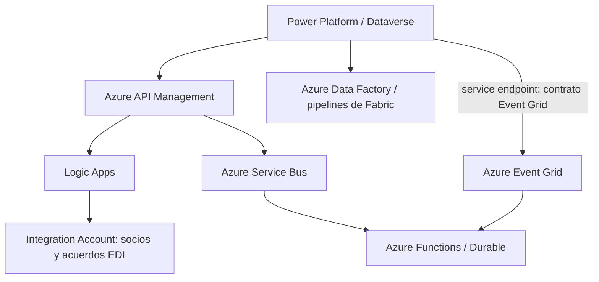
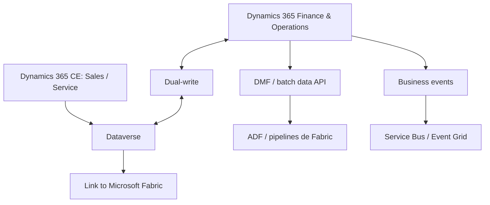

### 🚧 Antes de comenzar: este módulo no es autosuficiente en Azure

> **Requiere fundamentos de Azure que PlanEstudio todavía no enseña desde cero:** suscripción de
> Azure, Azure Portal, resource groups, regiones, roles y permisos (RBAC), y consumo/costos. Las
> prácticas reales de este módulo crean recursos de Azure (Logic Apps, API Management, Service Bus)
> y usan fragmentos de JSON de Logic Apps, XML de políticas de APIM y C# de Durable Functions. Las
> microprácticas, la sección **Decidir y defender**, el diagnóstico y el reto de transferencia se
> hacen **sin** Azure.

**Elige cómo avanzar según tu situación real:**

- **Modo conceptual (recomendado si nunca has usado Azure):** haz las microprácticas y los ejercicios
  "Ahora haz algo" de cada microlección, la sección **Decidir y defender**, el diagnóstico y el reto
  de transferencia, y salta las "Prácticas reales". **Este modo no valida que puedas desplegar o
  depurar una integración de Azure en producción.**
- **Modo práctico:** requiere una suscripción de Azure (de pago, o con créditos de una cuenta
  gratuita/estudiante), permisos para crear recursos, y supervisión activa de costos — ver aviso
  abajo. Lee primero [Fundamentos de Azure](/recursos/fundamentos-azure) (20-30 min, incluye práctica
  con cuenta gratuita) — cierra suscripción/resource group/RBAC/costos antes de este módulo.

> ⚠️ **Aviso de costos:** algunos servicios de Azure (Logic Apps Standard, API Management en tiers
> distintos de Consumption, Service Bus Premium, Azure Functions con planes dedicados) **pueden
> generar costos reales**, incluso en pruebas pequeñas, según el plan y la región. Las prácticas
> reales de este módulo usan a propósito las opciones más baratas (Logic Apps **Consumption**, API
> Management **Consumption** y Service Bus **Standard**). Antes de crear cualquier recurso: verifica
> el tipo de suscripción, revisa el pricing del servicio, y agrupa todo en un Resource Group dedicado
> (`rg-sit-m34`) que puedas eliminar por completo al terminar. No asumas que todo en Azure es
> gratuito solo porque el resto de este curso lo fue.
>
> **Orden de magnitud (aproximado, compruébalo en la [calculadora de precios](https://azure.microsoft.com/pricing/calculator/)
> para tu región):** API Management **Consumption** incluye el primer millón de llamadas al mes, así que
> las de este módulo no deberían facturarse; Logic Apps **Consumption** cobra por acción ejecutada y las
> pocas decenas de ejecuciones de la práctica suponen céntimos; Service Bus **Standard** tiene un **cargo
> base por hora** mientras el namespace existe (del orden de 10 USD al mes, prorrateado), además de las
> operaciones. Si terminas el módulo en una o dos sesiones y borras `rg-sit-m34`, el total debería quedar
> por debajo de 1-2 USD. Para no llevarte sorpresas, crea antes un presupuesto de **5 USD** con alertas:
> portal de Azure → **Cost Management** → **Budgets** → **+ Add**, ámbito tu suscripción o `rg-sit-m34`.

**Checklist de limpieza si trabajas en modo práctico:** al terminar cualquier actividad de este
módulo, confirma — (1) qué recursos creaste, (2) en qué Resource Group, (3) qué costo estimado
generaron, (4) que los desactivaste o eliminaste, y (5) que no queda ningún recurso facturable activo
en tu suscripción. Revísalo en el portal de Azure, no solo de memoria.

### 🎯 Objetivo
Decidir y defender, como arquitecto, qué pieza de Azure Integration Services resuelve cada integración de una organización con Power Platform en el centro: el motor de orquestación (Power Automate, Logic Apps Consumption o Standard, Azure Functions y Durable Functions), el gateway y su tier (API Management), mensajería o eventos (Service Bus con sesiones y caducidad, Event Grid), la orquestación de larga duración y el patrón CE + F&O (dual-write, eventos de negocio, batch). Al terminar, cada decisión queda escrita con sus trade-offs.

> **Cómo está organizado este módulo:** en el **Módulo 24** ya conectaste Dataverse con Service Bus, una Azure Function y un webhook. Aquí **no** se repite eso: se decide *entre* servicios y tiers y se diseña para fallos, orden, caducidad, red privada y límites por consumidor. Cada microlección trae el concepto, un ejercicio corto para decidir antes de construir, una práctica real (modo práctico) y una tabla de **evidencia** con el dato exacto que observaste. Después viene **Decidir y defender** (un caso con restricciones y una rúbrica), un **incidente** para diagnosticar con el síntoma primero, y un **reto de transferencia**.

### 📖 Conceptos Clave
- **Azure Logic Apps:** servicio de orquestación de integraciones hospedado en Azure, del mismo motor que Power Automate pero pensado para equipos de IT: definición JSON versionable, despliegue por pipeline y protocolos B2B (EDI X12, EDIFACT, AS2). Tiene dos modelos:
  - **Consumption:** multitenant, un solo workflow por recurso, se paga por ejecución y se despliega con plantillas ARM. No se integra con una red virtual.
  - **Standard:** single-tenant, varios workflows (stateful y stateless) en el mismo recurso, se hospeda en un plan Workflow Service Plan, en App Service Environment v3 o en despliegue híbrido sobre Azure Container Apps; tiene conectores integrados (built-in) como Service Bus y Event Hubs, integración con red virtual y private endpoints, y desarrollo local con VS Code. El antiguo Integration Service Environment (ISE) se retiró; su reemplazo es Logic Apps Standard.
- **Azure API Management (APIM):** gateway que publica las APIs de la organización bajo un dominio único, con **productos** (agrupan APIs y definen los términos de acceso de un tipo de consumidor), **suscripciones** (una clave por consumidor) y **políticas** XML en cuatro secciones: `inbound`, `backend`, `outbound` y `on-error`. El tier es una decisión de arquitectura, no de precio solamente:
  - **Consumption:** se paga por llamada, sin developer portal, sin private endpoint y sin red virtual.
  - **Developer:** todas las funciones (incluida la inyección en red virtual) pero para desarrollo y pruebas, no para producción.
  - **Basic, Standard** y los tiers **v2** (Basic v2, Standard v2, Premium v2): Standard v2 puede alcanzar backends aislados en una red virtual.
  - **Premium:** inyección en red virtual, despliegue multirregión y self-hosted gateway.
- **Rate limit vs. quota en APIM:** `rate-limit` corta picos (ventana deslizante de **hasta 300 segundos**; al excederse responde `429 Too Many Requests`); `quota` limita el volumen total de un periodo largo (una hora, un día; al excederse responde `403 Forbidden` con `Retry-After`) y se aplica en el ámbito de producto. "1.000 llamadas por hora" es una **quota**, no un rate limit. Las dos cuentan por suscripción y no son exactas al cien por ciento por la arquitectura distribuida del gateway.
- **APIM Developer Portal:** sitio administrado incluido en APIM (no en el tier Consumption) donde los integradores descubren APIs, leen la documentación OpenAPI, las prueban y se suscriben a productos para obtener su clave. Se personaliza con la marca de la empresa.
- **Azure Service Bus:** mensajería empresarial para desacoplar productores y consumidores (colas y topics los viste en el Módulo 24). Lo que decide el arquitecto:
  - **Tier:** Basic solo tiene colas; **Standard** agrega topics, sesiones, transacciones y detección de duplicados, con mensajes de hasta 256 KB; **Premium** usa capacidad dedicada (messaging units), mensajes de hasta 100 MB, private endpoints, service endpoints e integración con red virtual, geo-replicación y claves administradas por el cliente.
  - **Orden:** el número de secuencia garantiza el orden de llegada a la cola, pero **no** el orden de procesamiento con varios consumidores; para procesar en orden hacen falta **sesiones**.
  - **Caducidad:** cada mensaje tiene un time-to-live (TTL); el TTL por defecto de la entidad funciona como techo y, si el topic tiene un TTL menor que la suscripción, se aplica el del topic.
- **Message Session:** con las sesiones habilitadas en una cola o suscripción, todos los mensajes deben llevar `SessionId` (un mensaje sin él va a la dead-letter queue con el motivo `Session ID is null`), y un solo receptor a la vez tiene el bloqueo de una sesión, así que los mensajes de esa sesión se procesan en orden. Ejemplo: los eventos de un mismo pedido (creado, actualizado, cancelado) con `SessionId` = número de pedido. Si un mensaje de la sesión supera el TTL, expira **toda** la sesión. Reenviar un mensaje desde la dead-letter queue le da un número de secuencia nuevo: pierde su orden relativo.
- **Dead Letter Queue (DLQ):** subcola de cada cola y suscripción. Un mensaje llega allí al superar el **Max delivery count** (`MaxDeliveryCountExceeded`, Módulo 24), cuando el consumidor lo rechaza explícitamente, o al expirar **solo si** la entidad tiene activado el dead-lettering por expiración (motivo `TTLExpiredException`). **Si esa opción está apagada, el mensaje expirado se descarta** sin dejar rastro: es la forma más silenciosa de perder datos. La DLQ no se limpia sola y no aplica TTL.
- **Azure Event Grid:** enrutamiento de eventos pub/sub de tipo *push*, con filtrado por tipo y atributos. Entrega *at-least-once*, **sin garantía de orden**, con reintentos durante un máximo de 24 horas (hasta 30 intentos por defecto); los errores 400 y 413 no se reintentan, y el dead-lettering a un contenedor de Blob Storage **no** viene activado (sin él, el evento que agota los reintentos se descarta). Dataverse publica en Event Grid mediante un **service endpoint** con contrato **Event Grid** registrado con el Plug-in Registration Tool (el mismo mecanismo de service endpoint del Módulo 24, otro contrato).
- **Azure Data Factory (ADF):** ETL/ELT para cargas batch de alto volumen y migraciones, con Integration Runtime en la nube (Azure IR) o en red privada (Self-hosted IR). Para proyectos nuevos de datos, evaluar Data Factory en Microsoft Fabric (Módulo 35); ADF sigue siendo relevante donde ya hay inversión.
- **Azure Durable Functions:** extensión de Azure Functions para orquestaciones con estado escritas en código: Function Chaining, Fan-out/Fan-in, Human Interaction y Monitor. El estado se guarda en un *backend* de almacenamiento (Azure Storage, MSSQL o el **Durable Task Scheduler**, que es el recomendado hoy), lo que permite que una orquestación dure horas o días. El código del orquestador debe ser **determinista** (nada de `DateTime.Now`, llamadas HTTP ni E/S directas: eso va en actividades). Los ejemplos de este curso usan el **modelo de worker aislado**; el modelo in-process deja de tener soporte el 10 de noviembre de 2026.
- **Integration Account:** recurso de Azure con los artefactos B2B: schemas, mapas, certificados, **socios (partners)** y **acuerdos** EDI (X12, EDIFACT, AS2). Una Logic App Consumption necesita estar vinculada a una para usar esos artefactos. Una Logic App **Standard** puede guardar schemas y mapas en el propio recurso, pero para socios y acuerdos sigue necesitando una integration account.
- **WebHooks:** el sistema externo notifica con un HTTP POST a una URL de callback cuando ocurre un evento, en lugar de que tú lo consultes cada N minutos (polling). Ejemplo: el sistema de pagos llama al trigger HTTP de una Logic App cuando se procesa un pago.
- **Finance & Operations vs Customer Engagement:** Dynamics 365 CE (Sales, Customer Service, Field Service, Customer Insights) se enfoca en relación con clientes, procesos comerciales y servicio; Finance & Operations (Finance, Supply Chain Management, Commerce y escenarios ERP) gobierna procesos financieros, inventario, compras, fabricación, almacenes, impuestos y contabilidad. El arquitecto debe evitar duplicar reglas de ERP en Dataverse si F&O es el sistema maestro.
- **Dual-write:** sincronización estrechamente acoplada, casi en tiempo real y bidireccional entre las apps de F&O y Dataverse, con conceptos propios (company, party) y operaciones de pausa, reanudación y puesta al día (*catch-up*). Es apropiada cuando se necesita una experiencia integrada entre apps CE y F&O: cuentas/clientes, contactos, productos, pedidos o datos base compartidos. No reemplaza una estrategia de datos: exige ownership claro, mapeos, manejo de errores, ALM y gobierno de legal entities.
- **Data Management Framework (DMF) y batch data API:** importación/exportación de F&O por entidades de datos. Las recurring integrations y el package API encajan en cargas batch, migraciones e integraciones programadas de volumen alto, donde dual-write sería demasiado acoplado y OData demasiado lento (Microsoft desaconseja usar OData para volúmenes grandes o para alimentar informes de Power BI).
- **Business events de F&O:** F&O publica eventos de negocio (por ejemplo, un pedido confirmado) a Service Bus, Event Grid, Event Hubs, Power Automate y otros destinos. Son mensajes livianos, no un mecanismo de exportación; se activan por legal entity, **no garantizan orden** y traen un número de control para que el consumidor sea idempotente.
- **Legal entity / Company en Dataverse:** en F&O, la compañía o legal entity es parte del contexto operativo. Al integrar con Dataverse, el diseño debe considerar compañía, business units, owner teams, seguridad, moneda, impuestos y segregación de datos. Ignorar el concepto de compañía crea datos ambiguos: un cliente o producto puede existir en varias entidades legales con reglas distintas.
- **Cuándo no usar dual-write:** no usarlo para analítica masiva, historiales de alto volumen, eventos técnicos efímeros o sincronización de todo "por si acaso". Para analítica usar Link to Microsoft Fabric (Módulo 35); para eventos usar business events, Event Grid o Service Bus; para cargas batch usar DMF/ADF/pipelines de Fabric. Dual-write debe reservarse para datos maestros o transaccionales donde el usuario necesita continuidad operacional entre CE y F&O.

**Diagrama: stack de Azure Integration Services con Power Platform en el centro**



**Diagrama: CE + F&O + Dataverse**



---

## 🧩 Microlección 1 — Elegir el motor: Power Automate, Logic Apps o Functions (≈50 min)

**El concepto:** el mismo flujo se puede construir en cuatro motores, y la pregunta no es "cuál sabe hacerlo" sino **quién lo mantiene, por qué red pasa, cómo se paga y qué pasa cuando falla**:

| Criterio | Power Automate | Logic Apps Consumption | Logic Apps Standard | Azure Functions / Durable |
|---|---|---|---|---|
| Quién lo mantiene | Makers y equipos de negocio | IT, en Azure | IT, en Azure | Desarrolladores (.NET, JS, Python…) |
| Red privada | Gateway de datos local | No se integra con red virtual | Integración con red virtual y private endpoints | Según el plan de hosting |
| Workflows por recurso | — | Uno | Varios (stateful y stateless) | — (funciones en una Function App) |
| Facturación | Licencias de Power Platform | Por ejecución | Por plan de hosting | Según el plan |
| B2B / EDI | No | Con integration account | Con integration account (schemas y mapas también en el recurso) | Lo programas tú |
| Mejor para | Automatización de negocio cercana al usuario | Integraciones de IT de bajo volumen, sin red privada | Integraciones de IT con red privada, volumen alto o muchos workflows | Lógica a medida, alto paralelismo, orquestación en código |

**Ahora haz algo — micropráctica (8 min):** decide el motor para cinco integraciones de un mismo cliente → **[Elegir el motor y el modelo de cada integración](/practica/ip-int-004-elegir-motor-y-modelo)**.

**Práctica real (modo práctico, 35 min) — reintentos y Try/Catch en Logic Apps:** en el Módulo 24 los reintentos los hacía Dataverse al publicar. Aquí el que reintenta es el motor de orquestación, y el arquitecto decide cuántas veces, con qué espera y qué pasa cuando se agotan.

1. En el portal de Azure crea el resource group `rg-sit-m34` y, dentro, una Logic App de tipo **Consumption** llamada `la-sit-m34-erp-simulado`: es el "ERP caído". En su diseñador agrega el trigger **Request** (*When a HTTP request is received*) y, debajo, la acción **Response** con **Status Code** = `503` y **Body** = `{"error":"ERP en mantenimiento"}`. Guarda y copia la **HTTP URL** del trigger (o la **Workflow URL** en **Overview**). El trigger espera `POST` por defecto. Learn indica que la política de reintentos solo reintenta los códigos **408, 429 y 5xx** ([Learn: manejo de errores](https://learn.microsoft.com/azure/logic-apps/error-exception-handling)), así que un 503 controlado garantiza que verás los reintentos.
2. Crea en el mismo resource group una segunda Logic App **Consumption** llamada `la-sit-m34-reintentos`. En el diseñador agrega el trigger **Request** (*When a HTTP request is received*). Agrega una acción **Scope** y llámala `Try`. Dentro de `Try` agrega una acción **HTTP** con **Method** `POST` y, en **URI**, la **HTTP URL** de `la-sit-m34-erp-simulado`.
3. Debajo de `Try` agrega otro **Scope** llamado `Catch` y, en su configuración de ejecución (**Run after**), márcalo para correr solo si `Try` termina en **has failed** o **has timed out**.
4. Abre la vista de código (**Code view**) y ajusta la acción HTTP y el `Catch` para que queden como este fragmento (las acciones van dentro de `definition.actions`; el trigger lo dejas como lo creó el diseñador):

   ```json
   {
     "Try": {
       "type": "Scope",
       "actions": {
         "Llamar_ERP": {
           "type": "Http",
           "inputs": {
             "method": "POST",
             "uri": "<HTTP URL de la-sit-m34-erp-simulado>",
             "retryPolicy": {
               "type": "exponential",
               "count": 3,
               "interval": "PT10S",
               "minimumInterval": "PT5S",
               "maximumInterval": "PT1M"
             }
           },
           "runAfter": {}
         }
       },
       "runAfter": {}
     },
     "Catch": {
       "type": "Scope",
       "actions": {
         "Filtrar_fallos": {
           "type": "Query",
           "inputs": {
             "from": "@result('Try')",
             "where": "@equals(item()['status'], 'Failed')"
           },
           "runAfter": {}
         }
       },
       "runAfter": {
         "Try": ["Failed", "TimedOut"]
       }
     }
   }
   ```

   Fíjate en dos detalles que suelen salir mal: `retryPolicy` va **dentro** de `inputs` (no al lado), y `Query` es el tipo interno de la acción **Filter array**. `result('Try')` devuelve el resultado de cada acción del scope, así que `Filtrar_fallos` te dice cuál falló y por qué.
5. Guarda, copia la URL del trigger y llámala una vez (desde PowerShell: `Invoke-RestMethod -Method Post -Uri "<url-del-trigger>"`). Abre la ejecución en **Run history**: la acción HTTP muestra los reintentos, `Try` queda en **Failed** y `Catch` en **Succeeded**. Abre también el **Run history** de `la-sit-m34-erp-simulado`: deberías ver **4 ejecuciones** (la llamada original y los 3 reintentos), con la separación que marca la política exponencial.
6. En un diseño real, dentro de `Catch` enviarías el mensaje original a una cola de errores o registrarías un incidente; aquí basta con el filtro.

**Evidencia a reportar:**

| Campo | Tu valor |
|---|---|
| Número de reintentos que muestra la acción HTTP y duración total de `Try` | ___ |
| Ejecuciones en el **Run history** de `la-sit-m34-erp-simulado` y hora de cada una | ___ |
| Estado final de `Try` y de `Catch` en la ejecución | ___ |
| `status` y código o mensaje de error que devolvió `Filtrar_fallos` | ___ |
| Qué cambiarías en `count` y `maximumInterval` si el ERP tarda hasta 20 minutos en recuperarse, y por qué | ___ |

---

## 🧩 Microlección 2 — APIM como contrato: tier, productos, límites y errores (≈60 min)

**El concepto:** APIM no es "un proxy delante de las APIs": es el **contrato** con cada tipo de consumidor. Tres decisiones lo definen:

1. **El tier**, por red y por funciones: si el backend está en una red privada, Consumption no sirve; si necesitas developer portal, tampoco; si es producción, Developer tampoco.
2. **Los productos y sus límites:** un producto por tipo de consumidor (apps internas, partners, prueba gratuita), cada uno con su `rate-limit` (picos, máximo 300 s de ventana) y su `quota` (volumen por hora, día…).
3. **El formato del error:** cuando algo falla, el consumidor externo debe recibir siempre el mismo JSON con un identificador para que soporte encuentre la llamada, nunca la traza interna del backend.

**Ahora haz algo (5 min):** para cada requisito escribe qué política o tier lo resuelve, antes de mirar la clave: (a) "el producto Partners admite 1.000 llamadas por hora por partner"; (b) "nadie puede mandar más de 50 llamadas por minuto"; (c) "el backend es un servidor en la red privada de la empresa y esto es producción"; (d) "los partners se registran solos y leen la documentación"; (e) "el equipo quiere pagar solo por llamada en un piloto sin red privada".

**Clave:** (a) `quota calls="1000" renewal-period="3600"` en el producto; con `rate-limit` no se puede, porque su ventana máxima es de 300 segundos. (b) `rate-limit calls="50" renewal-period="60"`. (c) Premium (inyección en red virtual) o Standard v2 (alcanza backends en red virtual); Developer no es para producción. (d) Developer portal, que no existe en Consumption. (e) Consumption.

**Práctica real (modo práctico, 45 min) — un producto con límites y un error estándar:**

1. Crea una instancia de API Management en el tier **Consumption** en `rg-sit-m34` (`apim-sit-m34`).
2. Importa la Logic App `la-sit-m34-reintentos` de la Microlección 1 como API ([Learn: importar una Logic App como API](https://learn.microsoft.com/azure/api-management/import-logic-app-as-api)): en la instancia de APIM → **APIs** → **APIs** → **+ Add API** → en **Create from Azure resource** elige **Logic App** → **Browse** y selecciona la Logic App → escribe un **API URL suffix** (por ejemplo `pedidos`) → cambia a **Full** si quieres elegir ya el **Product** (si no, lo asignas en el paso 3) → **Create**. La operación que crea APIM se llama `manual-invoke`. Copia su **Request URL** desde la pestaña **Test** de esa operación: es la `$uri` del paso 6. Si no hiciste la práctica de la Microlección 1, crea una API HTTP en blanco que apunte a cualquier backend de prueba tuyo.
3. En **Products** crea el producto `Partners` con suscripción obligatoria, agrégale la API y publícalo. Crea una suscripción a ese producto y copia su clave.
4. Edita las políticas **del producto** (ámbito de producto) para que queden así:

   ```xml
   <policies>
     <inbound>
       <base />
       <!-- Picos: como máximo 20 llamadas en una ventana de 60 s por suscripción (429 al excederse) -->
       <rate-limit calls="20" renewal-period="60" />
       <!-- Volumen: como máximo 1.000 llamadas por hora por suscripción (403 al excederse) -->
       <quota calls="1000" renewal-period="3600" />
     </inbound>
     <backend>
       <base />
     </backend>
     <outbound>
       <base />
     </outbound>
     <on-error>
       <base />
     </on-error>
   </policies>
   ```

5. Edita las políticas de la **API** (ámbito de API, **All operations**) y reemplaza la sección `on-error` por este formato estándar de error:

   ```xml
   <on-error>
     <base />
     <set-header name="Content-Type" exists-action="override">
       <value>application/json</value>
     </set-header>
     <set-body>@{
       var error = new JObject();
       error["code"] = context.LastError.Reason;          // p. ej. el motivo que asignó la política que falló
       error["message"] = context.LastError.Message;      // mensaje legible, sin traza interna
       error["source"] = context.LastError.Source;        // qué política o etapa falló
       error["correlationId"] = context.RequestId.ToString(); // para buscar la llamada en los logs
       return error.ToString();
     }</set-body>
   </on-error>
   ```

6. Desde PowerShell, manda 30 llamadas seguidas con la clave, cuenta los códigos de estado y guarda el `Retry-After` y el cuerpo de la primera respuesta 429 (el script funciona en Windows PowerShell 5.1 y en PowerShell 7):

   ```powershell
   $headers = @{ "Ocp-Apim-Subscription-Key" = "<clave-de-la-suscripcion>" }
   $uri = "<Request URL de la operación, copiada de la pestaña Test>"
   $resultados = 1..30 | ForEach-Object {
     try {
       $r = Invoke-WebRequest -Uri $uri -Method Post -Headers $headers -Body '{}' -ContentType "application/json" -UseBasicParsing
       [pscustomobject]@{ Codigo = [int]$r.StatusCode; RetryAfter = $null; Cuerpo = $null }
     }
     catch {
       $resp = $_.Exception.Response
       if ($null -eq $resp) { throw }   # error de red: no hubo respuesta HTTP
       $cuerpo = $_.ErrorDetails.Message
       if ($resp -is [System.Net.HttpWebResponse]) {   # Windows PowerShell 5.1
         $retry = $resp.Headers['Retry-After']
         if (-not $cuerpo) { $cuerpo = (New-Object System.IO.StreamReader($resp.GetResponseStream())).ReadToEnd() }
       }
       else { $retry = "$($resp.Headers.RetryAfter)" }   # PowerShell 7
       [pscustomobject]@{ Codigo = [int]$resp.StatusCode; RetryAfter = $retry; Cuerpo = $cuerpo }
     }
   }
   $resultados | Group-Object Codigo | Select-Object Name, Count
   $resultados | Where-Object Codigo -eq 429 | Select-Object -First 1 | Format-List   # Retry-After y cuerpo del 429
   ```

   El rate limit no es exacto al cien por ciento (el gateway es distribuido): espera "alrededor de 20" respuestas aceptadas, no exactamente 20. Las llamadas que pasan el límite devuelven `202 Accepted`: la Logic App de la Microlección 1 no tiene acción **Response**, y Learn indica que en ese caso responde 202 de inmediato (cada una dispara, eso sí, los 3 reintentos contra el simulador). Learn indica que `rate-limit` añade por defecto el header `Retry-After` al 429; como tu `on-error` reescribe la respuesta, si no aparece, anótalo como hallazgo y explica por qué pudo perderse.

**Evidencia a reportar:**

| Campo | Tu valor |
|---|---|
| Tier elegido y por qué es aceptable para la práctica pero no para un backend en red privada | ___ |
| Recuento de códigos de estado de las 30 llamadas (cuántos 202 y cuántos 429) | ___ |
| Valor del header `Retry-After` en una respuesta 429 (o "no apareció" y tu explicación) | ___ |
| Cuerpo JSON de un error capturado por `on-error`, con su `correlationId` | ___ |

---

## 🧩 Microlección 3 — Cola, sesión o evento: orden, caducidad y red (≈50 min)

**El concepto:** en el Módulo 24 elegiste entre cola y topic y viste la DLQ por reintentos agotados. A nivel de arquitecto aparecen tres preguntas más:

- **¿Importa el orden?** Si los mensajes de un mismo pedido o póliza deben **procesarse** en orden con varios consumidores, necesitas **sesiones** (Standard o Premium) con `SessionId` = la clave de negocio. Sin sesiones, dos consumidores pueden terminar el mensaje 2 antes que el 1.
- **¿Qué pasa si nadie lee a tiempo?** Decide el TTL de cada cola y suscripción según cuánto puede esperar el negocio, y activa el dead-lettering por expiración donde perder un mensaje sea inaceptable. Con la opción apagada, el mensaje expirado se descarta.
- **¿Por qué red pasa?** Si el cliente exige private endpoints, el namespace debe ser **Premium**; Standard no los tiene.

Y una cuarta, de servicio: **Service Bus o Event Grid**. Event Grid empuja eventos a muchos suscriptores con filtros, ideal para "algo pasó, reaccionen"; no garantiza orden ni retiene mensajes para que un consumidor los lea a su ritmo. Service Bus retiene, ordena con sesiones y permite transacciones.

**Ahora haz algo (5 min):** para cada requisito elige cola o topic con o sin sesiones, Premium, o Event Grid: (a) "los cambios de estado de cada pedido deben aplicarse en orden en el WMS"; (b) "cuando se sube una factura PDF a Blob Storage, dos procesos distintos deben reaccionar"; (c) "el banco exige que el tráfico de mensajería no salga a internet"; (d) "un pedido confirmado lo consumen facturación y logística, y ninguno puede perderlo aunque esté caído un fin de semana".

**Clave:** (a) cola con sesiones, `SessionId` = número de pedido. (b) Event Grid (evento de Blob Storage con dos suscripciones). (c) Service Bus Premium con private endpoint. (d) topic con una suscripción por sistema, TTL que cubra la caída más larga esperable y dead-lettering por expiración activado.

**Práctica real (modo práctico, 30 min) — el mensaje que desaparece sin dejar rastro:**

1. Crea un namespace de Service Bus **Standard** en `rg-sit-m34` (o reutiliza el del Módulo 24).
2. Crea dos colas con **Message time to live** de **1 minuto**: `exp-ttl-descarta` con la casilla **Enable dead lettering on message expiration** **desmarcada** y `exp-ttl-dlq` con esa casilla **marcada** ([Learn: dead-lettering por expiración](https://learn.microsoft.com/azure/service-bus-messaging/enable-dead-letter)).
3. En cada cola abre **Service Bus Explorer** y usa **Send messages** para enviar un mensaje JSON, por ejemplo `{"pedido":"PED-1001"}`. Necesitas el rol **Service Bus Data Owner** (o Sender y Receiver) sobre el namespace.
4. Espera al menos 2 minutos. Service Bus expira los mensajes de forma perezosa (el contador y un **Peek** pueden mostrar todavía el mensaje), así que en cada cola pasa a **Receive Mode** y usa **Receive messages** en modo **PeekLock**: el mensaje expirado no se entrega.
5. Revisa la subcola **DeadLetter** de cada cola con **Peek Mode** > **Peek from start**: en `exp-ttl-dlq` aparece el mensaje con la propiedad `DeadLetterReason` = `TTLExpiredException`; en `exp-ttl-descarta` no hay nada.
6. Lee la tercera fila de la evidencia antes de cerrar: Service Bus Explorer **no admite sesiones**. Para probar una cola con sesiones necesitas un cliente que ponga `SessionId`, por ejemplo con la librería `Azure.Messaging.ServiceBus`. **Ejecutarlo es opcional.** Si lo haces: crea antes la cola `pedidos-por-cliente` con **Enable sessions** marcado (solo se puede elegir al crear la cola), crea un proyecto de consola .NET con los paquetes `Azure.Messaging.ServiceBus` y `Azure.Identity`, inicia sesión con `az login` (lo usa `DefaultAzureCredential`) y asegúrate de tener el rol **Service Bus Data Owner** sobre el namespace:

   ```csharp
   using Azure.Identity;
   using Azure.Messaging.ServiceBus;

   await using var client = new ServiceBusClient("<namespace>.servicebus.windows.net", new DefaultAzureCredential());
   ServiceBusSender sender = client.CreateSender("pedidos-por-cliente");
   // Los tres eventos del mismo pedido comparten SessionId: un solo receptor los procesa en orden
   foreach (var evento in new[] { "creado", "actualizado", "cancelado" })
   {
       await sender.SendMessageAsync(new ServiceBusMessage($"{{\"pedido\":\"PED-1001\",\"evento\":\"{evento}\"}}")
       {
           SessionId = "PED-1001"
       });
   }

   // Receptor: acepta la siguiente sesión disponible y recibe sus mensajes en orden
   ServiceBusSessionReceiver receiver = await client.AcceptNextSessionAsync("pedidos-por-cliente");
   ServiceBusReceivedMessage msg = await receiver.ReceiveMessageAsync();
   await receiver.CompleteMessageAsync(msg);
   ```

**Evidencia a reportar:**

| Campo | Tu valor |
|---|---|
| Mensajes en la subcola DeadLetter de cada cola después de recibir | ___ |
| `DeadLetterReason` del mensaje en `exp-ttl-dlq` | ___ |
| Qué herramienta usarías para probar una cola con sesiones y por qué no sirve Service Bus Explorer | ___ |
| El TTL y la opción de dead-lettering que pondrías a una suscripción de pedidos de un consumidor que puede estar caído un fin de semana | ___ |

---

## 🧩 Microlección 4 — Orquestación larga: Durable Functions o Logic Apps stateful (≈40 min)

**El concepto:** cuando un proceso dura horas, espera a una persona o reparte trabajo en paralelo y luego consolida, hay dos opciones de arquitecto:

- **Logic Apps (stateful):** el equipo de IT lo arma en el diseñador, el historial de ejecuciones se ve sin escribir código y los conectores ya existen. Encaja cuando la mayor parte del trabajo es llamar a sistemas y esperar.
- **Durable Functions:** el equipo de desarrollo lo escribe en código, con pruebas unitarias, y controla el paralelismo (fan-out/fan-in sobre miles de elementos). Exige disciplina: el orquestador debe ser determinista porque se *reproduce* desde el historial cada vez que reanuda.

**Ahora haz algo (5 min):** decide cuál de las dos y por qué: (a) "cada noche, recalcular la comisión de 50.000 vendedores en paralelo y consolidar un total por región"; (b) "una solicitud de crédito espera hasta 5 días la aprobación del gerente y, si no llega, escala"; (c) "copiar un archivo de SFTP a SharePoint cada hora". La clave está al final de la microlección.

**Práctica real (opcional, para equipos .NET, 30 min):** crea un proyecto de Durable Functions en C# con el **modelo de worker aislado** (plantilla de VS Code o Visual Studio) y reemplaza el orquestador por este fan-out/fan-in. Ejecútalo localmente con Azure Functions Core Tools y el emulador de almacenamiento que indique la plantilla (Azurite); si no los tienes, instálalos siguiendo [Learn: desarrollar Azure Functions en local con Core Tools](https://learn.microsoft.com/azure/azure-functions/functions-run-local) antes de empezar.

```csharp
using Microsoft.Azure.Functions.Worker;
using Microsoft.DurableTask;
using Microsoft.Extensions.Logging;

public record ResultadoNotificacion(string ClienteId, bool Ok, string? Error);

public static class ProcesarClientesBatch
{
    // Orquestador: determinista, solo coordina (sin HTTP, sin DateTime.Now, sin E/S)
    [Function(nameof(ProcesarClientesBatch))]
    public static async Task<List<ResultadoNotificacion>> RunOrchestrator(
        [OrchestrationTrigger] TaskOrchestrationContext context)
    {
        string lote = context.GetInput<string>() ?? "lote-sin-nombre";
        List<string> clientes = await context.CallActivityAsync<List<string>>(nameof(ObtenerClientesPendientes), lote);

        // Fan-out: una actividad por cliente, todas en paralelo
        var tareas = clientes
            .Select(id => context.CallActivityAsync<ResultadoNotificacion>(nameof(NotificarCliente), id))
            .ToList();

        // Fan-in: esperar a que terminen todas y consolidar
        ResultadoNotificacion[] resultados = await Task.WhenAll(tareas);
        return resultados.ToList();
    }

    [Function(nameof(ObtenerClientesPendientes))]
    public static List<string> ObtenerClientesPendientes([ActivityTrigger] string lote, FunctionContext executionContext)
    {
        ILogger log = executionContext.GetLogger(nameof(ObtenerClientesPendientes));
        log.LogInformation("Leyendo clientes del lote {Lote}", lote);
        // Aquí iría la consulta real a Dataverse; para la práctica, datos de ejemplo
        return Enumerable.Range(1, 100).Select(i => $"CLI-{i:D4}").ToList();
    }

    [Function(nameof(NotificarCliente))]
    public static ResultadoNotificacion NotificarCliente([ActivityTrigger] string clienteId, FunctionContext executionContext)
    {
        ILogger log = executionContext.GetLogger(nameof(NotificarCliente));
        try
        {
            log.LogInformation("Notificando cliente {ClienteId}", clienteId);
            // Aquí iría la llamada real a la API de notificaciones
            return new ResultadoNotificacion(clienteId, true, null);
        }
        catch (Exception ex)
        {
            log.LogError(ex, "Error notificando cliente {ClienteId}", clienteId);
            return new ResultadoNotificacion(clienteId, false, ex.Message); // el orquestador consolida éxitos y fallos
        }
    }
}
```

**Evidencia a reportar (si hiciste la práctica opcional):**

| Campo | Tu valor |
|---|---|
| Número de resultados consolidados y cuántos con `Ok = false` | ___ |
| Backend de estado que configuró la plantilla | ___ |
| Una línea que **no** pondrías en el orquestador y por qué | ___ |

**Clave del ejercicio inicial:** (a) Durable Functions (fan-out/fan-in sobre miles de elementos, en código). (b) Cualquiera de las dos sirve; Logic Apps stateful es lo natural si lo mantiene IT sin desarrolladores, Durable (patrón Human Interaction) si ya es parte de un servicio en código. (c) Ni una ni otra hace falta: es una integración simple; una Logic App Consumption o un flujo de Power Automate basta.

---

## 🧩 Microlección 5 — CE + F&O: dual-write, eventos de negocio o batch (≈45 min)

**El concepto:** en CE + F&O el error más caro es elegir la tecnología antes de decidir **qué sistema es maestro de cada dato**. Primero el dueño, después el patrón.

**Ahora haz algo — diseña la integración (35 min):** escenario: una empresa usa Dynamics 365 Sales para oportunidades y Dynamics 365 Finance para facturación, crédito, impuestos y contabilidad.

1. Completa el sistema maestro por dominio, sin mirar la clave:

| Dominio | Sistema maestro | Justificación |
|---|---|---|
| Cuentas y contactos comerciales | ___ | ___ |
| Crédito, impuestos y facturación | ___ | ___ |
| Productos vendibles | ___ | ___ |
| Oportunidades | ___ | ___ |
| Pedidos facturables | ___ | ___ |

2. Clasifica el patrón de integración de cada necesidad (dual-write, Link to Microsoft Fabric o export batch, API síncrona vía APIM, DMF / batch data API, business event):

| Necesidad | Patrón recomendado | Motivo |
|---|---|---|
| Cliente creado en Sales debe existir en Finance | ___ | ___ |
| Histórico de facturas de 10 años para Power BI | ___ | ___ |
| Validar crédito antes de confirmar quote | ___ | ___ |
| Importar catálogo nocturno de productos | ___ | ___ |
| Notificar pedido confirmado a logística | ___ | ___ |

**Clave de los pasos 1 y 2 (léela después de rellenar):**

- **Sistema maestro:** cuentas y contactos comerciales → Dataverse / CE (los vendedores gestionan relación y actividades); crédito, impuestos y facturación → F&O (reglas financieras y contables); productos vendibles → F&O o un sistema PIM (deben coincidir con inventario y precio oficial); oportunidades → Sales (pipeline y forecast comercial); pedidos facturables → F&O (impacto financiero y contable).
- **Patrón:** cliente creado en Sales que debe existir en Finance → dual-write (experiencia integrada y sincronización bidireccional); histórico de facturas de 10 años para Power BI → Link to Microsoft Fabric o export batch (analítica de volumen, no operación transaccional; OData no es para esto); validar crédito antes de confirmar la quote → API síncrona vía APIM (servicio personalizado de F&O o Function), porque la decisión es inmediata y previa a comprometer la venta; catálogo nocturno de productos → DMF / batch data API / pipeline (carga batch controlada); pedido confirmado a logística → business event de F&O hacia Service Bus (evento asíncrono desacoplado; el consumidor usa el número de control para ser idempotente y no asume orden).

Contrasta tus tablas con esta rúbrica (lo que importa es el razonamiento, no coincidir palabra por palabra con la clave):

| Criterio | Qué demuestra que lo cumples |
|---|---|
| Un solo maestro por dato | Ningún dominio queda con dos sistemas maestros sin una regla que diga cuál gana |
| El maestro decide el patrón | Cada patrón es coherente con el sistema maestro que elegiste (no usas dual-write para un dato que solo lee el otro lado) |
| Volumen y latencia | Distingues lo que necesita respuesta inmediata (API) de lo que es batch o analítica |
| Eventos sin orden | Para los business events dices cómo manejas duplicados y orden |

3. Documenta riesgos:
   - loops de sincronización por mapeos bidireccionales mal diseñados,
   - conflicto de ownership entre CE y F&O,
   - errores de legal entity o moneda,
   - latencia no entendida por usuarios,
   - falta de monitoreo de errores dual-write,
   - un consumidor de business events que asume orden y aplica un "cancelado" antes que el "confirmado".

4. Define controles:
   - mapeos versionados y revisados en ALM,
   - entorno sandbox para pruebas con datos representativos,
   - alertas sobre errores de sincronización,
   - plan de pausa/mantenimiento de dual-write,
   - runbook de reconciliación de datos,
   - business events activados solo en las legal entities que correspondan.

**Evidencia a reportar:**

| Campo | Tu valor |
|---|---|
| Un dominio donde dudaste del sistema maestro y cómo lo resolviste | ___ |
| El patrón que elegiste para "pedido confirmado a logística" y cómo maneja duplicados y orden | ___ |
| Los dos riesgos que consideras más probables en este cliente y su control | ___ |

---

## 🧭 Decidir y defender — el Integration Hub del grupo industrial

Este es el diseño del **Caso Real** de abajo, con sus restricciones. No hay pasos: hay que decidir y justificar.

**Restricciones:**

1. SAP corre en el centro de datos del cliente y solo es alcanzable por la red privada (VPN o ExpressRoute hacia una red virtual de Azure).
2. Salesforce notifica cambios de oportunidades por webhook.
3. El WMS debe recibir los cambios de cada pedido **en orden**, y no puede perder ninguno aunque esté caído hasta 8 horas por mantenimiento.
4. Dos cadenas de retail intercambian órdenes de compra y facturas en **EDI X12**.
5. 15 partners consultan disponibilidad de producto: como máximo 30 llamadas por minuto y 5.000 por día cada uno.
6. Equipo: dos integradores .NET y un maker de Power Platform. Objetivo del cliente: bajar el MTTR de 4 horas a 20 minutos.

**Entrega:** escribe **ADR-INT-001 "Integration Hub"** (una página): motor de cada integración, tier de APIM y productos con sus políticas, tier del namespace de Service Bus, entidades (colas, topics, sesiones, TTL y dead-lettering por expiración), dónde viven los artefactos EDI, cómo se monitorea para cumplir el MTTR, y qué **no** usarías y por qué. Contrasta tu decisión con esta rúbrica:

| Criterio | Qué demuestra que lo cumples |
|---|---|
| Red privada resuelta en cada pieza | Lo que habla con SAP corre en un servicio que se integra con red virtual (Logic Apps Standard, APIM Premium o Standard v2, Service Bus Premium si el tráfico debe ir por private endpoint), y lo dices explícitamente |
| Orden y no pérdida para el WMS | Sesiones con `SessionId` = número de pedido, TTL mayor que la caída máxima y dead-lettering por expiración activado; reconoces que reenviar desde la DLQ pierde el orden |
| Límites por partner bien expresados | `rate-limit` para los picos por minuto y `quota` diaria en el producto, una suscripción por partner |
| EDI con sus artefactos | Integration account con socios y acuerdos X12, vinculada a la Logic App |
| Operación medible | Alertas sobre la DLQ y sobre ejecuciones fallidas, `correlationId` de punta a punta y un runbook de reenvío |
| Trade-off escrito | Nombras qué empeora con tu diseño (costo de Premium, más piezas que operar, dependencia del equipo .NET…) y por qué lo aceptas |

| Campo | Tu valor |
|---|---|
| Motor de cada una de las 4 integraciones (SAP, Salesforce, WMS, EDI) | ___ |
| Tier de APIM y políticas del producto de partners | ___ |
| Tier de Service Bus y configuración de la entidad del WMS | ___ |
| Qué descartaste y por qué | ___ |
| Tu trade-off principal | ___ |

---

## 🔧 Diagnosticar — "los pedidos no llegaron y la DLQ está vacía"

El lunes, logística reporta que 37 pedidos confirmados el sábado nunca llegaron al WMS. El consumidor del WMS estuvo apagado 6 horas por mantenimiento. Facturación, que lee el mismo topic, sí recibió los 37. La dead-letter queue de la suscripción del WMS está en 0 y no hay errores en el consumidor. Antes de abrir nada, escribe **tres hipótesis** (una sobre el productor, una sobre la configuración de la suscripción y una sobre el consumidor) y qué evidencia del portal confirmaría o descartaría cada una. Después resuelve el caso:

**[Diagnosticar: pedidos perdidos con la DLQ vacía](/practica/ip-int-005-pedidos-perdidos-dlq-vacia)**

| Campo | Tu valor |
|---|---|
| Tus tres hipótesis y la evidencia que revisarías para cada una | ___ |
| La primera evidencia que contradice "Service Bus no pierde mensajes" | ___ |
| Causa raíz, corrección y una medida que lo detecte la próxima vez | ___ |

---

## 🔁 Reto de transferencia — Otro cliente, otras restricciones: decide y defiende

**Requisito nuevo:** una aseguradora quiere su capa de integración. Restricciones: el núcleo de pólizas está en su centro de datos y solo se alcanza por red privada; los eventos de cada póliza (emitida, endosada, cancelada) deben procesarse **en orden por póliza**; algunos mensajes llevan documentos de hasta **5 MB**; 40 corredores consumen la API de cotización con un máximo de 100 llamadas por minuto y 20.000 por día cada uno; y hay intercambio EDI X12 con dos socios.

**Micropráctica de transferencia (8 min):** **[Transferir: integración para una aseguradora con red privada](/practica/ip-int-006-transferir-aseguradora-red-privada)**.

**Después, sin pasos:** escribe **ADR-INT-002** (una página) con el tier y la configuración de cada servicio. Usa la misma rúbrica de **Decidir y defender**, y agrega un criterio: el tamaño de mensaje cabe en el tier que elegiste.

| Campo | Tu valor |
|---|---|
| Tier de Service Bus y por qué (dos razones) | ___ |
| Configuración de la entidad de eventos de póliza | ___ |
| Tier de APIM y políticas del producto Corredores | ___ |
| Motor y artefactos para el EDI | ___ |
| Una opción tentadora que descartaste y por qué | ___ |

---

### 💼 Caso Real de Negocio
**Empresa:** Grupo industrial con SAP, Salesforce, un WMS propio y Power Platform  
**Problema:** Cada sistema tenía integraciones punto a punto: SAP→Dataverse, Salesforce→Dataverse, WMS→SAP. 9 integraciones distintas, cada una con su propia lógica de retry y monitoreo. Una falla en SAP derribaba 3 integraciones simultáneamente.  
**Solución:** Integration Hub con APIM como puerta de entrada. Service Bus desacopla sistemas. Logic Apps para integraciones complejas (EDI, B2B). Event Grid distribuye eventos a múltiples suscriptores. Reducción de 9 integraciones a 1 hub centralizado.  
**Resultado:** MTTR (Mean Time to Recover) de integraciones: de 4 horas a 20 minutos. Visibilidad completa de mensajes en tránsito desde Azure Monitor.

**Escenario F&O:** distribuidora regional con Sales para vendedores, Finance para facturación y Supply Chain para inventario.  
**Problema:** los vendedores prometían productos sin stock y descuentos no aprobados por crédito. Finanzas corregía manualmente pedidos y se generaban reprocesos.  
**Solución:** Sales conserva oportunidad y quote; F&O valida crédito, impuestos, inventario y pedido facturable. Dual-write sincroniza datos maestros seleccionados; APIM expone validación de crédito; Service Bus publica pedido confirmado a logística.  
**Resultado esperado:** menos pedidos rechazados, forecast comercial alineado con capacidad operativa y trazabilidad clara de qué sistema decide cada dato.

### ✅ Buenas Prácticas
- Service Bus para async, HTTP directo para sync — nunca al revés en integraciones enterprise
- APIM como único punto de entrada — nunca exponer APIs de Dataverse directamente a internet
- Elegir el tier de APIM y de Service Bus por red y funciones (private endpoints, red virtual, developer portal, tamaño de mensaje), no solo por precio
- Expresar cada límite con la política correcta: `rate-limit` para picos (hasta 300 s), `quota` para volumen por hora o día
- Si el orden importa, sesiones con `SessionId` = la clave de negocio; si perder un mensaje es inaceptable, TTL pensado para la caída más larga y dead-lettering por expiración activado
- Durable Functions (modelo aislado, orquestador determinista) o Logic Apps stateful para orquestación de largo plazo, según quién la mantiene
- Monitorear DLQ con alertas — mensajes muertos son errores silenciosos de negocio
- Un `correlationId` de punta a punta (APIM, Logic Apps, Service Bus) para que el MTTR no dependa de adivinar
- En CE + F&O, definir sistema maestro por dominio antes de elegir tecnología
- Usar dual-write solo cuando se necesita experiencia integrada bidireccional; no como bus genérico de datos
- Consumidores de business events idempotentes (número de control) y sin suponer orden
- Diseñar legal entity, business unit, moneda y ownership desde el inicio
- Documentar runbooks de pausa, reintento y reconciliación para integraciones F&O

### ⚠️ Errores Comunes
| Error | Causa | Solución |
|-------|-------|----------|
| Logic App llama directamente al API del sistema externo sin retry ni manejo de errores | Se asumió que el API externo siempre está disponible | `retryPolicy` exponencial dentro de `inputs` en las acciones HTTP y un Scope `Try`/`Catch` con `runAfter` Failed/TimedOut que envíe el mensaje a una cola de errores |
| APIM expuesto sin límites ni autenticación en el producto de partners | Se prioriza la velocidad sobre la seguridad en la fase inicial | Desde el primer día: producto con suscripción obligatoria, `rate-limit` y `quota` conservadores; escalar después |
| "1.000 llamadas por hora" configurado como `rate-limit` con `renewal-period="3600"` | Se confunde rate limit con quota | `rate-limit` admite como máximo 300 segundos de ventana; el límite por hora es `quota calls="1000" renewal-period="3600"` en el producto |
| Se elige APIM Consumption y después el backend resulta estar en una red privada | El tier se eligió por precio | Consumption no tiene red virtual ni private endpoint; usar Premium o Standard v2 (o Developer solo fuera de producción) |
| Pedidos perdidos sin rastro en la DLQ | TTL corto en la suscripción y dead-lettering por expiración apagado: los mensajes expirados se descartan | TTL acorde a la caída máxima del consumidor, dead-lettering por expiración activado y alerta sobre mensajes activos envejecidos |
| Eventos de un mismo pedido aplicados fuera de orden | Varios consumidores sobre una cola sin sesiones, o Event Grid usado donde importa el orden | Sesiones con `SessionId` = número de pedido; Event Grid y los business events de F&O no garantizan orden |
| Power Automate usado para una integración síncrona con SLA de 1 segundo de respuesta | Se eligió el motor por familiaridad, sin medir latencia | Para respuestas síncronas con SLA estricto, una API en Azure Functions (en un plan sin arranque en frío si importa) o en Logic Apps Standard detrás de APIM, y medir la latencia real con una prueba de carga |
| Mensajes duplicados en Service Bus procesados dos veces por el consumidor | Fallo del consumidor después de procesar pero antes de hacer complete del mensaje — Service Bus lo reentrega | Implementar idempotencia en el consumidor: verificar si el registro ya existe antes de crearlo; usar el `MessageId` (o el número de control del business event) como clave de deduplicación |
| Dual-write usado para sincronizar todas las tablas | Falta de criterio sobre qué datos requieren experiencia integrada | Sincronizar solo entidades necesarias; usar analítica/batch/eventos para otros escenarios |
| Cliente existe en varias legal entities sin contexto | No se modeló Company/legal entity en Dataverse | Incorporar compañía, business units y ownership en el diseño de datos y seguridad |
| F&O y Sales calculan precios distintos | Reglas duplicadas en dos sistemas | Definir F&O/ERP como maestro de precio final, impuestos, crédito e inventario |

### 🧪 Criterios de Validación
- [ ] Elegí el motor (Power Automate, Logic Apps Consumption o Standard, Functions/Durable) de cada integración con un criterio explícito de mantenimiento, red y costo
- [ ] Logic App con `retryPolicy` exponencial dentro de `inputs` y Scope `Try`/`Catch`, con los reintentos y el resultado de `Catch` registrados en la evidencia
- [ ] Producto de APIM con `rate-limit` y `quota` y política `on-error` con `correlationId`, probado con el recuento de códigos 2xx y 429
- [ ] Sé explicar por qué un límite por hora es una `quota` y no un `rate-limit`, y qué tier de APIM necesita un backend en red privada
- [ ] Comprobé que un mensaje expirado se descarta sin dead-lettering por expiración y que con la opción activada llega a la DLQ con `TTLExpiredException`
- [ ] Sé cuándo hacen falta sesiones y qué pasa con el orden al reenviar desde la DLQ
- [ ] Decidí entre Durable Functions y Logic Apps stateful para tres procesos largos, justificando quién lo mantiene
- [ ] Matriz CE + F&O define sistema maestro por dominio
- [ ] Patrón de integración elegido para dual-write, DMF/batch, API síncrona y eventos async (business events), con riesgos de legal entity, moneda, ownership y orden documentados
- [ ] ADR-INT-001 contrastado con la rúbrica de **Decidir y defender**, con un trade-off escrito
- [ ] Diagnostiqué el caso de pedidos perdidos con la DLQ vacía y completé el reto de transferencia de la aseguradora

---
