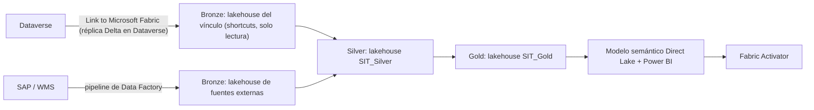

### 🎯 Objetivo
Decidir y defender la arquitectura de datos analítica de una organización con Dataverse y Power BI: cómo llegan los datos de Dataverse a la plataforma (Link to Microsoft Fabric o Azure Synapse Link for Dataverse), cómo se organizan en capas Medallion (Bronze→Silver→Gold) dentro de OneLake, qué variante de Direct Lake usa el modelo semántico y cuándo una alerta va en Fabric Activator, para crear una fuente única de verdad analítica con sus trade-offs escritos.

> **Cómo está organizado este módulo:** cada microlección trae el concepto, un ejercicio corto para decidir antes de construir, una práctica real en tu tenant y una tabla de **evidencia** con el dato exacto que observaste. Después viene **Decidir y defender** (el Caso Real con sus restricciones y una rúbrica), un **incidente** para diagnosticar con el síntoma primero y un **reto de transferencia**. Se apoya en Power BI y DAX de los Módulos 6 y 12.

> **Qué necesitas para las prácticas reales:** un ambiente de Dataverse con datos (el de la app de solicitudes de los niveles anteriores sirve), rol **System Administrator** en ese ambiente, un workspace de Fabric del que seas administrador y una capacidad de Fabric (de pago o de prueba) con la configuración del tenant que permite crear items de Fabric. Si no tienes capacidad de Fabric, haz las microprácticas, los ejercicios, **Decidir y defender**, el diagnóstico y el reto, y salta las prácticas reales. **Costo y limpieza:** la réplica que crea Link to Microsoft Fabric consume **capacidad de base de datos (Database) de Dataverse**; al terminar, quita las tablas que no necesitas o desvincula. Al desvincular se borra el lakehouse del vínculo, y la operación falla mientras otros items (un notebook programado, un pipeline, un modelo semántico) dependan de él: elimínalos o apúntalos a otro lado primero.

> **Capacidad, costo y licencias (verificado en Learn, 2026-11):**
> - **Empieza por la prueba gratuita de Fabric:** dura **60 días**, da una capacidad de prueba e incluye una prueba individual de Power BI; se inicia con **Start trial** en el administrador de cuenta (la foto de perfil, arriba a la derecha, en [app.fabric.microsoft.com](https://app.fabric.microsoft.com)) ([Learn: Fabric trial](https://learn.microsoft.com/fabric/fundamentals/fabric-trial)).
> - **Si usas una capacidad de pago:** una F-SKU se factura **por segundo, con un mínimo de un minuto**, mientras está encendida ([Learn: licencias de Fabric](https://learn.microsoft.com/fabric/enterprise/licenses)). Como orden de magnitud, una **F2** cuesta unos 0,36 USD por hora en algunas regiones, unos 260 USD al mes si la dejas encendida (compruébalo en la página de precios de Fabric para tu región). **Páusala** al terminar cada sesión: portal de Azure → **Microsoft Fabric** → tu capacidad → **Pause** → **Yes** ([Learn: pausar y reanudar](https://learn.microsoft.com/fabric/enterprise/pause-resume)); se reanuda con **Resume**.
> - **Power BI:** para crear el modelo semántico y el informe de la microlección 3 en tu workspace (fuera de **My workspace**) necesitas **Power BI Pro**, **Premium Per User** o una prueba individual de Power BI (la incluye la prueba de Fabric). Un modelo Direct Lake no puede estar en **My workspace**.
> - **Si tu Dataverse es un ambiente Developer:** su base de datos tiene un tope de **2 GB** ([Learn: Developer plan](https://learn.microsoft.com/power-platform/developer/plan)). La réplica de Link to Microsoft Fabric cuenta para esa capacidad, así que vincula solo las tres tablas de la microlección 1.

### 📖 Conceptos Clave
- **Microsoft Fabric:** plataforma analítica unificada de Microsoft que reúne en un solo entorno Data Factory (pipelines y dataflows), Data Engineering (lakehouses y notebooks Spark), Data Warehouse (SQL analítico), Data Science, Real-Time Intelligence y Power BI. Todos los workloads comparten el mismo almacenamiento (OneLake) y el mismo modelo de seguridad. Se adquiere como capacidad F-SKU (F2, F4… F2048); las capacidades P-SKU de Power BI Premium están en proceso de retiro, así que un diseño nuevo se basa en F-SKU. Las capacidades pequeñas permiten adopción gradual, pero los límites de Direct Lake (más abajo) dependen del tamaño de la capacidad.
- **Lakehouse:** arquitectura que combina el almacenamiento flexible y económico de un Data Lake con las capacidades de consulta SQL de un Data Warehouse, usando el formato Delta Lake para proveer transacciones ACID sobre los archivos. En Fabric, el Lakehouse tiene dos áreas: "Files" (archivos sin esquema, zona de aterrizaje) y "Tables" (tablas Delta registradas, accesibles vía SQL desde su **SQL analytics endpoint**). Una organización con 10 años de datos históricos en formatos dispares puede cargarlos en el área Files y transformarlos gradualmente a Tables estructuradas.
- **OneLake:** capa de almacenamiento única de Microsoft Fabric — análoga a OneDrive pero para datos analíticos. Todos los items de Fabric (lakehouses, warehouses, modelos semánticos) guardan sus datos en OneLake bajo una estructura por workspace. Distintos items pueden leer los mismos datos sin copiarlos, y los **shortcuts** permiten exponer en un lakehouse datos que viven en otro lado (otro lakehouse, ADLS Gen2, el almacenamiento de Dataverse) sin moverlos. OneLake es compatible con las APIs de ADLS Gen2, así que herramientas externas lo leen con rutas `abfss://`.
- **Medallion Architecture:** patrón de organización de datos en tres capas de calidad creciente. **Bronze:** datos crudos tal como llegan del sistema fuente, sin cambios; se usan para reprocesar si algo falla aguas abajo. **Silver:** datos limpios, validados, estandarizados y enriquecidos (tipos corregidos, duplicados eliminados, claves de negocio coherentes); son el input de todas las transformaciones de negocio. **Gold:** métricas y dimensiones orientadas al negocio, listas para Power BI; cada tabla Gold responde a una pregunta de negocio específica. El diseño que recomienda Microsoft en Fabric pone **cada capa en su propio lakehouse** (Gold también puede ser un warehouse), idealmente en workspaces separados, y usa shortcuts en Bronze en lugar de copiar datos que ya existen.
- **Link to Microsoft Fabric vs. Azure Synapse Link for Dataverse (no son sinónimos):**
  - **Link to Microsoft Fabric** es el mecanismo recomendado. Dataverse genera una réplica de las tablas seleccionadas en formato Delta parquet **dentro del almacenamiento de Dataverse** (cuenta para la capacidad Database de Dataverse) y crea en tu workspace de Fabric un lakehouse con **shortcuts** a esas tablas, más su SQL analytics endpoint. No necesitas una cuenta de almacenamiento propia ni pipelines. Los cambios pueden tardar **hasta una hora** en aparecer (también la sincronización inicial varía según el volumen); hay una sincronización de baja latencia en despliegue que se reconoce por la marca **Low-latency mode** en el vínculo. Se configura desde Power Apps en **Link data** > **Fabric Links**.
  - **Azure Synapse Link for Dataverse** (en el portal aparece como **Link to Data lake**, bajo **Other Links**; Microsoft anuncia que la marca "Azure Synapse Link" se retirará) exporta los datos a **tu propia** cuenta de Azure Data Lake Storage Gen2, opcionalmente conectada a un workspace de Azure Synapse, en CSV o en Delta. Sigue siendo válido cuando necesitas la copia en una cuenta de almacenamiento tuya. Un perfil existente con **Enable Parquet/Delta lake** se puede vincular a Fabric; uno en CSV o protegido con managed identity, hoy no.
- **Direct Lake:** modo de almacenamiento de los modelos semánticos de Power BI (requiere capacidad de Fabric) que carga las columnas directamente desde las tablas Delta de OneLake, sin importar los datos ni consultar con DirectQuery. Su "refresh" (*framing*) solo actualiza metadatos, por eso es casi instantáneo. Tiene dos variantes:
  - **Direct Lake on OneLake:** apunta directo al almacenamiento; **no** cae a DirectQuery (si una consulta supera un límite de la capacidad, falla); admite modelos compuestos con tablas Import y la seguridad de OneLake.
  - **Direct Lake on SQL:** pasa por el SQL analytics endpoint; puede usar vistas SQL y la seguridad (RLS/CLS/OLS) definida en el endpoint, y cae a DirectQuery para lo que Direct Lake no resuelve (vistas, ciertas reglas de seguridad, límites superados), con consultas más lentas.
  
  Limitaciones de diseño a tener en cuenta: columnas de tipo GUID o binario no se cargan (conviértelas a texto en Silver/Gold), las columnas calculadas que referencian tablas Direct Lake solo existen en preview para Direct Lake on OneLake, el modelo y el lakehouse deben estar en la misma región, y cada tamaño de capacidad tiene límites (*guardrails*) de archivos parquet, row groups y filas por tabla.
- **Azure Synapse Analytics → Microsoft Fabric:** Synapse Analytics es la plataforma de análisis de Azure con Synapse Spark, Synapse SQL (pools dedicados y serverless) y Synapse Pipelines. Microsoft publica una estrategia de migración de Synapse a Fabric y un **Migration Assistant** para llevar pools SQL dedicados a Fabric Data Warehouse. Para proyectos nuevos: Fabric. Para entornos con Synapse existente: migrar por workload, con shortcuts y pipelines de Fabric reemplazando piezas gradualmente. No hay una fecha de retiro de Synapse publicada en Learn a la fecha de verificación de este módulo.
- **Delta Lake format:** formato de tabla abierto que agrega transacciones ACID, control de versiones (time travel) y operaciones de upsert/merge/delete sobre archivos Parquet. En Fabric todas las tablas de lakehouse son Delta, escritas con la optimización V-Order por defecto. El log de transacciones (`_delta_log/`) permite consultar una versión anterior en Spark SQL: `SELECT * FROM silver_solicitud TIMESTAMP AS OF '2026-10-01'`, siempre que `VACUUM` (retención de 7 días por defecto) no haya borrado esos archivos.
- **Semantic Model (Power BI):** capa semántica centralizada que define medidas DAX, jerarquías, relaciones y descripciones de negocio sobre las tablas del Gold layer, reutilizable por múltiples reportes. Un modelo bien diseñado encapsula la lógica de negocio (¿qué significa "cliente activo"? ¿cómo se calcula la morosidad?) para que nadie la replique en cada reporte. La certificación del modelo en Power BI Service indica que es la fuente oficial de verdad.
- **Fabric Activator** (antes *Data Activator*): parte de Real-Time Intelligence que vigila datos y dispara acciones cuando se cumple una condición, sin código. Lee de eventstreams, eventos de Fabric y de Azure, informes y visuales de Power BI, Real-Time Dashboards y, en preview, reglas sobre consultas SQL de un Warehouse; sus acciones incluyen correo, Teams, flujos de Power Automate y ejecutar pipelines, notebooks o funciones de Fabric. Ejemplo: avisar al gerente de operaciones cuando el tiempo promedio de resolución supera las 4 horas.

**Diagrama: Medallion en OneLake con Dataverse (un lakehouse por capa)**



---

## 🧩 Microlección 1 — Cómo llega Dataverse a la plataforma analítica (≈50 min)

**El concepto:** hay tres formas de llevar Dataverse a analítica, y la decisión se toma por **dónde debe vivir la copia** y **cuánta frescura necesita el negocio**:

| Criterio | Link to Microsoft Fabric | Azure Synapse Link for Dataverse (Link to Data lake) | Copia propia (pipeline o dataflow) |
|---|---|---|---|
| Dónde vive la copia | Almacenamiento de Dataverse (capacidad Database), expuesta en Fabric por shortcuts | Tu cuenta de ADLS Gen2 | Donde la escribas |
| Infraestructura que mantienes | Ninguna (workspace y capacidad de Fabric) | Cuenta de almacenamiento y, si la usas, workspace de Synapse | El pipeline, su programación y sus errores |
| Frescura | Hasta una hora (baja latencia en despliegue) | Incremental, según la configuración del perfil | La que programes |
| Encaja cuando | El destino es Fabric y no hay requisito de copia propia | Se exige la copia en una cuenta propia o hay consumo fuera de Fabric | Solo necesitas pocas tablas transformadas o filtradas en origen |

**Ahora haz algo — micropráctica (8 min):** decide el mecanismo y las capas para una distribuidora con Dataverse y SAP → **[Elegir cómo llega Dataverse a Fabric y dónde va cada capa](/practica/ip-arq-022-elegir-link-a-fabric-y-capas)**.

**Práctica real (25 min) — crear el vínculo:**

1. En [make.powerapps.com](https://make.powerapps.com) selecciona tu ambiente y abre **Link data** en el panel izquierdo (si no lo ves, búscalo en **More**). Verás dos secciones: **Fabric Links** y **Other Links**.
2. Selecciona **+ New link** > **Link data via Fabric** (Learn lo marca como **Recommended**; en algunas páginas antiguas de Learn aparece como **Fabric link**). También se puede iniciar desde **Tables** > **Analyze** > **Analyze in Fabric**, que solo crea vínculos de Fabric.
3. Recorre el asistente: **Getting started**; **Setup Configuration**, donde eliges el workspace de Fabric y la conexión (la autenticación recomendada es **Workspace identity**; también admite **Service Principal** y **Organizational Account**); la selección de tablas, donde aparecen marcadas todas las tablas con **Track changes** activado (desmarca las que no necesites: cada tabla seleccionada consume capacidad); y **Review and create** > **Finish**.
4. Deja solo `sit_solicitud`, `account` y `contact` (o las tablas equivalentes de tu app). Una tabla sin **Track changes** no se puede vincular: actívalo en sus propiedades si hace falta.
5. Espera a que el vínculo quede en estado **Active**. En Fabric, el lakehouse creado muestra las tablas como no identificadas hasta que termina la sincronización inicial. Con **View in Microsoft Fabric** abres el lakehouse; con **Manage tables** agregas o quitas tablas; con **Refresh Fabric tables** fuerzas la actualización de metadatos.
6. Anota el **ID** del workspace y del lakehouse (aparecen en la URL de Fabric). No construyas nada que dependa del **nombre** del lakehouse del vínculo: Microsoft no garantiza que su patrón de nombres se mantenga.
7. En el Power Platform admin center revisa la capacidad de **Database** del ambiente antes de vincular y un día después.

**Evidencia a reportar:**

| Campo | Tu valor |
|---|---|
| Estado del vínculo, cuántas tablas y si muestra **Low-latency mode** | ___ |
| ID del workspace y del lakehouse del vínculo | ___ |
| Tiempo desde **Finish** hasta ver filas en `sit_solicitud` desde el SQL analytics endpoint | ___ |
| Capacidad Database del ambiente antes y después | ___ |

---

## 🧩 Microlección 2 — Medallion en OneLake: una capa por lakehouse (≈70 min)

**El concepto:** el lakehouse del vínculo ya es tu **Bronze** de Dataverse: son shortcuts de solo lectura a la réplica. Si escribes tablas Silver dentro de él, mezclas capas, quedas atado a un lakehouse que se borra al desvincular, y el desvínculo falla mientras tus notebooks dependan de él. Por eso Silver y Gold viven en lakehouses propios (`SIT_Silver`, `SIT_Gold`), y los notebooks leen y escriben por ruta OneLake con IDs, no por nombre.

Tres decisiones de Silver que suelen salir mal en datos de Dataverse:
- **`statecode = 0` significa "activo", no "no borrado".** Filtrar en Silver pierde la historia de lo inactivo; mejor derivar una columna `es_activa` y decidir el filtro en Gold.
- **Las fechas de sistema ya están en UTC.** `createdon` y `modifiedon` se guardan en UTC; si conviertes, es de UTC a la hora local para reportar (`from_utc_timestamp`), nunca al revés.
- **Los valores de una Choice personalizada no son 1, 2, 3.** Usa los valores reales de tu Choice (en una Choice del publisher `sit` suelen empezar por el prefijo de valor del publisher, por ejemplo `100000000`); compruébalos en la definición de la columna o en la tabla de metadatos de opciones que trae el vínculo (`OptionsetMetadata` / `GlobalOptionsetMetadata`).

**Ahora haz algo (5 min):** di en qué capa va cada transformación: (a) quitar columnas técnicas de Dataverse que nadie analiza; (b) "total de solicitudes por categoría y mes"; (c) traer la tabla de SAP tal cual llega; (d) convertir un GUID de cuenta a texto para que Direct Lake lo cargue; (e) "solo solicitudes activas" para el tablero de operación.

**Clave:** (a) Silver. (b) Gold. (c) Bronze. (d) Silver (o como tarde en Gold, antes del modelo). (e) Gold: Silver conserva todo y marca `es_activa`.

**Práctica real (45 min) — Bronze → Silver → Gold:**

1. En el mismo workspace crea dos lakehouses: `SIT_Silver` y `SIT_Gold`. Al crearlos, la casilla **Lakehouse schemas** viene marcada por defecto: el lakehouse nace con el esquema **dbo**, que aparece bajo **Tables**, y las tablas que escribes sin indicar esquema van a **dbo** ([Learn: lakehouse schemas](https://learn.microsoft.com/fabric/data-engineering/lakehouse-schemas)). Déjala marcada. En producción, Microsoft recomienda además un workspace por capa; aquí uno basta.
2. Crea un notebook y copia la ruta ABFS de cada lakehouse desde su explorador (menú **…** > **Properties**):
   - **Lakehouse del vínculo (Bronze):** abre **Properties** de una de sus tablas (por ejemplo `sit_solicitud`), copia la **ABFS path** y quítale el nombre de la tabla del final. Lo que queda es la carpeta que contiene las tablas, con o sin `/dbo`, según cómo creó Dataverse ese lakehouse.
   - **`SIT_Silver` y `SIT_Gold`:** todavía no tienen tablas, así que copia la **ABFS path** del esquema **dbo** que aparece bajo **Tables**. Termina en `/Tables/dbo`.

   Las rutas tienen la forma `abfss://<id-del-workspace>@onelake.dfs.fabric.microsoft.com/<id-del-lakehouse>/Tables/dbo` (o `.../Tables` en un lakehouse sin esquemas). Copiarlas evita adivinar.
3. Pega y ejecuta. Ajusta los nombres de columna a los de tu tabla: `sit_categoria`, `sit_presupuesto` y el lookup a cuenta `sit_cuentaid` son los del ejemplo.

```python
# Notebook de PySpark: Bronze (lakehouse del vínculo) -> Silver (SIT_Silver)
from pyspark.sql import functions as F
from delta.tables import DeltaTable

# Rutas copiadas de Properties (IDs, no nombres): no dependen de cómo se llame el lakehouse del vínculo
# Bronze: la ABFS path de una tabla del vínculo sin el nombre de la tabla (con o sin /dbo, como salga)
BRONZE_TABLES = "abfss://<id-del-workspace>@onelake.dfs.fabric.microsoft.com/<id-del-lakehouse-del-vinculo>/Tables"
# Silver: la ABFS path del esquema dbo (lakehouse con esquemas, la opción por defecto)
SILVER_TABLES = "abfss://<id-del-workspace>@onelake.dfs.fabric.microsoft.com/<id-de-SIT_Silver>/Tables/dbo"

df_bronze = spark.read.format("delta").load(f"{BRONZE_TABLES}/sit_solicitud")

# Validación mínima antes de transformar: falla a la vista, no en silencio
total = df_bronze.count()
sin_id = df_bronze.filter(F.col("sit_solicitudid").isNull()).count()
if total == 0 or sin_id > 0:
    raise ValueError(f"Bronze inesperado: {total} filas, {sin_id} sin sit_solicitudid")

df_silver = (df_bronze
    .withColumn("es_activa", F.col("statecode") == 0)                                   # 0 = Active; no filtramos aquí
    .withColumn("fecha_creacion_local", F.from_utc_timestamp(F.col("createdon"), "America/Bogota"))  # createdon ya es UTC
    .withColumn("categoria_analisis",
        F.when(F.col("sit_categoria").isin([100000000, 100000001]), "Hardware")       # usa los valores reales de tu Choice
         .when(F.col("sit_categoria") == 100000002, "Software")
         .otherwise("Otros"))
    .withColumn("cuenta_id", F.col("sit_cuentaid").cast("string"))                     # GUID como texto para Direct Lake
    .select("sit_solicitudid", "es_activa", "createdon", "fecha_creacion_local",
            "categoria_analisis", "cuenta_id", "sit_presupuesto", "modifiedon")
    .dropDuplicates(["sit_solicitudid"])
)

silver_path = f"{SILVER_TABLES}/silver_solicitud"
if DeltaTable.isDeltaTable(spark, silver_path):
    (DeltaTable.forPath(spark, silver_path).alias("t")
        .merge(df_silver.alias("s"), "t.sit_solicitudid = s.sit_solicitudid")
        .whenMatchedUpdateAll()
        .whenNotMatchedInsertAll()
        .execute())
else:
    df_silver.write.format("delta").save(silver_path)   # primera ejecución: crea la tabla

df_cuentas = (spark.read.format("delta").load(f"{BRONZE_TABLES}/account")
    .select(F.col("accountid").cast("string").alias("cuenta_id"),
            F.col("name").alias("nombre_cliente"),
            "address1_country")
    .dropDuplicates(["cuenta_id"]))
df_cuentas.write.format("delta").mode("overwrite").save(f"{SILVER_TABLES}/silver_cliente")

print(f"Silver actualizado: {df_silver.count()} solicitudes, {df_cuentas.count()} clientes")
```

```python
# Gold (SIT_Gold): una tabla por pregunta de negocio, lista para Power BI
from pyspark.sql import functions as F

# Las mismas rutas del esquema dbo que copiaste de Properties (quita /dbo si el lakehouse no tiene esquemas)
SILVER_TABLES = "abfss://<id-del-workspace>@onelake.dfs.fabric.microsoft.com/<id-de-SIT_Silver>/Tables/dbo"
GOLD_TABLES = "abfss://<id-del-workspace>@onelake.dfs.fabric.microsoft.com/<id-de-SIT_Gold>/Tables/dbo"

df_sol = spark.read.format("delta").load(f"{SILVER_TABLES}/silver_solicitud")
df_cli = spark.read.format("delta").load(f"{SILVER_TABLES}/silver_cliente")

# Pregunta: "¿cuántas solicitudes activas y cuánto presupuesto por categoría, cliente y mes?"
df_gold = (df_sol.filter(F.col("es_activa"))
    .join(df_cli, "cuenta_id", "left")
    .withColumn("mes_creacion", F.date_format("fecha_creacion_local", "yyyy-MM"))
    .groupBy("categoria_analisis", "nombre_cliente", "address1_country", "mes_creacion")
    .agg(F.count("sit_solicitudid").alias("total_solicitudes"),
         F.sum("sit_presupuesto").alias("presupuesto_total"),
         F.max("modifiedon").alias("modifiedon")))   # última modificación del grupo: sirve para vigilar la frescura de Gold

(df_gold.write.format("delta").mode("overwrite")
    .option("overwriteSchema", "true")
    .save(f"{GOLD_TABLES}/gold_solicitudes_resumen"))
```

4. Programa el notebook (**Schedule**) una vez al día. En el Caso Real, eso es lo que da "datos del día anterior".

**Evidencia a reportar:**

| Campo | Tu valor |
|---|---|
| Filas en Bronze, en `silver_solicitud` y en `gold_solicitudes_resumen` | ___ |
| Valores reales de tu Choice que mapeaste a cada categoría | ___ |
| Una fila de Gold (categoría, cliente, mes, total, presupuesto) | ___ |
| Qué pasa si vuelves a ejecutar el notebook de Silver (¿se duplican filas?) y por qué | ___ |

---

## 🧩 Microlección 3 — Direct Lake: elegir la variante del modelo semántico (≈40 min)

**El concepto:** Direct Lake no es "Import sin refresh" sin condiciones. La variante se decide por **seguridad, vistas y qué quieres que pase cuando se supera un límite**:

| Necesitas… | Variante |
|---|---|
| El rendimiento más predecible, sin caídas a DirectQuery, o mezclar tablas Direct Lake con tablas Import | Direct Lake on OneLake |
| Usar la seguridad RLS/CLS/OLS definida en el SQL analytics endpoint (modo delegado) | Direct Lake on SQL |
| Tablas basadas en vistas SQL | Direct Lake on SQL (esas tablas caen a DirectQuery); en Direct Lake on OneLake, las vistas entran como tablas Import o DirectQuery de un modelo compuesto |

**Ahora haz algo (5 min):** para cada requisito elige variante: (a) "Finanzas definió RLS por país en el SQL analytics endpoint y no quiere duplicarla en el modelo"; (b) "el tablero ejecutivo nunca debe volverse lento sin aviso; si algo excede la capacidad, preferimos que falle y nos enteremos"; (c) "queremos una dimensión de presupuesto en Import junto a los hechos en Direct Lake". **Clave:** (a) on SQL; (b) on OneLake; (c) on OneLake (modelo compuesto).

**Práctica real (30 min):**

1. Abre el **SQL analytics endpoint** de `SIT_Gold` y selecciona **New semantic model**. El cuadro te deja elegir entre **Direct Lake on OneLake** y **Direct Lake on SQL** (por defecto propone una según el modo de acceso del endpoint). Elige **Direct Lake on OneLake** y la tabla `gold_solicitudes_resumen`. Otras formas de crearlo: desde Power BI Desktop, o en Power BI Service con **Create** > **OneLake catalog** (ambas solo crean Direct Lake on OneLake).
2. Agrega las medidas:

```dax
// DAX sobre el Gold Layer (ya pre-calculado, las medidas son simples)
Total Solicitudes = SUM(gold_solicitudes_resumen[total_solicitudes])

Presupuesto Promedio por Cliente =
DIVIDE(
    SUM(gold_solicitudes_resumen[presupuesto_total]),
    DISTINCTCOUNT(gold_solicitudes_resumen[nombre_cliente]),
    0
)
```

3. Crea un informe con un visual de **Total Solicitudes** por `mes_creacion`. Vuelve a ejecutar el notebook de Gold y refresca el modelo: el refresh de Direct Lake (framing) solo actualiza metadatos y tarda segundos.
4. Busca en Learn los *guardrails* de Direct Lake de tu SKU (archivos parquet, row groups y filas por tabla) y compáralos con tu tabla Gold.

**Evidencia a reportar:**

| Campo | Tu valor |
|---|---|
| Variante de Direct Lake elegida y por qué | ___ |
| Duración del refresh del modelo después de reescribir Gold | ___ |
| SKU de tu capacidad y su límite de filas por tabla para Direct Lake | ___ |
| Una columna que tuviste que convertir o excluir para que el modelo cargue | ___ |

---

## 🧩 Microlección 4 — Fabric Activator: la alerta va donde están los datos (≈30 min)

**El concepto:** no toda alerta necesita Activator. Si es "mándame el informe cada lunes", es una suscripción de Power BI; si es "cuando se cree un registro en Dataverse, avisa", es un flujo de Power Automate sobre Dataverse. Activator sirve cuando la condición se evalúa **sobre datos analíticos o de streaming** (una métrica de un visual, un evento de un eventstream) y debe dispararse sola, sin que nadie mire el tablero.

**Ahora haz algo (5 min):** (a) "avisar en Teams cuando el promedio de días abiertos del visual supere 4"; (b) "enviar el PDF del tablero al comité cada lunes"; (c) "cuando una solicitud urgente se cree en Dataverse, asignarla a la cola de urgentes"; (d) "cuando la temperatura de un sensor del eventstream pase de 8 °C, ejecutar un pipeline". **Clave:** (a) Activator sobre el visual de Power BI; (b) suscripción de Power BI; (c) Power Automate o una regla de Dataverse (es transaccional, no analítica); (d) Activator sobre el eventstream, con acción de ejecutar pipeline.

**Práctica real (opcional, 20 min):** en el informe de la Microlección 3 crea una regla de Activator sobre el visual de **Total Solicitudes**: condición "cuando supere un umbral que elijas", acción correo o Teams a ti mismo. Escribe antes la especificación (no es sintaxis de ningún producto):

```text
Objeto vigilado: Total Solicitudes por mes_creacion (visual del informe)
Condición:      el valor del mes actual supera 50
Acción:         mensaje de Teams a la cola de supervisores con el valor y el mes
Dueño:          supervisor de operaciones (quien recibe y quien mantiene la regla)
```

| Campo | Tu valor |
|---|---|
| Origen de datos de la regla y condición | ___ |
| Acción y destinatario | ___ |
| Una alerta de tu organización que hoy se hace con Activator pero debería ser un flujo, o al revés | ___ |

---

## 🧭 Decidir y defender — la plataforma de datos del retailer

Este es el diseño del **Caso Real** de abajo, con sus restricciones. No hay pasos: hay que decidir y justificar.

**Restricciones:**

1. Dynamics 365 (Dataverse) es el CRM; SAP y el WMS están en el centro de datos del cliente.
2. El reporte mensual debe estar disponible el día 1 y las decisiones de reabastecimiento usan datos del día anterior.
3. El equipo de BI escribe SQL y DAX; tiene un solo ingeniero de datos que sabe PySpark.
4. Auditoría pide poder reconstruir cualquier cifra del reporte desde el dato crudo de origen.
5. La capacidad de Fabric aprobada es pequeña y el presupuesto no permite subirla este año.

**Entrega:** escribe **ADR-DAT-001 "Plataforma de datos"** (una página): mecanismo de llegada de cada fuente, lakehouses y workspaces por capa, qué se transforma en cada capa, variante de Direct Lake del modelo, frecuencia de actualización y monitoreo de frescura, y qué **no** harías y por qué. Contrasta tu decisión con esta rúbrica:

| Criterio | Qué demuestra que lo cumples |
|---|---|
| Llegada de cada fuente justificada | Dataverse con Link to Microsoft Fabric (sin copia propia que mantener); SAP y WMS con pipelines y gateway de datos local hacia un Bronze separado |
| Capas separadas y trazables | Bronze sin cambios (shortcuts del vínculo y aterrizaje de SAP/WMS), Silver y Gold en lakehouses propios; cualquier cifra de Gold se reconstruye desde Bronze |
| Frescura acorde a la promesa | Reconoces que el vínculo puede tardar hasta una hora y que "datos de ayer" se cumple con un notebook diario, no con "tiempo real" |
| Modelo que cabe en la capacidad | Variante de Direct Lake elegida con criterio, Gold agregado para no superar los guardrails de una capacidad pequeña |
| Operable por este equipo | Lo que hace el único ingeniero de PySpark está acotado; el resto se hace en SQL (SQL analytics endpoint) y DAX |
| Trade-off escrito | Nombras qué empeora con tu diseño (latencia del vínculo, capacidad Database de Dataverse consumida, más lakehouses que gobernar…) y por qué lo aceptas |

| Campo | Tu valor |
|---|---|
| Mecanismo de llegada de cada fuente | ___ |
| Lakehouses y workspaces por capa | ___ |
| Variante de Direct Lake y por qué | ___ |
| Cómo detectas que el dato de ayer no llegó | ___ |
| Tu trade-off principal | ___ |

---

## 🔧 Diagnosticar — "el tablero dejó de moverse y todo está en verde"

Desde el día 14, el tablero de presupuesto muestra las mismas cifras todos los días. El notebook de Silver/Gold termina en verde cada noche, el refresh del modelo también, y nadie tocó el notebook. El único cambio registrado ese día fue en Dataverse: un maker cambió la precisión de la columna `sit_presupuesto`. Antes de abrir nada, escribe **tres hipótesis** (una sobre el vínculo, una sobre el notebook y una sobre el modelo) y qué evidencia confirmaría o descartaría cada una. Después resuelve el caso:

**[Diagnosticar: el tablero congelado con todo en verde](/practica/ip-arq-023-tablero-congelado-todo-en-verde)**

| Campo | Tu valor |
|---|---|
| Tus tres hipótesis y la evidencia que revisarías para cada una | ___ |
| La primera evidencia que contradice "los datos están al día" | ___ |
| Causa raíz, corrección y una medida que lo detecte la próxima vez | ___ |

---

## 🔁 Reto de transferencia — Otro cliente, otras restricciones: decide y defiende

**Requisito nuevo:** una red de hospitales con Dataverse quiere su plataforma analítica. Restricciones: el regulador exige que la copia analítica de los datos esté en una **cuenta de almacenamiento propiedad del hospital**, en su suscripción y con su propia retención; el equipo de datos trabaja en notebooks de Fabric y Power BI; el área de seguridad ya definió **RLS por hospital** en el SQL analytics endpoint y algunas tablas del modelo son **vistas SQL**; y el gerente de camas quiere un aviso cuando la ocupación de un hospital pase del 90 %.

**Micropráctica de transferencia (8 min):** **[Transferir: plataforma analítica para una red de hospitales](/practica/ip-arq-024-transferir-red-de-hospitales)**.

**Después, sin pasos:** escribe **ADR-DAT-002** (una página) con el mecanismo de llegada y su formato, cómo se conecta con Fabric, la variante de Direct Lake y la alerta. Usa la misma rúbrica de **Decidir y defender** y agrega un criterio: el requisito del regulador se cumple literalmente.

| Campo | Tu valor |
|---|---|
| Mecanismo de llegada, formato y por qué no Link to Microsoft Fabric directo | ___ |
| Cómo llegan esos datos a los notebooks de Fabric | ___ |
| Variante de Direct Lake y qué pasa con las vistas y la RLS | ___ |
| Origen y acción de la alerta de ocupación | ___ |
| Una opción tentadora que descartaste y por qué | ___ |

---

### 💼 Caso Real de Negocio
**Empresa:** Retailer con 50 tiendas, datos en D365, SAP, y WMS  
**Problema:** El equipo de BI tardaba 3 días en producir el reporte mensual de ventas porque debían extraer de 3 sistemas, limpiar en Excel y consolidar manualmente. Decisiones tomadas con datos desactualizados.  
**Solución:** Fabric Lakehouse como single source of truth. Dataverse Link exporta CRM en tiempo real. ADF sincroniza SAP y WMS al Bronze layer. Notebooks Silver/Gold automatizan la transformación. DirectLake permite que Power BI lea datos del día anterior sin importación.  
**Resultado:** Reporte mensual: de 3 días a disponible el día 1 del mes. Decisiones de reabastecimiento basadas en datos del día anterior (antes eran de hace 1 semana).

### ✅ Buenas Prácticas
- Link to Microsoft Fabric es la integración preferida para Dataverse — sin código, sin pipelines adicionales y sin cuenta de almacenamiento propia; cuenta en la capacidad Database de Dataverse, así que vincula solo las tablas que se analizan
- Azure Synapse Link for Dataverse (Link to Data lake) solo cuando hay un requisito real de copia en una cuenta propia; en ese caso, en Delta y no en CSV, para poder vincularlo a Fabric
- Bronze = sin cambios (crudo), Silver = curado, Gold = orientado al negocio; un lakehouse por capa y el lakehouse del vínculo como Bronze de solo lectura
- Referenciar lakehouses por ID en las rutas OneLake, nunca por el nombre del lakehouse del vínculo
- Conservar en Silver lo inactivo con una marca (`es_activa`) y decidir los filtros en Gold
- Direct Lake sobre Gold, con la variante elegida por seguridad y comportamiento ante límites; Gold agregado para respetar los guardrails de la capacidad
- Diseñar el Gold layer pensando en Power BI — desnormalizar para evitar joins complejos en DAX
- Monitorear la frescura con el dato, no con el estado del job: la marca de tiempo más reciente en Bronze (`SinkModifiedOn`) y en Gold
- Gobernar los cambios de esquema en Dataverse: cambiar el tipo o la precisión de una columna ya vinculada rompe la sincronización

### ⚠️ Errores Comunes
| Error | Causa | Solución |
|-------|-------|----------|
| Las consultas de Direct Lake caen a DirectQuery (o fallan) en producción | En Direct Lake on SQL, una tabla basada en una vista, reglas de seguridad del endpoint o un límite (guardrail) de la capacidad superado provocan el fallback; en Direct Lake on OneLake no hay fallback y la consulta falla | Revisar qué tablas son vistas y qué límites supera la tabla (archivos, row groups, filas); mantener las tablas Gold (`OPTIMIZE`, V-Order, tamaño de archivo adecuado), agregar más en Gold o elegir la variante según el comportamiento que quieres |
| Los datos de Dataverse llegan con más retraso del que se prometió | Se prometió "tiempo real" o 5-15 minutos, pero el vínculo puede tardar hasta una hora, y un cambio de metadatos puede retrasarlo hasta otra hora | Prometer frescura según la documentación del vínculo; monitorear el estado en **Link data** > **Fabric Links** (o **Other Links** si es un Azure Synapse Link existente) y alertar si `SinkModifiedOn` más reciente supera el umbral acordado |
| La sincronización de una tabla falla para siempre después de un cambio en Dataverse | Se cambió el tipo de dato o la precisión de una columna ya vinculada (borrarla y recrearla con el mismo nombre tampoco funciona) | Quitar la tabla del vínculo y volver a agregarla en **Manage tables**; gobernar los cambios de esquema de tablas vinculadas en ALM |
| El desvínculo de Fabric falla o, al lograrlo, se pierden tablas Silver | Se escribieron tablas Silver dentro del lakehouse del vínculo o hay items que dependen de él | Silver y Gold en lakehouses propios; antes de desvincular, revisar el lineage del workspace y quitar las dependencias |
| Notebooks Silver fallan en producción aunque funcionaron en desarrollo | Los datos de producción tienen valores nulos, tipos inesperados o volúmenes que no existían en DEV | Agregar validaciones de datos al inicio de cada notebook (contar nulos, verificar tipos) y fallar con un mensaje claro en vez de silenciar errores |
| Gold layer rediseñado múltiples veces porque Power BI pide cambios | El Gold se diseña desde la perspectiva técnica de Spark, no desde las preguntas de negocio | Diseñar el Gold layer empezando por los reportes: ¿qué preguntas debe responder? → esas preguntas definen las columnas y agregaciones del Gold |

### 🧪 Criterios de Validación
- [ ] Elegí entre Link to Microsoft Fabric, Azure Synapse Link for Dataverse y una copia propia con un criterio explícito de dónde vive la copia y qué frescura se necesita
- [ ] Link to Microsoft Fabric configurado y en estado **Active**, con las tablas, los IDs y la capacidad Database registrados en la evidencia
- [ ] Silver y Gold en lakehouses propios, leídos y escritos por ruta OneLake con IDs
- [ ] Notebook Bronze→Silver con validación inicial, fechas tratadas como UTC, valores reales de la Choice y merge idempotente
- [ ] Gold layer con métricas de negocio pre-calculadas que responden a una pregunta concreta
- [ ] Modelo semántico Direct Lake creado con una variante justificada, y sé qué pasa cuando se supera un límite en cada variante
- [ ] Sé cuándo una alerta va en Fabric Activator, en una suscripción de Power BI o en Power Automate
- [ ] ADR-DAT-001 contrastado con la rúbrica de **Decidir y defender**, con un trade-off escrito
- [ ] Diagnostiqué el tablero congelado y completé el reto de transferencia de la red de hospitales

---
