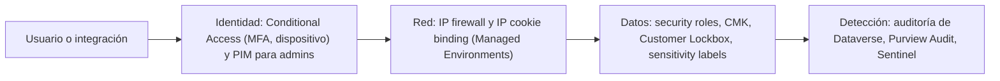

> **☁️ ¿Nunca usaste Azure Portal?** Lee primero [Fundamentos de Azure](/recursos/fundamentos-azure)
> — suscripción, resource group, RBAC y costos, antes de las actividades con Azure Key Vault y
> Privileged Identity Management (PIM) de Microsoft Entra ID de este módulo.

*Lectura: 22-28 min · Con práctica: unos 165 min, mejor en dos sesiones (la primera hasta la Microlección 2; la segunda, de la 3 al final). La primera vez, cuenta entre una vez y media y el doble.*

### 🎯 Objetivo
Implementar una postura de seguridad Zero Trust para Power Platform: clasificación de datos con Microsoft Purview, Customer-Managed Keys, Privileged Identity Management para administradores, auditoría avanzada con Microsoft Sentinel, y cumplimiento regulatorio documentado.

> **Cómo está organizado este módulo:** es un módulo de decisión, así que aquí "construir sin pasos" significa **decidir y defender**: ante un cliente con un riesgo, un regulador y un presupuesto, eliges qué controles activas, escribes por qué y lo contrastas con criterios explícitos. No hay una única respuesta correcta; la evidencia es tu decisión escrita con sus razones. Cada microlección trae un concepto breve, una micropráctica con feedback inmediato y una práctica con **evidencia** (el dato exacto que viste en el portal o en tu decisión). Después diagnosticarás integraciones que fallan tras activar un control de red, a partir del síntoma, y cerrarás con un reto de transferencia en un banco.
>
> **Antes de empezar, necesitas:**
> - Acceso al [Power Platform Admin Center](https://admin.powerplatform.microsoft.com) como **Power Platform Administrator** y un ambiente **Sandbox** o **Developer** de prueba que ya sea Managed Environment (lo activaste en el Módulo 33). **No uses PROD.**
> - Para Conditional Access y PIM, el [Microsoft Entra admin center](https://entra.microsoft.com) con un rol de administrador. Conditional Access exige Microsoft Entra ID P1 y PIM exige P2 (o Microsoft Entra ID Governance).
> - Varias funciones de este módulo (IP firewall, Customer-managed key, Customer Lockbox) exigen, además de Managed Environments, una licencia de cumplimiento tipo Microsoft 365 E5/A5/G5. Un tenant de prueba casi nunca la tiene: cada práctica que la necesita tiene una **variante en papel**, y la de la Microlección 3 es en papel para todos.
> - Haber hecho los Módulos 16 (seguridad y administración), 31 y 33.

### 📖 Conceptos Clave
Un mapa rápido; cada pieza se practica en su microlección.

- **Zero Trust:** modelo de seguridad basado en el principio "Nunca confiar, siempre verificar" — a diferencia del modelo perimetral tradicional (confiar en todo dentro de la red corporativa), Zero Trust requiere verificar explícitamente la identidad del usuario, validar el estado del dispositivo y aplicar mínimo privilegio en cada acceso, independientemente de la ubicación de red. Se apoya en identidad (Microsoft Entra ID + MFA + Conditional Access), dispositivos (cumplimiento en Intune) y datos (Purview + data policies). Para Power Platform significa que ningún usuario, ni siquiera un admin, tiene acceso permanente a producción sin justificación verificada.
- **Microsoft Purview:** plataforma de gobierno y cumplimiento de datos. Para Power Platform importan tres piezas: el **Data Map** (registra un ambiente de Dataverse como origen, lo escanea y clasifica columnas; los resultados se ven en el Unified Catalog), **Audit** (la búsqueda de auditoría donde llegan los registros de actividad de Power Platform) e **Information Protection** (las sensitivity labels). Compliance Manager y eDiscovery completan la plataforma.
- **Sensitivity Labels:** clasificaciones de confidencialidad (Público, Interno, Confidencial, Altamente Confidencial) creadas en el portal de Purview. En Power BI la etiqueta **no** cambia quién puede ver el contenido en el servicio; lo que hace es acompañar al dato cuando se exporta: el archivo de Excel, PowerPoint, PDF o .pbix exportado lleva la etiqueta y, si la etiqueta cifra, queda protegido. No se aplica a las exportaciones a .csv. Las etiquetas no deciden "desde qué red" se exporta: eso es Conditional Access.
- **Customer-Managed Keys (CMK):** el cliente cifra los datos de Dataverse con su propia clave en Azure Key Vault en lugar de la clave gestionada por Microsoft. Solo se aplica en Managed Environments y exige licencia de cumplimiento. La clave debe ser RSA de 2048 o 3072 bits, en un Key Vault con soft-delete y purge protection, y se asigna a ambientes mediante una **enterprise policy** creada en Azure. Mientras se cifra, el ambiente queda deshabilitado (puede tardar hasta cuatro días). Si la clave se revoca o expira, el ambiente queda bloqueado y nadie, ni el soporte de Microsoft, puede acceder; puede haber pérdida de datos. **Sí es reversible**: se puede volver a la clave gestionada por Microsoft.
- **Customer Lockbox:** cuando un ingeniero de Microsoft necesita acceder a los datos del cliente para resolver un caso de soporte, el cliente aprueba o rechaza la solicitud. Solo se aplica en Managed Environments; una solicitud no aprobada en cuatro días expira y el acceso aprobado dura ocho horas y no se puede revocar. No aplica a requerimientos legales externos.
- **PIM (Privileged Identity Management):** funcionalidad de Microsoft Entra ID P2 que convierte los roles privilegiados (Global Administrator, Power Platform Administrator) de permanentes a "elegibles" — el administrador activa el rol cuando lo necesita, con justificación, MFA y, si se configura, aprobación; el acceso expira solo (entre 1 y 24 horas). Ojo con Power Platform: un Power Platform Administrator **ya no** recibe automáticamente System Administrator en cada ambiente; debe autoasignárselo (**Membership** → **Add me**) y, con PIM, ese rol se le retira cuando expira la asignación.
- **Microsoft Sentinel:** servicio SIEM (Security Information and Event Management) y SOAR (Security Orchestration and Automated Response) cloud-native de Azure. Para Power Platform se instala la solución **Microsoft Business Applications**, cuyos conectores llevan los registros a tablas de Log Analytics: `PowerPlatformAdminActivity` (actividad administrativa y, desde octubre de 2024, también la de Power Apps, data policies y conectores) y `DataverseActivity` (actividad sobre datos de Dataverse). Trae reglas de análisis listas (eliminación masiva de registros, actividad de empleados que se van, Power Apps desde geografías no autorizadas) que se ajustan antes de crear las propias.
- **Conditional Access:** motor de políticas de Microsoft Entra ID que evalúa cada inicio de sesión y decide si lo permite, exige MFA o lo bloquea, según el usuario, el dispositivo, la red, la aplicación y el riesgo. Para las apps de Dataverse el recurso a seleccionar es **Common Data Service** (Microsoft Dataverse); los flujos incrustados necesitan además **Microsoft Flow Service**. Se evalúa al autenticar: bloquear no corta una sesión ya abierta hasta que caduque. Siempre se activa primero en **Report-only**.
- **IP firewall e IP cookie binding:** dos controles de red de Managed Environments. El **IP firewall** solo deja entrar a Dataverse desde rangos de IP y service tags permitidos, y tiene un modo **audit-only** para observar antes de bloquear. El **IP cookie binding** ata la cookie de sesión a la IP con la que se inició, para que una cookie robada no sirva desde otra red.
- **CASB (Cloud Access Security Broker):** Microsoft Defender for Cloud Apps actúa como intermediario entre usuarios y aplicaciones cloud, dando visibilidad de shadow IT (qué apps cloud usan los empleados fuera del control IT) y aplicando políticas de acceso en tiempo real. Se integra con Conditional Access para aplicar controles granulares por aplicación.
- **Auditoría y registros de actividad:** hay dos capas distintas. La **auditoría de Dataverse** registra cambios en los datos (se activa por ambiente, por tabla y por columna; su retención se configura y por defecto es indefinida, y consume capacidad de Log). Los **registros de actividad** de Power Platform (incluidas las lecturas de Dataverse con **Read logs**) llegan a **Microsoft Purview Audit**, solo desde ambientes de producción: Audit (Standard) los conserva 180 días y Audit (Premium) hasta un año por defecto (hasta diez con un add-on). Para retener más o correlacionar, se envían a Sentinel.
- **Data Exfiltration prevention:** conjunto de controles para prevenir que datos sensibles de Dataverse salgan por canales no autorizados: data policies (bloquear conectores que envían datos fuera), tenant isolation (Módulo 33), Managed Environments con límites de sharing, Conditional Access (bloquear desde dispositivos no gestionados), sensitivity labels (proteger lo que se exporta) y reglas de Sentinel (alertar sobre lecturas masivas). Ningún control individual es suficiente; la defensa en profundidad requiere todos los niveles activos.

**Diagrama: dónde actúa cada control en un acceso a Dataverse**



### 👨‍💻 Actividades Prácticas

## 🧩 Microlección 1 — Cada amenaza con su control

**¿Qué vas a aprender?** A asociar cada amenaza concreta (cookie robada, administrador permanente, lectura masiva, acceso desde una red no corporativa, soporte de Microsoft accediendo a datos) con el control que la mitiga, y a reconocer los controles que suenan bien pero no cubren esa amenaza.

**¿Por qué existe esto?** El error más caro en seguridad enterprise no es olvidar un control, sino activar uno que no cubre el riesgo y dar el problema por resuelto. En el Caso Real de este módulo, CMK no habría impedido que un ex-empleado con permisos legítimos descargara datos: eso lo detecta una regla sobre los registros de actividad.

| Amenaza | Control principal | Lo que **no** la cubre |
|---|---|---|
| Alguien reutiliza una cookie de sesión robada desde otra red | IP cookie binding | CMK, sensitivity labels |
| Un admin tiene System Administrator permanente en PROD | PIM con activación justificada y el rol de System Administrator autoasignado solo cuando hace falta | IP firewall |
| Un usuario legítimo lee miles de registros en su último día | Read logs en Purview + regla en Sentinel sobre `DataverseActivity` | CMK (el usuario tiene permiso; los datos se le descifran) |
| Acceso a PROD desde fuera de la red corporativa | IP firewall (red) y Conditional Access con ubicaciones (identidad) | Límites de sharing |
| Un ingeniero de Microsoft necesita ver datos para un caso de soporte | Customer Lockbox | PIM (solo gobierna roles de tu directorio) |
| Los datos deben quedar ilegibles si la empresa retira su clave | CMK | Customer Lockbox |

**Ahora haz algo — micropráctica (6 min):** → **[Decidir: qué control para cada amenaza](/practica/ip-arq-019-control-para-cada-amenaza)**. Una aseguradora enumera sus riesgos; elige los controles que de verdad los mitigan.

**Práctica real en tu entorno (25 min) — Conditional Access en Report-only y PIM en lectura:**

1. En el [Microsoft Entra admin center](https://entra.microsoft.com), ve a **Entra ID** → **Conditional Access** → **Policies** → **New policy**. **Si no ves Conditional Access o no te deja crear**, tu tenant no tiene Entra ID P1 o tu rol no basta (necesitas al menos Conditional Access Administrator): pasa a la variante en papel.
2. Nombre: `PP-Produccion-MFA-ReportOnly`. En **Users or workload identities**, **Include**: un grupo de prueba (no **All users** en un tenant compartido). **Exclude**: tus cuentas de emergencia (break-glass).
3. En **Target resources** → **Resources (formerly cloud apps)** → **Include**, elige seleccionar recursos concretos y busca **Common Data Service** (en algunos tenants aparece como **Microsoft Dataverse**). Anota el nombre exacto que ves. Si tus usuarios usan flujos incrustados en apps, añade también **Microsoft Flow Service**.
4. En **Access controls** → **Grant**, selecciona **Grant access** y **Require multifactor authentication**.
5. Deja **Enable policy** en **Report-only** y selecciona **Create**. **No la pases a On**: es una práctica.
6. Abre una app Model-Driven de tu ambiente con un usuario del grupo, y después, en los **Sign-in logs** de Entra ID, abre ese inicio de sesión y su pestaña **Report-only**: anota qué resultado muestra tu política.
7. **PIM (solo lectura):** **ID Governance** → **Privileged Identity Management** → **Microsoft Entra roles** → **Roles** → **Power Platform Administrator** → **Role settings**. Anota **Activation maximum duration**, si exige MFA o una authentication context de Conditional Access, **Require justification on activation** y **Require approval to activate**. **No los cambies** si el tenant es compartido: pedir aprobación sin aprobadores puede dejar a todos fuera.
8. En el Power Platform Admin Center, **Manage** → **Environments** → tu ambiente → **Membership**: localiza **Add me** y anota qué rol te asignaría. Es como un Power Platform Administrator obtiene hoy System Administrator en un ambiente.

**Variante en papel:** escribe la política que crearías (usuarios, exclusiones, recurso, control) y la configuración de PIM que propondrías para Power Platform Administrator, con una razón por cada valor.

**Evidencia a reportar (el dato exacto, no un "sí/no"):**

| Campo | Tu valor |
|---|---|
| Nombre exacto del recurso de Dataverse que encontraste en **Target resources** | ___ |
| Resultado de tu política en la pestaña **Report-only** del inicio de sesión | ___ |
| **Activation maximum duration** y si exige MFA, justificación y aprobación (valores actuales) | ___ |
| Rol que te asigna **Add me** en **Membership** | ___ |
| La amenaza de la tabla que tu tenant hoy no cubre y el control que propondrías | ___ |

---

## 🧩 Microlección 2 — Red: IP firewall e IP cookie binding sin dejar fuera a las integraciones

**¿Qué vas a aprender?** A activar los dos controles de red de un Managed Environment en el orden seguro: primero observar (audit-only), después bloquear, sin romper flujos ni integraciones.

**¿Por qué existe esto?** Un IP firewall con solo los rangos de la oficina bloquea también a los servicios que llaman a Dataverse desde la nube: los conectores administrados de Power Automate, Azure, las integraciones con application users. Learn recomienda dejarlo en **audit-only** al menos una semana y añadir las service tags necesarias antes de pasar a bloqueo. El cookie binding, por su parte, obliga a reautenticar cada vez que cambia la IP (VPN que se activa o desactiva, punto de acceso móvil) y no funciona detrás de un proxy inverso con IP dinámica.

**Ahora haz algo — antes de activarlo (3 min):** escribe qué crees que pasaría con un flujo de Power Automate que actualiza filas de tu ambiente si activas el IP firewall solo con la IP pública de tu casa y sin audit-only. Lo comprobarás en el diagnóstico.

**Práctica real en tu entorno (20 min) — solo en tu ambiente de prueba gestionado:**

1. En el Admin Center, **Security** → **Identity and access** → **IP firewall**. Selecciona tu ambiente de prueba y **Set up IP firewall**. **Si el ambiente no aparece o el ajuste está deshabilitado**, no es Managed Environment o el tenant no tiene la licencia de cumplimiento: pasa a la variante en papel.
2. Activa **IP Firewall**. En **Allowed list of IP addresses** escribe tu IP pública en formato CIDR (por ejemplo `203.0.113.10/32`; búscala con cualquier servicio "cuál es mi IP"). Se admiten hasta 200 rangos.
3. Revisa y anota el estado de **Allowed list of service tags**, **Allow access for Microsoft trusted services**, **Allow access for all application users** y **Reverse proxy IP addresses**.
4. Comprueba que **Enable IP firewall in audit-only mode** está activado (viene activado por defecto) y guarda. El cambio tarda entre 5 y 10 minutos en aplicarse.
5. Ejecuta un flujo que lea o escriba en el ambiente y abre la app desde tu red. En audit-only nada se bloquea: anota qué esperas encontrar en los registros (la acción de auditoría del IP firewall) cuando un acceso viene de una IP no permitida.
6. **Cookie binding:** **Manage** → **Environments** → tu ambiente → **Settings** → **Product** → **Privacy + Security** → **IP address settings** → **Enable IP address-based cookie binding**. Actívalo, abre la app, conecta o desconecta una VPN (o cambia a la red del móvil) y recarga: anota qué pasa.
7. Al terminar, desactiva ambos controles si el ambiente es compartido.

**Variante en papel:** dibuja el tráfico que llega a tu ambiente (usuarios en oficina, usuarios en casa con VPN, flujos de Power Automate, una Azure Function con application user) y escribe qué rangos o service tags necesitaría cada uno en el IP firewall.

**Evidencia a reportar:**

| Campo | Tu valor |
|---|---|
| Rango CIDR que permitiste y estado de las cuatro opciones del paso 3 | ___ |
| ¿Estaba activado audit-only por defecto? | ___ |
| Qué pasó al cambiar de red con el cookie binding activo | ___ |
| Tu predicción del flujo con firewall sin audit-only (la comprobarás en el diagnóstico) | ___ |
| Tráfico de tu ambiente que necesitaría service tags o application users permitidos | ___ |

---

## 🔧 Diagnosticar — las integraciones caen tras activar el IP firewall

Antes de seguir con datos y claves, resuelve este caso a partir del síntoma, no de la tabla de errores:

**[Diagnosticar: el IP firewall bloqueó flujos e integraciones](/practica/ip-arq-020-ip-firewall-bloquea-integraciones)**

Síntoma: el viernes, el equipo de seguridad activó el IP firewall en el ambiente de producción con los rangos de la oficina y la VPN. Los usuarios entran bien, pero desde entonces los flujos de Power Automate que actualizan Dataverse fallan y la integración nocturna de una Azure Function devuelve un error que dice que el acceso desde su IP está bloqueado. Formula tu hipótesis antes de ver la causa: ¿qué falta en la configuración, qué harías hoy para destrabarlo y qué cambiarías en el procedimiento para la próxima vez?

---

## 🧩 Microlección 3 — Datos y claves: CMK, Customer Lockbox y sensitivity labels (en papel)

**¿Qué vas a aprender?** A decidir cuándo compensa CMK, qué procedimiento de emergencia exige y qué cubre Customer Lockbox, sin activarlos en un tenant de prueba (exigen licencia de cumplimiento y un error puede bloquear el ambiente).

**¿Por qué existe esto?** CMK da control al cliente y también le traslada el riesgo: si la clave expira o alguien la revoca, el ambiente queda bloqueado para todos, incluido el soporte de Microsoft, y puede haber pérdida de datos. Por eso la decisión va acompañada de un runbook: quién rota la clave, cómo, y qué se hace si se bloquea.

Cómo se configura de verdad (para que tu runbook sea concreto):

1. En Azure, un **Key Vault** con soft-delete y purge protection y una clave **RSA** de 2048 o 3072 bits (o RSA-HSM). Se registra el resource provider `Microsoft.PowerPlatform` en la suscripción.
2. Se crea la **enterprise policy** de cifrado (desde **Deploy a custom template** en Azure, con la plantilla de Learn) y se le da el rol **Key Vault Crypto Service Encryption User** sobre el Key Vault. El administrador de Power Platform necesita **Reader** sobre la policy.
3. En el Admin Center, **Security** → **Data and Privacy** → **Customer-managed encryption key** → la policy → **Edit policy** → **Add environments** → **Save** → **Confirm**. El ambiente pasa por los estados **Encrypting** y **Encrypted** y queda deshabilitado mientras dura (hasta cuatro días).
4. **Rotación sin parada:** se crea una versión nueva de la clave (o una política de rotación) y se conserva la versión anterior al menos 28 días.
5. **Volver atrás:** se puede revertir a la clave gestionada por Microsoft; el ambiente vuelve a quedar deshabilitado mientras se descifra y conviene conservar la clave 30 días.

**Customer Lockbox:** se activa en **Manage** → **Tenant settings** → **Customer Lockbox** (tarda hasta 24 horas) y las solicitudes se revisan en **Security** → **Compliance** → **Customer Lockbox**, con **Approve** o **Deny**. Mientras está activo, no se puede mover un ambiente a otro tenant (Módulo 33).

**Sensitivity labels en Power BI:** protegen lo que se exporta (Excel, PowerPoint, PDF, .pbix), no lo que se ve en el servicio, y no se aplican a .csv. Si el requisito es "no exportar desde fuera de la red", la respuesta es Conditional Access, no la etiqueta.

**Ahora haz algo — micropráctica (5 min):** vuelve a **[Decidir: qué control para cada amenaza](/practica/ip-arq-019-control-para-cada-amenaza)** si en el primer intento elegiste CMK para frenar a un usuario con permisos: es la confusión que esta microlección corrige.

**Práctica (25 min, en papel; con lectura en el Admin Center si tienes permisos):**

1. Si tienes permisos, abre **Security** → **Data and Privacy** y anota si aparece **Customer-managed encryption key** y qué te pide (o el mensaje de licencia que muestra). Abre también **Manage** → **Tenant settings** y anota el estado de **Customer Lockbox**. No cambies nada.
2. Escribe el runbook de CMK para el Caso Real de este módulo (empresa de salud): dueño de la clave, caducidad, cómo se rota, quién recibe la alerta antes de que expire, y qué se hace si el ambiente aparece bloqueado un lunes a las 8:00.
3. Escribe en tres líneas qué resolvería y qué **no** resolvería Customer Lockbox para esa empresa.

**Evidencia a reportar:**

| Campo | Tu valor |
|---|---|
| Qué muestra **Customer-managed encryption key** en tu tenant y estado de **Customer Lockbox** (o "sin permiso") | ___ |
| Tipo y tamaño de clave, y los dos ajustes obligatorios del Key Vault | ___ |
| Cuánto tiempo conservas la versión anterior al rotar y por qué | ___ |
| Primer paso de tu runbook si el ambiente aparece bloqueado por la clave | ___ |
| Lo que Customer Lockbox **no** cubre en el Caso Real | ___ |

---

## 🧩 Microlección 4 — Auditar y detectar: Dataverse, Purview y Sentinel

**¿Qué vas a aprender?** A activar la auditoría de Dataverse, a saber qué llega a Purview Audit y cuánto se conserva, y a escribir una regla de detección en Sentinel sobre las tablas que de verdad existen.

**¿Por qué existe esto?** En el Caso Real, los logs de acceso no se conservaban y la descarga se descubrió tres meses tarde. La auditoría de Dataverse registra **cambios**; las **lecturas** (como un `RetrieveMultiple` masivo) llegan a Purview con **Read logs** activado, y solo desde ambientes de producción. Si nadie las mira, siguen sin detectarse: hace falta una regla.

**Práctica real en tu entorno (25 min):**

1. **Auditoría de Dataverse:** en el Admin Center, **Security** → **Compliance** → **Auditing** → **Set up auditing**, elige tu ambiente y activa **Turn on auditing**. Anota el valor de **Event log retention** (por defecto, sin límite). **Si no ves esta ruta**, usa la del ambiente: **Settings** → **Audit and logs** → **Audit settings** → **Global Audit Settings** → **Start Auditing**.
2. En [make.powerapps.com](https://make.powerapps.com), **Tables** → una tabla tuya de un módulo anterior (por ejemplo `Solicitud TI`) → **Edit** → **Edit table properties** → **Advanced options** y marca **Audit changes to its data**. **Save**. Cambia una fila en la app Model-Driven y busca el cambio en la pestaña **Related** → **Audit History** de esa fila (necesitas el privilegio **View Audit History**). Anota quién, qué columna y el valor anterior.
3. **Lecturas hacia Purview:** en **Audit settings** del ambiente, revisa **Log access** y **Read logs**. Anota si tu ambiente permite activarlos: **Read logs** solo funciona en ambientes de producción, así que en un Sandbox o Developer es normal que no tenga efecto.
4. **Purview Audit (lectura):** en el [portal de Microsoft Purview](https://purview.microsoft.com), abre **Audit** y busca actividad de Power Platform de los últimos días. **Si no ves Audit**, necesitas el rol **Audit Logs** o **View-Only Audit Logs**. Anota qué tipos de actividad aparecen.
5. **Regla de detección (papel o Sentinel si lo tienes):** con la solución **Microsoft Business Applications** instalada, los datos de Dataverse llegan a la tabla `DataverseActivity`. Esta consulta es una **plantilla a validar contra tu workspace**: los umbrales son de ejemplo y se calibran con tu línea base.

```kql
// Plantilla: lecturas masivas por usuario en ventanas de 5 minutos
// El umbral (200) es un ejemplo: calíbralo con dos semanas de línea base
DataverseActivity
| where TimeGenerated > ago(1h)
| where Message == "RetrieveMultiple"
| summarize Operaciones = count(), IPs = make_set(ClientIp)
          by UserUpn, InstanceUrl, bin(TimeGenerated, 5m)
| where Operaciones > 200
| order by Operaciones desc

// Plantilla: actividad fuera de horario desde fuera de la red interna
DataverseActivity
| where TimeGenerated > ago(24h)
| extend Hora = hourofday(TimeGenerated)   // TimeGenerated está en UTC: ajusta a tu zona horaria
| where Hora < 6 or Hora > 22
| where not(ipv4_is_in_range(ClientIp, "10.0.0.0/8"))   // rango interno de ejemplo
| summarize Operaciones = count() by UserUpn, ClientIp
| where Operaciones > 5
```

6. Antes de escribir reglas propias, revisa las reglas de análisis que trae la solución (por ejemplo, la de eliminación masiva de registros o la de actividad de empleados que se van) y anota una que activarías tal cual.

**Variante en papel (sin Purview Audit ni Sentinel):** escribe qué evidencia necesitaría el auditor de HIPAA del Caso Real (qué registro, de qué fuente, con cuánta retención) y dónde la obtendrías.

**Evidencia a reportar:**

| Campo | Tu valor |
|---|---|
| Valor de **Event log retention** de tu ambiente | ___ |
| Cambio que viste en **Audit History**: quién, columna y valor anterior | ___ |
| Si **Read logs** tiene efecto en tu ambiente y por qué | ___ |
| Retención de Purview Audit (Standard) y cómo la ampliarías para el Caso Real | ___ |
| Tabla de Sentinel, columnas que usaste y umbral elegido con su justificación | ___ |

---

## 🧩 Microlección 5 — Decidir y defender un plan de controles (sin pasos)

**¿Qué vas a aprender?** A priorizar controles con presupuesto y licencias limitados, y a explicar qué riesgo queda abierto.

**¿Por qué existe esto?** Ningún cliente activa todo el primer mes. Lo que se evalúa en un arquitecto es el orden: qué control cubre más riesgo por cada licencia y cada hora de operación, y qué queda pendiente con un dueño.

**🏗️ Reto (sin pasos): escribe el plan de controles de una cooperativa de ahorro.** No te damos la decisión, solo el caso.

> **Caso:** una cooperativa de ahorro con 120 empleados usa una app Model-Driven sobre Dataverse para gestionar créditos de sus socios. Tiene licencias Microsoft 365 E3 y Microsoft Entra ID P1 (no P2, no E5). Los empleados trabajan desde las oficinas y algunos desde casa sin VPN. Una integración con su core bancario corre desde una Azure Function con application user. El regulador pide conservar evidencia de acceso a datos de socios durante un año. El presupuesto alcanza para **una** ampliación de licencias este año.
> **Opciones a considerar (al menos estas tres):** (a) comprar E5 (o el complemento de cumplimiento) para tener IP firewall, CMK, Lockbox y Audit (Premium); (b) comprar Entra ID P2 para PIM y quedarse con Conditional Access, auditoría de Dataverse y Audit (Standard) exportado a Sentinel; (c) no ampliar y cubrir con Conditional Access, IP cookie binding, data policies y auditoría de Dataverse.
> **Formato:** contexto, opciones con ventajas y desventajas, decisión, riesgos que quedan abiertos con su dueño, y orden de activación de los controles.

Contrasta tu plan con estos criterios (no hay una sola respuesta correcta; lo que se evalúa es el razonamiento):

| Criterio | Qué demuestra que lo cumples |
|---|---|
| Cumple la retención del regulador | Dices de dónde sale la evidencia de un año (auditoría de Dataverse con su retención, Audit Premium o Sentinel) y por qué Audit (Standard) solo no alcanza |
| Los controles caben en las licencias | Cada control que propones existe con las licencias del caso o con la ampliación que eliges |
| No rompe la integración | Explicas qué pasa con la Azure Function si activas IP firewall o Conditional Access |
| Cubre al administrador | Dices cómo se controla el acceso privilegiado con y sin PIM |
| Activa en el orden seguro | Report-only o audit-only antes de bloquear, con la duración |
| Nombra el riesgo que queda | Al menos un riesgo abierto, con dueño y fecha de revisión |

**Evidencia a reportar:**

| Campo | Tu valor |
|---|---|
| Opción elegida y la razón principal en una frase | ___ |
| Fuente de la evidencia de un año | ___ |
| Orden de activación de los tres primeros controles | ___ |
| Riesgo que queda abierto, su dueño y su fecha de revisión | ___ |
| Criterio de la tabla que te costó más cumplir y cómo lo resolviste | ___ |

---

## 🔁 Reto de transferencia — un banco con regulador estricto

El mismo razonamiento, con otras restricciones: un **banco** regulado exige que ningún tercero, incluido el proveedor de la nube, acceda a datos de clientes sin aprobación expresa; que los datos queden ilegibles si el banco retira su clave; conservar registros de actividad siete años; y que ningún administrador tenga privilegios permanentes. Tiene licencias E5 y Entra ID P2.

**[Transferir: controles para un banco regulado](/practica/ip-arq-021-controles-banco-regulado)** — decide qué controles activas y cómo. Si solo memorizaste "CMK y listo", este reto te lo va a mostrar: la clave sin un procedimiento de rotación y sin Lockbox deja dos requisitos sin cubrir, y siete años no caben en la retención por defecto de Purview.

Cierra el reto con un plan de media página contrastado con la tabla de criterios de la Microlección 5.

**Evidencia a reportar:**

| Campo | Tu valor |
|---|---|
| Control para cada uno de los cuatro requisitos del banco | ___ |
| Cómo conservas los registros siete años (producto y ajuste) | ___ |
| Procedimiento de rotación de la clave y cuánto conservas la versión anterior | ___ |
| Qué limitación aceptas al activar Customer Lockbox (piensa en el Módulo 33) | ___ |

---

### 💼 Caso Real de Negocio
**Empresa:** Empresa de salud con datos de pacientes en Dataverse  
**Problema:** Auditoría de HIPAA/HITECH reveló que los logs de acceso a datos de pacientes no se estaban conservando. Un ex-empleado descargó datos de 50,000 pacientes en su último día de trabajo y nadie lo detectó hasta 3 meses después.  
**Solución:** Sentinel con regla de detección de descarga masiva hubiera alertado en tiempo real. CMK para que los datos sean inaccesibles sin la clave corporativa. PIM para acceso a datos de producción con aprobación. Purview clasifica automáticamente datos de pacientes.  
**Resultado:** Brecha similar detectada en 4 minutos en el simulacro post-implementación. Cumplimiento HIPAA certificado en auditoría siguiente.

> **Para leer el caso con lo que ya sabes:** de las cuatro medidas, la que habría detectado la descarga es la regla de Sentinel, y solo si las lecturas llegaban a Purview (**Read logs** en un ambiente de producción) y de ahí a `DataverseActivity`. CMK protege frente a la retirada de la clave, no frente a un empleado con permisos; PIM reduce el riesgo de los administradores, y la clasificación de Purview dice dónde están los datos de pacientes para priorizar. En tu plan de la Microlección 5 debes poder decir qué cubre cada una.

### ✅ Buenas Prácticas
- Probar CMK primero en un sandbox gestionado, con el runbook de rotación y de desbloqueo escrito antes de PROD; es reversible, pero cada cambio deja el ambiente deshabilitado mientras se cifra o descifra
- Alertar antes de que caduque la clave de CMK: una clave expirada deja el ambiente bloqueado
- PIM con duración máxima corta para administración rutinaria (Learn admite de 1 a 24 horas) y MFA en la activación; cuentas de emergencia (break-glass) excluidas de Conditional Access y con su propio procedimiento
- Activar Conditional Access en **Report-only** y el IP firewall en **audit-only** antes de bloquear; al menos una semana para el IP firewall, según Learn
- Elegir el recurso **Common Data Service** (Microsoft Dataverse) en Conditional Access, y **Microsoft Flow Service** si hay flujos incrustados
- Activar **Read logs** en los ambientes de producción con datos sensibles y definir la retención según la norma: Audit (Standard) conserva 180 días; para un año o más, Audit (Premium), un add-on de retención o Sentinel
- Empezar por las reglas de análisis de la solución Microsoft Business Applications y calibrar umbrales con una línea base antes de crear reglas propias

### ⚠️ Errores Comunes
| Error | Causa | Solución |
|-------|-------|----------|
| CMK activado en PROD sin probar el proceso de rotación de clave | Se activa CMK para cumplimiento pero nunca se simula una rotación | Probar la rotación (versión nueva de la clave, conservando la anterior al menos 28 días) en un sandbox gestionado antes de PROD; documentar el procedimiento con tiempos esperados |
| El ambiente de PROD aparece bloqueado un lunes por la mañana | La clave de CMK expiró o se revocó y nadie tenía alerta | Restaurar el acceso a la clave en Key Vault siguiendo el runbook; configurar alertas de caducidad y política de rotación |
| PIM configurado pero nadie lo usa porque el proceso es "muy lento" | Falta de adopción cultural — los admins prefieren mantener roles permanentes | El sponsor ejecutivo (CISO o CTO) debe exigir el uso de PIM con un plazo concreto; configurar alertas si hay roles privilegiados permanentes activos |
| Flujos e integraciones fallan con "access to your IP is blocked" tras activar el IP firewall | Se pasó a bloqueo sin audit-only y sin service tags ni application users permitidos | Volver a audit-only, añadir las service tags necesarias o **Allow access for all application users**, y repetir la observación |
| Reglas de Sentinel generan demasiadas alertas falsas positivas | Umbrales demasiado sensibles configurados sin línea base del comportamiento normal | Observar dos semanas sin respuesta automática para establecer la línea base; partir de las reglas de la solución Microsoft Business Applications |
| La consulta de detección no devuelve nada aunque hubo lecturas masivas | Se consulta una tabla que no recibe esos datos, o **Read logs** no está activo, o el ambiente no es de producción | Consultar `DataverseActivity`, activar **Read logs** en el ambiente de producción y comprobar el conector de Dataverse en Sentinel |
| Conditional Access bloquea acceso legítimo en el go-live | La política se activó en **On** sin período de prueba en **Report-only** | Activar siempre en **Report-only** primero, revisar la pestaña **Report-only** de los inicios de sesión y excluir las cuentas de emergencia |

### 🧪 Criterios de Validación
- [ ] Resolví la micropráctica de amenazas y controles y expliqué por qué CMK no frena a un usuario con permisos
- [ ] Creé una política de Conditional Access en **Report-only** sobre el recurso de Dataverse y anoté su resultado en el inicio de sesión (o hice la variante en papel)
- [ ] Leí la configuración de PIM de Power Platform Administrator y encontré **Add me** en **Membership**
- [ ] Configuré el IP firewall en audit-only y el IP cookie binding en un ambiente de prueba, y anoté qué pasó al cambiar de red
- [ ] Diagnostiqué las integraciones bloqueadas por el IP firewall formulando una hipótesis antes de ver la causa
- [ ] Escribí el runbook de CMK con rotación, caducidad y desbloqueo
- [ ] Activé la auditoría de Dataverse en una tabla y leí un cambio en **Audit History**
- [ ] Escribí la regla de detección sobre `DataverseActivity` con un umbral justificado
- [ ] Escribí el plan de controles de la cooperativa sin pasos y lo contrasté con la tabla de criterios
- [ ] Completé el reto de transferencia del banco con su plan de controles

---
