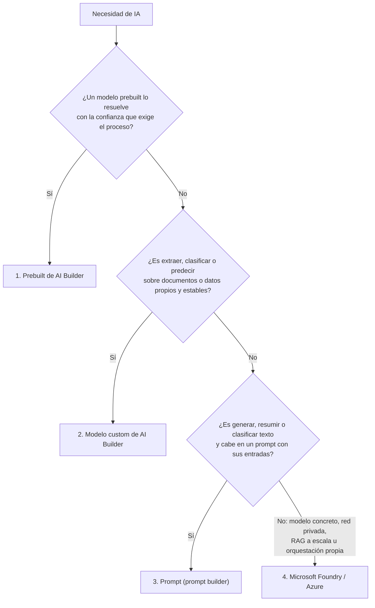

### 🎯 Objetivo
Decidir, para cada necesidad de IA de una solución Power Platform, qué opción conviene y defender esa decisión: un **modelo prebuilt** de AI Builder, un **modelo custom** entrenado con tus documentos o datos, un **prompt** de prompt builder, o un servicio de **Microsoft Foundry** (Azure OpenAI, Foundry Tools o un modelo propio). Al terminar, has construido un flujo que extrae datos de facturas con revisión humana por umbral de confianza, un prompt que clasifica casos con temperatura 0, y sabes explicar qué consume cada opción (AI Builder credits o Copilot Credits), cómo se gobierna y cuándo hay que salir a Azure.

> **Cómo está organizado este módulo:** en Arquitecto el "construir sin pasos" se convierte en **decidir y defender**. Cada microlección tiene un concepto breve, una micropráctica para decidir bien, una práctica en tu entorno con una tabla de **evidencia** (el dato exacto que viste, no un "sí/no") y, cuando toca, un entregable escrito. Después viene un **diagnóstico síntoma primero** y el cierre es un **reto de transferencia**: otro proceso, otras restricciones, y tu decisión escrita contrastada con una rúbrica. En los retos de decisión **no hay una sola respuesta correcta**: se evalúa que la decisión cumpla los criterios y que sus trade-offs estén escritos.
>
> **Antes de empezar:**
> - **Viene del Suplemento 1A del Módulo 1** (qué es AI Builder y sus modelos prebuilt) y del **Módulo 11** (flujos con condiciones y manejo de errores). Aquí no se repite lo básico: se decide entre opciones.
> - **Un entorno con Dataverse** donde puedas crear modelos y flujos (tu entorno Developer o de práctica). AI Builder no funciona en un entorno sin base de datos.
> - **Si tu entorno es Developer:** el Developer Plan **no** incluye derechos de uso de AI Builder ([Learn: Developer Plan](https://learn.microsoft.com/power-platform/developer/plan)). Crear, entrenar y probar modelos y prompts no requiere créditos, pero **ejecutarlos** en un flujo sí. La página del Developer Plan aún menciona una prueba (*trial*) de AI Builder, mientras que la de licencias de AI Builder dice que esas pruebas **se discontinuaron** ([Learn: licencias de AI Builder](https://learn.microsoft.com/ai-builder/administer-licensing)). Si **AI hub** te ofrece una prueba, úsala; si no te deja crear el modelo o el flujo falla por falta de créditos, sigue con la variante sin créditos de la Microlección 2 (está al final de su Parte B).
> - **Qué cuesta créditos y qué no:** entrenar modelos, probarlos desde la página **AI models** y probar prompts en prompt builder **no consume créditos**. Ejecutar un modelo o un prompt **dentro de un flujo o una app sí** consume: primero AI Builder credits (si el entorno los tiene) y, si no hay o se acabaron, **Copilot Credits**; si no hay ninguno de los dos, la acción falla ([Learn: licencias y AI Builder credits](https://learn.microsoft.com/ai-builder/credit-management)). Si tu entorno no tiene créditos, haz las partes de "probar" y deja la ejecución en el flujo como diseño; anótalo en tu evidencia.
> - **Azure es opcional:** solo la parte B de la Microlección 3 necesita una suscripción de Azure con un recurso de Azure OpenAI o de Foundry. Sin suscripción, haz la parte A (prompt builder) y responde la parte B como decisión escrita.

> **Nota de vigencia (nov-2026):**
> - **Fin de los AI Builder credits.** Desde el 1 de noviembre de 2025 los clientes nuevos ya no pueden comprar el add-on de capacidad de AI Builder y deben comprar Copilot Credits. El 1 de noviembre de 2026 llegan al fin de vida el add-on y los créditos incluidos (*seeded*) en licencias premium: los contratos activos se respetan hasta que vencen. **Las funciones de AI Builder no se retiran**: siguen funcionando con Copilot Credits ([Learn: fin de los AI Builder credits](https://learn.microsoft.com/ai-builder/endofaibcredits)).
> - **Nombres de acciones.** Desde mayo de 2025 la acción **Extract information from documents** se llama **Process documents**, y **Create text with GPT using a prompt** se llama **Run a prompt** ([Learn: document processing en Power Automate](https://learn.microsoft.com/ai-builder/form-processing-model-in-flow), [Learn: prompt en Power Automate](https://learn.microsoft.com/ai-builder/use-a-custom-prompt-in-flow)). Si sigues un tutorial antiguo, busca el nombre nuevo.
> - **Nombres de Azure.** La marca actual es **Microsoft Foundry** (antes Azure AI Studio / Azure AI Foundry), y lo que se llamaba **Azure AI Services** hoy es **Foundry Tools**. Azure OpenAI sigue existiendo como los modelos de OpenAI dentro de Foundry, y su API estable nueva es la **v1** (`/openai/v1/`), que ya no exige el parámetro `api-version` mensual ([Learn: qué es Microsoft Foundry](https://learn.microsoft.com/azure/foundry/what-is-foundry), [Learn: API v1 de Azure OpenAI](https://learn.microsoft.com/azure/foundry/openai/api-version-lifecycle)).

### 📖 Conceptos Clave

**Las cuatro opciones, de menos a más esfuerzo.** Casi todas las decisiones de IA en Power Platform se reducen a subir por esta escalera solo cuando el escalón anterior no basta:

| Escalón | Qué es | Cuándo encaja | Qué te cuesta |
|---|---|---|---|
| **1. Modelo prebuilt** de AI Builder | Modelo listo para usar, sin entrenamiento: facturas, recibos, tarjetas de presentación, documentos de identidad, contratos (en preview), texto (OCR), sentimiento, idioma, frases clave, traducción, extracción de entidades | El problema es común a muchas empresas (una factura es una factura) | Nada que entrenar; consumo por uso |
| **2. Modelo custom** de AI Builder | Lo entrenas con tus documentos o tus datos: document processing, category classification, entity extraction, object detection, prediction | Tus documentos o datos son propios de tu negocio, o el prebuilt no extrae bien lo que necesitas | Reunir y etiquetar ejemplos, reentrenar cuando cambian los datos |
| **3. Prompt** (prompt builder) | Instrucción en lenguaje natural a un modelo generativo, con entradas y, si quieres, datos de Dataverse como conocimiento | Resumir, clasificar en categorías que cambian, redactar, extraer de texto libre | Diseñar y probar el prompt; respuestas probabilísticas que hay que controlar |
| **4. Microsoft Foundry / Azure** | Azure OpenAI y otros modelos de Foundry, Foundry Tools, Azure AI Search para RAG, o un modelo propio de Azure Machine Learning | Necesitas un modelo concreto, red privada, RAG sobre miles de documentos, o lógica que no cabe en AI Builder | Suscripción y recursos de Azure, identidad, red y operación a tu cargo |

La tabla de modelos de AI Builder, con su tipo (prebuilt o custom), está en [Learn: modelos de AI Builder y escenarios](https://learn.microsoft.com/ai-builder/model-types). Hoy **category classification** y **entity extraction** existen como prebuilt y como custom; **document processing**, **prediction** y **object detection** son custom.



- **AI Builder y su licencia:** AI Builder es una función **premium** dentro de Power Apps: agregar una acción de AI Builder a una app (o un flujo con AI Builder dentro de una app) la convierte en app premium. En Power Automate, agregar una acción de AI Builder **no** convierte el flujo en premium. Cuando el consumo mensual de un entorno supera sus créditos disponibles, el entorno entra en *overage*: el sistema intenta usar Copilot Credits y, si no hay, las acciones fallan con `EntitlementNotAvailable` o `QuotaExceeded`. Un entorno con créditos **asignados** solo consume esos créditos: **no** pasa automáticamente a los créditos sin asignar del inquilino ([Learn: licencias y AI Builder credits](https://learn.microsoft.com/ai-builder/credit-management)).
- **Document processing (custom):** al crearlo eliges entre **Fixed template documents** (antes "structured": los campos están en lugares parecidos para un layout dado; entrena rápido), **General documents** (antes "unstructured": documentos sin estructura fija o complejos; entrena más lento) e **Invoices** (amplía el modelo prebuilt de facturas con campos o ejemplos nuevos). Los documentos se agrupan en **collections**: una por layout, con **al menos 5 documentos** de ejemplo cada una, hasta 200 collections por modelo. Formatos JPG, PNG o PDF de hasta 20 MB; TIFF no sirve para entrenar ([Learn: crear un modelo de document processing](https://learn.microsoft.com/ai-builder/create-form-processing-model), [Learn: requisitos](https://learn.microsoft.com/ai-builder/form-processing-model-requirements)). Cada campo extraído devuelve su **confidence score** entre 0 y 1, y esa es la base del diseño con revisión humana.
- **Invoice processing (prebuilt):** extrae sin entrenamiento campos como `InvoiceId`, `InvoiceDate`, `VendorName`, `VendorTaxId`, `InvoiceTotal` y las líneas (`Items`), cada uno con su confidence score. Su lista de idiomas incluye **Spanish (Spain)**, no otras variantes del español: con facturas de proveedores latinoamericanos, pruébalo con tus documentos antes de comprometerte. Learn propone combinarlo con un modelo custom: llamar primero al prebuilt y, si la confianza de un campo es baja (el ejemplo usa < 0.65), llamar al custom entrenado para esos casos, o al revés ([Learn: modelo prebuilt de facturas](https://learn.microsoft.com/ai-builder/prebuilt-invoice-processing)).
- **Object detection (custom):** detecta y localiza objetos en imágenes y devuelve su nombre, confianza y bounding box. Casos típicos: inventario por foto, verificación de equipo de protección en obra, control de calidad visual con la cámara del teléfono desde una Canvas App.
- **Category classification y entity extraction:** clasifican texto en categorías o extraen entidades (nombres, fechas, montos). Ojo con la decisión: si tus categorías cambian cada trimestre, un prompt con la lista de categorías en la instrucción puede ser más barato de mantener que reentrenar un modelo custom; si son estables y tienes muchos ejemplos etiquetados, el modelo custom da resultados más predecibles.
- **Prediction (custom):** predice a partir del historial de una tabla de **Dataverse** una respuesta **binaria** (sí/no, a tiempo/tarde), entre **varios resultados** posibles, o **numérica**. Necesita al menos **10 filas de resultado histórico por cada clase** de la columna a predecir y un mínimo de **50 filas**, aunque Learn recomienda **al menos 1.000** para buenos resultados ([Learn: requisitos del modelo de predicción](https://learn.microsoft.com/ai-builder/prediction-prereq)). Se ejecuta con **Run now** o con una programación de **Run** y **Retrain** (diaria, semanal o mensual; en preview), o en tiempo real desde Power Automate con la acción **Predict** ([Learn: usar tu modelo de predicción](https://learn.microsoft.com/ai-builder/prediction-use)). La tabla de modelos que se pueden llamar con Power Fx (`'Modelo'.Predict(...)`) en una Canvas App **no incluye** prediction: desde una app, la predicción en tiempo real se pide a un flujo ([Learn: modelos de AI Builder en Power Apps](https://learn.microsoft.com/ai-builder/powerfx-in-powerapps)).
- **Prompts y prompt builder:** un prompt es una instrucción en lenguaje natural para un modelo generativo; prompt builder permite crearlo, probarlo y guardarlo para reutilizarlo en apps, flujos y agentes. Se crea en Power Apps o Power Automate desde **AI hub** > **Prompts** > **Build your own prompt**; las entradas se agregan escribiendo **/** o con **Add content** (**Text** o **Image or document**), y en la sección **Knowledge** puedes conectar datos de Dataverse ([Learn: crear un prompt](https://learn.microsoft.com/microsoft-copilot-studio/create-custom-prompt)). En el campo **Model** eliges el modelo: el predeterminado es **GPT-4.1 mini** (tarifa *Basic*); otros, como GPT-4.1 o GPT-5 chat, tienen tarifa *Standard*, y los de razonamiento, *Premium*. La **temperatura** va de 0 a 1 y por defecto es **0** (en **…** > **Settings**; no existe para el modelo GPT-5 reasoning) ([Learn: modelo y configuración del prompt](https://learn.microsoft.com/microsoft-copilot-studio/prompt-model-settings)). Las funciones de IA AISummarize, AIExtract, AIReply, AIClassify y AISentiment son prompts prediseñados con la tarifa *Basic*.
- **Dónde se consume cada cosa:** un prompt usado en Power Apps o Power Automate consume primero AI Builder credits (si hay) y después Copilot Credits; el mismo prompt usado en Copilot Studio consume **solo Copilot Credits** ([Learn: modelo y configuración del prompt](https://learn.microsoft.com/microsoft-copilot-studio/prompt-model-settings)). Para agentes y su consumo, ver el Módulo 22.
- **Microsoft Foundry:** plataforma de Azure que reúne agentes (Foundry Agent Service), modelos (Foundry Models, con modelos de Microsoft, OpenAI, Anthropic, Meta y otros) y herramientas bajo un solo recurso, con RBAC, red y políticas comunes. Un recurso de Azure OpenAI existente se puede actualizar a recurso de Foundry conservando endpoint y claves ([Learn: qué es Microsoft Foundry](https://learn.microsoft.com/azure/foundry/what-is-foundry)).
- **Privacidad de los modelos vendidos por Azure (incluye Azure OpenAI):** tus prompts y respuestas **no** están disponibles para otros clientes ni para OpenAI, y **no** se usan para entrenar modelos fundacionales sin tu permiso. Lo que sí existe por defecto es el **abuse monitoring**: si el sistema detecta un patrón de abuso, una muestra puede pasar a revisión. Con una deployment *Global* o *DataZone* el procesamiento puede ocurrir fuera de tu geografía (o dentro de la zona de datos) aunque los datos en reposo queden en ella: es una decisión de residencia, no un detalle ([Learn: datos, privacidad y seguridad](https://learn.microsoft.com/azure/foundry/responsible-ai/openai/data-privacy)).
- **Tres formas de llamar a Azure desde Power Platform:** (1) el conector **Azure OpenAI** (Premium; acciones como **Creates a completion for the chat message** y **Get an embedding**; autenticación con **API Key** o **Microsoft Entra ID Integrated**, que exige el rol *Cognitive Services OpenAI User* a cada usuario) ([Learn: conector Azure OpenAI](https://learn.microsoft.com/connectors/azureopenai/)); (2) la acción **HTTP** contra la API v1; (3) **traer tu modelo de Foundry a un prompt**: en el campo **Model** del prompt, el signo **+** abre **Connect a model from Azure AI Foundry**, donde indicas **Model deployment name** y **Base model name**. Esta tercera vía solo acepta endpoints de *chat completions* (no el de Responses) y hoy **no** admite la familia GPT-5 ([Learn: traer tu propio modelo a los prompts](https://learn.microsoft.com/microsoft-copilot-studio/bring-your-own-model-prompts)).
- **Prompt engineering:** diseñar instrucciones que den respuestas consistentes. Técnicas clave: rol y reglas al inicio, ejemplos de entrada→salida esperada (*few-shot*), pedir un formato de salida exacto (una categoría de una lista cerrada, un número, un JSON) y separar la **instrucción** del **contexto**. Para clasificar o extraer, temperatura 0; para redactar, algo más alta.
- **Grounding y RAG:** anclar la respuesta del modelo a documentos de la empresa en vez de a su conocimiento general. El patrón RAG (*retrieval-augmented generation*) busca primero los fragmentos más relevantes en un índice (por ejemplo Azure AI Search con búsqueda vectorial) y solo esos entran en el prompt. Pegar todo el corpus en el mensaje no escala: excede el contexto del modelo y lo llena de información irrelevante. En prompt builder, el **Knowledge** de Dataverse es un grounding acotado; en Copilot Studio, las Knowledge sources (Módulos 15 y 22).
- **Frameworks de orquestación** *(referencia avanzada)*: cuando la lógica no cabe en Copilot Studio ni en un prompt, Foundry permite desplegar un **hosted agent** con tu propio código o framework, por ejemplo **Microsoft Agent Framework**, **Semantic Kernel** o LangGraph ([Learn: qué es Microsoft Foundry](https://learn.microsoft.com/azure/foundry/what-is-foundry)). Exige código (C# o Python) y operar ese servicio: es el escalón 4 en su versión más cara.
- **Supervisión humana:** Learn insiste en que el contenido generado lo revise una persona antes de publicarlo, enviarlo a un cliente o usarlo para decidir, y documenta cómo agregar una aprobación (**Start and wait for an approval of text**) después de **Run a prompt** ([Learn: prompt en Power Automate](https://learn.microsoft.com/ai-builder/use-a-custom-prompt-in-flow)). En extracción de documentos, el equivalente es el umbral de confianza.

---

## 🧩 Microlección 1 — La escalera de decisión: prebuilt, custom, prompt o Azure (≈40 min)

**El concepto:** el error más caro en IA aplicada no es elegir mal el modelo, es **saltarse escalones**: montar Azure OpenAI con RAG para algo que un prebuilt resolvía, o entrenar un modelo custom para clasificar en categorías que cambian cada mes. Decide por el escalón más bajo que cumpla la confianza que exige el proceso, y escribe por qué no sirve el anterior.

**Ahora haz algo — micropráctica (8 min):** cuatro requisitos de una aseguradora, una decisión por requisito → **[Prebuilt, custom, prompt o Azure: elegir por requisito](/practica/ip-ia-001-prebuilt-custom-prompt-o-azure)**.

**Explora en tu entorno (sin consumir créditos):**

1. Entra a [make.powerapps.com](https://make.powerapps.com) en tu entorno de práctica (selector de entorno arriba a la derecha).
2. En el panel izquierdo, selecciona **… More** > **AI hub**. Si quieres tenerlo siempre a mano, fíjalo con el icono de chincheta.
3. Bajo **Discover an AI capability**, selecciona **AI models**. Verás las tarjetas de los modelos disponibles en tu región.
4. Abre la tarjeta de facturas (invoice processing) y pruébala con una factura en PDF o imagen que tengas a mano (una propia, o una de ejemplo descargada de un proveedor). Probar un modelo desde esta página **no consume créditos** ([Learn: licencias y AI Builder credits](https://learn.microsoft.com/ai-builder/credit-management)).
5. Anota qué campos reconoce y su confianza. Si tu factura no está en inglés ni en español de España, observa qué campos baja de confianza.

> **Si no ves AI hub o AI models:** tu entorno no tiene Dataverse o la región no ofrece la función ([Learn: disponibilidad por región](https://learn.microsoft.com/ai-builder/availability-region)). Cambia a un entorno con base de datos.

**Evidencia a reportar:**

| Campo | Tu valor |
|---|---|
| Nombre de tu entorno y región | ___ |
| Tres modelos que ves en **AI models** y si cada uno es prebuilt o custom | ___ |
| Campos que extrajo la prueba de facturas y la confianza de `InvoiceTotal` (o el campo de total) | ___ |
| El campo con menor confianza y una hipótesis de por qué | ___ |
| Tu decisión para el Caso Real (escalón 1 o 2) y la razón en una frase | ___ |

---

## 🧩 Microlección 2 — Modelo custom de documentos con revisión humana por umbral (≈120 min)

**El concepto:** un modelo de extracción nunca está "bien" o "mal": cada campo trae un **confidence score**, y la arquitectura decide qué hacer con él. El Caso Real lo resuelve con un umbral: lo que supera 0.85 se procesa solo; lo demás va a una persona. El umbral es una **decisión de negocio** (cuánto error tolera el proceso frente a cuánta revisión manual puede pagar), y debe quedar escrito.

**Ahora decide (5 min, sin feedback automático):** antes de construir, escribe en tu cuaderno qué campo usarás para decidir (¿el total, el número de factura, ambos?) y qué pasa si **uno** de los dos baja del umbral. Lo contrastarás con lo que observes en el paso 15.

**Construye en tu entorno:**

*Parte A — el modelo (≈60 min, más el tiempo de entrenamiento):*

1. Reúne facturas de **dos proveedores** con layouts distintos, al menos 5 de cada uno (PDF, JPG o PNG, menos de 20 MB). Si no tienes, en el asistente puedes usar los datos de ejemplo de Microsoft ([Learn: datos de ejemplo](https://learn.microsoft.com/ai-builder/form-processing-sample-data)).
2. En **AI hub** > **AI models**, selecciona **Extract custom information from documents** > **Create custom model**.
3. En **Choose document type**, elige **Fixed template documents** (cada proveedor usa siempre el mismo layout). Anota por qué no elegiste **General documents** ni **Invoices**.
4. En **Choose information to extract**, con **+Add**, define: un campo de texto `NumeroFactura`, un campo de texto `NITProveedor`, un campo numérico `Total` (elige el separador decimal que usan tus facturas: **.** o **,**) y un campo de fecha `FechaFactura` (elige el orden **Day**, **Month**, **Year** si tus facturas usan día/mes/año).
5. Crea **dos collections**, una por proveedor, y sube al menos 5 documentos a cada una.
6. Etiqueta los campos en cada documento siguiendo el asistente.
7. Selecciona **Train**. Cuando termine, selecciona **Quick test** con una factura que **no** usaste para entrenar.
8. En la página del modelo, bajo **Last trained version**, selecciona **Publish** ([Learn: publicar un modelo](https://learn.microsoft.com/ai-builder/publish-model)). Publicar lo deja disponible para todos los usuarios del entorno.

*Parte B — el flujo con umbral (≈45 min):*

9. Crea en tu solución del curso (publisher `sit`, Módulo 2) una tabla **Factura Proveedor** con las columnas **Número de factura** (texto), **NIT proveedor** (texto), **Total** (moneda o decimal), **Confianza total** (decimal) y **Estado de revisión** (Choice: *Automática*, *Revisión manual*).
10. En [make.powerautomate.com](https://make.powerautomate.com), **+Create** > **Instant cloud flow** > **Manually trigger a flow** > **Create**. En el trigger, **+Add an input** > **File**.
11. Agrega la acción **Process documents**: en **AI Model** elige tu modelo, en **Document type** el tipo de archivo y en **Form** el contenido del archivo del trigger ([Learn: document processing en Power Automate](https://learn.microsoft.com/ai-builder/form-processing-model-in-flow)).
12. Agrega un **Condition**: **Total confidence score** **is greater than or equal to** `0.85`, y una segunda fila con **NumeroFactura confidence score** con el mismo umbral (las dos deben cumplirse).
13. En la rama **True**: **Add a new row** en **Factura Proveedor** con los valores (**NumeroFactura value**, **NITProveedor value**, el total convertido a número con `float(...)` porque el modelo devuelve texto), la confianza y **Estado de revisión** = *Automática*.
14. En la rama **False**: **Add a new row** con lo que se extrajo y **Estado de revisión** = *Revisión manual*, más una notificación al equipo de revisión (Teams o correo).
15. **Save** y **Test** con una factura de cada proveedor y con una tercera de un proveedor **que el modelo no conoce**.

> **En producción** el trigger sería la llegada del correo con la factura. Si usas el conector de Outlook, filtra los adjuntos *inline* (las firmas de correo llegan como adjuntos): condición **Attachments Is Inline** igual a `false` antes de **Process documents** ([Learn: document processing en Power Automate](https://learn.microsoft.com/ai-builder/form-processing-model-in-flow)).
>
> **Si la ejecución falla con `EntitlementNotAvailable` o `QuotaExceeded`:** el entorno no tiene créditos disponibles. Es exactamente el diagnóstico de más abajo; anótalo y sigue con la evidencia del Quick test.
>
> **Variante sin créditos (o si no pudiste crear el modelo):** deja el flujo guardado tal como lo diseñaste (o, si no pudiste crear el modelo, escribe sus pasos 9 a 14 con los campos y la condición), anota el error exacto de la ejecución y prueba la factura del proveedor desconocido en **Quick test** (o, sin modelo custom, en la prueba del modelo prebuilt de facturas de la Microlección 1, que tampoco consume créditos). En la evidencia, la fila de "las 3 ejecuciones" se llena con el error y con la confianza que dio esa prueba para cada factura.

**Evidencia a reportar:**

| Campo | Tu valor |
|---|---|
| Tipo de documento elegido y por qué no los otros dos | ___ |
| Confianza de `Total` en el Quick test (documento no usado para entrenar) | ___ |
| Resultado de las 3 ejecuciones: estado de revisión y confianza de cada una | ___ |
| Qué pasó con la factura del proveedor desconocido y qué cambiarías en el modelo | ___ |
| Tu umbral final y su justificación de negocio (cuánta revisión manual implica) | ___ |

---

## 🧩 Microlección 3 — Prompt en prompt builder o Azure OpenAI directo (≈60 min, +30 min opcionales)

**El concepto:** clasificar casos de soporte en categorías es el ejemplo típico donde un prompt compite con un modelo custom. El prompt gana si las categorías cambian o si no tienes ejemplos etiquetados; el modelo custom, si son estables y necesitas resultados repetibles con muchos ejemplos. Y cuando ya elegiste "prompt", queda otra decisión: **prompt builder** (gobernado dentro de Power Platform, consumo en créditos) o **Azure OpenAI** (control del modelo, de la red y de la factura de Azure, pero más piezas que operar).

**Ahora decide (5 min, sin feedback automático):** escribe qué haría que movieras la clasificación de un prompt de prompt builder a Azure: ¿un requisito de red, un modelo concreto, el volumen, el costo? Lo retomarás en la evidencia.

**Parte A — prompt builder (≈45 min, la prueba no consume créditos):**

1. En Power Automate (o Power Apps), **AI hub** > **Prompts** > **Build your own prompt** ([Learn: crear un prompt](https://learn.microsoft.com/microsoft-copilot-studio/create-custom-prompt)).
2. Selecciona el nombre generado arriba a la izquierda y cámbialo por **Clasificar caso de soporte**.
3. Escribe la instrucción. Escribe **/** donde va la descripción del caso (o usa **Add content** > **Text**) para crear una entrada llamada `Descripcion`:

   ```
   Eres un analista de soporte técnico de SIT Consulting. Clasifica el caso en UNA de estas
   categorías: Hardware, Software, Red, Accesos, Otro.
   Responde ÚNICAMENTE con el nombre exacto de la categoría, sin explicación ni puntuación.
   Si el texto no describe un problema técnico, responde Otro.

   Caso: [Descripcion]
   ```

4. Escribe un valor de ejemplo en la entrada (por ejemplo: "No puedo entrar a la VPN desde casa desde ayer").
5. Abre **…** > **Settings** y confirma que **Temperature** está en 0. En **Model** deja **GPT-4.1 mini** (tarifa *Basic*) ([Learn: modelo y configuración](https://learn.microsoft.com/microsoft-copilot-studio/prompt-model-settings)).
6. Selecciona **Test** con 5 descripciones distintas, incluida una ambigua ("la impresora no imprime desde la red") y una que no es técnica. Después **Save**.
7. En un flujo instantáneo, agrega **Run a prompt**, elige tu prompt en **Prompt** y llena **Descripcion** con una entrada del trigger. La salida está en la variable **Text** ([Learn: prompt en Power Automate](https://learn.microsoft.com/ai-builder/use-a-custom-prompt-in-flow)). Antes de escribir en Dataverse, valida que **Text** sea una de las 5 categorías (una condición o un `Switch`): un modelo generativo puede responder algo fuera de la lista.

**Parte B — Azure OpenAI directo (opcional, ≈30 min, necesita suscripción de Azure):**

1. En el [portal de Foundry](https://ai.azure.com) despliega un modelo de chat (por ejemplo `gpt-4.1-mini`) y anota el **nombre del deployment**.
2. En Power Automate, la opción más gobernada es el conector **Azure OpenAI** con la acción **Creates a completion for the chat message**: la clave queda en la conexión y no en el flujo (o usa **Microsoft Entra ID Integrated**, que exige a cada usuario el rol *Cognitive Services OpenAI User*) ([Learn: conector Azure OpenAI](https://learn.microsoft.com/connectors/azureopenai/)).
3. Si necesitas la API v1, la acción **HTTP** (premium) usa estos valores. Esto es la configuración de la acción, no código ejecutable fuera de Power Automate:

   | Campo de la acción HTTP | Valor |
   |---|---|
   | **Method** | `POST` |
   | **URI** | `https://<tu-recurso>.openai.azure.com/openai/v1/chat/completions` |
   | **Headers** | `Content-Type: application/json` y `api-key:` con la clave (nunca escrita en el flujo: tómala de un secreto, ver Módulos 24 y 36) |
   | **Body** | el JSON de abajo |

   ```json
   {
     "model": "gpt-4.1-mini",
     "temperature": 0,
     "messages": [
       { "role": "system", "content": "Eres un analista de soporte técnico de SIT Consulting. Clasifica el caso en UNA de estas categorías: Hardware, Software, Red, Accesos, Otro. Responde ÚNICAMENTE con el nombre exacto de la categoría." },
       { "role": "user", "content": "Caso: @{triggerBody()?['text']}" }
     ]
   }
   ```

   En la API v1, `model` es el **nombre de tu deployment** ([Learn: API v1 de Azure OpenAI](https://learn.microsoft.com/azure/foundry/openai/api-version-lifecycle)). `@{triggerBody()?['text']}` es la entrada de texto del trigger manual; ajústala al nombre de tu entrada. Pega el Body tal cual, como objeto JSON: así la expresión se evalúa **dentro** de la propiedad `content` y su resultado queda como el valor de texto de esa propiedad ([Learn: expresiones en la definición del flujo](https://learn.microsoft.com/azure/logic-apps/logic-apps-workflow-definition-language#expressions)). Lo que no debes hacer es armar el cuerpo concatenando texto (por ejemplo, un **Compose** de texto que luego pasas por `json()`): ahí una entrada con comillas dobles, como `La impresora dice "sin papel"`, produce un JSON inválido. Con texto que escribe un usuario final, el conector del paso 2 sigue siendo la opción más gobernada. La categoría se lee con esta expresión (la acción HTTP se llama `HTTP_OpenAI` en el ejemplo):

   ```
   first(body('HTTP_OpenAI')?['choices'])?['message']?['content']
   ```

4. Compara las dos rutas con las mismas 5 descripciones.

**Evidencia a reportar:**

| Campo | Tu valor |
|---|---|
| Las 5 descripciones de prueba y la categoría que devolvió el prompt | ___ |
| Qué respondió con la descripción ambigua y si repitió la misma respuesta al probar dos veces | ___ |
| Cómo validas en el flujo que la respuesta sea una categoría de la lista | ___ |
| (Parte B o por escrito) Qué requisito concreto te haría mover esta clasificación a Azure, y qué pierdes al hacerlo | ___ |

---

## 🧩 Microlección 4 — Predicción y ciclo de vida del modelo (≈30 min)

**El concepto:** un modelo publicado no se queda bueno: los datos cambian (nuevos productos, nuevos canales de venta) y la exactitud cae en silencio. El modelo de **prediction** es donde más se nota, porque aprende del historial. El arquitecto decide **cada cuánto se reentrena y se ejecuta**, dónde se guardan los resultados y quién revisa la exactitud.

**Diseña (sin construir, salvo que tengas los datos):** un equipo comercial quiere saber qué oportunidades tienen riesgo de perderse. La tabla **Oportunidad SIT** tiene 2 años de historial con la columna Choice **Resultado** (*Ganada*, *Perdida*).

1. Comprueba los requisitos: datos en Dataverse, al menos 10 filas por clase y 50 en total, idealmente 1.000 o más ([Learn: requisitos](https://learn.microsoft.com/ai-builder/prediction-prereq)).
2. Decide cómo se ejecuta: **programado** (la predicción se recalcula con **Run** y el modelo se reentrena con **Retrain**, en cadencia diaria, semanal o mensual; la programación crea un flujo que no debes editar a mano) o **en tiempo real** con la acción **Predict** en un flujo, por ejemplo con el trigger **When a row is added, modified, or deleted** ([Learn: usar tu modelo de predicción](https://learn.microsoft.com/ai-builder/prediction-use), [Learn: predicción en Power Automate](https://learn.microsoft.com/ai-builder/prediction-pwr-automate)).
3. Si la quieren ver en una Canvas App mientras el vendedor llena la oportunidad: la app no llama al modelo de predicción con Power Fx (no está en la lista de modelos con `Predict`); llama a un flujo que usa **Predict** y devuelve el resultado, o muestra el resultado ya guardado en la fila.
4. Si tienes los datos, constrúyelo; si no, puedes usar los datos de ejemplo de Microsoft ([Learn: datos de ejemplo de predicción](https://learn.microsoft.com/ai-builder/prediction-sample-data)).

**Evidencia a reportar:**

| Campo | Tu valor |
|---|---|
| Cuántas filas por clase tiene tu historial (real o supuesto) y si cumple los mínimos | ___ |
| Ejecución elegida (programada o en tiempo real) y por qué | ___ |
| Cadencia de **Retrain** y qué evento de negocio la justifica | ___ |
| Quién revisa la exactitud del modelo, cada cuánto y con qué dato | ___ |

---

## 🔧 Diagnosticar — "en un entorno la IA funciona y en el otro no"

El lunes 2 de noviembre, el flujo de facturas de **PROD-Finanzas** empieza a fallar en la acción **Process documents** con `QuotaExceeded`, mientras el mismo flujo en **PROD-Compras** sigue funcionando. El administrador dice que "el inquilino todavía tiene créditos de AI Builder sin usar". Antes de abrir nada, escribe **dos hipótesis** (una sobre cómo se asignan los créditos, otra sobre qué cambió el 1 de noviembre) y qué evidencia del Power Platform admin center confirmaría cada una. Después resuelve el caso:

**[Diagnosticar: QuotaExceeded en un solo entorno](/practica/ip-ia-002-quota-exceeded-en-un-solo-entorno)**

| Campo | Tu valor |
|---|---|
| Tus dos hipótesis y la evidencia que revisarías para cada una | ___ |
| La primera evidencia que contradice "el inquilino tiene créditos, así que debe funcionar" | ___ |
| La corrección inmediata y la medida para que no vuelva a pasar | ___ |

---

## 🧭 Decidir y defender — El Caso Real, con tu arquitectura

Toma el **Caso Real de Negocio** de abajo (2,000 facturas al mes, umbral de 85%) y escribe **ADR-IA-001 "Extracción de facturas"** (una página: contexto, opciones, decisión, consecuencias). Debe responder: prebuilt, custom o la combinación de ambos; el umbral y qué campos lo deciden; qué consume créditos y cuántas ejecuciones al mes calculas (las tarifas exactas están en la tabla de tarifas de AI Builder de la [guía de licencias](https://go.microsoft.com/fwlink/?linkid=2085130); si no la consultas, deja la cifra como supuesto marcado); qué pasa el día que se agotan los créditos; y cómo sabrás en seis meses si el modelo empeoró.

| Criterio | Qué demuestra que lo cumples |
|---|---|
| Escalón justificado | Dices por qué no basta el escalón anterior (o por qué el prebuilt sí basta) con un dato de tu prueba, no con una opinión |
| Umbral como decisión de negocio | El umbral se relaciona con el costo de un error frente al costo de la revisión manual, y dices qué campos lo deciden |
| Créditos y continuidad | Nombras qué consume (AI Builder credits o Copilot Credits), en qué entorno se asignan y qué pasa si se agotan |
| Ciclo de vida | Hay un dueño, una métrica (por ejemplo, % de facturas que van a revisión manual) y un disparador para reentrenar |
| Trade-off escrito | Nombras qué empeora con tu diseño (más revisión manual, más mantenimiento de collections, dependencia de Azure…) y por qué lo aceptas |

---

## 🔁 Reto de transferencia — Otro proceso, otras restricciones: decide y defiende

**Requisito nuevo:** una aseguradora de salud quiere automatizar los **reclamos de reembolso**: el afiliado sube fotos de recetas y facturas médicas desde un portal, y hay que (1) extraer proveedor, fecha y monto; (2) clasificar el reclamo en una de 12 categorías de cobertura que el área legal **cambia cada trimestre**; (3) redactar una respuesta al afiliado cuando falta un documento; y (4) responder preguntas de los analistas sobre **4.000 páginas** de pólizas. Restricciones: los datos de salud **no pueden procesarse fuera de la geografía** del cliente, Legal exige que ninguna respuesta salga al afiliado sin revisión humana y el equipo no tiene desarrolladores de C# o Python.

**Micropráctica de transferencia (8 min):** **[Transferir: reclamos de reembolso en una aseguradora](/practica/ip-ia-003-transferir-reclamos-de-reembolso)**.

**Después, sin pasos:** escribe **ADR-IA-002 "IA en reclamos de reembolso"** (una página) con la decisión para cada una de las cuatro necesidades: escalón, modelo o servicio, dónde vive la revisión humana, qué consume y qué tipo de deployment usarías en Azure si sales a Azure. No hay una sola respuesta correcta: contrasta tu decisión con esta rúbrica.

| Criterio | Qué demuestra que lo cumples |
|---|---|
| Escalón por necesidad | Cada una de las 4 necesidades tiene su escalón y la razón; no usas el mismo martillo para todo |
| Categorías que cambian | Explicas por qué tu opción para la clasificación sobrevive a un cambio trimestral de categorías sin reentrenar (o cuánto cuesta reentrenar) |
| Residencia de datos | Si usas Azure, dices qué tipo de deployment usas y por qué no uno *Global* o *DataZone* que procese fuera de la geografía |
| Revisión humana | La respuesta al afiliado pasa por una aprobación antes de enviarse, y lo dices con la acción o el mecanismo concreto |
| Capacidad del equipo | Nada de tu diseño exige escribir C# o Python, o dices quién lo escribiría y lo opera |
| Trade-off escrito | Nombras qué empeora con tu diseño y por qué lo aceptas |

| Campo | Tu valor |
|---|---|
| Decisión para la extracción (1) y por qué | ___ |
| Decisión para la clasificación (2) y cómo sobrevive al cambio trimestral | ___ |
| Decisión para la respuesta al afiliado (3) y dónde está la revisión humana | ___ |
| Decisión para las preguntas sobre pólizas (4) y la residencia de datos | ___ |
| Tu trade-off principal | ___ |

---

### 💼 Caso Real de Negocio
**Empresa:** Firma de contabilidad que procesa 2,000 facturas mensuales  
**Problema:** 5 personas dedicadas exclusivamente a tipear datos de facturas físicas al sistema. Error rate: 3% (60 facturas con errores que causaban diferencias en pagos).  
**Solución:** AI Builder Document Processing con 95% de exactitud promedio. Las facturas con confianza < 85% van a revisión humana (solo 8% del total). Para las que pasan, el flujo de Power Automate crea el registro automáticamente en D365.  
**Resultado:** 5 personas reubicadas a trabajo de mayor valor. Error rate: 0.3% (solo en facturas revisadas manualmente mal procesadas). ROI: 18 meses.

### ✅ Buenas Prácticas
- Subir por la escalera solo cuando el escalón anterior no basta: prebuilt → custom → prompt → Azure, y escribir por qué se descartó el anterior
- Probar el modelo prebuilt con **tus** documentos antes de entrenar uno custom: la prueba desde **AI models** no consume créditos
- Una collection por layout, con ejemplos de cada variante real (proveedores, años, escaneos de distinta calidad); al aparecer un layout nuevo, una collection nueva y reentrenar
- Decidir con el confidence score y no con el "funcionó en la prueba": el umbral es una decisión de negocio escrita, y lo que no lo supera va a una persona
- Prediction: al menos 50 filas y 10 por clase como mínimo técnico, 1.000 o más para resultados útiles; reentrenar con una cadencia que siga al negocio
- Temperatura 0 para clasificar o extraer; validar siempre que la salida de un prompt pertenezca a la lista esperada antes de escribirla en Dataverse
- Revisión humana (**Start and wait for an approval of text** u otro paso de aprobación) antes de que un texto generado llegue a un cliente
- Asignar créditos por entorno a propósito y vigilar el consumo en el admin center: un entorno con créditos asignados no toma los del inquilino cuando se le acaban
- En Azure, elegir el tipo de deployment por residencia de datos, autenticar con Microsoft Entra ID cuando se pueda y no escribir claves en el flujo
- Monitorear mensualmente cuántos documentos van a revisión manual: si sube, el modelo empeoró o cambiaron los documentos

### ⚠️ Errores Comunes
| Error | Causa | Solución |
|-------|-------|----------|
| Modelo de document processing que falla con un proveedor nuevo | Se entrenó con las primeras facturas disponibles, todas de los mismos layouts | Una collection por layout con al menos 5 documentos cada una (más si la calidad varía); al llegar un layout nuevo, agregar su collection y reentrenar |
| Se eligió **General documents** para facturas que siempre tienen el mismo formato | No se comparó el tipo de documento con el problema | **Fixed template documents** entrena más rápido cuando el layout es constante; **Invoices** amplía el prebuilt de facturas |
| El flujo escribe totales vacíos o con símbolo de moneda en Dataverse | El modelo devuelve todo como texto | Limpiar con `replace(...)` y convertir con `float(...)` antes de **Add a new row** |
| Las acciones de AI Builder fallan con `QuotaExceeded` en un entorno aunque el inquilino tiene créditos | El entorno tiene créditos asignados, ya los consumió y no pasa solo a los del inquilino; tampoco tiene Copilot Credits | Reasignar créditos al entorno o asignarle Copilot Credits; vigilar el consumo por entorno |
| La clasificación con un prompt devuelve respuestas distintas o fuera de la lista | Temperatura mayor que 0, o la instrucción no limita el formato de salida | Temperatura 0, lista cerrada de categorías en la instrucción y validación de la salida en el flujo |
| Se intenta llamar a un modelo de predicción con `Predict` en Power Fx desde una Canvas App | Prediction no está entre los modelos que se llaman con Power Fx | Pedir la predicción a un flujo con la acción **Predict**, o mostrar el resultado guardado en la fila |
| Modelo de predicción que acierta en el entrenamiento y falla meses después | El historial de entrenamiento ya no representa el negocio actual | Programar **Retrain** con una cadencia que siga al negocio y medir la exactitud con datos recientes |
| Conectar un modelo de Foundry al prompt devuelve **Resource not found** | Se usó el endpoint de Responses (`/openai/v1/responses`) | Usar el endpoint de *chat completions*; y recordar que la familia GPT-5 no se admite en esta vía |

### 🧪 Criterios de Validación
- [ ] Probé un modelo prebuilt con un documento propio y anoté la confianza de sus campos antes de decidir si entrenar uno custom
- [ ] Entrené y publiqué un modelo de document processing con al menos 2 collections de 5 documentos y lo probé con un documento no usado para entrenar
- [ ] Mi flujo con **Process documents** decide por el confidence score y separa *Automática* de *Revisión manual*, y probé un proveedor desconocido (o, sin créditos, dejé el flujo diseñado con el error de ejecución anotado y probé el proveedor desconocido en **Quick test** o en la prueba del prebuilt: la variante sin créditos de la Microlección 2)
- [ ] Mi prompt clasifica con temperatura 0 y el flujo valida que la respuesta esté en la lista antes de escribirla
- [ ] Sé explicar qué consume cada opción (AI Builder credits o Copilot Credits), dónde se asigna y qué pasa cuando se agota
- [ ] Diseñé la ejecución y el reentrenamiento de un modelo de predicción con su cadencia y su dueño
- [ ] Escribí ADR-IA-001 y ADR-IA-002 y los contrasté con sus rúbricas, con el trade-off escrito

---
