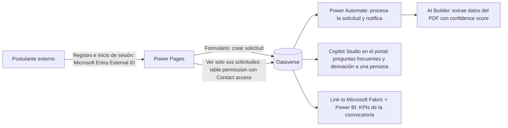

*Lectura: 20-25 min · Con práctica: unos 160 min, mejor en dos sesiones (la primera hasta el diagnóstico; la segunda, la Microlección 3 y el reto de transferencia). La primera vez, cuenta entre una vez y media y el doble.*

### 📚 Mini-glosario antes de empezar

| Término | En una frase |
|---|---|
| **AS-IS / TO-BE** | Cómo funciona el proceso hoy (con sus dolores medidos) y cómo funcionará después del cambio. |
| **Cutover** | El momento en que se apaga el sistema antiguo y el nuevo pasa a ser el único que se usa. |
| **Ejecución en paralelo** | Un periodo en el que el sistema antiguo y el nuevo funcionan a la vez para comparar resultados antes del cutover. |
| **Event log** | Una tabla con una fila por cada paso que ocurrió en un caso (qué paso, de qué caso y cuándo); es la materia prima del process mining. |
| **Variante** | Una secuencia única de pasos de principio a fin; dos casos que pasan por los mismos pasos en el mismo orden son la misma variante. |

### 🎯 Objetivo
Analizar y diseñar soluciones para los patrones más comunes de transformación digital con Power Platform: modernización de sistemas legacy, digitalización de procesos manuales, portales de autoservicio, y automatización de operaciones.

> **Cómo está organizado este módulo:** es un módulo de casos. Cada microlección es un caso con restricciones en el que **decides y defiendes**: eliges una opción, escribes el trade-off que aceptas y lo contrastas con una rúbrica explícita ("Criterio | Qué demuestra que lo cumples"). No hay una única respuesta correcta; la evidencia es tu decisión escrita con sus razones. En la Microlección 2 medirás un proceso real con la capacidad de process mining de Power Automate. Después diagnosticarás una transformación que falló, empezando por el síntoma, y cerrarás con un reto de transferencia en otro sector.
>
> **Antes de empezar, necesitas:**
> - Haber terminado los Niveles 1 a 3 y los Módulos 31 a 38 (gobernanza, seguridad, AI Builder y liderazgo técnico): aquí se combinan, no se vuelven a explicar.
> - Tu ambiente **DEV** del curso (un ambiente Developer con Dataverse, el de la solución `SIT Solicitudes Internas`).
> - Para la Microlección 2, una licencia **Power Automate Premium** o la **prueba de Power Automate** (90 días), que incluyen process mining. Si no tienes ninguna, esa práctica tiene una variante en papel.
> - Los casos de este módulo (inventario, crédito, universidad) son **ilustrativos**: sus cifras sirven para razonar, no son datos de empresas reales.

### 📖 Conceptos Clave
Un mapa rápido; cada pieza se practica en su microlección.

- **Transformación digital:** cambio organizacional profundo que va mucho más allá de implementar tecnología: implica rediseñar procesos de negocio (eliminando pasos manuales que tecnología puede ejecutar), transformar la cultura (empoderar a empleados para proponer mejoras, experimentar y fallar rápido), y en algunos casos, revisar el modelo de negocio completo (habilitar canales digitales que antes no existían). Es habitual que estas iniciativas no alcancen sus objetivos, y las causas que más se repiten son de personas y de liderazgo (resistencia al cambio, falta de patrocinio ejecutivo), no limitaciones de la tecnología.
- **Legacy Modernization:** proceso de migrar aplicaciones o procesos basados en tecnología obsoleta (Excel con macros VBA, Access databases, sistemas AS/400, aplicaciones Visual Basic 6) a plataformas modernas como Power Platform. La estrategia más prudente es incremental: mantener el sistema legacy en paralelo durante unas semanas mientras el nuevo sistema se valida, y luego hacer el cutover. La migración de datos históricos suele ser una parte grande del esfuerzo y el mayor riesgo; requiere limpieza de datos (deduplicación, estandarización) antes de cargar en Dataverse. *(Las semanas de paralelo y el peso de la migración son heurísticas de proyecto, no cifras de Microsoft: estímalos con el volumen y la calidad de los datos de tu caso.)*
- **Process Mining:** disciplina analítica que reconstruye y visualiza cómo se ejecutan realmente los procesos de negocio a partir de los registros de eventos (event logs) de los sistemas de información, en lugar de depender de documentación o entrevistas que describen cómo "deberían" ejecutarse. El resultado es un mapa del proceso con sus variantes, los tiempos de cada paso y los bucles de retrabajo, que sirve para priorizar qué automatizar.
- **Process mining en Power Automate (antes "Process Advisor"):** la capacidad de process mining de Power Automate extrae los eventos de tu sistema de registro y dibuja el mapa del proceso con métricas ([Learn: process mining](https://learn.microsoft.com/power-automate/process-mining-overview)). El event log necesita como mínimo tres datos por fila: **Case ID** (el caso, p. ej. el número de solicitud), **Activity Name** (el paso) y la marca de tiempo (**Start Timestamp**, y **End Timestamp** si el log registra inicio y fin); opcionalmente, **Resource** (quién ejecutó el paso) y atributos de negocio ([Learn: datos requeridos](https://learn.microsoft.com/power-automate/process-mining-processes-and-data)). Los datos se importan con Power Query (Text/CSV, SQL Server y muchos otros conectores; para Dataverse se usa el conector **OData**, porque el conector de Dataverse no está soportado aquí). Junto a él existe **task mining**, que graba las acciones de usuarios en el escritorio para descubrir tareas automatizables. Licencias: la **prueba de Power Automate** (90 días) da process mining con 100 MB por proceso; cada licencia **Power Automate Premium** suma 50 MB a un pool del tenant de hasta 100 GB, y el **Process Mining add-on** añade 100 GB más ([Learn: licencias de process mining](https://learn.microsoft.com/power-automate/process-advisor-overview#licensing)). Para análisis avanzados existe la app de escritorio **Power Automate Process Mining**.
- **Hyperautomation:** concepto de Gartner que describe la combinación de múltiples tecnologías de automatización para automatizar el mayor número posible de procesos de negocio: Power Automate (flujos de nube), **Power Automate for desktop** (RPA para sistemas sin API), AI Builder (extracción de datos de documentos no estructurados), y modelos de Azure OpenAI (clasificación y toma de decisiones sobre texto). El objetivo no es automatizar todo, sino identificar los procesos con mayor ROI de automatización y atacarlos con la herramienta adecuada para cada tipo de tarea.
- **Coste de la IA en el caso de negocio:** desde el **1 de noviembre de 2026** las licencias premium nuevas ya no traen AI Builder credits incluidos; las funciones de AI Builder siguen funcionando y consumen **Copilot Credits** cuando no quedan AI Builder credits ([Learn: fin de los AI Builder credits](https://learn.microsoft.com/ai-builder/endofaibcredits)). Un ROI que use AI Builder tiene que presupuestar ese consumo.
- **Change Management:** disciplina de gestión que se ocupa de preparar, apoyar y guiar a las personas a través de los cambios organizacionales que implica la transformación digital. Incluye: comunicación temprana y transparente sobre el cambio (¿por qué? ¿qué cambia para mí?), capacitación en las nuevas herramientas, identificación de "Change Champions" (líderes informales que adoptan el cambio y ayudan a sus colegas), y gestión de la resistencia (algunas personas pierden poder o habilidades valiosas en el proceso). Un plan de Change Management documenta los stakeholders, su nivel de resistencia actual y las acciones para moverlos hacia la adopción.

### 👨‍💻 Actividades Prácticas

## 🧩 Microlección 1 — Modernizar un legacy en Excel: estrategia y ROI defendibles

**¿Qué vas a aprender?** A pasar de un AS-IS con dolores medidos a un TO-BE con Power Platform, a elegir la estrategia de migración (de golpe, en paralelo o por capacidades) y a escribir un ROI cuyos supuestos otra persona pueda revisar.

**¿Por qué existe esto?** En la modernización de un legacy lo que suele fallar no es la tecnología, sino el cutover apresurado, los datos sucios cargados tal cual y un ROI que solo cuenta el ahorro. Este es el caso ilustrativo de partida:

```markdown
## Escenario (ilustrativo): Gestión de inventario en Excel con 15 años de historia

Situación actual (AS-IS):
- 5 archivos Excel con macros VBA que solo una persona sabe mantener
- Datos duplicados entre archivos
- No hay historial de cambios
- 3 personas actualizando manualmente el mismo "sistema"

Análisis de dolor:
- 2 horas/día perdidas en conciliar los archivos entre sí
- 1 vez al mes hay pérdida de datos por sobreescritura
- El único experto del Excel está a punto de jubilarse

Solución Power Platform propuesta:
1. Migrar datos a Dataverse (dataflow de Power Query desde Excel, con limpieza)
2. Model-Driven App para gestión de inventario (formularios, vistas, flujos)
3. Canvas App mobile para el almacenero (escaneo de código de barras)
4. Power Automate para alertas de stock mínimo
5. Power BI para dashboard de rotación de inventario

Estrategia de migración propuesta:
  Semana 1-2: Migrar datos históricos con Power Query (limpieza incluida)
  Semana 3-4: Correr en paralelo (Excel + Dataverse) — validar consistencia
  Semana 5: Apagar Excel, solo Dataverse

ROI del borrador (incompleto a propósito):
- 2h/día × 5 días × 48 semanas × $25/hora = $12,000/año solo en tiempo ahorrado
- Costo del proyecto: $25,000
- Payback: ~2 años
```

Fíjate en lo que falta en ese ROI: **no incluye ningún coste recurrente** (licencias de Power Apps para los usuarios, capacidad de Dataverse, soporte) ni el valor de evitar la pérdida mensual de datos. Un payback calculado así no se puede defender ante un sponsor.

**Ahora haz algo — micropráctica (6 min):** → **[Modernizar el inventario en Excel sin romper la operación](/practica/ip-arq-028-modernizar-inventario-excel)**. Elige las decisiones que defenderías ante el comité y mira la consecuencia de cada una.

**Práctica (25 min, papel) — decidir y defender la estrategia de migración:** el comité añade dos restricciones que el borrador no tenía: **el cierre fiscal es dentro de 6 semanas** y no se puede perder ni un movimiento de ese mes; y **el experto del Excel se jubila en 8 semanas**.

1. Elige una estrategia: (a) cutover de golpe un fin de semana; (b) migración completa y ejecución en paralelo con criterio de salida; (c) migración por capacidades (primero el catálogo de productos y las alertas, después los movimientos), al estilo Strangler Fig del Módulo 18.
2. Escribe en qué semana cae el cutover y **qué criterio** tiene que cumplirse para apagar el Excel (por ejemplo, "dos cierres semanales seguidos en los que el stock de Dataverse y el del Excel coinciden en todos los productos").
3. Rehaz el ROI con al menos un coste recurrente y marca cada cifra como **dato** (te lo dio el cliente) o **supuesto** (lo estimaste tú). No inventes precios de licencias: si no los tienes, escribe "supuesto: precio de lista vigente, a confirmar".

Contrasta tu decisión con esta rúbrica:

| Criterio | Qué demuestra que lo cumples |
|---|---|
| La estrategia respeta las dos fechas | El cutover queda antes de la jubilación del experto y no cae en medio del cierre fiscal |
| El paralelo tiene criterio de salida | Escribiste una condición medible para apagar el Excel, no "cuando estemos seguros" |
| El experto trabaja para el proyecto | Su tiempo está planificado para documentar las reglas de las macros antes de irse |
| Los datos se limpian antes de cargar | Nombraste al menos una regla de deduplicación o estandarización |
| El ROI se puede auditar | Incluye al menos un coste recurrente y cada cifra está marcada como dato o supuesto |
| Aceptas un coste | Escribiste qué empeora con tu estrategia (doble trabajo durante el paralelo, más semanas, más riesgo) |

**Evidencia a reportar:**

| Campo | Tu valor |
|---|---|
| Estrategia elegida (a, b o c) y semana del cutover | ___ |
| Criterio de salida del paralelo (la condición exacta) | ___ |
| Coste recurrente que añadiste al ROI y si es dato o supuesto | ___ |
| Payback recalculado (con la fórmula) | ___ |
| El coste que aceptas con tu estrategia | ___ |

---

## 🧩 Microlección 2 — Medir el proceso real con process mining

**¿Qué vas a aprender?** A construir un event log, cargarlo en la capacidad de process mining de Power Automate y leer en el mapa del proceso las variantes, el retrabajo y el paso que más tiempo consume, antes de decidir qué automatizar.

**¿Por qué existe esto?** En un taller, todos describen el camino feliz. El event log enseña lo que de verdad pasa: cuántas solicitudes vuelven al solicitante, cuántas veces y cuánto tiempo pasan esperando. Automatizar sin medir suele acelerar el paso equivocado.

**Ahora haz algo — antes de abrir Power Automate (3 min):** mira el event log de abajo sin hacer cálculos y escribe tu predicción: ¿cuántas variantes distintas hay y qué actividad crees que tiene la **mayor duración media**?

El log describe seis solicitudes de TI (ilustrativas) del sistema SIT. Cópialo en el Bloc de notas y guárdalo como `sit-eventlog.csv` con codificación **UTF-8**:

```text
CaseId,ActivityName,StartTimestamp,EndTimestamp,Resource
SOL-001,Crear solicitud,2026-10-05 09:00:00,2026-10-05 09:10:00,Solicitante
SOL-001,Revisar,2026-10-05 10:00:00,2026-10-05 12:00:00,Tecnico TI
SOL-001,Aprobar,2026-10-05 13:00:00,2026-10-05 13:15:00,Jefe de area
SOL-001,Cerrar,2026-10-05 14:00:00,2026-10-05 14:05:00,Tecnico TI
SOL-002,Crear solicitud,2026-10-05 11:00:00,2026-10-05 11:10:00,Solicitante
SOL-002,Revisar,2026-10-05 15:00:00,2026-10-05 17:00:00,Tecnico TI
SOL-002,Aprobar,2026-10-06 09:00:00,2026-10-06 09:15:00,Jefe de area
SOL-002,Cerrar,2026-10-06 10:00:00,2026-10-06 10:05:00,Tecnico TI
SOL-003,Crear solicitud,2026-10-06 09:00:00,2026-10-06 09:10:00,Solicitante
SOL-003,Revisar,2026-10-06 10:00:00,2026-10-06 11:00:00,Tecnico TI
SOL-003,Devolver al solicitante,2026-10-06 11:00:00,2026-10-08 11:00:00,Solicitante
SOL-003,Revisar,2026-10-08 12:00:00,2026-10-08 13:00:00,Tecnico TI
SOL-003,Aprobar,2026-10-08 14:00:00,2026-10-08 14:15:00,Jefe de area
SOL-003,Cerrar,2026-10-08 15:00:00,2026-10-08 15:05:00,Tecnico TI
SOL-004,Crear solicitud,2026-10-07 09:00:00,2026-10-07 09:10:00,Solicitante
SOL-004,Revisar,2026-10-07 10:00:00,2026-10-07 12:00:00,Tecnico TI
SOL-004,Rechazar,2026-10-07 12:00:00,2026-10-07 12:15:00,Jefe de area
SOL-004,Cerrar,2026-10-07 13:00:00,2026-10-07 13:05:00,Tecnico TI
SOL-005,Crear solicitud,2026-10-07 14:00:00,2026-10-07 14:10:00,Solicitante
SOL-005,Revisar,2026-10-08 09:00:00,2026-10-08 11:00:00,Tecnico TI
SOL-005,Aprobar,2026-10-08 11:30:00,2026-10-08 11:45:00,Jefe de area
SOL-005,Cerrar,2026-10-08 12:00:00,2026-10-08 12:05:00,Tecnico TI
SOL-006,Crear solicitud,2026-10-08 09:00:00,2026-10-08 09:10:00,Solicitante
SOL-006,Revisar,2026-10-08 10:00:00,2026-10-08 11:00:00,Tecnico TI
SOL-006,Devolver al solicitante,2026-10-08 11:00:00,2026-10-09 11:00:00,Solicitante
SOL-006,Revisar,2026-10-09 12:00:00,2026-10-09 13:00:00,Tecnico TI
SOL-006,Devolver al solicitante,2026-10-09 13:00:00,2026-10-12 13:00:00,Solicitante
SOL-006,Revisar,2026-10-12 14:00:00,2026-10-12 15:00:00,Tecnico TI
SOL-006,Aprobar,2026-10-12 15:30:00,2026-10-12 15:45:00,Jefe de area
SOL-006,Cerrar,2026-10-12 16:00:00,2026-10-12 16:05:00,Tecnico TI
```

**Práctica real en tu entorno (35 min)** — pasos de [Learn: empezar con process mining](https://learn.microsoft.com/power-automate/process-mining-tutorial):

1. Entra en [Power Automate](https://make.powerautomate.com) y, arriba a la derecha, selecciona tu ambiente **DEV**. Learn advierte que en el ambiente Default pueden faltar funciones: no uses Default.
2. En el panel de navegación de la izquierda, selecciona **Process mining**. **Si no aparece**, búscalo en la opción de más elementos al final del panel y fíjalo. **Si al crear el proceso ves un mensaje de licencia**, activa la prueba de Power Automate o pasa a la variante en papel.
3. En la sección **Create new process**, selecciona **Start here**. En la pantalla **Create a new process**, escribe `SIT Solicitudes - [tu nombre]` y selecciona **Import data** → **Continue**. Si te ofrece un workspace de Power BI, déjalo en blanco → **Continue**.
4. En **Choose a data source**, selecciona **Text/CSV**. En **Connection settings**, selecciona **Upload file (Preview)** → **Browse**, elige `sit-eventlog.csv` → **Open**. Si te pide autenticarte, **Sign in**. Después, **Next**. **Si solo ves la opción de buscar en OneDrive**, Learn indica que el conector Text/CSV necesita OneDrive for Business; sin él, usa **Blank table** y pega los datos.
5. En la vista de Power Query, comprueba que `StartTimestamp` y `EndTimestamp` se reconocieron como fecha y hora (no como texto) → **Next**.
6. En la tabla de mapeo, asigna a cada columna (**Attribute Name**) su tipo (**Attribute Type**): `CaseId` → **Case ID**, `ActivityName` → **Activity Name**, `StartTimestamp` → **Start Timestamp**, `EndTimestamp` → **End Timestamp**, `Resource` → **Resource**. Selecciona **Save and analyze**. El análisis tarda unos minutos.
7. **Qué deberías ver:** el mapa del proceso y un panel con KPIs ([Learn: visualizar el proceso](https://learn.microsoft.com/power-automate/process-mining-visualize)). Los contadores **Cases**, **Activities** y **Variants** deberían mostrar **6**, **6** y **4**. **Si ves un solo caso o una sola actividad**, el mapeo del paso 6 quedó mal: edita el proceso y revisa qué columna es **Case ID** y cuál **Activity Name**.
8. En **Variants by frequency**, anota la variante más común y cuántos casos tiene. En los KPIs, anota **Average Case Duration** y **Rework Cases %**.
9. En el mapa, cambia a la capa de rendimiento (**Performance**) con la métrica **Mean duration** y busca la actividad con la mayor duración media. Después abre la pestaña **Variant DNA** y localiza el caso que repite la revisión dos veces.

**Variante en papel (sin licencia):** con el log de arriba, cuenta a mano las variantes, el porcentaje de casos con retrabajo (algún paso que se repite) y la duración media de `Devolver al solicitante` y de `Revisar` (duración de una actividad = su fin menos su inicio; duración de un caso = del inicio de su primera actividad al fin de la última). Deberías llegar a los mismos números que la herramienta, que puede redondearlos o mostrarlos en otro formato.

**Solución de la variante en papel (mírala solo después de contar):** 6 casos, 6 actividades y 4 variantes; la más frecuente es `Crear solicitud → Revisar → Aprobar → Cerrar`, con 3 casos. Rework Cases % = **33,3 %** (2 de 6: SOL-003 y SOL-006, que repiten `Revisar`). Duración media de `Devolver al solicitante` = **48 h** (48 + 24 + 72 h, entre 3); de `Revisar` = **1 h 27 min** (13 h entre 9 revisiones). Average Case Duration ≈ **35 h 15 min** (de 4 h 05 min en SOL-004 a 103 h 05 min en SOL-006). Si te salió otra cifra, revisa primero si contaste las tres revisiones de SOL-006.

**Evidencia a reportar:**

| Campo | Tu valor |
|---|---|
| Tu predicción (variantes y actividad más lenta) frente a lo que viste | ___ |
| Cases / Activities / Variants (o "variante en papel") | ___ |
| Variante más frecuente y número de casos | ___ |
| Average Case Duration y Rework Cases % (tal como se muestran) | ___ |
| Actividad con mayor Mean duration y su valor | ___ |
| Qué automatizarías primero a la vista del mapa, y por qué no el paso `Revisar` | ___ |

> **Lo que el mapa te dice:** la mayor parte del tiempo no está en la revisión, sino en la espera del solicitante tras una devolución. La primera mejora no es automatizar `Revisar`, sino evitar las devoluciones (campos obligatorios y validación en el formulario de alta) y avisar al solicitante cuando se le devuelve una solicitud.

---

## 🔧 Diagnosticar — la modernización que nadie usa

Antes de la Microlección 3, resuelve este caso empezando por el síntoma, no por la tabla de errores:

**[Diagnosticar: dos meses después del go-live, el inventario vuelve al Excel](/practica/ip-arq-029-inventario-vuelve-al-excel)**

Síntoma: ocho semanas después del go-live del inventario en Dataverse, el stock de la app no coincide con el físico, los almaceneros vuelven a anotar en un Excel "por si acaso" y el sponsor pregunta por qué el proyecto "no funciona" si el panel técnico muestra 99,9 % de disponibilidad. Formula tu hipótesis antes de ver la causa: ¿qué se saltó el proyecto y qué harías ahora para recuperar la confianza en el dato?

---

## 🧩 Microlección 3 — Hyperautomation: una herramienta por tarea (decidir y defender, sin pasos)

**¿Qué vas a aprender?** A asignar a cada tarea de un proceso la herramienta que le corresponde (cloud flow, RPA, AI Builder, lógica de servidor, intervención humana) y a defender el diseño con sus costes y riesgos, no solo con la promesa de ahorro.

**¿Por qué existe esto?** "Automatizarlo todo con IA" no es una arquitectura. Cada herramienta tiene su límite: RPA es frágil ante cambios de pantalla y para ejecutarse sin una persona delante necesita un bot desatendido, que aporta la licencia **Power Automate Process** ([Learn: tipos de licencia](https://learn.microsoft.com/power-platform/admin/power-automate-licensing/types)); AI Builder devuelve una **confidence score** de 0 a 1 por cada campo extraído, que sirve para decidir cuándo interviene una persona ([Learn: document processing en Power Automate](https://learn.microsoft.com/ai-builder/form-processing-model-in-flow)); y su consumo se paga en créditos.

Este es el caso de partida (ilustrativo):

```markdown
## Escenario: Procesamiento de solicitudes de crédito

Situación actual:
- Analista recibe solicitud por email
- Abre el portal del buró de crédito manualmente
- Copia el score a Excel
- Llena el formulario del sistema interno manualmente
- Aprueba o rechaza basándose en tabla de reglas en papel

Tiempo: 45 minutos por solicitud × 50 solicitudes/día = 37.5 horas/día

Propuesta de Hyperautomation con Power Platform:
1. Power Automate cloud: recibe email → crea registro en Dataverse
2. Power Automate for desktop (RPA):
   - Abre portal del buró (sistema legado sin API)
   - Ingresa número de documento del solicitante
   - Lee el score crediticio de la página
   - Retorna el score al flujo cloud
3. AI Builder (document processing):
   - Analiza los documentos adjuntos (comprobante de ingresos, cédula)
   - Extrae ingresos declarados, cada campo con su confidence score
4. Plugin C#:
   - Ejecuta las reglas de aprobación automática
   - Si califica → aprueba automáticamente con flag "auto-aprobado"
   - Si no califica → asigna a analista humano con toda la info preparada
5. Power BI: dashboard de tiempo de procesamiento y tasa de auto-aprobación

Objetivo del caso (hipótesis a validar, no un resultado medido):
- 70% de solicitudes auto-aprobadas en < 5 minutos
- 30% que requieren revisión humana: analista recibe toda la info lista (no desde cero)
- Tiempo analista por caso revisado: de 45 min a 10 min
```

**🏗️ Reto (sin pasos): escribe el ADR de la automatización del crédito.** No te damos la decisión, solo las restricciones nuevas:

> **Restricciones:** el buró **ofrece una API de pago** además del portal, pero su contrato tarda 3 meses en firmarse; el banco quiere arrancar en 6 semanas. El área de riesgos exige que ninguna solicitud se apruebe si un ingreso se extrajo con baja confianza. Las reglas de aprobación cambian cada trimestre y hoy las mantiene el área de riesgos, no TI. El flujo debe procesar las solicitudes por la noche, sin nadie delante del equipo.
> **Decide al menos:** (1) RPA contra el portal, esperar la API o RPA como puente hasta la API; (2) dónde viven las reglas de aprobación (plugin C#, una tabla de reglas en Dataverse que lee el flujo, u otra opción) y quién las cambia; (3) qué umbral de confidence score manda el caso a una persona; (4) qué licencias y créditos añade tu diseño al ROI.
> **Formato:** las secciones del ADR del Módulo 18 (Contexto, Opciones, Decisión, Consecuencias), con al menos una consecuencia negativa.

Antes de cerrar el ADR, comprueba con el área legal si la normativa local permite aprobar créditos sin revisión humana: es una restricción de negocio que puede invalidar el 70 % de auto-aprobación.

Contrasta tu ADR con esta rúbrica (lo que se evalúa es el razonamiento, no una respuesta única):

| Criterio | Qué demuestra que lo cumples |
|---|---|
| Cada tarea tiene su herramienta y su porqué | Las cinco tareas del AS-IS aparecen con la herramienta elegida y una razón de una línea |
| El RPA tiene fecha de caducidad o una razón para quedarse | Dices qué pasa cuando llegue la API y cómo detectarás que el portal cambió de pantalla |
| La baja confianza nunca aprueba | Escribiste el umbral y qué ve el analista cuando un campo queda por debajo |
| Las reglas las cambia quien las posee | Explicas cómo riesgos cambia una regla trimestral sin un despliegue de código, o por qué aceptas que lo haga TI |
| El coste está completo | Aparecen la licencia del bot desatendido y el consumo de créditos de AI Builder (Copilot Credits) |
| Hay una consecuencia ⚠️ de tu decisión | Al menos un riesgo o coste que aceptas, escrito con su mitigación |

**Evidencia a reportar:**

| Campo | Tu valor |
|---|---|
| Decisión sobre RPA o API, y la condición para cambiarla | ___ |
| Dónde viven las reglas y quién las cambia | ___ |
| Umbral de confidence score y qué pasa por debajo | ___ |
| Licencias y créditos que añadiste al ROI | ___ |
| Criterio de la rúbrica que te costó más y cómo lo resolviste | ___ |

---

## 🔁 Reto de transferencia — otro sector: becas universitarias

El mismo razonamiento, en un sector que no se parece al crédito ni al inventario. Una **universidad** abre cada semestre una convocatoria de becas: unos 8.000 postulantes externos envían su solicitud y un certificado de ingresos en PDF; las notas de cada postulante están en un sistema académico antiguo sin API, al que solo se accede por pantalla; un comité revisa los casos dudosos; el área de becas son cuatro personas y hoy la resolución tarda seis semanas. El rector pide "una IA que decida las becas".

**[Transferir: automatizar la convocatoria de becas](/practica/ip-arq-030-transferir-becas-universitarias)** — elige el canal, las herramientas y dónde decide una persona. Si solo memorizaste "hyperautomation = automatizarlo todo", este reto te lo va a mostrar.

Como punto de partida para el canal de autoservicio, esta es una arquitectura de referencia de portal B2C con nombres de producto vigentes:



Tres notas para no copiar nombres viejos: **Azure AD B2C** no se puede contratar para clientes nuevos desde el 1 de mayo de 2025 ([Learn](https://learn.microsoft.com/azure/active-directory-b2c/overview)); para un portal nuevo, Power Pages se integra con **Microsoft Entra External ID** ([Learn](https://learn.microsoft.com/power-pages/security/authentication/entra-external-id)). El acceso de cada postulante a sus propios registros se resuelve con table permissions de tipo **Contact access** ([Learn](https://learn.microsoft.com/power-pages/security/table-permissions)). Y la derivación del agente de Copilot Studio a un agente humano con cola de atención requiere Dynamics 365 Customer Service con su complemento de chat, en el mismo ambiente que el agente ([Learn](https://learn.microsoft.com/microsoft-copilot-studio/configuration-hand-off-omnichannel)); si la universidad no lo tiene, define otra salida (un caso o un correo al área de becas).

Cierra el reto con un **ADR de media página**, contrastado con la rúbrica de la Microlección 3.

**Evidencia a reportar:**

| Campo | Tu valor |
|---|---|
| Canal e identidad de los postulantes | ___ |
| Herramienta para el sistema académico sin API y su plan de salida | ___ |
| Dónde decide una persona y con qué información llega el caso | ___ |
| Qué medirías con process mining antes de automatizar, y con qué event log | ___ |
| Qué le respondes al rector sobre "una IA que decida las becas" (dos frases) | ___ |

---

### 💼 Caso Real de Negocio
**Empresa:** Aseguradora con proceso de renovación de pólizas 100% manual  
**Problema:** 3 empleados dedicados solo a enviar emails de recordatorio de renovación y procesar los formularios en papel que llegaban por correo físico.  
**Solución:** Power Pages para que el asegurado renueve en línea. Power Automate envía recordatorios 60/30/15 días antes. AI Builder extrae datos del formulario si llega en PDF. D365 actualiza la póliza automáticamente. Solo los casos con excepciones llegan a los empleados.  
**Resultado:** Proceso 85% automatizado. Los 3 empleados fueron reubicados a ventas (mayor valor). Tasa de renovación mejoró de 68% a 79% porque los recordatorios ahora son personalizados y oportunos.

### ✅ Buenas Prácticas
- Empezar la transformación por el proceso de mayor dolor — genera credibilidad rápida
- Medir el proceso real (event log y process mining) antes de decidir qué automatizar; el paso más visible no siempre es el que más tiempo consume
- Ejecutar siempre en paralelo (legacy + nueva solución) antes de apagar el sistema antiguo, con un criterio de salida medible
- Change Management es la mitad del proyecto — no es un anexo
- Medir el impacto con KPIs concretos desde el inicio — no después
- Escribir el ROI con sus supuestos marcados e incluir los costes recurrentes: licencias, bots desatendidos y créditos de IA
- Decidir dónde interviene una persona (umbral de confianza, comité) antes de prometer porcentajes de automatización

### ⚠️ Errores Comunes
| Error | Causa | Solución |
|-------|-------|----------|
| Apagar el sistema legacy demasiado rápido sin período de ejecución paralela | Presión por reducir costos de licencias del sistema antiguo o apuro del cliente | Establecer en el SoW un periodo mínimo de ejecución paralela con criterio de salida (por ejemplo, dos cierres seguidos sin diferencias) antes del cutover definitivo |
| No involucrar a los usuarios finales en el diseño del TO-BE | El arquitecto diseña la solución en aislamiento con solo el sponsor ejecutivo | Incluir a al menos 2-3 usuarios de cada rol en el Discovery Workshop; si no usan la solución, no hay transformación |
| Transformación fallida por resistencia del "experto del Excel" | La persona que mantenía el sistema legacy percibe la transformación como una amenaza a su rol | Involucrar a ese experto como "Subject Matter Expert" del proyecto — su conocimiento es invaluable para documentar las reglas de negocio; reorientarle hacia el nuevo sistema |
| KPIs de éxito definidos solo en términos tecnológicos (uptime, velocidad) | El arquitecto no tradujo el impacto a métricas de negocio | Definir KPIs de negocio desde el Discovery: tiempo de proceso reducido X%, costo por transacción reducido Y%, tasa de error reducida Z% — son los únicos KPIs que importan al sponsor |
| El process mining muestra un solo caso o una sola actividad | El mapeo de columnas asignó mal **Case ID** o **Activity Name**, o las fechas se importaron como texto | Revisar el mapeo de atributos y el tipo de las columnas de tiempo en Power Query antes de **Save and analyze** |
| El ROI se cae en la primera revisión de finanzas | Solo cuenta el ahorro de horas frente al coste del proyecto | Añadir los costes recurrentes (licencias, bot desatendido, Copilot Credits para AI Builder) y marcar cada cifra como dato o supuesto |
| El RPA deja de funcionar tras un cambio en el portal externo | Se trató el RPA como solución definitiva contra una interfaz que no controlas | Tratar el RPA como puente con plan de salida (API o exportación), monitorear sus fallos y prever la revisión humana mientras se repara |

### 🧪 Criterios de Validación
- [ ] Análisis AS-IS documentado para un proceso real con métricas de dolor cuantificadas
- [ ] Diseño TO-BE con Power Platform que ataca cada punto de dolor identificado
- [ ] Cálculo de ROI con supuestos documentados (costo/hora, tiempo ahorrado, etc.) que incluye al menos un coste recurrente
- [ ] Plan de migración de sistema legacy con semanas de ejecución paralela y un criterio de salida medible antes del cutover
- [ ] Cargué un event log en process mining (o hice la variante en papel) y anoté casos, variantes, retrabajo y la actividad con mayor duración media
- [ ] Diagnostiqué la modernización que nadie usa formulando una hipótesis antes de ver la causa
- [ ] Escribí el ADR de la automatización del crédito sin pasos y lo contrasté con la rúbrica, incluida al menos una consecuencia negativa
- [ ] Completé el reto de transferencia de las becas universitarias con su ADR de media página

---
