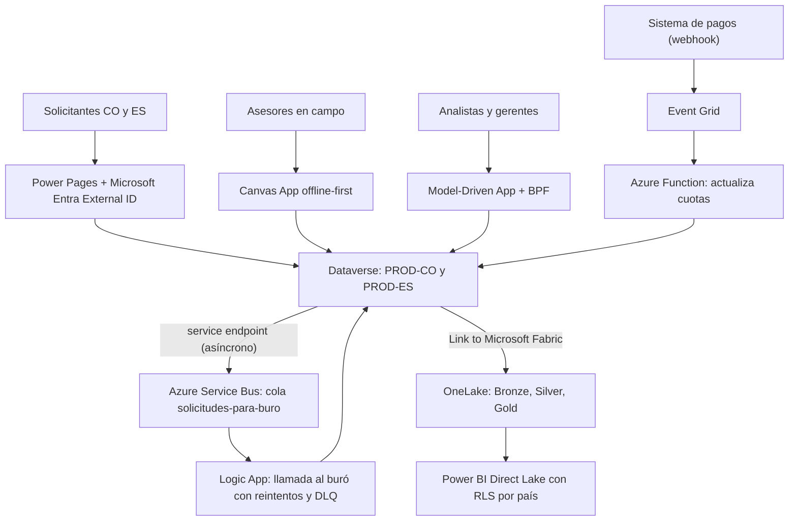

*Lectura: 25-30 min · Con práctica: unas 19 horas, mejor en seis o siete sesiones (1: Microlección 1; 2: Microlección 2; 3: Microlección 3; 4: Microlección 4 y el diagnóstico; 5: Microlección 5; 6: preparar la defensa; 7: la defensa y el reto de transferencia). La primera vez, cuenta entre una vez y media y el doble, más el tiempo de coordinar al comité si lo tienes.*

### 🎯 Objetivo
Diseñar, probar en lo esencial y **defender** la arquitectura de una solución enterprise completa, integrando todo lo del Nivel 4: topología de tenant y ambientes, identidad y seguridad, integraciones con Azure, datos analíticos, IA, ALM, gobierno, operación y plan de proyecto. Al terminar tienes un **Architecture Blueprint** con ocho ADRs, un **slice vertical** desplegado de DEV a TEST que demuestra las decisiones más arriesgadas (incluida una data policy verificada y un rollback ensayado), y una presentación que resiste las preguntas de un comité de arquitectura y de un CFO, como lo haría un Solution Architect.

> **Cómo está organizado este módulo:** es el capstone del nivel, así que "construir sin pasos" significa **decidir y defender**. El trabajo va en **cinco etapas** (descubrimiento, diseño, prueba de concepto, plan y defensa), cada una con su entregable. Cada microlección construye una parte del entregable: parte de un **borrador del equipo** (la propuesta de partida que heredas), tú decides qué sostienes y qué cambias, lo contrastas con una rúbrica "Criterio | Qué demuestra que lo cumples" y dejas la evidencia en una tabla "Campo | Tu valor". No hay una única respuesta correcta: la evidencia es tu decisión escrita con sus razones y lo que aceptas perder. Dos microlecciones tienen práctica real en el tenant; las demás son de decisión, y donde haga falta una licencia que un alumno no suele tener hay **variante en papel**. Después diagnosticarás un incidente de producción a partir del síntoma, defenderás todo ante un comité y cerrarás con un reto de transferencia en otro sector.
>
> **Antes de empezar, necesitas:**
> - Haber terminado los Niveles 1 a 3 y los **Módulos 31 a 40**. Aquí no se vuelve a explicar ningún concepto: se combinan. Cada microlección te dice qué módulo repasar si una decisión se te atraganta.
> - Un tenant **de práctica** con rol **Power Platform Administrator**, tus ambientes `SIT-DEV` (DEV) y `SIT-TEST` del [Lab 19](/labs/lab-19-cicd-azure-devops). Si vas a desplegar con pipelines in Power Platform, `SIT-TEST` debe ser Managed Environment (lo activas como en el Módulo 33). **Nunca el tenant de tu empresa.**
> - **Revisa tus ambientes antes de empezar** (tu ambiente del curso suele ser un **Trial**, que dura 30 días más una extensión y solo se puede crear y eliminar; ver [Entornos y trials](/recursos/entornos-y-trials)) ([Learn: Developer Plan](https://learn.microsoft.com/power-platform/developer/plan)): desde el **15 de noviembre de 2026** cada usuario solo puede crear **un** Developer gestionado (Managed Environment), y los Developer **no** gestionados se suspenden desde el **15 de diciembre de 2026** y se eliminan desde el 15 de enero de 2027. El capstone dura varias semanas, así que es fácil que cruces esas fechas. Además, el Developer Plan no incluye derechos de uso de Managed Environments: para ejecutar apps y flujos en un Developer gestionado necesitas una licencia premium (por ejemplo, la prueba de 30 días de Power Apps). Elige una de estas configuraciones y anótala en tu ADR-008:
>   - **(a) Dos ambientes:** `SIT-DEV` en tu Developer gestionado (o en el Sandbox que te dé tu organización) y `SIT-TEST` en tu ambiente **Trial** estándar (el Trial es uno por usuario; si tu `SIT-DEV` ya es tu Trial, usa la opción (b) o (c)) (Admin Center → **Manage** → **Environments** → **New**, **Type** **Trial**, con base de datos de Dataverse). Dura 30 días y se puede ampliar una vez otros 30 con **Extend trial**, en sus últimos siete días; **no** admite copia de seguridad ni restauración, así que el rollback por restauración del Lab 115 no te servirá ahí ([Learn: ambientes de prueba](https://learn.microsoft.com/power-platform/admin/trial-environments)). Créalo cuando llegues a la Microlección 2, no antes.
>   - **(b) Dos ambientes con Sandbox:** si tu tenant te deja crear un Sandbox, úsalo como `SIT-TEST`; es lo más parecido a un TEST real.
>   - **(c) Un solo ambiente:** haz en él la data policy de la Microlección 2 y el slice de la Microlección 4 (tabla, numeración y security role), y resuelve el paso a TEST y el rollback con la **variante en papel** de la Microlección 4. Es válido para aprobar; en tu Risk Register queda el riesgo "despliegue y rollback no probados".
> - **Si estudias solo** (sin mentor ni comité): cada paso que pide a otra persona tiene una alternativa. La revisión del mentor se reemplaza por una autorrevisión con la rúbrica de cada microlección, al menos 48 horas después de escribir. La defensa ante el comité se reemplaza por una **defensa grabada**, como se explica en **Decidir y defender**.
> - Un camino de despliegue que ya funcione: el pipeline de Azure DevOps del Lab 19 o un pipeline de **pipelines in Power Platform** (Módulos 33 y 54).
> - Para presentar: dos o tres personas que hagan de comité (un colega técnico, alguien no técnico como "CFO simulado" y, si puedes, un mentor con experiencia de arquitectura), o la defensa grabada si estudias solo.
> - El escenario y sus cifras son **ilustrativos**: sirven para razonar, no son datos de una empresa real.

### 🔧 Qué queda para después (Profundización opcional)
- **Métricas de éxito del Capstone** (plegado, antes de los Criterios de Validación): umbrales orientativos que ni los criterios ni la rúbrica de la defensa exigen.
- El **modo práctico** de los Módulos 34, 35 y 37 es el único criterio opcional: si no lo haces, tu ADR lo declara como riesgo abierto.

### 📖 Conceptos Clave
Este módulo es aplicado: no introduce productos nuevos. Estos son los artefactos que vas a producir.

- **Architecture Decision Record (ADR):** documento ligero (1-2 páginas) que registra una decisión arquitectónica importante con su contexto, las opciones consideradas, la decisión tomada y las consecuencias. Un ADR no se borra cuando la decisión cambia — se marca como "superseded" y se crea uno nuevo. Ejemplo: "ADR-003: Elegimos Power Pages sobre una aplicación React personalizada porque el equipo del cliente no tiene capacidad para mantener código custom en el largo plazo y Power Pages cubre el 95% de los requerimientos del portal sin desarrollo adicional." En este capstone cada ADR nombra además el pilar de **Power Platform Well-Architected** que paga la decisión (Reliability, Security, Operational Excellence, Performance Efficiency o Experience Optimization; Módulo 31).
- **Architecture Blueprint:** el conjunto que entregas al comité: drivers del caso (requisitos, restricciones y supuestos), Fit-Gap, diagrama de alto nivel, los ADRs, el Risk Register, la estrategia de ambientes y el plan de operación. Es el documento que otra persona puede evaluar sin que tú estés en la sala.
- **Slice vertical:** la porción mínima de la solución, construida de punta a punta, que prueba las decisiones más caras de equivocar (la tabla central con su numeración, un rol, una data policy y el camino de despliegue con su rollback). No es el MVP: es la prueba de que el Blueprint se puede construir.
- **MVP (Minimum Viable Product):** versión mínima del sistema que entrega valor real al usuario final y permite validar las hipótesis de negocio más importantes antes de invertir en las funcionalidades completas. En proyectos de Power Platform, el MVP típicamente incluye: el flujo principal de negocio funcionando end-to-end (aunque sin optimizaciones de UX), integraciones críticas sin las cuales el sistema no tiene valor, y seguridad básica. Lo que queda fuera del MVP son: reportes avanzados, integraciones secundarias, configuración de notificaciones personalizadas, y funcionalidades "nice to have".
- **Go-Live Checklist:** lista de verificación que confirma que el sistema está listo para ser usado en producción por usuarios reales. Para Power Platform incluye: Solution Checker con 0 errores críticos, pipeline CI/CD verde en todas las etapas, UAT completado y firmado por el cliente, los controles de seguridad que decidió el ADR de seguridad configurados en PROD (por ejemplo PIM y, si el ADR lo eligió y las licencias lo permiten, CMK), plan de rollback documentado y probado, runbook de operaciones creado, y training de usuarios completado. Ningún item es opcional; si alguno falla, el go-live se pospone.
- **Runbook de Operaciones:** documento que describe cómo operar y mantener el sistema en producción: cómo monitorear el estado del sistema (qué dashboards mirar, qué alertas existen), cómo responder a las alertas más comunes (procedimiento paso a paso), cómo hacer un rollback si hay un problema post-despliegue, contactos de escalamiento (quién llama a quién cuando hay un problema crítico a las 2am), y cuándo y cómo aplicar actualizaciones. Sin runbook, el equipo de operaciones improvisa ante cada incidente.
- **Stakeholder Communication Plan:** plan que define para cada stakeholder del proyecto: qué información necesita, con qué frecuencia, en qué formato, y a través de qué canal. El CFO necesita el estado financiero mensual en un email ejecutivo de 1 página; el equipo de desarrollo necesita las decisiones técnicas inmediatamente vía Teams; el usuario final necesita avisos de mantenimiento con 48h de antelación vía email. Sin este plan, la comunicación es reactiva y genera fricción.

**Escenario del proyecto:**
Empresa de servicios financieros con 1,500 empleados en Colombia y España. Necesita modernizar su sistema de gestión de créditos: desde la solicitud del cliente hasta el desembolso y seguimiento del crédito, con cumplimiento GDPR (España) y Ley 1581 (Colombia).

**Datos del caso (ilustrativos) que usarás en todas las microlecciones:**

| Dato | Valor |
|---|---|
| Solicitudes de crédito | unas 4.000 al mes (65 % Colombia, 35 % España); picos de 3x a fin de mes |
| Usuarios internos | 120 asesores comerciales en campo (a veces sin cobertura), 40 analistas, 10 gerentes de crédito, 6 auditores |
| Solicitantes externos | personas naturales de ambos países, sin cuenta en el tenant |
| Buró de crédito | uno por país; API REST con un límite de 10 llamadas por segundo y ventanas de mantenimiento nocturnas de hasta 4 horas |
| Sistema de pagos | externo; notifica cada pago recibido por webhook |
| Licencias actuales | Microsoft 365 E3 y Microsoft Entra ID P1 para todos; el presupuesto del proyecto admite **una** ampliación de licencias de seguridad |
| Equipo | 2 makers, 2 desarrolladores .NET, 1 administrador de la plataforma; hay un equipo de Azure corporativo que opera suscripciones |
| Plazo | el sponsor pide el MVP en producción en Colombia en 6 meses y en España 3 meses después |
| Política del DPO | los datos personales de solicitantes españoles no salen del Espacio Económico Europeo; los de Colombia, según la autorización de transferencia que exija la Ley 1581 |
| Restricciones de gobierno | al menos una data policy que separe conectores de uso empresarial (Dataverse, SharePoint) de conectores no aprobados (HTTP genérico, servicios de terceros no auditados); soporte post go-live en los dos países con SLA definido, también fuera de horario (la España peninsular va 6 o 7 horas por delante de Colombia según el horario de verano); reglas de aprobación de cambios: qué puede ir directo a TEST y qué necesita un comité de cambios antes de PROD |

**Diagrama: la arquitectura de partida que propone el equipo (la vas a cuestionar)**



---

## 🏁 Etapa 1 — Descubrimiento: drivers, Fit-Gap y la lista de ADRs (Microlección 1)

**Entregable de esta etapa:** la tabla de drivers, el Fit-Gap, la plantilla de ADR en tu repositorio y el ADR-002 completo.

**Tiempo estimado:** ≈75 min.

**¿Qué vas a aprender?** A convertir un escenario en **drivers** (requisitos, restricciones y supuestos) y a deducir de ellos qué decisiones necesitan un ADR, antes de dibujar nada.

**¿Por qué existe esto?** Un Blueprint que empieza por el diagrama acaba justificando el diagrama. Uno que empieza por los drivers deja ver qué decisiones ya están tomadas por una restricción (el DPO, las licencias, el plazo) y cuáles son de verdad tuyas. Es la misma lectura del caso del Módulo 40, ahora con tu propio proyecto.

**Ahora haz algo (10 min):** de la tabla de datos del caso, separa en tres columnas: **requisito** (lo que el sistema debe hacer), **restricción** (lo que limita cómo lo haces) y **supuesto** (lo que das por cierto sin que nadie lo haya confirmado). Pista: "el buró tiene ventanas de mantenimiento de 4 horas" es una restricción; "el buró acepta llamadas desde Azure" es un supuesto hasta que alguien lo pruebe. Si quieres repasar el método, vuelve a **[Leer el caso de ensayos clínicos y descartar lo que viola una restricción](/practica/ip-arq-031-ensayos-clinicos-restricciones)**.

**Práctica (papel, 50 min):**

1. Escribe la tabla de drivers con al menos 8 requisitos, 6 restricciones y 4 supuestos. Para cada supuesto, anota quién lo confirma y para cuándo.
2. Haz el **Fit-Gap** de los requisitos con la misma taxonomía del Módulo 38: para cada uno, **Fit** (lo cubre la plataforma sin desarrollo), **Partial Fit** (configuración adicional o customización menor), **Gap** (necesita desarrollo o integración: plugin, PCF, integración externa) o **Exclusión** (fuera del alcance del proyecto).
3. Copia en tu repositorio (por ejemplo `docs/adr/`) esta plantilla y crea un archivo por ADR. Los ocho del capstone son los de la lista de abajo; cada microlección te pide escribir dos o tres.

```markdown
# ADR-NNN: <decisión en una frase>
Estado: propuesto | aceptado | superseded por ADR-MMM
Fecha: AAAA-MM-DD · Autor: <tú> · Revisó: <mentor, par o "autorrevisión">

## Contexto
Drivers que obligan a decidir (cita la fila de tu tabla de drivers).

## Opciones consideradas
1. <opción> — ventajas / desventajas
2. <opción> — ventajas / desventajas
3. <opción> — ventajas / desventajas

## Decisión
Elegimos X porque Y, aunque consideramos Z, que rechazamos por W.

## Consecuencias
- ✅ Lo que ganamos
- ⚠️ Lo que aceptamos perder (al menos una) y el pilar de Well-Architected que lo paga
- 🔗 Enlaces de Learn que respaldan cada afirmación técnica
```

**Los ocho ADRs del capstone** (el borrador del equipo traía cinco; dos de sus opciones ya no existen como tales y se corrigieron):

| ADR | Decisión | Microlección |
|---|---|---|
| ADR-001 | Topología: tenants, ambientes y regiones para Colombia y España | 2 |
| ADR-002 | Sistema de registro del core de créditos: Dataverse o Azure SQL | 1 (ahora) |
| ADR-003 | Portal de solicitantes: Power Pages con Microsoft Entra External ID o una app web a medida (el borrador lo comparaba con un "D365 Portal"; hoy la plataforma de Power Platform para sitios externos es Power Pages, así que la alternativa real es una app web a medida: [Learn: qué es Power Pages](https://learn.microsoft.com/power-pages/introduction)) | 2 |
| ADR-004 | Integración con los burós: Logic Apps con Service Bus o Power Automate | 3 |
| ADR-005 | Analítica: Link to Microsoft Fabric con Medallion, Azure Synapse Link for Dataverse o Power BI sobre Dataverse (el borrador decía "Fabric vs Azure Synapse": la decisión real es cómo llegan los datos y dónde viven, Módulo 35) | 3 |
| ADR-006 | IA: modelos de AI Builder, prompts o Microsoft Foundry, y qué consumen | 3 |
| ADR-007 | Seguridad y cumplimiento: qué controles, con qué licencias y en qué orden | 2 |
| ADR-008 | ALM y cambios: cuántas soluciones, qué herramienta de despliegue, quién aprueba y cómo se hace rollback | 4 |

4. **Decisión: escribe el ADR-002 completo.** Usa al menos estos argumentos: modelo relacional y seguridad por fila de Dataverse frente a la libertad de esquema y el costo de Azure SQL; quién construye los formularios, la auditoría y los procesos en cada opción; y la capacidad de Database de Dataverse que consumirán 4.000 solicitudes al mes con sus documentos (Learn indica que los archivos adjuntos, como un PDF, se guardan en la capacidad de **File** y que la base de datos solo guarda los atributos para acceder a ellos: [Learn: capacidad de Dataverse](https://learn.microsoft.com/power-platform/admin/capacity-storage)).

**Rúbrica de la microlección:**

| Criterio | Qué demuestra que lo cumples |
|---|---|
| Restricción frente a preferencia | Cada restricción de tu tabla tiene al lado la opción que descarta |
| Supuestos con dueño | Ningún supuesto queda sin quién lo confirma ni fecha |
| Fit-Gap honesto | Al menos un requisito está en **Exclusión** o explicas por qué ninguno lo está |
| ADR-002 defendible | Tiene tres opciones (Dataverse, Azure SQL, y una tercera, por ejemplo SharePoint Lists, descartada por una restricción) y una consecuencia ⚠️ |

**Evidencia a reportar:**

| Campo | Tu valor |
|---|---|
| Número de requisitos, restricciones y supuestos de tu tabla | ___ |
| El supuesto más peligroso, quién lo confirma y para cuándo | ___ |
| Requisitos en **Gap** (cuáles y con qué pieza) | ___ |
| Decisión del ADR-002 y su consecuencia ⚠️ | ___ |
| Ruta de tu repositorio donde viven los ADRs | ___ |

---

## 🏁 Etapa 2 — Diseño: topología, seguridad, integración, datos e IA (Microlecciones 2 y 3)

**Entregable de esta etapa:** seis ADRs (001, 003, 007, 004, 005 y 006), una data policy verificada en `SIT-TEST` (o su variante en papel), la hoja de costos y el diagrama corregido.

**Tiempo estimado:** ≈360 min, en dos sesiones.

### 🧩 Microlección 2 — Topología, identidad y seguridad (≈180 min)

**¿Qué vas a aprender?** A cerrar ADR-001, ADR-003 y ADR-007 con los criterios de los Módulos 33 y 36, y a **verificar** en tu tenant al menos un control de gobierno, no solo describirlo.

**¿Por qué existe esto?** Son las decisiones más caras de deshacer: separar o unir tenants después cuesta una migración, mover un ambiente de geografía cambia su URL y su ID, y un control de seguridad elegido sin mirar las licencias se queda en el papel. La rúbrica de cierre pide además una data policy **verificada en la prueba**.

**El borrador del equipo dice (sostén o corrige cada línea):**

```
- Dos tenants, uno por país, "porque el GDPR lo exige"
- Región "West Europe" para España
- Registro de solicitantes con Azure AD B2C
- CMK habilitado en PROD "para cumplir GDPR y Ley 1581"
- Field Security: número de cuenta bancaria visible solo a Gerente de Crédito
- Row-level: el Asesor Comercial solo ve sus propios clientes
- Roles: Asesor Comercial, Analista de Crédito, Gerente de Crédito, Auditor
- PIM para administradores; Conditional Access con MFA para entrar a PROD
- Purview clasifica los datos de crédito como "Confidencial"; Sentinel alerta descargas masivas
```

**Ahora haz algo — micropráctica (8 min):** → **[Decidir: el Blueprint de créditos, línea por línea](/practica/ip-arq-034-blueprint-creditos-decisiones)**. Selecciona las decisiones del Blueprint que defenderías y mira la consecuencia de cada una. Si dudas con la topología, repasa **[¿un tenant con ambientes o varios tenants?](/practica/ip-arq-016-un-tenant-o-varios)**; con los controles, **[qué control para cada amenaza](/practica/ip-arq-019-control-para-cada-amenaza)**.

Lo que ya sabes y debes aplicar (cada punto está verificado en el módulo que se cita):

- La residencia de datos se resuelve con la **Region** de cada ambiente, no exige otro tenant; en el Admin Center eliges una Region o una macro región (por ejemplo **European Union (EU) and European Free Trade Association (EFTA)** si se exige la EU Data Boundary), no un datacenter como "West Europe" (Módulo 33).
- Azure AD B2C ya no se vende a clientes nuevos desde el 1 de mayo de 2025; Power Pages admite **Microsoft Entra External ID** como proveedor de identidad, configurado en el design studio en **Security** > **Identity providers** ([Learn: Entra External ID con Power Pages](https://learn.microsoft.com/power-pages/security/authentication/entra-external-id); Módulo 40).
- CMK solo se aplica a Managed Environments, exige licencias de cumplimiento tipo Microsoft 365 E5/A5/G5 para los usuarios, y si la clave se revoca el ambiente queda bloqueado. Es un control de cifrado, no el cumplimiento de una norma (Módulos 36 y 40). Con E3 y P1, CMK solo es posible si la **única** ampliación de licencias va a cumplimiento, y entonces no hay presupuesto para PIM (que exige Entra ID P2): esa es la decisión del ADR-007.

**Práctica real en tu entorno (45 min) — verificar una data policy en `SIT-TEST`:**

> **Antes de empezar:** una data policy afecta a **todas** las apps y flujos del ambiente al que la apliques. Aplícala solo a `SIT-TEST` (o a un ambiente de prueba creado para el capstone) y revisa antes qué flujos tiene y qué conectores usan: si alguno usa HTTP o mezcla conectores que vas a dejar en grupos distintos, quedará suspendido. Para crear una política de nivel de inquilino necesitas el rol **Power Platform Administrator** ([Learn: gestionar data policies](https://learn.microsoft.com/power-platform/admin/prevent-data-loss)).

1. En el [Power Platform Admin Center](https://admin.powerplatform.microsoft.com), selecciona **Security** en el panel de navegación; en el panel **Security**, bajo **Settings**, **Data and privacy**; en la pantalla de protección de datos, la sección **Data policy** y **+ New Policy**.
2. **Policy name:** `Capstone - Credito - TEST`. **Next**.
3. **Prebuilt connectors:** busca **Dataverse**, selecciónalo y elige **Move to Business**. Haz lo mismo con **SharePoint** y con los conectores que ya usan los flujos de `SIT-TEST` junto a Dataverse (por ejemplo **Approvals**, **Office 365 Outlook** o **Microsoft Teams**, si los usaste en el Lab 05): dos conectores solo pueden convivir en un flujo si están en el mismo grupo, y uno que olvides dejará suspendido el flujo que ya funcionaba. Busca **HTTP** y muévelo a **Blocked**. Anota qué ves en la columna **Blockable** de Dataverse: Learn indica que Dataverse no se puede bloquear, solo clasificar como Business o Non-business ([Learn: clasificación de conectores](https://learn.microsoft.com/power-platform/admin/dlp-connector-classification)). Deja el grupo por defecto para conectores nuevos en **Non-business** (Learn lo recomienda). **Next**.
4. **Custom connectors:** deja el patrón por defecto y **Next**. Anota cómo se clasifican los conectores personalizados en una política de inquilino: por patrones de la URL del host, no por nombre.
5. **Scope:** elige **Add multiple environments** y **Next**. En **Environments**, selecciona solo `SIT-TEST`, usa **Add to policy** y comprueba en la lista que es el único ambiente incluido antes de seguir. **Next**.
6. **Review:** revisa y selecciona **Create policy**. **Si no ves Data policy o el botón está deshabilitado**, tu rol no basta: pasa a la variante en papel.
7. **Comprobarla (la política tarda unos minutos en aplicarse; si al principio no ves efecto, espera y repite):** en [make.powerautomate.com](https://make.powerautomate.com), cambia al ambiente `SIT-TEST`, **My flows** → **New flow** → **Instant cloud flow**, disparador **Manually trigger a flow**. Añade la acción de Dataverse **List rows** sobre cualquier tabla, después una acción **HTTP** contra `https://example.com`, y **Save**. **Qué deberías ver:** según Learn, en Power Automate un flujo que usa un conector **bloqueado**, o conectores de grupos que no pueden convivir, **se guarda igualmente**, el diseñador muestra un error de data policy y el flujo queda marcado como **Suspended**: no se ejecuta hasta que se resuelva la violación. Que el diseñador te deje añadir HTTP **no** significa que la política falló. En Power Apps es distinto: la app no añade la conexión ([Learn: impacto de las data policies](https://learn.microsoft.com/power-platform/admin/dlp-impact-policies-apps-flows), [Learn: gestionar data policies](https://learn.microsoft.com/power-platform/admin/prevent-data-loss)). Anota el mensaje del diseñador y el estado del flujo en **My flows**. **Si el flujo se guarda sin error y no queda Suspended**, la política aún no se aplicó o el ambiente no está en su alcance: revisa el paso 5 y espera unos minutos.
8. Para ver el segundo caso (conectores de grupos distintos, ninguno bloqueado), quita la acción HTTP y añade en su lugar cualquier acción del conector **RSS** (no lo clasificaste, así que quedó en **Non-business**, el grupo por defecto). Guarda y anota el mensaje exacto del diseñador y el estado del flujo en **My flows**. Después quita la acción RSS, guarda otra vez y anota si el error desaparece.
9. **Limpieza:** si el tenant es compartido, elimina la política (**Delete Policy**) o déjala solo sobre `SIT-TEST`; anota cuál de las dos cosas hiciste. Si tu ADR-007 dice que PROD tendrá esta misma política, mantenerla en TEST es lo correcto: lo verás en el diagnóstico.

**Variante en papel (sin rol de administrador):** escribe la política que crearías (nombre, conectores en cada grupo, alcance) y qué pasaría con un flujo existente que use Dataverse y HTTP al publicarla, con la cita de Learn.

**Decisión (papel, 90 min): escribe ADR-001, ADR-003 y ADR-007.** Para el ADR-007, contrasta al menos tres opciones de la única ampliación de licencias, como en el Módulo 36: (a) cumplimiento (E5 o complemento: CMK, Customer Lockbox, IP firewall, Audit Premium); (b) Entra ID P2 (PIM); (c) no ampliar y cubrir con Conditional Access, data policies, IP cookie binding y auditoría de Dataverse.

**Rúbrica de la microlección:**

| Criterio | Qué demuestra que lo cumples |
|---|---|
| Residencia separada de tenant | ADR-001 explica si España necesita otro tenant o solo otra Region, con la Region real del Admin Center |
| Identidad externa vigente | ADR-003 usa Microsoft Entra External ID y dice por qué no una app a medida |
| Controles que caben en las licencias | Cada control del ADR-007 existe con E3 + P1 o con la ampliación elegida, y dices qué riesgo queda abierto |
| Control verificado, no descrito | Tienes el mensaje del diseñador y el estado **Suspended** del flujo (o la variante en papel con su cita) |
| Una pérdida aceptada por ADR | Cada uno de los tres ADRs tiene una consecuencia ⚠️ con su pilar |

**Evidencia a reportar:**

| Campo | Tu valor |
|---|---|
| Conectores en **Business** y en **Blocked** de tu política, y lo que mostró **Blockable** para Dataverse | ___ |
| Mensaje del diseñador y estado del flujo al guardarlo con **HTTP** (conector bloqueado) | ___ |
| Mensaje del diseñador al guardar el flujo con Dataverse + RSS y estado en **My flows** | ___ |
| Estado del flujo tras quitar la acción RSS | ___ |
| ADR-001: número de tenants y Region de PROD-ES y de PROD-CO | ___ |
| ADR-007: ampliación de licencias elegida, controles resultantes y el riesgo que queda abierto con su dueño | ___ |

---

### 🧩 Microlección 3 — Integración, datos e IA (≈180 min)

**¿Qué vas a aprender?** A cerrar ADR-004, ADR-005 y ADR-006 juntando lo que decidiste en los Módulos 34, 35 y 37, y a escribir qué cuesta cada decisión en capacidad, créditos y operación.

**¿Por qué existe esto?** Son las decisiones que más se "heredan" de un proyecto anterior sin revisarlas: "siempre usamos Logic Apps", "el reporting va en Fabric". El caso tiene restricciones que pueden cambiar la respuesta: un buró con ventanas de mantenimiento, un volumen moderado, un equipo con dos desarrolladores .NET y créditos de IA que desde el 1 de noviembre de 2026 se pagan como **Copilot Credits** ([Learn: fin de los AI Builder credits](https://learn.microsoft.com/ai-builder/endofaibcredits)).

**El borrador del equipo dice (sostén o corrige cada línea):**

```
Integración con el buró:
  - Plugin asíncrono EvaluacionPostCreate o service endpoint → cola "solicitudes-para-buro" de Service Bus
  - Logic App: recibe el mensaje, llama al buró con retry policy, actualiza Dataverse con el score
  - Si la API del buró falla 3 veces → DLQ + alerta al equipo
  - APIM expone las APIs de Dataverse a sistemas externos
Pagos:
  - Event Grid recibe el pago y lo distribuye a una Azure Function (actualiza la cuota en Dataverse)
    y a una Logic App (genera el recibo PDF y lo envía al cliente)
Analítica:
  - Link to Microsoft Fabric con todas las tablas del crédito; Bronze, Silver y Gold;
    Power BI Direct Lake con RLS por país
IA:
  - AI Builder extrae los ingresos de los documentos cargados en el portal
  - Modelo de predicción de probabilidad de mora entrenado con el historial
```

Preguntas que el comité te hará y que tu ADR debe contestar:

- **ADR-004:** ¿el mensaje sobrevive a una ventana de mantenimiento de 4 horas del buró (TTL de la cola mayor que la caída y dead-lettering por expiración, Módulo 34)? ¿Cómo respetas el límite de 10 llamadas por segundo? ¿Quién reenvía desde la DLQ y con qué runbook? ¿Necesitas APIM en el MVP, o es una pieza más que operar? Si eliges Power Automate, ¿qué pierdes en reintentos, operación y licencias?
- **ADR-005:** ¿las 4.000 solicitudes al mes justifican Fabric con tres lakehouses, o basta un modelo de Power BI sobre Dataverse en el MVP y Fabric cuando lleguen otras fuentes? Si eliges Link to Microsoft Fabric: ¿qué tablas vinculas (cada una consume capacidad de Database de Dataverse), qué variante de Direct Lake usa el modelo y cómo se separan los datos de España y Colombia si viven en ambientes de regiones distintas? (Módulo 35.)
- **ADR-006:** ¿los comprobantes de ingresos de dos países son un documento con estructura fija o variable (custom **Fixed template documents** o **General documents**)? ¿Qué umbral de confianza manda a revisión humana? ¿El modelo de predicción tiene el historial mínimo (al menos 50 filas y 10 por clase; Learn recomienda 1.000) y **quién decide** con su resultado? ¿Cuántos Copilot Credits consume al mes tu diseño y quién los paga? (Módulo 37.)

**Ahora haz algo — repaso dirigido (15 min):** si en alguno de los tres ADRs no sabes qué contestar, vuelve a la micropráctica del módulo que lo trata: **[Elegir el motor y el modelo de integración](/practica/ip-int-004-elegir-motor-y-modelo)**, **[Elegir cómo llega Dataverse a Fabric y dónde va cada capa](/practica/ip-arq-022-elegir-link-a-fabric-y-capas)** o **[Prebuilt, custom, prompt o Azure](/practica/ip-ia-001-prebuilt-custom-prompt-o-azure)**.

**Práctica (papel, 150 min; modo práctico opcional):**

1. Escribe ADR-004, ADR-005 y ADR-006 con la plantilla de la Microlección 1.
2. **Reutiliza tu evidencia real:** si hiciste las prácticas reales de los Módulos 34 (Service Bus y Logic Apps), 35 (Link to Microsoft Fabric) o 37 (modelo de documentos con umbral), enlaza su tabla de evidencia desde el ADR correspondiente: es la prueba de que la decisión se puede construir. Si no las hiciste, el ADR lo dice en **Consecuencias** como riesgo abierto ("no probado en un tenant").
3. Completa una **hoja de costos y capacidad** de una página: capacidad de Database y de File de Dataverse estimada a 12 meses, recursos de Azure con su tier (Service Bus, Logic Apps, APIM si lo mantienes), capacidad de Fabric si la eliges, y Copilot Credits estimados para la IA. No inventes precios: escribe la **unidad** que se factura y de dónde sacarías el precio.
4. Dibuja tu diagrama de alto nivel corregido (draw.io o Mermaid) a partir del de partida.

**Rúbrica de la microlección:**

| Criterio | Qué demuestra que lo cumples |
|---|---|
| El fallo está diseñado | ADR-004 dice qué pasa en la ventana de mantenimiento del buró y con un mensaje que agota los reintentos |
| La pieza se justifica por el volumen | ADR-005 relaciona su decisión con las 4.000 solicitudes al mes y con la capacidad que consume |
| La IA tiene una persona al final | ADR-006 fija un umbral de confianza, quién revisa por debajo y quién decide sobre el crédito |
| El costo tiene unidad | La hoja de costos nombra la unidad de facturación de cada pieza, incluidos los Copilot Credits |
| Lo no probado está declarado | Cada decisión sin evidencia real aparece como riesgo abierto en su ADR |

**Evidencia a reportar:**

| Campo | Tu valor |
|---|---|
| ADR-004: motor elegido, TTL de la cola y qué pasa en la ventana de mantenimiento | ___ |
| ADR-005: mecanismo elegido y qué decide que no sea otro | ___ |
| ADR-006: tipo de modelo, umbral de revisión humana y quién decide el crédito | ___ |
| Las tres piezas más caras de tu hoja de costos y su unidad de facturación | ___ |
| Evidencia real reutilizada de los Módulos 34, 35 o 37 (o "no probado") | ___ |

---

## 🏁 Etapa 3 — Prueba de concepto: el slice vertical y un incidente (Microlección 4)

**Entregable de esta etapa:** el slice vertical desplegado en `SIT-TEST` y un rollback ensayado y medido (o su variante en papel), el ADR-008, el Go-Live Checklist, el runbook y el diagnóstico del incidente.

**Tiempo estimado:** ≈150 min, más el diagnóstico.

### 🧩 Microlección 4 — El slice vertical y el camino a producción (≈150 min)

**¿Qué vas a aprender?** A construir la porción mínima que prueba que tu Blueprint se puede desplegar, a ensayar un rollback y a escribir el ADR-008, el Go-Live Checklist y el runbook con lo que viste, no con lo que supones.

**¿Por qué existe esto?** La rúbrica de cierre pide un pipeline con gates entre ambientes y un **rollback probado al menos una vez**. El rollback es la parte que casi nadie ensaya y la que más falla el día que hace falta: un despliegue de soluciones solo admite versiones superiores salvo que el pipeline permita redesplegar versiones anteriores, y redesplegar borra lo que la versión nueva añadió ([Learn: pipelines, FAQ de rollback](https://learn.microsoft.com/power-platform/alm/pipelines)).

**Práctica real en tu entorno (100 min):**

1. **Solución del slice (DEV, 25 min).** En [make.powerapps.com](https://make.powerapps.com), en DEV, crea la solución `SIT Capstone Credito` con tu publisher `sit`. Dentro, la tabla **Solicitud de Crédito** con: la columna principal (anota su nombre interno, como en el LAB-02), una columna **Choice** `Estado` (Recibida, En análisis, Aprobada, Rechazada, Desembolsada), una columna **Currency** `Monto solicitado` y una columna **Lookup** a **Contact** para el solicitante.
2. **Configurar primero: la numeración (10 min).** El borrador pedía un plugin `SolicitudPreCreate` que generara `SOL-CO-2026-XXXXX` / `SOL-ES-2026-XXXXX`. Antes de escribir código, prueba lo nativo: en la tabla, **Columns** → **New column**, **Display name** `Número de solicitud` y **Data type** **Autonumber**. Elige el tipo (**String prefixed number** o **Date prefixed number**), el prefijo y la semilla (por defecto 1000), y guarda ([Learn: columnas autonuméricas](https://learn.microsoft.com/power-apps/maker/data-platform/autonumber-fields)). Crea dos filas y anota los números que se generan. Ojo con dos datos de Learn que van a tu ADR: la numeración puede tener huecos (un número asignado a una fila que no se guardó no se reutiliza) y la semilla **no viaja** en la solución: se fija en cada ambiente. Decide: ¿una secuencia por ambiente (PROD-CO y PROD-ES) basta, o el negocio exige el código de país y una secuencia propia dentro del **mismo** ambiente? Solo lo segundo justifica el plugin.
3. **Seguridad mínima (15 min).** Crea en la solución el security role `SIT Asesor Comercial` (Learn sugiere partir de una copia del rol predefinido **App Opener**, que trae los privilegios mínimos para abrir una app: [Learn: security roles y privilegios](https://learn.microsoft.com/power-platform/admin/security-roles-privileges)). Concede, como mínimo para crear solicitudes con su solicitante:
   - Sobre **Solicitud de Crédito**, nivel **User** (el asesor solo ve lo suyo): **Create**, **Read**, **Write** y **Append** (Append porque la solicitud se asocia a un Contact por el lookup).
   - Sobre **Contact**: **Read** y **Append To** (para que una solicitud pueda asociarse a ese contacto), con el nivel que decidas: ¿el asesor elige entre todos los contactos o solo entre los suyos?

   Si tienes un segundo usuario, prueba el rol con él: si al guardar una solicitud aparece un error de privilegios, el mensaje dice cuál falta. Anota qué privilegio dejaste sin conceder (por ejemplo **Delete**) y por qué.
4. **Desplegar a `SIT-TEST` (20 min).** Despliega la solución como **managed** a `SIT-TEST` con tu camino de despliegue (el pipeline del [Lab 19](/labs/lab-19-cicd-azure-devops) o un pipeline de pipelines in Power Platform). Anota quién aprobó el despliegue o qué gate lo detuvo. Recuerda lo que viste en la Microlección 2: en `SIT-TEST` hay una data policy; si tu solución tuviera un flujo con HTTP, ¿dónde te habrías enterado?
5. **Versión 1.1 y rollback ensayado (30 min).** En DEV, añade a la tabla una columna nueva (por ejemplo `Canal de origen`), sube la versión de la solución y despliégala a `SIT-TEST`. Crea una fila en TEST que use esa columna. Ahora ensaya volver a la versión anterior con **uno** de estos métodos y **mide cuánto tardas**:
   - **Pipelines in Power Platform:** si el pipeline tiene activado **Allow redeployments of older versions**, en la página **Pipelines** de tu solución elige el pipeline, **Run history**, los puntos suspensivos junto al despliegue anterior y **Redeploy**. Learn advierte que redesplegar sobrescribe la versión más reciente **y sus datos**, de forma irreversible, y que se eliminan sus novedades, incluidas tablas nuevas ([Learn: redesplegar versiones anteriores](https://learn.microsoft.com/power-platform/alm/redeploy-past-solution-versions)). Anota qué pasó con la columna `Canal de origen` y con el dato que guardaste.
   - **Azure DevOps (Lab 19):** como solo se pueden importar versiones superiores, el rollback es *fix-forward*: revierte el cambio en DEV (o en el repositorio), sube otra vez la versión y despliega. Anota qué tuviste que hacer y si la columna desapareció de TEST.
   - **Restaurar el ambiente:** con el procedimiento del [Lab 115](/labs/lab-115-disaster-recovery-backup-restore-rto-rpo), restaura una copia de `SIT-TEST` anterior al despliegue. Anota el RTO real. No sirve si tu `SIT-TEST` es un Trial: Learn indica que un Trial no admite copias de seguridad ni restauraciones.
6. **Si algo no te deja seguir** (no tienes pipeline, el despliegue falla por dependencias, la opción de redespliegue no aparece): anota el mensaje exacto. Es evidencia válida para el ADR-008 y para el Risk Register.

**Variante en papel (sin un segundo ambiente):** escribe el procedimiento de rollback de cada uno de los tres métodos con el riesgo de datos que tiene cada uno, y cuál elegirías para PROD-CO.

**Decisión (papel, 50 min):**

1. **ADR-008 — ALM y cambios.** Cuántas soluciones (Learn recomienda una sola en implementaciones pequeñas y medianas, y capas Foundation + una por dominio cuando hay varios equipos o ritmos; Módulo 40; el borrador traía seis sin justificar), qué herramienta de despliegue (pipelines in Power Platform no despliegan a otro tenant y entre geografías solo si el host tiene activado **Cross-Geo Solution Deployments**, [Learn](https://learn.microsoft.com/power-platform/alm/pipelines)), quién aprueba antes de PROD (en pipelines in Power Platform, con despliegues delegados), qué cambios van directo a TEST y cuáles pasan por el comité de cambios (incluidos los cambios de data policies y de reglas de grupos de ambientes), y tu método de rollback con su riesgo de datos.
2. **Go-Live Checklist** del MVP de Colombia, con un dueño y una evidencia por ítem.
3. **Runbook** de una página: monitoreo, las tres alertas más probables (DLQ del buró, flujo crítico detenido, ambiente bloqueado o lento), escalamiento en los dos países y fuera de horario, y el procedimiento de rollback que ensayaste.

**Rúbrica de la microlección:**

| Criterio | Qué demuestra que lo cumples |
|---|---|
| Configurar antes que codificar | La decisión sobre la numeración se apoya en lo que viste con la columna Autonumber |
| Despliegue gobernado | La solución llegó a TEST como managed por el camino de despliegue, con su gate o aprobación anotados |
| Rollback ensayado y medido | Tienes el método, el tiempo y lo que se perdió (o la variante en papel con el riesgo de cada método) |
| El ADR-008 cubre los cambios de gobierno | Los cambios de data policies y de reglas de grupo pasan por el mismo control que los de soluciones |
| Checklist con evidencia | Cada ítem del Go-Live Checklist tiene dueño y la prueba que lo cierra |

**Evidencia a reportar:**

| Campo | Tu valor |
|---|---|
| Números generados por la columna Autonumber y tu decisión sobre el plugin | ___ |
| Camino de despliegue usado y quién o qué aprobó el paso a TEST | ___ |
| Método de rollback, tiempo medido y qué pasó con la columna y el dato de la v1.1 | ___ |
| ADR-008: número de soluciones y herramienta de despliegue, con la razón | ___ |
| Tres ítems del Go-Live Checklist con su dueño y su evidencia | ___ |

---

### 🔧 Diagnosticar — "el lunes nadie recibió su score"

Antes de la Microlección 5, resuelve este incidente empezando por el síntoma:

**[Diagnosticar: las solicitudes de Colombia se quedaron sin score tras un cambio de gobierno](/practica/ip-arq-035-score-detenido-tras-data-policy)**

Síntoma: el viernes por la tarde, el equipo de seguridad publicó una data policy corporativa para los ambientes de producción. El lunes, las solicitudes de Colombia se acumulan en **En análisis** sin score del buró; la DLQ de la cola del buró está vacía y la Logic App no registra ejecuciones desde el viernes. En TEST, el mismo proceso funcionó el jueves. Antes de abrir nada, escribe **tres hipótesis** (una sobre la implementación, una sobre el cambio del viernes y una sobre el monitoreo) y qué evidencia confirmaría o descartaría cada una.

| Campo | Tu valor |
|---|---|
| Tus tres hipótesis y la evidencia que revisarías para cada una | ___ |
| La primera evidencia que explica por qué TEST no lo detectó | ___ |
| Qué haces hoy, qué corriges en el diseño y qué cambias en el proceso de cambios | ___ |

---

## 🏁 Etapa 4 — Plan: riesgos, costos y comunicación (Microlección 5)

**Entregable de esta etapa:** el MVP con MoSCoW, el plan por fases, la estimación como rango, el Risk Register de 10 riesgos y el plan de comunicación.

**Tiempo estimado:** ≈165 min.

**¿Qué vas a aprender?** A convertir el Blueprint en un plan que un sponsor puede aprobar: MVP con alcance explícito, estimación como rango, Risk Register y un plan de comunicación por audiencia (Módulo 38).

**¿Por qué existe esto?** Un comité aprueba arquitecturas que sabe cuándo, cuánto y con qué riesgo se entregan. El sponsor quiere Colombia en 6 meses y España 3 meses después; tu Blueprint tiene ocho decisiones, algunas sin probar. El plan es donde se ve si ambas cosas caben.

**El borrador del equipo dice:** "Entregable 1: Blueprint (semanas 1-2); 2: modelo de datos y core (3-6); 3: aplicaciones — Power Pages, Canvas offline para asesores, Model-Driven con BPF Recepción → Análisis → Aprobación → Desembolso, y un agente de Copilot Studio en Teams para asesores (7-12); 4: integraciones (13-18); 5: analítica y gobierno (19-22); 6: presentación ejecutiva (23)". Son 23 semanas, todo en serie, sin UAT, sin migración de datos y con la IA y el agente dentro del MVP.

**Práctica (papel, 150 min):**

1. **MVP con MoSCoW:** clasifica cada pieza del borrador (portal, app de asesores, Model-Driven con BPF, integración con el buró, pagos, analítica, extracción de documentos, predicción de mora, agente de Copilot Studio, CoE) en Must, Should, Could o Won't para el go-live de Colombia. Justifica cada Must con un requisito de tu tabla de drivers.
2. **Plan por fases:** reordena el borrador para que el MVP de Colombia quepa en 6 meses con el equipo del caso, incluidos UAT, migración de los datos que existan y la formación. Di qué se hace en paralelo y qué depende de qué.
3. **Estimación como rango** con sus tres supuestos principales y la contingencia (Módulo 38).
4. **Risk Register** con los 10 riesgos principales: probabilidad (1-5), impacto (1-5), score, mitigación, contingencia, dueño y disparador con fecha. Al menos tres deben salir de tus ADRs (por ejemplo, "no probado en un tenant") y uno del diagnóstico.
5. **Stakeholder Communication Plan:** CFO, DPO, CISO, gerentes de crédito, asesores y equipo de operaciones: qué necesita cada uno, con qué frecuencia, en qué formato y por qué canal.

**Rúbrica de la microlección:**

| Criterio | Qué demuestra que lo cumples |
|---|---|
| Alcance explícito | Cada pieza del borrador tiene su MoSCoW y los Must están ligados a un requisito |
| Plan realista | El plan del MVP incluye UAT, migración y formación, y dice qué variable flexibilizas si no cabe |
| Riesgos con disparador | Los riesgos tienen dueño, mitigación, contingencia y una fecha que los activa, no solo una descripción |
| Comunicación por audiencia | El CFO y el DPO reciben cosas distintas, en formatos distintos |

**Evidencia a reportar:**

| Campo | Tu valor |
|---|---|
| Piezas que quedaron fuera del MVP de Colombia y por qué | ___ |
| Duración del MVP como rango y su supuesto principal | ___ |
| Los tres riesgos de mayor score con su dueño y disparador | ___ |
| Qué recibe el DPO, con qué frecuencia y en qué formato | ___ |

---

## 🏁 Etapa 5 — Defensa: Decidir y defender ante el comité de arquitectura

**Entregable de esta etapa:** el Architecture Blueprint entregado, la presentación de 10 slides defendida (o la defensa grabada) y tu puntaje con la rúbrica.

**Tiempo estimado:** ≈240 min.

Junta las cinco microlecciones en el **Architecture Blueprint** y defiéndelo ante tu comité simulado. No hay pasos: hay un formato, unas preguntas y una rúbrica.

**Prepara la presentación (≈120 min, en una sesión aparte):** las 10 slides de abajo, a partir de lo que ya escribiste; las tres primeras en lenguaje de negocio (Módulo 38). La sesión con el comité son otros ≈60 min, más el tiempo de corregir lo que te pidan.

**Entrega antes de la sesión (24 horas antes):** el Blueprint (drivers, Fit-Gap, diagrama, los ocho ADRs, Risk Register, estrategia de ambientes, hoja de costos, plan y runbook) y la evidencia de las Microlecciones 2 y 4.

**Presentación al "Board" (10 slides, 20 minutos) y 20 minutos de preguntas:**

1. El problema que resolvemos (en euros/pesos perdidos, no en términos técnicos)
2. La solución en 1 imagen (arquitectura de alto nivel)
3. ¿Qué cambió para el cliente de crédito? (journey map antes vs después)
4. ¿Qué cambió para el analista de crédito? (journey map antes vs después)
5. Qué se mide en el MVP: los KPIs que se acordaron en el Discovery y cómo se medirán en las primeras 4 semanas en producción (no inventes cifras: si no hay dato aún, di cuándo lo habrá)
6. Cumplimiento regulatorio: GDPR + Ley 1581 (lo que el abogado y el DPO necesitan ver: dónde viven los datos, qué sale de la geografía, qué controles hay y qué riesgo queda)
7. Costos (licencias + Azure + Copilot Credits + desarrollo + mantenimiento anual), como rango
8. ROI proyectado a 3 años, con sus supuestos
9. Riesgos y cómo los estamos gestionando
10. Hoja de ruta: qué viene después del MVP

**Preguntas del comité (cada miembro elige dos; tú no las ves antes):**

- *CFO simulado:* "¿Qué pasa con el presupuesto si el buró de España no tiene la API que suponemos?" · "¿Por qué pagamos Fabric si hoy hay 4.000 solicitudes al mes?" (o "¿por qué no", si no lo elegiste)
- *DPO:* "¿Qué dato de un solicitante español puede acabar fuera del Espacio Económico Europeo con tu diseño?" · "¿Dónde está la evidencia de quién leyó los datos de un solicitante el mes pasado?"
- *CISO:* "¿Qué impide que un administrador tenga privilegios permanentes en PROD con las licencias que elegiste?" · "¿Qué pasa con la integración si mañana activamos el IP firewall?"
- *Arquitecto revisor:* "¿Qué ADR cambiarías primero si el plazo se acorta dos meses?" · "Muéstrame el rollback que ensayaste: ¿qué datos se pierden?"

**Si estudias solo — defensa grabada:** graba la presentación (20 minutos, con tu pantalla y tu voz). Después, sin mirar tus notas, elige **cuatro preguntas al azar**, una por rol (por ejemplo, tira una moneda para cada rol: cara, la primera pregunta; cruz, la segunda), y responde cada una en voz alta en la misma grabación, con un máximo de 3 minutos por respuesta. Al menos 24 horas después, mira la grabación y puntúate con la rúbrica de abajo. La evidencia es la grabación (o un enlace a ella), las cuatro preguntas que salieron y tu nivel en cada criterio.

**Rúbrica de la defensa** (son los siete criterios de la rúbrica *Arquitectura Empresarial* de cierre, con lo que cada uno exige en este capstone):

| Criterio | Qué demuestra que lo cumples |
|---|---|
| Arquitectura objetivo y ADRs | Los ocho ADRs tienen opciones descartadas con su razón y una consecuencia ⚠️ con su pilar de Well-Architected |
| Modelo de seguridad | Menor privilegio en los roles, controles que caben en las licencias y el riesgo que queda nombrado |
| ALM enterprise | Despliegue con gate o aprobación entre ambientes y rollback ensayado, con su evidencia |
| Integraciones | El fallo del buró (mantenimiento, reintentos agotados, DLQ) está diseñado y tiene runbook |
| Gobernanza | Una data policy verificada en TEST y su paridad con PROD decidida en el ADR-008 |
| Riesgos y roadmap | Risk Register con probabilidad, impacto, dueño y disparador; plan con UAT y migración |
| Comunicación ejecutiva | El "CFO simulado" (o tú, al ver la grabación) entiende riesgo y costo sin preguntas básicas de seguimiento, y ante una pregunta que no esperabas dices qué dato te falta y cómo lo obtendrías, en vez de improvisar una cifra |

**Evidencia a reportar:**

| Campo | Tu valor |
|---|---|
| Quiénes formaron el comité y qué rol simuló cada uno (o "defensa grabada" y las cuatro preguntas que salieron) | ___ |
| La pregunta más difícil que te hicieron y tu respuesta en dos líneas | ___ |
| El ADR que el comité te pidió cambiar (o "ninguno") y si lo marcaste como superseded | ___ |
| Nivel (0-4) de cada criterio, puntaje /100 con la fórmula de la rúbrica de cierre, quién puntuó y el criterio más bajo | ___ |

---

## 🔁 Reto de transferencia — otro sector: ayuda humanitaria en tres países

El mismo método con restricciones que empujan hacia otras decisiones. Una **ONG humanitaria** entrega ayuda (alimentos, efectivo, kits de salud) a familias desplazadas en tres países de Centroamérica. 200 trabajadores de campo registran visitas en campamentos sin cobertura; 30 organizaciones donantes quieren ver informes de impacto **agregados**, sin datos personales; el acuerdo con los donantes exige que los datos de las familias se alojen en el continente americano y que se guarde el consentimiento de cada familia; el volumen es de unas 20.000 familias y 6.000 visitas al mes; las licencias son Microsoft 365 E3 sin presupuesto para E5; y el equipo es de dos makers y un administrador, sin equipo de Azure.

**[Transferir: arquitectura para una ONG humanitaria con poco equipo](/practica/ip-arq-036-transferir-ong-humanitaria)** — decide la app de cada grupo, dónde viven los datos, cómo ven los donantes sus informes y cómo se despliega. Si solo memorizaste "un capstone enterprise lleva Logic Apps, Fabric con Medallion y CMK", este reto te lo va a mostrar: con este equipo, este volumen y estas licencias, varias piezas del capstone sobran o no son posibles.

Cierra el reto con un **ADR de una página** (Contexto, Opciones, Decisión, Consecuencias) contrastado con la rúbrica de **Decidir y defender** y con una sección "Qué cambió respecto al capstone de créditos y por qué".

**Evidencia a reportar:**

| Campo | Tu valor |
|---|---|
| App para los trabajadores de campo y cómo funciona sin cobertura | ___ |
| Cómo ven los donantes sus informes y por qué no con **Publish to web** | ___ |
| Región o macro región de los datos y cómo guardas el consentimiento | ___ |
| Dos piezas del capstone de créditos que descartaste aquí y la restricción que las descarta | ___ |
| Herramienta de despliegue y quién aprueba antes de producción | ___ |

---

### 💼 Caso Real de Negocio
**Empresa:** Cooperativa financiera regional con 800 empleados, operaciones en 3 países (Colombia, Ecuador, Perú), datos de socios en Excel y sistema legacy AS/400 de los años 90.
**Problema:** El proceso de aprobación de créditos tardaba en promedio 5 días hábiles (la competencia fintech lo hace en 10 minutos). Cada oficina regional usaba su propia versión de un Excel para trackear solicitudes, con datos inconsistentes e inaccesibles desde la sede central. No había visibilidad ejecutiva en tiempo real. El cumplimiento de la Ley 1581 en Colombia y las regulaciones de la Superintendencia de Bancos en Ecuador y Perú no estaba documentado.
**Solución implementada (análoga al proyecto capstone):** Arquitectura multi-tenant (Colombia en Brazil South, Ecuador+Perú en East US), Power Pages para solicitudes de socios, Canvas App mobile para asesores, Model-Driven + BPF para analistas, Logic Apps para integración con 2 burós de crédito, AI Builder para extracción de documentos de ingresos, Fabric Lakehouse con DirectLake para reporting consolidado multi-país, Zero Trust con PIM y Sentinel, CoE con compliance process para 3 tenants sincronizados.
**Resultado:** Tiempo de aprobación reducido de 5 días a 4 horas para el 70% de solicitudes. 30% restante sigue en revisión humana pero con toda la información preparada automáticamente. Cumplimiento regulatorio documentado y auditado. Costo del sistema 60% menor que la solución legacy que cotizaban antes de conocer Power Platform.

> **Para leer el caso con lo que ya sabes:** el caso es un buen resultado de negocio, pero su descripción técnica no pasaría tu propia revisión sin preguntas. "Brazil South" y "East US" son nombres de datacenters de Azure: en el Admin Center se elige una **Region** (Brazil, United States) y Learn documenta que los datos de Brazil South pueden replicarse a South Central US para recuperación (Módulo 33). La residencia por país, por sí sola, no exige varios tenants; el caso habla de dos regiones y a la vez de "3 tenants sincronizados", y no dice qué requisito justificó cada tenant: en tu ADR-001 eso es lo primero que habría que preguntar. "AI Builder para extracción de documentos" hoy se ejecuta con la acción **Process documents** y consume Copilot Credits (Módulo 37), y "DirectLake" se escribe Direct Lake y tiene dos variantes (Módulo 35). Lo que sí sale reforzado es el patrón de **revisión humana** para el 30 % de solicitudes que necesitan juicio: es el mismo umbral que diseñas en el ADR-006.

### ✅ Buenas Prácticas
- Empezar el capstone con el Architecture Blueprint antes de escribir una sola línea de código — las decisiones arquitectónicas tempranas son las más baratas de cambiar
- Empezar el Blueprint por los drivers (requisitos, restricciones y supuestos con dueño), no por el diagrama
- Versionar todos los ADRs en git; cuando una decisión cambia, el historial del ADR explica por qué — invaluable para nuevos miembros del equipo
- El proyecto capstone no es un proyecto "de estudio" — tratarlo como si fuera un cliente real: SoW, Risk Register actualizado semanalmente, presentación ejecutiva final
- Documentar cada decisión no obvia con el patrón "decidimos X porque Y, aunque consideramos Z que rechazamos por W" — esto es lo que diferencia a un arquitecto de un developer senior
- Construir un slice vertical que pruebe las decisiones más caras de equivocar (despliegue, rollback, gobierno) antes de comprometer el plan completo
- Aplicar en TEST las mismas data policies y reglas de grupo que en PROD: un TEST más permisivo que producción no prueba nada de gobierno
- Ensayar el rollback y anotar qué datos se pierden con cada método; el día del incidente no es el momento de descubrirlo
- Respaldar cada afirmación técnica de un ADR con un enlace de Learn vigente: los productos cambian de nombre y de capacidades (Azure AD B2C, AI Builder credits, Data Activator, hoy Fabric Activator)
- Usar el proyecto capstone activamente en entrevistas y conversaciones con clientes — es el portfolio que demuestra capacidad real

### ⚠️ Errores Comunes
| Error | Causa | Solución |
|-------|-------|----------|
| Saltarse el Architecture Blueprint y empezar a construir directo | Impaciencia por "ver algo funcionando" — el instinto de developer | Sin Blueprint, cada decisión técnica se toma en el momento sin visión global; el costo de refactorizar después es 5-10x mayor que diseñar bien primero |
| Meter en el capstone cada tecnología del nivel "porque la rúbrica la pide" | Confundir demostrar criterio con demostrar catálogo | Cada pieza (Fabric, Logic Apps, CMK, Sentinel) entra porque un driver la exige y tiene su ADR; descartar una con razones demuestra más nivel que incluirla sin ellas |
| Capstone con scope demasiado pequeño que no demuestra capacidades de Nivel 4 | Subestimación del proyecto o intento de terminarlo rápido | Los ocho ADRs deben cubrir topología, seguridad, integración, datos, IA y ALM, y el slice vertical debe probar despliegue, gobierno y rollback en un tenant |
| Separar tenants "porque lo exige el GDPR" | Confundir residencia de datos con límite de identidad | La residencia se resuelve con la Region del ambiente; otro tenant solo cuando hay directorio, licencias o administración realmente separados (Módulo 33) |
| Prometer controles que las licencias no permiten | Escribir el ADR de seguridad sin mirar el contrato de licencias | Cada control del ADR-007 debe existir con las licencias actuales o con la ampliación elegida; lo demás va como riesgo abierto con dueño |
| TEST excluido de la data policy de producción | Copiar el ejemplo de "excluir los ambientes de prueba" sin pensar en para qué sirve TEST | Paridad de gobierno entre TEST y PROD, y los cambios de data policies por el mismo comité de cambios que las soluciones |
| No involucrar a un mentor o par para revisar el Architecture Blueprint | Trabajo en aislamiento sin validación externa | Buscar al menos 1 persona con experiencia para revisar el Blueprint antes de empezar a construir; los errores arquitectónicos son invisibles para quien los diseñó |
| Presentación ejecutiva final llena de jerga técnica | El arquitecto está más cómodo hablando de tecnología que de negocio | Practicar la presentación con alguien no técnico (familiar, colega de otra área); si no entienden, reescribir hasta que entiendan |
| Inventar KPIs y ahorros en la presentación | Querer que la slide de números "se vea bien" | Cada cifra sale de un dato del cliente, de tu estimación o de un KPI acordado; si no existe aún, se dice cuándo existirá |

#### 🔧 Profundización opcional — Métricas de éxito del Capstone
Las fija el equipo antes del go-live (son umbrales de equipo, orientativos, no cifras de Microsoft) y cada una tiene la herramienta con la que se mide:

- Tiempo promedio de aprobación de crédito: de X horas a Y horas (mejora medible)
- % de solicitudes procesadas automáticamente (sin intervención humana): objetivo ≥ 60%
- Score del Solution Checker: 0 errores críticos
- Uptime del sistema en UAT: ≥ 99%
- Tiempo de rollback ensayado: el que mediste en la Microlección 4, comparado con el RTO acordado

### 🧪 Criterios de Validación del Capstone
- [ ] Tabla de drivers (requisitos, restricciones y supuestos con dueño) y Fit-Gap del caso
- [ ] Architecture Blueprint con los 8 ADRs (opciones, decisión, al menos una consecuencia negativa y su pilar de Well-Architected), Risk Register y diagrama, versionados en git y revisados por un mentor o par (o, si estudias solo, autorrevisados con la rúbrica de cada microlección al menos 48 horas después de escribirlos)
- [ ] Resolví la micropráctica del Blueprint de créditos y corregí las líneas del borrador que violan una restricción (tenants, región, B2C, CMK)
- [ ] Verifiqué en `SIT-TEST` una data policy: el flujo con HTTP (bloqueado) y el que mezcla Dataverse con un conector Non-business se guardaron y quedaron **Suspended** (o la variante en papel con su cita de Learn)
- [ ] Desplegué el slice vertical (tabla, numeración decidida, security role) de DEV a `SIT-TEST` como solución managed por mi camino de despliegue
- [ ] Ensayé un rollback en TEST, medí el tiempo y anoté qué datos se perdieron (o la variante en papel con el riesgo de cada método)
- [ ] ADR-004, ADR-005 y ADR-006 con el fallo del buró diseñado, la capacidad estimada y un umbral de revisión humana para la IA
- [ ] Go-Live Checklist con dueño y evidencia por ítem, y runbook con soporte en los dos países y fuera de horario
- [ ] Plan del MVP con MoSCoW, estimación como rango, Risk Register de 10 riesgos con disparador y plan de comunicación por audiencia
- [ ] Diagnostiqué el score detenido tras la data policy formulando tres hipótesis antes de ver la causa
- [ ] Presentación ejecutiva de 10 slides defendida ante un comité de al menos dos personas con preguntas no anticipadas (o, si estudias solo, la defensa grabada con cuatro preguntas sacadas al azar y autoevaluada con la rúbrica)
- [ ] Completé el reto de transferencia de la ONG con su ADR y la sección "qué cambió respecto al capstone"
- [ ] (Opcional, modo práctico de los Módulos 34, 35 y 37) Logic App con el buró (real o mock) con reintentos y DLQ, Link to Microsoft Fabric con Bronze/Silver/Gold y un modelo de AI Builder con umbral de confianza, enlazados desde sus ADRs

**Rúbrica de cierre:** evalúa este capstone con la rúbrica ponderada *Arquitectura Empresarial*
de [Rúbricas y Plantillas de Evaluación](/recursos/rubricas-plantillas): siete criterios (ADRs,
seguridad, ALM, integraciones, gobernanza, riesgos y comunicación ejecutiva), los mismos de la
rúbrica de la defensa; en este capstone, el de ADRs exige los **ocho** ADRs.

- **Quién puntúa:** cada miembro del comité, por separado; tu nota es el promedio. Si estudias
  solo, puntúas tú con la grabación de la defensa y lo dejas escrito ("autoevaluado").
- **Cómo se calcula:** cada criterio recibe un nivel de 0 a 4 con la escala del recurso (3 =
  Profesional, 4 = Enterprise). Puntaje = Σ (peso del criterio × nivel / 4). Por ejemplo, nivel 3
  en todos da 75/100; nivel 4 en ADRs (20 %) y en ALM (15 %) y 3 en el resto da 83,75/100.
- **Aprobación:** ≥75/100 y ningún criterio en nivel 0-1. Nivel profesional/excelencia: ≥92/100.

Esta rúbrica es el criterio que decide si el capstone está aprobado — la autoevaluación de la
sección siguiente es un espacio de reflexión complementario, no un sustituto de la rúbrica.

---

## Criterios de Graduación — Nivel 4 (Solution Architect)

Para considerarse Solution Architect Master de Power Platform, debes cumplir:

### Criterios Técnicos
- [ ] Proyecto Capstone completo: Blueprint defendido y slice vertical desplegado en ambientes DEV/TEST
- [ ] Well-Architected Review completado con plan de remediación
- [ ] Gobernanza de tenant implementada (Managed Environments + admin center como base; CoE Starter Kit implementado con compliance process activo también es válido — ver Módulo 32)
- [ ] Pipeline CI/CD con aprobaciones por ambiente, con el número de soluciones que justifique tu ADR-008 (una sola es lo recomendado en implementaciones pequeñas y medianas; Módulo 40)
- [ ] Integración enterprise con Azure con las piezas que justifique tu ADR-004 (por ejemplo, Service Bus y Logic Apps; APIM solo si el ADR lo justifica) diseñada y, en modo práctico, construida (Módulo 34)
- [ ] Arquitectura de datos decidida en tu ADR-005 (Medallion en Fabric con Direct Lake u otra opción justificada por el volumen) diseñada y, si eliges Fabric y tienes capacidad, construida (Módulo 35)
- [ ] Plan de controles Zero Trust (PIM, Purview, Sentinel, Conditional Access) decidido según las licencias, con lo que tu tenant permita activado y lo demás como riesgo documentado (Módulo 36)
- [ ] AI Builder con un modelo personalizado entrenado y un umbral de revisión humana documentado (Módulo 37)

### Criterios de Liderazgo
- [ ] Discovery Workshop diseñado (agenda adaptada, Módulo 38) y, si puedes, facilitado con un cliente real o simulado
- [ ] Fit-Gap Analysis y estimación de proyecto completados
- [ ] Presentación ejecutiva de arquitectura sin jerga técnica
- [ ] (Fuera del curso) Al menos 1 colega del Nivel 1-2 mentorado por ti durante tu Nivel 4

### Certificaciones (fuera del curso)
Exigen pagar y aprobar exámenes externos; ninguna microlección los produce. Antes de inscribirte, comprueba en Learn cuáles siguen vigentes.

- [ ] PL-900 obtenida (debería estar completada desde Nivel 1)
- [ ] PL-200 obtenida (Nivel 2)
- [ ] PL-400 obtenida (Nivel 3)
- [ ] **Portafolio de arquitectura revisado y aprobado** ← meta final (PL-600 se retiró el 30 de junio de 2026; si quieres una credencial de arquitecto vigente, mira AB-100 en el Módulo 40)

### Auto-evaluación Final
Espacio de reflexión personal — complementa la rúbrica de cierre, no la reemplaza (la aprobación
real del capstone la define el puntaje ≥75/100 de la rúbrica *Arquitectura Empresarial*, no este
promedio). Califica cada área del 1 al 5:

- Enterprise Architecture y Gobernanza: ___/5
- CoE y Administración a escala: ___/5
- Multi-tenant y cumplimiento regulatorio: ___/5
- Azure Integration Services: ___/5
- Arquitectura de datos (Fabric/Medallion): ___/5
- Seguridad Zero Trust: ___/5
- AI Builder y Azure OpenAI: ___/5
- Liderazgo técnico y comunicación ejecutiva: ___/5
- Casos de transformación digital: ___/5

**Cada área en 4 o más → Eres Solution Architect de Power Platform & D365**

---

## Mensaje Final

Has llegado al final de un recorrido de 20-32 meses que te convierte en uno de los perfiles más demandados del ecosistema Microsoft. El Solution Architect de Power Platform es el puente entre los problemas de negocio y la tecnología — habla el idioma del CFO y del desarrollador al mismo tiempo.

**Lo que te diferenció:**

- No solo aprendiste herramientas — aprendiste a tomar decisiones arquitectónicas justificadas
- No solo codificaste — aprendiste a liderar equipos y comunicar con el C-suite
- No solo configuraste — aprendiste a gobernar una plataforma a escala

**El camino continúa:**

- Mantener las certificaciones vigentes: las certificaciones Associate, Expert y Specialty de Microsoft se renuevan cada año, gratis, aprobando una evaluación en línea durante los seis meses previos a su vencimiento; las Fundamentals no caducan ([Learn: renovación de certificaciones](https://learn.microsoft.com/credentials/certifications/renew-your-microsoft-certification))
- Participar en la comunidad (Power Platform Community, eventos MVP)
- Considerar la certificación Azure Solutions Architect Expert (examen AZ-305, que exige antes la Azure Administrator Associate) como complemento ([Learn](https://learn.microsoft.com/credentials/certifications/azure-solutions-architect/))
- Contribuir: publicar casos de estudio, hablar en eventos, mentorear a otros

*El mejor arquitecto es el que sigue aprendiendo.*

---

*[← Nivel 3 Avanzado](/nivel/avanzado) | [Inicio →](/)*
