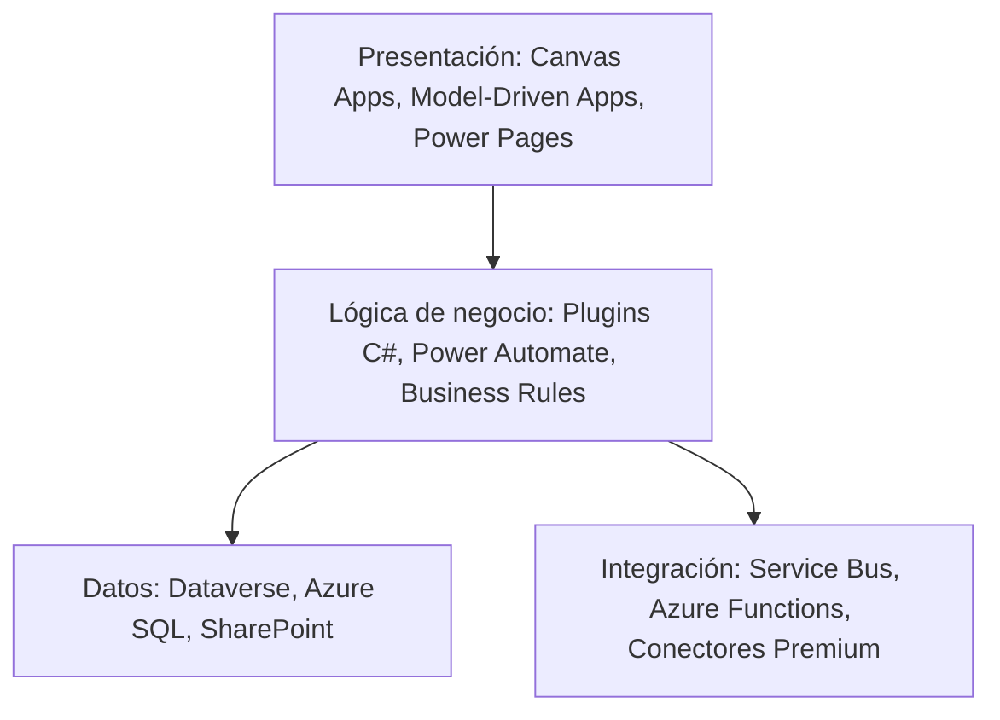
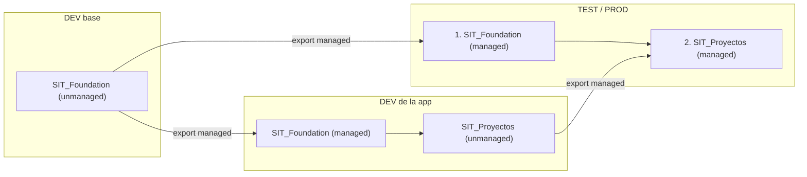

> **📌 Primer módulo de Avanzado (PL-400).** Este nivel asume que ya completaste Básico e Intermedio — el vocabulario de aquí en adelante (ADR, capas, patrones de integración) construye sobre eso, no lo repite. Si llegaste saltando niveles, vuelve a Módulo 1 antes de seguir; el resto del curso no te espera dos veces.

*Lectura: 20-25 min · Con práctica: unos 150 min (los dos ADR son lo que más se alarga), mejor en dos sesiones (la primera hasta la Microlección 2; la segunda, de la 3 al final). La primera vez, cuenta entre una vez y media y el doble.*

### 📚 Mini-glosario antes de empezar

| Término | En una frase |
|---|---|
| **ADR (Architecture Decision Record)** | Un documento corto que explica por qué elegiste una opción técnica sobre otra, para que alguien en 6 meses entienda el "por qué", no solo el "qué". |
| **Capa (Layer)** | Una responsabilidad separada del sistema (ej. "donde se ve" vs "donde se guardan los datos") — separarlas evita que un cambio en una rompa las demás. |
| **API** | La forma en que un programa le pide datos a otro programa, sin intervención humana. |
| **Middleware** | Un sistema intermedio que conecta dos aplicaciones que no se hablan directamente entre sí. |
| **Escalabilidad** | Que la solución siga funcionando bien cuando crece el número de usuarios o datos, no solo en la prueba con 5 registros. |

### 🎯 Objetivo
Diseñar arquitecturas de soluciones escalables, definir estrategias de datos multi-capa, seleccionar el tipo correcto de aplicación según el escenario, y documentar decisiones arquitectónicas con ADRs (Architecture Decision Records).

> **Cómo está organizado este módulo:** es el módulo de arquitectura del nivel, así que aquí "construir sin pasos" significa **decidir y defender**: ante un caso con restricciones eliges una opción, escribes por qué y la contrastas con criterios explícitos. No hay una única respuesta correcta; la evidencia es tu decisión escrita con sus razones. Cada microlección trae un concepto breve, una micropráctica con feedback inmediato y una práctica con **evidencia** (el dato exacto que viste en tu ambiente o en tu decisión). Después diagnosticarás un fallo de importación a partir del síntoma y cerrarás con un reto de transferencia para otro cliente.
>
> **Antes de empezar, necesitas:**
> - Tu ambiente **DEV** con la solución `SIT Solicitudes Internas` (`SIT_SolicitudesInternas`) de los labs 02 a 05: las tablas `Solicitud TI` y `Categoría`, la Canvas App del Lab 03 y la app Model-Driven del Lab 04.
> - Para la Microlección 2, acceso al [Power Platform Admin Center](https://admin.powerplatform.microsoft.com) con rol de administrador (en tu tenant de prueba personal ya lo eres). Si no lo tienes, esa práctica tiene una variante en papel.
> - Haber hecho el Módulo 16 (soluciones managed/unmanaged, DEV → TEST) y el 17.

### 📖 Conceptos Clave
Un mapa rápido; cada pieza se practica en su microlección.

- **Canvas vs Model-Driven vs Pages:** criterios de selección según el escenario. Canvas App para UX muy personalizada, móvil-first o procesos ad-hoc. Model-Driven App cuando el dato es el centro y se necesitan formularios complejos, BPF, vistas, dashboards y lógica de servidor (plugins). Power Pages cuando los usuarios son externos al tenant (clientes, proveedores, ciudadanos) y necesitan un portal web con autenticación propia.
- **Dataverse vs SharePoint vs Azure SQL:** Dataverse es la opción default dentro de Power Platform — ofrece relaciones, seguridad por fila, plugins, BPF y auditoría sin código adicional; ideal cuando la lógica vive en la plataforma. SharePoint Lists sirve para almacenamiento simple y colaboración de documentos, pero no soporta relaciones complejas ni lógica de servidor. Azure SQL es la opción cuando se requiere flexibilidad máxima, consultas SQL complejas o integración con sistemas legados — pero exige licencias de conector premium y no tiene seguridad nativa de Power Platform.
- **Arquitectura de capas:** modelo de separación de responsabilidades con cuatro capas: Presentación (Canvas Apps, Model-Driven Apps, Power Pages), Lógica de negocio (Plugins C#, Power Automate, Business Rules), Datos (Dataverse, Azure SQL, SharePoint), e Integración (Azure Service Bus, Azure Functions, conectores premium). Cada capa solo depende de la capa inmediatamente inferior — nunca circular.
- **Patrón Strangler Fig:** estrategia de migración incremental de sistemas legacy a Power Platform donde la nueva plataforma reemplaza funcionalidades una por una mientras el sistema antiguo sigue activo. Ejemplo: migrar primero el módulo de clientes de un ERP a Dataverse mientras el resto del ERP sigue operando, y en cada sprint se migra un módulo adicional hasta que el sistema antiguo puede apagarse.
- **Event-driven architecture:** arquitectura donde los componentes reaccionan a eventos en lugar de ser orquestados secuencialmente. En Power Platform, los eventos de Dataverse (Create/Update/Delete en una tabla) actúan como disparadores para plugins, Power Automate, o Service Endpoints que notifican a sistemas externos — permitiendo desacoplar el CRM del ERP sin llamadas directas entre sistemas. Un **Service Endpoint** registra en Dataverse un destino de Azure (por ejemplo una cola de Azure Service Bus) al que la plataforma envía el contexto del evento sin que escribas código de envío; se practica en el Módulo 24.
- **Organización de soluciones (single vs multi-solution):** Learn describe tres estrategias, de la más simple a la más compleja ([Learn: organizar soluciones](https://learn.microsoft.com/power-platform/alm/organize-solutions)): (1) **una sola solución**, recomendada para implementaciones pequeñas y medianas (para soluciones grandes, Learn propone segmentar por tabla antes que trocear); (2) **varias soluciones en un mismo ambiente de desarrollo**, solo para áreas independientes que **no comparten componentes**, porque multiplica los conflictos de dependencias; (3) **varias soluciones con un ambiente de desarrollo por capa**: una solución base (Foundation) se exporta managed y se importa en el ambiente de cada app, que construye encima su propia solución. La tercera es la de proyectos enterprise con varios equipos. En todas: **un solo publisher**, y Learn pide mantener el número de soluciones "tan pequeño como sea posible".
- **ADR (Architecture Decision Record):** documento estructurado que captura el contexto de una decisión arquitectónica, las opciones consideradas, la decisión tomada y sus consecuencias (positivas y negativas). Formato típico: Estado, Contexto, Opciones consideradas, Decisión, Consecuencias. Ejemplo: `ADR-001: Selección de Dataverse sobre SharePoint para el módulo de proyectos` — documenta por qué se descartó SharePoint y qué beneficios y compromisos implica Dataverse.
- **Power Platform Well-Architected:** marco de **cinco pilares** para evaluar una carga de trabajo ([Learn: pilares](https://learn.microsoft.com/power-platform/well-architected/pillars)): **Reliability** (fiabilidad: resiliencia, disponibilidad, recuperación), **Security** (seguridad: proteger confidencialidad, integridad y disponibilidad), **Operational Excellence** (excelencia operacional: observabilidad, DevOps, despliegues seguros), **Performance Efficiency** (eficiencia de rendimiento: escalar y atender la demanda) y **Experience Optimization** (optimización de la experiencia: usabilidad y experiencias claras). El coste no es un pilar de este marco: lo trabajas en el capacity planning. Microsoft publica un cuestionario de evaluación, el *Power Platform Well-Architected Review* ([aka.ms/powa/assessment](https://aka.ms/powa/assessment)).
- **Capacity planning:** dimensionar antes de comprometer la arquitectura. Cuatro frentes: (1) **licencias** por tipo de usuario; (2) **Power Platform requests**: cada licencia de pago da un tope de peticiones por 24 horas — 40.000 para Power Apps Premium, Power Automate Premium y las licencias Enterprise y Professional de Dynamics 365; 6.000 para Power Apps per app y las licencias de Microsoft 365 que incluyen Power Platform. Las identidades no interactivas (application users, el usuario SYSTEM) comparten un **pool del tenant**: 25.000 peticiones base si el tenant solo tiene licencias de Power Apps o de Power Automate, sin acumulación por licencia ([Learn: límites de peticiones](https://learn.microsoft.com/power-platform/admin/api-request-limits-allocations)). Estos topes diarios son distintos de los límites de protección del servicio de Dataverse; (3) **almacenamiento**: Dataverse mide tres capacidades, **Database**, **File** y **Log**; lo que tiene el tenant es la capacidad por defecto, más lo que suma cada licencia, más lo comprado. Las cifras por licencia están en el Licensing Guide y el desglose real de tu tenant se ve en el Admin Center ([Learn: capacidad de Dataverse](https://learn.microsoft.com/power-platform/admin/capacity-storage)); (4) que los **conectores** que usarás estén cubiertos por las licencias del cliente.
- **Integration patterns:** patrones para conectar sistemas. Push vs Pull: el sistema origen envía datos activamente (Push) vs el destino los solicita periódicamente (Pull). Sync vs Async: la llamada espera la respuesta (Sync, bloquea) vs el sistema envía y continúa sin esperar (Async, Service Bus). Point-to-Point vs Hub-and-Spoke: conexiones directas entre cada par de sistemas (difícil de mantener con N sistemas) vs todos los sistemas hablan con un middleware central (APIM, Service Bus) que enruta los mensajes.

**Diagrama: arquitectura de capas**



### 👨‍💻 Actividades Prácticas

## 🧩 Microlección 1 — Elegir el tipo de app y el almacén de datos

**¿Qué vas a aprender?** A elegir Canvas, Model-Driven o Power Pages, y Dataverse o SharePoint, a partir de **quién** usa la app y **qué** necesita el dato, no del gusto del equipo.

**¿Por qué existe esto?** El tipo de app se decide al principio y cuesta caro cambiarlo: una Canvas App que creció hasta tener etapas, vistas y seguridad por fila termina reconstruyendo a mano lo que una Model-Driven trae hecho, y dar licencias internas a usuarios externos es más caro y más inseguro que un portal. Este árbol de decisión es el punto de partida:

```
¿El usuario es externo (cliente/proveedor)?
  → SÍ: Power Pages
  → NO: ¿Requiere formularios complejos con lógica de negocio intensa?
    → SÍ: Model-Driven App
    → NO: ¿Requiere UX muy personalizada o mobile-first?
      → SÍ: Canvas App
      → NO: ¿Es principalmente reportes/dashboards?
        → SÍ: Power BI Embedded o Power BI App
        → NO: Model-Driven App (default)
```

Un mismo sistema puede necesitar **varias** respuestas a la vez: el árbol se aplica por grupo de usuarios, no por proyecto.

**Ahora haz algo — micropráctica (5 min):** → **[Elegir app y almacén para cada usuario](/practica/ip-arq-001-elegir-app-y-almacen)**. Una cadena de farmacias tiene compradores internos, proveedores externos y repartidores; decide qué recibe cada uno.

**Práctica real en tu entorno (15 min) — justificar el SIT que ya construiste:** tu sistema de solicitudes ya tiene dos apps sobre la misma tabla. Ahora vas a defender por qué tienen ese tipo.

1. En [make.powerapps.com](https://make.powerapps.com), con el ambiente **DEV** activo, abre **Solutions** → `SIT Solicitudes Internas` y localiza las dos apps (la Canvas del Lab 03 y la Model-Driven del Lab 04).
2. Para cada una, recorre el árbol de arriba con su usuario real (quien la abre de verdad) y anota en qué rama cae.
3. Piensa en un tercer grupo que hoy no existe: **los proveedores externos** que reparan los equipos quieren ver las solicitudes que les asignaron. Aplica el árbol y anota qué tipo usarías y por qué no les darías la Model-Driven.

**Evidencia a reportar (el dato exacto, no un "sí/no"):**

| Campo | Tu valor |
|---|---|
| App del Lab 03: tipo, quién la usa y rama del árbol en la que cae | ___ |
| App del Lab 04: tipo, quién la usa y rama del árbol en la que cae | ___ |
| Qué perdería el usuario del Lab 04 si su app fuera Canvas (nombra una capacidad concreta) | ___ |
| Tipo para los proveedores externos y por qué no la Model-Driven | ___ |
| Por qué `Solicitud TI` vive en Dataverse y no en una lista de SharePoint (una razón técnica) | ___ |

---

## 🧩 Microlección 2 — Capacidad y límites antes de prometer

**¿Qué vas a aprender?** A leer la capacidad real de Dataverse de un tenant y a estimar si un diseño cabe en los topes de Power Platform requests antes de comprometerlo con el cliente.

**¿Por qué existe esto?** Una arquitectura que funciona en DEV puede no caber en producción: una integración nocturna con un application user consume del pool **del tenant**, no de la licencia de nadie, y el almacenamiento de PROD sí cuenta contra la capacidad, mientras que tu Developer no. Learn lo dice claro: los ambientes **Developer**, **Trial**, de Teams, Preview y Support aparecen con **0 GB** y no cuentan contra la capacidad del tenant ([Learn: capacidad de Dataverse](https://learn.microsoft.com/power-platform/admin/capacity-storage)).

**Ahora haz algo — antes de abrir el Admin Center (3 min):** escribe tu predicción: ¿cuántos GB de **Database** crees que consume tu DEV según el informe del tenant? Compárala al final del paso 3.

**Práctica real en tu entorno (20 min):**

1. Entra al [Power Platform Admin Center](https://admin.powerplatform.microsoft.com) → en el panel de navegación, **Licensing** → en el panel **Licensing**, **Dataverse** (bajo **Products**). **Si no ves Licensing o te dice que no tienes permiso**, necesitas un rol de Tenant administrator, Power Platform administrator o Dynamics 365 administrator: salta a la variante en papel de abajo.
2. En el tile **Usage per storage type**, anota para **Database**, **File** y **Log** lo que el tenant tiene contratado (**Total prepaid entitlement**) y lo que consume (**Total consumption**). **Si un tenant de prueba muestra 0 o casi nada**, es normal: anótalo igual, es tu dato.
3. Selecciona **See Dataverse capacity per license**: muestra cómo se calculó la capacidad (capacidad base y lo que suma cada licencia). Anota qué licencias aparecen. **Si la lista está vacía**, anota "sin licencias que acumulen capacidad".
4. En el tile **Top environment consuming storage**, selecciona **See all environments** y busca tu DEV. **Qué deberías ver:** tu ambiente Developer con **0 GB**. Selecciona su nombre para abrir su detalle y busca la sección **Consumption per table**: anota las dos tablas que más ocupan (casi siempre son tablas de sistema, no las tuyas).
5. **Cálculo de peticiones (papel, 5 min):** el cliente tendrá 150 usuarios con **Power Apps Premium** y una integración nocturna con un **application user** que hará unas 30.000 peticiones al día; el tenant no tiene licencias de Dynamics 365. Con la tabla de Learn ([límites de peticiones](https://learn.microsoft.com/power-platform/admin/api-request-limits-allocations)), responde: ¿cuántas peticiones por 24 horas tiene cada usuario? ¿De qué pool sale la integración y cuánto tiene ese pool? ¿Cabe?

**Variante en papel (sin permisos de administrador):** haz solo el paso 5 y, para los pasos 2-4, escribe qué valores esperarías ver en un tenant de empresa y por qué un Developer aparece con 0 GB.

**Evidencia a reportar:**

| Campo | Tu valor |
|---|---|
| Database / File / Log: contratado y consumido (o "variante en papel") | ___ |
| Licencias que aparecen en **See Dataverse capacity per license** | ___ |
| GB que muestra tu DEV en la lista y las 2 tablas que más ocupan en su detalle | ___ |
| Tu predicción del paso previo frente a lo que viste | ___ |
| Peticiones por usuario Premium / pool de la integración / ¿cabe? (con la cifra) | ___ |
| Qué cambiarías en el diseño si la integración no cabe (una decisión concreta) | ___ |

---

## 🧩 Microlección 3 — Organizar soluciones y leer dependencias

**¿Qué vas a aprender?** A elegir entre una solución o varias con el criterio de Learn y a leer las dependencias reales de tus componentes antes de decidir dónde cortar.

**¿Por qué existe esto?** "Separar por dominio" suena bien, pero Learn advierte que varias soluciones en un mismo ambiente de desarrollo que comparten componentes generan dependencias cruzadas: Solution A no se importa porque depende de B, y B no se importa porque depende de A. Por eso recomienda ([Learn: organizar soluciones](https://learn.microsoft.com/power-platform/alm/organize-solutions)):

- **Un solo publisher** para todas las soluciones. El publisher es dueño de los componentes managed y no se puede cambiar después: mover una tabla a otra solución con otro publisher obliga a borrarla, con pérdida de datos si no los migras antes.
- Si usas varias soluciones en el mismo DEV: no metas el mismo componente en dos soluciones y deja **todas las tablas en una sola solución**, porque una simple relación entre tablas de dos soluciones crea una dependencia entre ellas.
- Para proyectos grandes con varios equipos: **capas en ambientes separados**. La base se desarrolla en su DEV y se exporta managed; el DEV de cada app la importa managed y construye encima. En TEST y PROD se importa primero la base y luego cada app.



Un ejemplo de estructura por capas para un proyecto enterprise (cada solución se desarrolla en su propio ambiente, con el mismo publisher `sit`):

```
SIT_Foundation (base layer — su propio DEV)
  ├── Tabla: Configuración Global
  ├── Tabla: Catálogos (País, Región, Moneda)
  ├── Personalización de las tablas estándar Cuenta y Contacto
  ├── Security Roles base
  └── Environment Variables comunes

SIT_CRM (dominio CRM — DEV propio, con Foundation managed importada)
  ├── Dependencia: SIT_Foundation
  ├── Tablas propias: Propuesta, Seguimiento Comercial
  ├── Canvas App: Gestión Comercial
  ├── Model-Driven App: CRM Managers
  └── Flujos de aprobación

SIT_Proyectos (dominio proyectos — DEV propio, con Foundation managed importada)
  ├── Dependencia: SIT_Foundation
  ├── Tablas: Proyecto, Tarea, Recurso
  └── Canvas App: Gestión de Proyectos

SIT_Integraciones (capa de integración)
  ├── Dependencia: SIT_Foundation
  ├── Conectores personalizados y sus Connection References
  └── Flujos de integración con sistemas externos
      (las Azure Functions viven en Azure y se despliegan con su propio pipeline:
       no son componentes de una solución de Power Platform)
```

> La tabla Oportunidad no existe en un ambiente sin las apps de Dynamics 365 Sales: si tu CRM es propio, sus tablas también lo son (por eso arriba aparecen `Propuesta` y `Seguimiento Comercial`).

**Ahora haz algo — predice antes de mirar (3 min):** en tu solución del curso, ¿qué componentes crees que **usan** la tabla `Categoría`? Escribe tu lista antes del paso 2.

**Práctica real en tu entorno (20 min) — leer dependencias:**

1. En [make.powerapps.com](https://make.powerapps.com), ambiente **DEV** → **Solutions** → `SIT Solicitudes Internas` → **Tables** → selecciona la tabla `Categoría` (sin abrirla).
2. En el menú **⋯** de la fila de la tabla (en algunas vistas también aparece en la barra de comandos con la fila seleccionada), **Advanced** → **Show dependencies** ([Learn: ver dependencias](https://learn.microsoft.com/power-apps/maker/data-platform/view-component-dependencies)). Se abre la página **Dependencies** con tres pestañas:
   - **Delete blocked by**: lo que impide borrar el componente.
   - **Used by**: lo que usa este componente.
   - **Uses**: lo que este componente usa.
3. **Qué deberías ver:** en **Used by** o **Delete blocked by**, al menos la relación o el lookup `Categoría` de la tabla `Solicitud TI` (Lab 02). **Si no aparece nada**, revisa que seleccionaste `Categoría` y no `Solicitud TI`, y que estás en DEV.
4. Repite con la tabla `Solicitud TI`: anota qué apps, vistas, formularios o flujos aparecen. **No borres nada**: esta práctica es de solo lectura.
5. **Decisión (papel, 5 min):** mañana se suma un segundo equipo que construirá un módulo de Proyectos que también usa `Categoría`. Con las tres estrategias de Learn, decide si SIT sigue en una sola solución o pasa a capas, y qué tendría que pasar con `Categoría` en cada caso.

**Evidencia a reportar:**

| Campo | Tu valor |
|---|---|
| Tu predicción del paso previo | ___ |
| Lo que muestra **Used by** de `Categoría` (nombres exactos) | ___ |
| Lo que muestra **Delete blocked by** de `Categoría` | ___ |
| Tres componentes que aparecen en las dependencias de `Solicitud TI` | ___ |
| Estrategia elegida para el segundo equipo, dónde queda `Categoría` y por qué | ___ |
| Publisher de tu solución (nombre y prefijo) | ___ |

---

## 🔧 Diagnosticar — la importación se detiene por una dependencia

Antes de escribir tu ADR, resuelve este caso a partir del síntoma, no de la tabla de errores:

**[Diagnosticar: TEST no deja importar SIT_Proyectos](/practica/ip-arq-002-importacion-falla-por-dependencia)**

Síntoma: un compañero creó dos soluciones unmanaged en el mismo DEV, `SIT_Foundation` (con `Categoría`) y `SIT_Proyectos` (con `Proyecto`, que tiene un lookup a `Categoría`). Exportó solo `SIT_Proyectos` como managed y al importarla en TEST el asistente se detiene avisando que faltan componentes requeridos. Formula tu hipótesis antes de ver la causa: ¿qué falta, qué haces hoy para destrabarlo y qué cambiarías para que no se repita?

---

## 🧩 Microlección 4 — Documentar la decisión con un ADR (decidir y defender, sin pasos)

**¿Qué vas a aprender?** A escribir un ADR que otra persona pueda evaluar: contexto, opciones reales, decisión y consecuencias, incluidas las negativas.

**¿Por qué existe esto?** Dentro de seis meses nadie recordará por qué el inventario se integró con una cola y no con un flujo. Un ADR corto evita repetir la discusión y deja claro qué se aceptó perder. Este es un ejemplo completo:

```markdown
# ADR-001: Selección de almacén de datos para módulo de proyectos

## Estado: Aceptado

## Contexto
El módulo de gestión de proyectos requiere almacenar datos relacionales 
con lógica de negocio compleja (plugins, reglas, BPF) y necesita integrarse 
con Power Automate, Power BI y Canvas Apps existentes.

## Opciones consideradas
1. **Dataverse** — nativo de Power Platform
2. **SharePoint Lists** — familiar para el equipo
3. **Azure SQL** — flexibilidad máxima, requiere conector premium

## Decisión
**Dataverse**

## Consecuencias
- ✅ Integración nativa con todos los componentes Power Platform
- ✅ Security Roles, Auditoría, BPF disponibles sin código adicional
- ✅ Soporte para plugins C# y lógica de servidor
- ⚠️ Costo de licencias adicional (Dataverse for Teams no suficiente)
- ⚠️ Consume capacidad de Database del tenant (en PROD sí cuenta, a diferencia
     del Developer): vigilar el crecimiento en Licensing > Dataverse y planificar archivado

## Alternativa rechazada: SharePoint
SharePoint Lists no soporta relaciones complejas ni plugins.
Rechazado por limitaciones técnicas.
```

**🏗️ Reto (sin pasos): escribe el ADR-002 de SIT.** No te damos la decisión, solo el caso.

> **Caso:** cuando una `Solicitud TI` de hardware se aprueba, SIT debe avisar al sistema de inventario de la empresa (una API REST) para que reserve el equipo.
> **Restricciones:** unas 300 aprobaciones al día; la API de inventario se cae a veces entre 5 y 10 minutos; el técnico que aprueba **no** puede quedarse esperando a la API; el equipo de SIT domina Power Automate pero nunca operó recursos de Azure; ninguna aprobación puede perderse.
> **Opciones a considerar (al menos estas tres):** (a) cloud flow con el conector personalizado del Módulo 14 disparado por el cambio de estado; (b) plugin C# síncrono que llama a la API al guardar; (c) Dataverse publica el evento a Azure Service Bus y una Azure Function lo entrega a la API.
> **Formato:** las secciones del ADR-001. En **Consecuencias**, al menos una negativa de la opción elegida.

Contrasta tu ADR con estos criterios (no hay una sola respuesta correcta; lo que se evalúa es el razonamiento):

| Criterio | Qué demuestra que lo cumples |
|---|---|
| El contexto recoge las restricciones | Las cinco restricciones del caso aparecen en el ADR con sus cifras (300/día, 5-10 min, etc.) |
| Las opciones son reales y comparables | Cada opción tiene al menos una ventaja y una desventaja escritas, no solo la elegida |
| La decisión responde a "ninguna aprobación puede perderse" | Dices qué pasa con un aviso cuando la API está caída: dónde espera y quién lo reintenta |
| La decisión respeta que el técnico no espere | Explicas si la llamada es síncrona o asíncrona y por qué |
| Las consecuencias incluyen lo que se acepta perder | Hay al menos una consecuencia ⚠️ de la opción elegida (coste, operación, habilidades del equipo) |
| Un compañero entiende el "por qué" sin preguntarte | Se lo das a leer a alguien y puede repetir la razón principal en una frase |

**Evidencia a reportar:**

| Campo | Tu valor |
|---|---|
| Opción elegida en tu ADR-002 | ___ |
| Qué pasa con un aviso cuando la API lleva 10 minutos caída (según tu diseño) | ___ |
| La consecuencia negativa principal que aceptaste | ___ |
| Criterio de la tabla que te costó más cumplir y cómo lo resolviste | ___ |

---

## 🔁 Reto de transferencia — otro cliente, otras restricciones

El mismo razonamiento, en un cliente que no se parece a SIT: un **municipio** que tramita permisos de construcción. Los ciudadanos (miles, externos) solicitan el permiso por internet y consultan su estado; los inspectores visitan las obras con una tablet; el back-office revisa cada expediente por etapas; el equipo es de tres personas y la primera versión debe salir en cuatro meses.

**[Transferir: arquitectura para permisos municipales](/practica/ip-arq-003-transferir-permisos-municipales)** — decide el tipo de app de cada grupo y la estrategia de soluciones. Si solo memorizaste "separar siempre por dominio", este reto te lo va a mostrar: con un equipo de tres personas y un solo ritmo de entregas, lo que Learn recomienda es otra cosa.

Cierra el reto con un **ADR-003** de media página para la estrategia de soluciones del municipio, contrastado con la misma tabla de criterios de la Microlección 4.

**Evidencia a reportar:**

| Campo | Tu valor |
|---|---|
| Tipo de app para ciudadanos, inspectores y back-office | ___ |
| Estrategia de soluciones elegida y la recomendación de Learn que la respalda | ___ |
| Qué cambiaría en tu decisión si el municipio contratara a un segundo equipo para un módulo de licencias comerciales | ___ |

---

### 💼 Caso Real de Negocio
**Empresa:** Empresa de seguros con 500K pólizas  
**Problema:** Tenían 12 aplicaciones separadas, datos duplicados, y nadie sabía qué sistema era el "sistema de verdad" para el dato de póliza.  
**Solución:** Arquitectura con Dataverse como Master Data hub. Foundation layer con catálogos compartidos. Cada dominio (Pólizas, Siniestros, Agentes) en su propia solución con dependencia hacia Foundation. Power Pages para el portal de agentes. ADRs documentados para cada decisión mayor.  
**Resultado:** Reducción de 12 sistemas a 1 plataforma. Tiempo de onboarding de desarrolladores: de 3 semanas a 3 días.

### ✅ Buenas Prácticas
- Separar por dominio funcional cuando hay varios equipos o ritmos de entrega distintos (como en el caso de la aseguradora), con capas en ambientes de desarrollo separados; en proyectos pequeños o medianos, una sola solución es lo que recomienda Learn
- Foundation layer nunca depende de capas superiores (dependencia unidireccional)
- Un solo publisher para todas las soluciones del proyecto, desde el día 1
- Documentar todas las decisiones con ADR — especialmente las que parecen obvias
- Revisar capacity y licencias antes de comprometer la arquitectura con el cliente: capacidad de Dataverse en **Licensing** → **Dataverse** y topes de Power Platform requests, incluido el pool de las integraciones con application users
- Definir strategy de branching antes de empezar a desarrollar

### ⚠️ Errores Comunes
| Error | Causa | Solución |
|-------|-------|----------|
| Solución enorme que tarda en importarse y en la que varios desarrolladores se pisan los cambios | Un solo DEV compartido sin control de código fuente | Learn propone control de versiones, una estrategia de ramas, un DEV por rama y segmentar por tabla; pasar a capas en ambientes separados solo si hay varios equipos |
| Dependencias circulares entre soluciones (A no se importa sin B, B no se importa sin A) | Varias soluciones en el mismo DEV que comparten componentes o tienen tablas relacionadas | Mapear dependencias en día 1; todas las tablas en una sola solución, o capas en ambientes separados |
| La solución de dominio no se importa en TEST: faltan componentes requeridos | Se importó antes que la base de la que depende | Importar primero la base managed y después la de dominio; revisar **Show dependencies** antes de exportar |
| No se puede mover una tabla a otra solución | Cada solución se creó con un publisher distinto | Un solo publisher para todo el proyecto; si ya pasó, migrar los datos antes de rehacer la tabla |
| La integración nocturna empieza a fallar por exceso de peticiones | Se dimensionó con el tope de un usuario Premium, pero un application user consume del pool del tenant | Calcular el pool no interactivo del tenant en el capacity planning y licenciar o rediseñar antes del go-live |
| Decisiones sin documentar | "Lo recordamos" | ADR obligatorio para cada decisión que afecte más de 1 componente |

### 🧪 Criterios de Validación
- [ ] Resolví la micropráctica de tipo de app y almacén antes de justificar las apps del SIT
- [ ] Justifiqué el tipo de las dos apps del SIT y elegí un tipo para los proveedores externos, con la rama del árbol de cada una
- [ ] Leí la capacidad real del tenant (o hice la variante en papel) y calculé si la integración nocturna cabe en el pool de peticiones, con la cifra
- [ ] Leí las dependencias de `Categoría` y `Solicitud TI` con **Show dependencies** y anoté los nombres exactos de **Used by** y **Delete blocked by**
- [ ] Elegí una estrategia de soluciones para el segundo equipo apoyándome en una de las tres estrategias de Learn
- [ ] Diagnostiqué la importación que falla por dependencia formulando una hipótesis antes de ver la causa
- [ ] Escribí el ADR-002 sin pasos y lo contrasté con la tabla de criterios, incluida al menos una consecuencia negativa
- [ ] Completé el reto de transferencia del municipio con su ADR-003 de estrategia de soluciones

---
