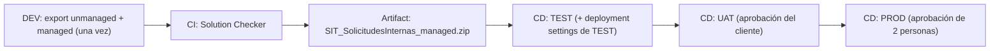

*Lectura: 20-25 min · Con práctica: unas 5 horas y media, mejor en cuatro sesiones (1: Microlección 1; 2: Microlección 2 con los Ejercicios 1 y 2 del Lab 19; 3: Microlección 3 con su reto; 4: Microlección 4 y reto de transferencia). Si usas el agente self-hosted del plan B, súmale unos 30 minutos la primera vez. La configuración de Entra ID y Azure DevOps es lo que más se alarga.*

### 🎯 Objetivo
Implementar pipelines completos de CI/CD para Power Platform con Azure DevOps (y saber trasladarlos a GitHub Actions): la solución como código con pac CLI, un pipeline de CI que construye **una sola vez** el artefacto managed y lo pasa por Solution Checker, y un pipeline de CD que lo despliega con aprobación y con los valores propios de cada ambiente. En tu tenant practicarás el tramo DEV → TEST de punta a punta; UAT y PROD los diseñarás, porque crear más ambientes exige capacidad que un tenant de práctica normalmente no tiene.

> **Cómo está organizado este módulo:** cada microlección trae un concepto breve, una micropráctica con feedback inmediato y una práctica real con **evidencia** (el dato exacto que viste, no un sí/no). Antes de terminar el CD vas a diagnosticar un despliegue "verde" que en realidad dejó el ambiente roto, después harás un reto de construcción sin pasos y, al final, un reto de transferencia con otro cliente que usa GitHub.
>
> **Antes de empezar, necesitas:**
> - Lo que dejaste del [Módulo 16](/nivel/intermedio/modulo/seguridad-y-administracion-de-soluciones): tu ambiente **DEV** con la solución `SIT Solicitudes Internas` (nombre `SIT_SolicitudesInternas`), su variable de entorno `Correo Equipo TI` y sus referencias de conexión, y el ambiente **`SIT-TEST`** donde ya importaste versiones managed.
> - Permiso para crear un **App registration** en Microsoft Entra ID y para agregar usuarios de aplicación en los dos ambientes (en tu tenant de prueba personal ya lo tienes).
> - Una organización de Azure DevOps ([dev.azure.com](https://dev.azure.com)), creada con la **misma cuenta de trabajo del curso**, con un proyecto y la extensión **Power Platform Build Tools** instalada (el [Lab 19](/labs/lab-19-cicd-azure-devops) explica cómo). Al crear el proyecto (**New project**), en sus opciones avanzadas elige el proceso de work items **Agile**: la Microlección 4 usa **User Story** y su campo **Acceptance Criteria**, que el proceso Basic no tiene. Si ya lo creaste con Basic, se puede cambiar: **Organization settings** > **Boards** > **Process** > **Basic** > pestaña **Projects** > **More actions** junto a tu proyecto > **Change process** > **Agile** > **Save** ([Learn: de Basic a Agile](https://learn.microsoft.com/azure/devops/organizations/settings/work/change-process-basic-to-agile)).
> - **Decide hoy dónde van a correr tus pipelines (no lo dejes para la Microlección 2).** Un pipeline necesita un *agente* y la organización, un *parallel job* gratuito. Learn indica que el de agentes propios (**self-hosted**) se concede automáticamente, pero el de agentes alojados por Microsoft (**Microsoft-hosted**, los `vmImage` del YAML) hay que activarlo vinculando la organización a una suscripción de Azure ([Learn: parallel jobs](https://learn.microsoft.com/azure/devops/pipelines/licensing/concurrent-jobs)). Tienes dos caminos:
>   - **A. Microsoft-hosted:** **Organization settings** > **Billing** > **Set up billing** > elige la suscripción > **Save**. Al configurar la facturación, el nivel gratuito (un job a la vez, hasta 60 min por ejecución y 1.800 min al mes) se aplica solo; no hay que pedirlo con ningún formulario. Dos condiciones de Learn: la suscripción tiene que estar en el **mismo Microsoft Entra ID** que la organización de DevOps, y **la prueba gratuita de Azure (Azure Free Trial, la "cuenta gratuita") no sirve** ([Learn: facturación](https://learn.microsoft.com/azure/devops/organizations/billing/set-up-billing-for-your-organization-vs)). Con una cuenta gratuita tendrías que convertirla a pago por uso (**Subscriptions** > tu suscripción > **Upgrade subscription**, que pide un método de pago; [Learn: actualizar la cuenta](https://learn.microsoft.com/azure/cost-management-billing/manage/upgrade-azure-subscription)). El nivel gratuito de parallel jobs no cobra, pero a partir de ahí lo que uses en Azure sí.
>   - **B. Self-hosted en tu propio equipo (gratis, sin suscripción):** instalas el agente de Azure Pipelines en tu Windows y cambias una línea del YAML. Los pasos están en el apartado **Agentes de Azure Pipelines** del Lab 19. Es el camino si no tienes una suscripción de pago en el tenant del curso, o mientras la consigues.
>
>   Si tu primera ejecución se queda en cola sin empezar, es esto: resuélvelo antes de seguir.
> - Git y Power Platform CLI en tu equipo. La forma más sencilla es la extensión **Power Platform Tools** de Visual Studio Code; en Windows, Learn recomienda la extensión o el instalador MSI si vas a usar comandos que solo existen en Windows ([Learn: instalar Power Platform CLI](https://learn.microsoft.com/power-platform/developer/cli/introduction)).

### 📖 Conceptos Clave
Un mapa rápido; cada pieza se practica en su microlección.

- **pac CLI (Power Platform CLI):** herramienta de línea de comandos para autenticarse contra ambientes, exportar, importar, desempaquetar y comprobar soluciones, entre otras cosas. Los perfiles de autenticación se crean con `pac auth create --environment <URL o nombre>` y se revisan con `pac auth who` y `pac auth list` ([Learn: pac auth](https://learn.microsoft.com/power-platform/developer/cli/reference/auth)). `pac solution export` exporta unmanaged por defecto; con el modificador `--managed` exporta managed ([Learn: pac solution](https://learn.microsoft.com/power-platform/developer/cli/reference/solution)).
- **Solución como código:** `pac solution unpack` descompone el `.zip` en archivos XML/JSON legibles que se versionan en Git; así un Pull Request muestra **qué** cambió. Con `--packagetype Both` se guardan a la vez la versión unmanaged y la managed. Importante: **SolutionPackager no convierte una solución unmanaged en managed**; para tener la managed hay que exportarla como managed ([Learn: SolutionPackager](https://learn.microsoft.com/power-platform/alm/solution-packager-tool)).
- **Power Platform Build Tools:** extensión de Azure DevOps con tareas que envuelven al pac CLI: `PowerPlatformToolInstaller@2` (siempre primero), `PowerPlatformWhoAmi@2`, `PowerPlatformExportSolution@2`, `PowerPlatformUnpackSolution@2`, `PowerPlatformPackSolution@2`, `PowerPlatformChecker@2`, `PowerPlatformImportSolution@2`, `PowerPlatformSetSolutionVersion@2`, entre otras ([Learn: tareas de Build Tools](https://learn.microsoft.com/power-platform/alm/devops-build-tool-tasks)). `PowerPlatformSetConnectionVariables@2` **no** configura referencias de conexión: solo deja variables `BuildTools.*` para que las usen tareas de script posteriores.
- **Service connection:** guarda en Azure DevOps cómo autenticarse contra **un** ambiente, y las tareas la referencian por nombre (`PowerPlatformSPN: 'SC-PowerPlatform-DEV'`), así no hay credenciales en el YAML. Learn documenta tres tipos: **Workload Identity Federation** (recomendada: sin secreto que rotar), service principal con client secret y usuario/contraseña. El service principal tiene que estar dado de alta como **usuario de aplicación** con rol System Administrator en cada ambiente ([Learn: Build Tools](https://learn.microsoft.com/power-platform/alm/devops-build-tools)).
- **Solution Checker en el pipeline:** la tarea `PowerPlatformChecker@2` envía la solución al servicio de análisis. Con `RuleSet: '0ad12346-e108-40b8-a956-9a8f95ea18c9'` (el conjunto *Solution checker*), `ErrorLevel` (por ejemplo `HighIssueCount`), `ErrorThreshold` y `FailOnPowerAppsCheckerAnalysisError: true`, el build falla si hay más incidencias de esa severidad que el umbral.
- **Artefacto:** el `.zip` managed que produce el CI y se publica con `PublishBuildArtifacts@1`. El CD lo **descarga**, no vuelve a exportar: así TEST, UAT y PROD reciben exactamente el mismo binario que pasó el Solution Checker.
- **Deployment settings file:** un JSON con el **valor** de cada variable de entorno y la **conexión** de cada referencia de conexión para un ambiente. Se genera con `pac solution create-settings` y se pasa a la importación (`UseDeploymentSettingsFile` / `DeploymentSettingsFile`). Es el equivalente automatizado de lo que el asistente de importación te preguntaba en el Módulo 16 ([Learn: deployment settings](https://learn.microsoft.com/power-platform/alm/conn-ref-env-variables-build-tools)).
- **Environments y aprobaciones (Azure Pipelines):** un *environment* de Azure DevOps (no confundir con un ambiente de Power Platform) puede tener **Approvals and checks**; el stage que despliega a ese environment se pausa hasta que alguien apruebe o venza el timeout. Las aprobaciones no se definen en el YAML, así que quien edita el YAML no puede saltárselas ([Learn: approvals](https://learn.microsoft.com/azure/devops/pipelines/process/approvals)).
- **YAML pipeline:** el pipeline como código en el repositorio: `trigger`, `resources`, `variables`, `stages` → `jobs` → `steps`. Un pipeline de CD puede dispararse cuando termina el de CI declarándolo como `resources.pipelines` ([Learn: pipeline resources](https://learn.microsoft.com/azure/devops/pipelines/process/resources)).
- **Branching strategy:** *trunk-based* (ramas cortas que se fusionan a `main` con frecuencia) encaja con equipos pequeños que despliegan a menudo; un GitFlow simplificado (`main` ← `develop` ← `feature/*`) ayuda cuando hay releases con ventana y varios equipos. En Power Platform pesa además que la solución vive en un ambiente compartido: la rama no aísla el trabajo como en código puro, por eso conviene exportar a Git con frecuencia.
- **Azure Boards:** el mismo proyecto de Azure DevOps tiene Boards: `Epic → Feature → User Story → Task`, con Sprint Backlog y Product Backlog. En el proceso Agile, la User Story tiene el campo **Acceptance Criteria** ([Learn: proceso Agile](https://learn.microsoft.com/azure/devops/boards/work-items/guidance/agile-process-workflow)).
- **Criterios Gherkin (Given/When/Then):** `Given` el contexto, `When` la acción, `Then` el resultado verificable. Se escriben como texto en **Acceptance Criteria** y sirven de base a las pruebas de aceptación.
- **Trazabilidad commit ↔ work item:** en **Azure Repos**, escribir `#123` en el mensaje del commit lo vincula al work item 123 si el ajuste **Commit mention linking** del repositorio está activado ([Learn: ajustes del repositorio](https://learn.microsoft.com/azure/devops/repos/git/repository-settings)). La sintaxis `AB#123` es la de los repositorios de **GitHub** conectados a Azure Boards ([Learn: vincular GitHub](https://learn.microsoft.com/azure/devops/boards/github/link-to-from-github)).

**Diagrama: pipeline CI/CD multi-ambiente**



### 👨‍💻 Actividades Prácticas

## 🧩 Microlección 1 — Tu solución como código (pac CLI + Git)

**¿Qué vas a aprender?** A sacar la solución de DEV como archivos legibles, versionarlos en Git y ver en un diff qué cambió.

**¿Por qué existe esto?** Sin la solución en Git no hay auditoría de qué cambió, ni Pull Request que revisar, ni forma de reconstruir una versión anterior. Y el error más caro de un script de ALM no es de sintaxis: es ejecutarlo contra el ambiente equivocado.

**Ahora haz algo — micropráctica (5 min):** → **[Diagnosticar: Environment incorrecto](/practica/ip-trb-002-entorno-incorrecto)**

**Práctica real en tu equipo (25 min):**
1. Abre una terminal PowerShell (la de Visual Studio Code si instalaste solo la extensión) y crea un perfil contra DEV: `pac auth create --environment "<URL de tu ambiente DEV>"`. Se abre el inicio de sesión de Microsoft. **Qué deberías ver:** un mensaje de perfil creado y autenticado.
2. Ejecuta `pac auth who`. **Comprueba que la URL que muestra es la de DEV**, no la de `SIT-TEST`. Si tienes varios perfiles, `pac auth list` los numera y `pac auth select --index <n>` activa el correcto.
3. En una carpeta vacía llamada `sit-alm-local` (no la llames `sit-alm`: ese nombre lo usará el repositorio que clonarás en el Lab 19), ejecuta `git init` y crea las carpetas `out` y `solutions`. Agrega un archivo `.gitignore` con la línea `out/`: los `.zip` no se versionan, se versiona lo desempaquetado. Si nunca usaste Git en este equipo, configura antes tu identidad o el primer commit fallará con *Author identity unknown*:
   ```powershell
   git config --global user.name "Tu Nombre"
   git config --global user.email "tu-correo@tu-dominio.com"
   ```
4. Exporta las dos versiones y desempaquétalas juntas:

```powershell
pac solution export --name SIT_SolicitudesInternas --path ./out/SIT_SolicitudesInternas.zip
pac solution export --name SIT_SolicitudesInternas --path ./out/SIT_SolicitudesInternas_managed.zip --managed
# Both necesita los dos .zip en la misma carpeta: X.zip y X_managed.zip
pac solution unpack --zipfile ./out/SIT_SolicitudesInternas.zip --folder ./solutions/SIT_SolicitudesInternas --packagetype Both
git add .
git commit -m "chore: primera exportación de SIT_SolicitudesInternas"
```

   **Si `export` dice que no encuentra la solución:** `--name` es el **Name** (`SIT_SolicitudesInternas`), no el nombre visible con espacios.
5. Ve a [make.powerapps.com](https://make.powerapps.com), en DEV, abre la solución, cambia la **Description** de la tabla `Solicitud TI` (o de otro componente) y guarda.
6. Repite los dos `export` añadiendo `--overwrite` (los `.zip` ya existen en `out` y, según la referencia de pac, este modificador es el que permite sobrescribirlos) y el `unpack` añadiendo `--allowWrite --allowDelete` (para que sobrescriba y elimine archivos de componentes que ya no existan):

   ```powershell
   pac solution export --name SIT_SolicitudesInternas --path ./out/SIT_SolicitudesInternas.zip --overwrite
   pac solution export --name SIT_SolicitudesInternas --path ./out/SIT_SolicitudesInternas_managed.zip --managed --overwrite
   pac solution unpack --zipfile ./out/SIT_SolicitudesInternas.zip --folder ./solutions/SIT_SolicitudesInternas --packagetype Both --allowWrite --allowDelete
   ```

   Después ejecuta `git status` y `git diff --stat`.

   **Qué deberías ver:** solo unos pocos archivos modificados; el de la tabla que tocaste, entre ellos. Si aparecen cientos de archivos cambiados, mira si desempaquetaste en otra carpeta.

**Evidencia a reportar:**

| Campo | Tu valor |
|---|---|
| URL que mostró `pac auth who` antes de exportar | |
| Número de archivos que listó `git diff --stat` tras tu cambio | |
| Ruta del archivo que contiene la descripción que cambiaste | |
| Versión de la solución en `solutions/SIT_SolicitudesInternas/Other/Solution.xml` (elemento `<Version>`) | |

## 🧩 Microlección 2 — Pipeline de CI: el artefacto se construye una vez

**¿Qué vas a aprender?** A automatizar en Azure DevOps lo que hiciste a mano: versionar, exportar unmanaged y managed, pasar el Solution Checker y publicar el artefacto que el CD desplegará.

**¿Por qué existe esto?** Si cada ambiente recibe una exportación nueva, TEST y PROD pueden recibir cosas distintas (alguien cambió DEV entre medias) y lo que validó el Checker ya no es lo que llega a producción. La regla es: **se construye una vez y se promueve el mismo binario**.

**Ahora haz algo — micropráctica (6 min):** → **[Decidir: un solo artefacto para todos los ambientes](/practica/ip-alm-001-artefacto-unico-del-ci)**

**Práctica real en tu tenant (70 min):**
1. Haz el **Ejercicio 1** del [Lab 19](/labs/lab-19-cicd-azure-devops): App registration, usuario de aplicación con System Administrator en DEV y en `SIT-TEST`, y las service connections `SC-PowerPlatform-DEV` y `SC-PowerPlatform-TEST`. El lab usa client secret porque es el camino más corto en un tenant de práctica; en un cliente, prefiere **Workload Identity Federation** (sin secreto que caduque).
2. Haz el **Ejercicio 2** del lab, pero con este YAML para `azure-pipelines/ci-build.yml`:

```yaml
# azure-pipelines/ci-build.yml
trigger:
  branches:
    include:
      - develop

variables:
  solution_name: 'SIT_SolicitudesInternas'
  artifact_name: 'solution-drop'

pool:
  vmImage: 'windows-latest'        # camino A (Microsoft-hosted)
  # Plan B (agente self-hosted): sustituye la línea de arriba por
  #   name: 'Default'

stages:
  - stage: Build
    displayName: 'Exportar, verificar y publicar'
    jobs:
      - job: ExportAndCheck
        steps:
          - task: PowerPlatformToolInstaller@2       # siempre la primera tarea
            inputs:
              DefaultVersion: true

          - task: PowerPlatformWhoAmi@2              # falla rápido si la service connection está mal
            inputs:
              authenticationType: 'PowerPlatformSPN'
              PowerPlatformSPN: 'SC-PowerPlatform-DEV'

          - task: PowerPlatformSetSolutionVersion@2  # versión trazable al build (cambia la versión en DEV)
            inputs:
              authenticationType: 'PowerPlatformSPN'
              PowerPlatformSPN: 'SC-PowerPlatform-DEV'
              SolutionName: '$(solution_name)'
              SolutionVersionNumber: '1.1.$(Build.BuildId).0'

          - task: PowerPlatformExportSolution@2
            displayName: 'Exportar unmanaged (para Git y el desempaquetado)'
            inputs:
              authenticationType: 'PowerPlatformSPN'
              PowerPlatformSPN: 'SC-PowerPlatform-DEV'
              SolutionName: '$(solution_name)'   # el Name, no el nombre visible
              SolutionOutputFile: '$(Build.ArtifactStagingDirectory)/$(solution_name).zip'
              Managed: false
              AsyncOperation: true
              MaxAsyncWaitTime: '60'

          - task: PowerPlatformExportSolution@2
            displayName: 'Exportar managed (lo que se despliega)'
            inputs:
              authenticationType: 'PowerPlatformSPN'
              PowerPlatformSPN: 'SC-PowerPlatform-DEV'
              SolutionName: '$(solution_name)'
              SolutionOutputFile: '$(Build.ArtifactStagingDirectory)/$(solution_name)_managed.zip'
              Managed: true
              AsyncOperation: true
              MaxAsyncWaitTime: '60'

          - task: PowerPlatformChecker@2               # analiza el mismo .zip managed que se desplegará
            inputs:
              PowerPlatformSPN: 'SC-PowerPlatform-DEV'
              FilesToAnalyze: '$(Build.ArtifactStagingDirectory)/$(solution_name)_managed.zip'
              RuleSet: '0ad12346-e108-40b8-a956-9a8f95ea18c9'   # Solution checker
              ErrorLevel: 'HighIssueCount'
              ErrorThreshold: '0'
              FailOnPowerAppsCheckerAnalysisError: true

          - task: PublishBuildArtifacts@1
            inputs:
              PathtoPublish: '$(Build.ArtifactStagingDirectory)'
              ArtifactName: '$(artifact_name)'
              publishLocation: 'Container'
```

   La versión empieza en `1.1.` para que siempre sea mayor que las `1.0.x.0` que importaste a mano en el Módulo 16. El Checker analiza el `_managed.zip`, es decir, exactamente el binario que el CD desplegará (Learn indica que la tarea admite archivos managed y unmanaged, [Learn: tareas de Build Tools](https://learn.microsoft.com/power-platform/alm/devops-build-tool-tasks)). La unmanaged se exporta igual porque es la fuente desde la que se reconstruye DEV y la que necesita el desempaquetado con `Both`. Este CI no desempaqueta: desempaquetar solo sirve si el resultado se guarda en Git (lo hiciste en la Microlección 1; automatizarlo con un commit desde el pipeline es el reto avanzado del lab).

   **Si usas el plan B (agente self-hosted):** cambia `vmImage: 'windows-latest'` por `name: 'Default'` en el bloque `pool`, como indica el comentario, y deja el agente corriendo (`run.cmd`) mientras ejecutas el pipeline.
3. Registra el pipeline con el nombre `SIT-CI-Build` (sin espacios ni rayas largas: el CD lo buscará por este nombre exacto) y ejecútalo. **Qué deberías ver:** todas las tareas en verde; el Checker suele ser la más larga. Si se queda en cola sin empezar, vuelve al aviso de agentes del principio. Si en la primera ejecución aparece *This pipeline needs permission to access a resource before this run can continue*, pulsa **View** > **Permit** y confirma con **Permit** ([Learn: solución de problemas](https://learn.microsoft.com/azure/devops/pipelines/troubleshooting/troubleshooting)). **Si falla el Checker:** su informe es un archivo `.sarif` que la tarea publica como artefacto de la ejecución (por defecto con el nombre `CodeAnalysisLogs`); descárgalo y ábrelo en Visual Studio Code con una extensión para ver archivos SARIF ([Learn: Build Tools](https://learn.microsoft.com/power-platform/alm/devops-build-tools)). Corrige las incidencias High o documenta por qué se aceptan; no subas el umbral para todo.
4. Abre el artefacto publicado de la ejecución. **Qué deberías ver:** `SIT_SolicitudesInternas.zip` y `SIT_SolicitudesInternas_managed.zip`. En DEV, la solución muestra ahora la versión `1.1.<BuildId>.0`.

**Evidencia a reportar:**

| Campo | Tu valor |
|---|---|
| Número de ejecución (Build ID) del CI | |
| Versión que quedó en la solución de DEV | |
| Duración de la tarea del Solution Checker | |
| Incidencias que reportó el Checker por severidad (o "0") | |
| Nombres de los dos archivos del artefacto `solution-drop` | |

## 🧩 Microlección 3 — Pipeline de CD: aprobación y valores por ambiente

**¿Qué vas a aprender?** A desplegar el artefacto del CI en `SIT-TEST` detrás de una aprobación, y a dar en la importación los valores que cambian por ambiente.

**¿Por qué existe esto?** Que la importación termine bien no significa que el ambiente funcione. Una solución con flujos y variables de entorno necesita, en cada destino, **qué conexión** usa cada referencia y **qué valor** tiene cada variable. En el Módulo 16 lo respondías en el asistente de importación; un pipeline no tiene a quién preguntar.

### 🔧 Diagnosticar — un despliegue "verde" que dejó el ambiente roto

**Antes de construir el CD, diagnostica (7 min):** → **[Diagnosticar: el pipeline terminó bien pero el flujo no corre](/practica/ip-alm-002-deploy-verde-flujo-apagado)**

Primero lee el síntoma y escribe tu hipótesis; después compárala con el escenario. Es exactamente lo que te pasaría si promovieras a un ambiente nuevo con el CD de esta microlección tal cual.

**Práctica real en tu tenant (50 min):**
1. Haz el **Ejercicio 3** del Lab 19: crea el environment `SIT-TEST` de Azure Pipelines con una aprobación. La ruta que documenta Learn es **Pipelines** > **Environments** > el environment > pestaña **Approvals and checks** > **+** > **Approvals** > **Next**; añade tu usuario como **Approvers**, escribe instrucciones y un **Timeout**, y pulsa **Create**.
2. Crea `azure-pipelines/cd-deploy.yml` con este contenido:

```yaml
# azure-pipelines/cd-deploy.yml
trigger: none                      # no se dispara por push

resources:
  pipelines:
    - pipeline: ci_build           # alias: también es la carpeta de descarga
      source: 'SIT-CI-Build'       # nombre exacto del pipeline de CI
      trigger:
        branches:
          include:
            - develop

variables:
  solution_name: 'SIT_SolicitudesInternas'
  artifact_name: 'solution-drop'

stages:
  - stage: DeployTest
    jobs:
      - deployment: DeployTEST
        environment: 'SIT-TEST'    # aquí se aplica la aprobación
        pool:
          vmImage: 'windows-latest'  # Plan B (self-hosted): name: 'Default'
        strategy:
          runOnce:
            deploy:
              steps:
                # En un deployment job, el artefacto del pipeline resource se descarga solo en
                # $(Pipeline.Workspace)/<alias>/<artefacto>
                - task: PowerPlatformToolInstaller@2
                  inputs:
                    DefaultVersion: true

                - task: PowerPlatformImportSolution@2
                  inputs:
                    authenticationType: 'PowerPlatformSPN'
                    PowerPlatformSPN: 'SC-PowerPlatform-TEST'
                    SolutionInputFile: '$(Pipeline.Workspace)/ci_build/$(artifact_name)/$(solution_name)_managed.zip'
                    AsyncOperation: true     # sin esto, la importación agota el tiempo a los 4 minutos
                    MaxAsyncWaitTime: '120'
                    PublishWorkflows: true
```

3. **Antes del primer CD, comparte las conexiones de `SIT-TEST` con el service principal.** Con `PublishWorkflows: true`, quien importa (el service principal) intenta activar los flujos, y Learn indica que quien activa un flujo tiene que ser dueño de todas sus conexiones o tenerlas compartidas; si no, la activación falla con `ConnectionAuthorizationFailed`. Las conexiones de `SIT-TEST` las creaste tú en el Módulo 16. En [make.powerapps.com](https://make.powerapps.com), ambiente `SIT-TEST` > **Connections** > cada conexión que usa la solución (Dataverse, Office 365 Outlook) > **Share** > escribe `SIT-PowerPlatform-Pipeline` > permiso **Can use** > **Save** ([Learn: compartir conexiones para activar flujos](https://learn.microsoft.com/power-apps/maker/data-platform/create-connection-reference#share-connections-with-another-user-so-flows-can-be-enabled)). Learn añade que las conexiones OAuth solo se pueden compartir explícitamente con un usuario que represente a un service principal, que es justo este caso.
4. Regístralo con el nombre `SIT-CD-Deploy-TEST` y cambia su rama por defecto a `develop` (**Edit** > **More actions** > **Triggers** > **YAML** > **Get sources** > **Default branch for manual and scheduled builds**; sin esto el CD no se dispara solo, porque los filtros del trigger se evalúan en el YAML de la rama por defecto). Después lanza el CI (Ejercicio 4 del lab) y, cuando el CD se pause, apruébalo. **Qué deberías ver:** el stage esperando aprobación; tras aprobar, la importación en verde y, en `SIT-TEST`, la solución managed con la versión `1.1.<BuildId>.0`.
5. En `SIT-TEST`, abre la solución y revisa el flujo de notificación y el valor actual de `Correo Equipo TI`. Anótalo: así compruebas si el despliegue dejó el ambiente operativo o solo "importado". Como `SIT-TEST` ya tenía valor y conexiones del Módulo 16 y en el paso 3 las compartiste, el flujo debería seguir **On**; en un ambiente nuevo, no. **Si el flujo quedó Off** o la importación avisa de un problema de conexiones, revisa el paso 3: falta compartir alguna conexión con `SIT-PowerPlatform-Pipeline`.

**Evidencia a reportar:**

| Campo | Tu valor |
|---|---|
| Tiempo que el stage estuvo esperando aprobación | |
| Comentario que escribiste al aprobar | |
| Versión de la solución en `SIT-TEST` después del CD | |
| Estado del flujo de notificación en `SIT-TEST` (On/Off) | |
| Valor actual de `Correo Equipo TI` en `SIT-TEST` | |

### 🏗️ Reto de construcción (sin pasos, tenant real)

> **Requerimiento:** el CD debe dejar `SIT-TEST` operativo sin tocar nada a mano: el valor de `Correo Equipo TI` y las conexiones de las referencias de conexión tienen que venir de un archivo de deployment settings versionado en el repositorio.
>
> **Criterios de aceptación:**
> - Existe `deployment-settings/test.json` en el repositorio, generado con `pac solution create-settings` a partir del `.zip` **managed** y completado con el valor de la variable y los `ConnectionId` de las conexiones de `SIT-TEST`.
> - El CD lo usa con `UseDeploymentSettingsFile: true` y `DeploymentSettingsFile`, y el job hace `checkout: self` (un deployment job **no** descarga el repositorio por defecto).
> - Cambias el valor de `Correo Equipo TI` en el archivo, vuelves a desplegar y el valor actual en `SIT-TEST` cambia solo.
>
> **Restricciones:** no guardes secretos en el archivo (un `ConnectionId` no es un secreto; una contraseña sí). No uses `PowerPlatformSetConnectionVariables@2` para esto: no configura referencias de conexión.

Si te bloqueas: el archivo generado ya trae `SchemaName`, `LogicalName` y `ConnectorId`; tú solo rellenas `Value` y `ConnectionId`. El `ConnectionId` es la última parte de la URL de la conexión cuando la abres en el ambiente `SIT-TEST`. Learn advierte que la importación valida la conexión: si falla por eso, la conexión tiene que pertenecer a la identidad que importa o estar compartida con ella (es lo que hiciste en el paso 3: **Connections** > la conexión > **Share** > `SIT-PowerPlatform-Pipeline` > **Can use**). Para la ruta de `DeploymentSettingsFile`: con un solo `- checkout: self`, el repositorio queda en `$(Build.SourcesDirectory)`, así que la ruta es `$(Build.SourcesDirectory)/deployment-settings/test.json`. Este es el esquema del archivo (los nombres son **ejemplo**: usa los que genere tu comando):

```json
{
  "EnvironmentVariables": [
    { "SchemaName": "sit_CorreoEquipoTI", "Value": "equipo-ti-test@tu-dominio.com" }
  ],
  "ConnectionReferences": [
    {
      "LogicalName": "sit_sharedcommondataserviceforapps_xxxxx",
      "ConnectionId": "<id de la conexión de Dataverse en SIT-TEST>",
      "ConnectorId": "/providers/Microsoft.PowerApps/apis/shared_commondataserviceforapps"
    }
  ]
}
```

**Evidencia del reto:**

| Campo | Tu valor |
|---|---|
| Comando `pac solution create-settings` exacto que usaste | |
| Número de variables y de referencias de conexión que traía el archivo | |
| Valor de `Correo Equipo TI` en el archivo y valor que viste en `SIT-TEST` tras desplegar | |
| Ruta que pusiste en `DeploymentSettingsFile` | |

## 🧩 Microlección 4 — Trazabilidad: historia, criterios Gherkin y commit vinculado

**¿Qué vas a aprender?** A que cada cambio desplegado se pueda rastrear hasta la historia de negocio que lo pidió.

**¿Por qué existe esto?** En una auditoría ("¿por qué cambió esto en PROD?") la respuesta tiene que salir del sistema, no de la memoria de alguien. Y una historia sin criterios verificables no se puede aprobar con honestidad en UAT.

**Práctica real en tu proyecto de Azure DevOps (20 min):**
1. En **Boards** > **Sprints**, crea o usa la primera iteración del proyecto.
2. Crea una **User Story**: "Como técnico de TI, quiero que el correo de notificación salga al buzón del equipo configurado para el ambiente, para que en TEST no lleguen avisos al buzón real." En **Acceptance Criteria** escribe:

   ```
   Given la variable Correo Equipo TI de SIT-TEST tiene el valor de prueba
   When se crea una Solicitud TI nueva en SIT-TEST
   Then la notificación llega al buzón de prueba y no al buzón de producción

   Given el archivo deployment-settings/test.json cambia el valor de la variable
   When el CD despliega en SIT-TEST
   Then el valor actual de la variable en SIT-TEST es el del archivo, sin editarlo a mano
   ```

3. Crea dos **Tasks** hijas (por ejemplo "Generar deployment settings de TEST" y "Usar el archivo en el CD").
4. En **Project settings** > **Repositories** > tu repositorio > **Settings**, comprueba que **Commit mention linking** está activado.
5. Haz el commit del reto de la Microlección 3 mencionando la Task: `git commit -m "cd: deployment settings de TEST #<ID de la Task>"` y haz push. **Qué deberías ver:** el commit enlazado en la Task, en su zona de desarrollo/enlaces. Si no aparece, revisa el ajuste del paso 4 y que el ID sea el de un work item del mismo proyecto. (`AB#<ID>` es la sintaxis para repositorios de GitHub conectados a Boards, no para Azure Repos.)

**Evidencia a reportar:**

| Campo | Tu valor |
|---|---|
| ID de la User Story y de la Task | |
| Mensaje exacto del commit | |
| Dónde viste el enlace al commit dentro de la Task | |

## 🔁 Reto de transferencia — el mismo ALM en GitHub para otro cliente

**El nuevo caso:** una aseguradora mantiene su código en **GitHub** (repositorio privado) y no usa Azure DevOps. Quiere: build en cada push a `main`, Solution Checker, despliegue automático a TEST y a PROD "con dos aprobadores", y ningún secreto escrito en el workflow. Tiene DEV, TEST y PROD.

**Micropráctica (8 min):** → **[Transferir: el pipeline a GitHub Actions](/practica/ip-alm-003-transferir-a-github-actions)**

**Tu entrega (30 min, por escrito, sin tenant):**
1. Un esquema de workflow en dos jobs (`build` y `deploy-test`) con las acciones de `microsoft/powerplatform-actions` que usarías en orden. Learn exige `actions-install` como **primera** acción; `export-solution` (con `managed: true` para el artefacto), `check-solution`, `actions/upload-artifact`, y en el job de despliegue `actions/download-artifact` + `import-solution`.
2. Dónde viven las credenciales: secretos del repositorio o del **environment** de GitHub (los secretos de un environment solo los ve el job que lo referencia, y después de la aprobación). Learn documenta las acciones con `app-id`/`client-secret`/`tenant-id`; si el cliente exige cero secretos, investiga y documenta como opción la autenticación federada de pac CLI (`pac auth create --githubFederated`) ([Learn: pac auth](https://learn.microsoft.com/power-platform/developer/cli/reference/auth)).
3. Cómo cubres "dos aprobadores": en GitHub, un environment con **required reviewers** pide revisión, pero **basta con que apruebe una** de las personas indicadas, y en repositorios privados esa protección depende del plan de GitHub del cliente ([GitHub Docs: deployments and environments](https://docs.github.com/actions/reference/workflows-and-actions/deployments-and-environments)). Escribe qué propones (por ejemplo, revisión obligatoria del Pull Request **más** la aprobación del environment) y qué le dices al cliente antes de prometer "dos firmas".
4. Una tabla "Pieza en Azure DevOps | Equivalente en GitHub | Diferencia que importa" con al menos: service connection, environment con aprobación, artefacto, deployment settings file.

**Evidencia del reto:**

| Campo | Tu valor |
|---|---|
| Acciones del job `build`, en orden | |
| Dónde guardas las credenciales y por qué | |
| Tu propuesta para las "dos firmas" de PROD y su limitación | |
| La diferencia entre plataformas que más te sorprendió | |

### 💼 Caso Real de Negocio
**Empresa:** Partner de Microsoft con 8 proyectos Power Platform simultáneos  
**Problema:** Los despliegues a producción eran manuales, tardaban 3 horas, y 1 de cada 4 tenía errores. No había audit trail de qué se desplegó cuándo.  
**Solución:** Pipeline completo CI/CD en Azure DevOps. Build automático en cada PR. Solution Checker falla el build si hay errores críticos. Deploy a TEST automático, UAT requiere aprobación del cliente, PROD requiere 2 aprobadores.  
**Resultado:** Tiempo de despliegue: de 3 horas a 25 minutos. Errores en PROD: 0 en 6 meses. Auditoría completa en Azure DevOps de cada cambio.

### ✅ Buenas Prácticas
- El pipeline debe fallar rápido — Solution Checker en el primer stage
- Autenticar sin secretos de usuario: en las service connections, **Workload Identity Federation** (lo que recomienda Learn); Managed Identity solo aplica si usas pac CLI con `--managedIdentity` en agentes propios alojados en Azure. Nunca secretos de usuario
- Versionar la solución con el número de build del pipeline antes de exportarla: `PowerPlatformSetSolutionVersion@2` con `1.1.$(Build.BuildId).0` (cuatro partes: mayor.menor.build.revisión)
- Separar pipelines de CI y CD — el CD consume artifacts del CI y nunca vuelve a exportar
- Configurar "Required approvers" en el Environment de UAT y PROD en Azure DevOps: **Approvals and checks** del environment, con timeout y con instrucciones de qué revisar. Si el aprobador es un grupo, basta con que apruebe una persona del grupo
- Exportar la managed desde el ambiente de origen: SolutionPackager no convierte unmanaged en managed
- Los valores por ambiente (variables de entorno y conexiones) van en un deployment settings file por ambiente, versionado; los secretos, en Azure Key Vault o en secretos del pipeline, nunca en el archivo
- `PowerPlatformWhoAmi@2` al principio del pipeline: un fallo de credenciales aparece en segundos, no al final
- Escribir siempre criterios de aceptación en Given/When/Then antes de estimar la User Story — una historia sin criterios verificables no está lista para el sprint (no cumple Definition of Ready)
- Mencionar el work item en cada commit relevante (`#<id>` en Azure Repos; `AB#<id>` en GitHub) — la trazabilidad código↔historia no debe reconstruirse manualmente en una auditoría

### ⚠️ Errores Comunes
| Error | Causa | Solución |
|-------|-------|----------|
| Pipeline falla con "Solution not found" | Se puso el nombre visible (con espacios) en vez del **Name**, o hay un error de mayúsculas | Copia el **Name** de la solución (`SIT_SolicitudesInternas`) en `SolutionName` |
| La importación agota el tiempo | Solución grande sin modo asíncrono: sin `AsyncOperation`, la tarea se corta a los 4 minutos | `AsyncOperation: true` y un `MaxAsyncWaitTime` acorde (en minutos; por defecto 60) |
| El paso "empaquetar como managed" no produce una managed válida | Se desempaquetó como Unmanaged y se intentó empaquetar como Managed: SolutionPackager no convierte | Exporta también la managed (`Managed: true`) o desempaqueta con `Both` a partir de los dos `.zip` |
| El CD no encuentra el `.zip` | La ruta no incluye el alias del pipeline resource: se descarga en `$(Pipeline.Workspace)/<alias>/<artefacto>` | `$(Pipeline.Workspace)/ci_build/solution-drop/...` |
| El CD no encuentra el deployment settings file | Un deployment job no hace checkout del repositorio | Añade `- checkout: self` como primer paso del deploy |
| Importación correcta, pero el flujo está apagado y la variable vacía en un ambiente nuevo | No se dieron conexiones ni valores para ese ambiente | Deployment settings file del ambiente con `UseDeploymentSettingsFile: true` |
| Error de autenticación (401) en la primera tarea | El service principal no es usuario de aplicación del ambiente o le falta System Administrator | Agrégalo en cada ambiente; `PowerPlatformWhoAmi@2` lo detecta al principio |
| El pipeline se queda en cola sin empezar | Organización sin el nivel gratuito de agentes Microsoft-hosted (no se configuró la facturación, o la suscripción es una Azure Free Trial, que no se admite), o el YAML pide `name: 'Default'` y tu agente self-hosted no está corriendo | Configura la facturación con una suscripción de pago por uso del mismo tenant de Entra ID, o usa el agente self-hosted del Lab 19 (`pool: name: 'Default'`) con `run.cmd` abierto |
| La importación termina, pero el flujo queda Off o falla con `ConnectionAuthorizationFailed` | El service principal que importa y activa los flujos no es dueño de las conexiones ni las tiene compartidas | En el ambiente destino, **Connections** > la conexión > **Share** > el service principal > **Can use** |
| El CD no se dispara o no compila por el pipeline resource | `source` no coincide con el nombre real del CI (un espacio o una raya distinta basta) | Usa nombres sin espacios ni rayas largas (`SIT-CI-Build`) y cópialos de la lista de **Pipelines** |
| Solution Checker da falsos positivos | Reglas muy estrictas para componentes de terceros | Revisa cada hallazgo; documenta las excepciones aceptadas en vez de subir el umbral para todo |
| User Story con criterio "debe funcionar bien" | Se captura el deseo de negocio pero no el comportamiento verificable | Reescribir como Given/When/Then — si no se puede escribir un escenario concreto, la historia todavía no está entendida |
| Commit no aparece vinculado en el Work Item | Falta `#<id>` en el mensaje (Azure Repos) o **Commit mention linking** está desactivado; o se usó `AB#` en Azure Repos | Activa el ajuste del repositorio y menciona `#<id>`; también se puede vincular a mano desde el work item |

### 🧪 Criterios de Validación
- [ ] Exporté la solución con pac CLI, comprobé antes con `pac auth who` que apuntaba a DEV y la tengo desempaquetada en Git con al menos dos commits
- [ ] Service connections configuradas para DEV y TEST en Azure DevOps, y el service principal es usuario de aplicación en ambos ambientes
- [ ] Pipeline CI versiona la solución con el Build ID, exporta unmanaged y managed, pasa el Solution Checker con umbral y publica el artifact con los dos `.zip`
- [ ] Pipeline CD descarga el artifact del CI (no vuelve a exportar) e importa la managed en TEST
- [ ] El environment `SIT-TEST` de Azure Pipelines requiere aprobación manual antes de desplegar, y la aprobé con un comentario
- [ ] Diagnostiqué el "despliegue verde con el flujo apagado" y sé qué falta en el CD para un ambiente nuevo
- [ ] El CD usa un deployment settings file versionado y un cambio de valor en el archivo llega a TEST sin tocar nada a mano
- [ ] Una User Story con criterios Gherkin en **Acceptance Criteria** y al menos un commit vinculado a su Task
- [ ] Redacté el diseño del mismo ALM en GitHub Actions, incluida la limitación de "dos aprobadores"

### 📸 Evidencia para guardar
- Tus tablas de evidencia de las cuatro microlecciones, el reto de construcción y el reto de transferencia.
- Captura de la ejecución del CI con el artefacto y de la ejecución del CD con la aprobación.
- El `deployment-settings/test.json` sin secretos y el diff de Git de la Microlección 1.

---
