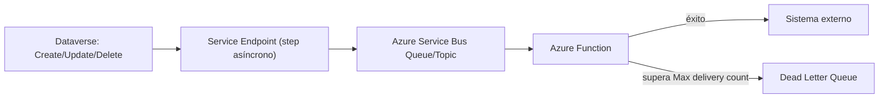

*Lectura: 18-22 min · Con práctica: unos 170 min con una suscripción de Azure (la primera vez, cuenta entre el doble y el triple). La Microlección 3 exige publicar una Function en Azure; la 4 (API Management) es opcional porque crear una instancia tarda y tiene costo.*

> **☁️ ¿Nunca usaste Azure Portal?** Lee primero [Fundamentos de Azure](/recursos/fundamentos-azure)
> — suscripción, resource group, RBAC y costos, con práctica en cuenta gratuita antes de crear los
> recursos que este módulo usa (Service Bus, Functions, API Management, Event Grid).

### 🎯 Objetivo
Integrar Power Platform con Azure Service Bus, Azure Functions, Azure API Management y Event Grid para construir arquitecturas de integración robustas, escalables y desacopladas entre Dataverse y sistemas externos.

> **Cómo está organizado este módulo:** vas a **decidir** el mecanismo de integración antes de crear recursos, vas a llevar eventos de Dataverse a una cola **sin código**, vas a consumirlos con una Azure Function que reintenta y deja los fallidos en la Dead Letter Queue, vas a **construir sin pasos** un segundo consumidor, vas a **diagnosticar** mensajes que terminan en la DLQ antes de ver la causa y vas a cerrar con un **reto de transferencia** con tres sistemas destino.
>
> Necesitas: el Plugin Registration Tool conectado a tu entorno (Microlección 1 del [Módulo 23](/nivel/avanzado/modulo/c-plugins-para-dataverse)), la tabla **Solicitud TI** (`sit_solicitud`) del Laboratorio 2, una suscripción de Azure con un resource group propio, Visual Studio o VS Code con las herramientas de Azure Functions y el SDK de .NET 8 o posterior. Al terminar, borra el resource group para no pagar recursos olvidados.

---

## 📖 Conceptos clave (referencia rápida)

- **Service Endpoint (Dataverse):** un destino de Azure que se registra con el Plugin Registration Tool y se asocia a un step como si fuera un plugin. Dataverse serializa el contexto del evento (`RemoteExecutionContext`: tabla, ID, mensaje, usuario, columnas) y lo envía sin que escribas C#. Destinos posibles: **Queue**, **Topic**, **OneWay**, **TwoWay** y **REST** (Azure Relay), **Event Hub** y **Event Grid**. El formato del mensaje (**Message Format**) puede ser binario de .NET (el valor por defecto), JSON o XML.
- **Webhook (Dataverse):** el mismo mecanismo, pero el destino es una URL HTTPS cualquiera (por ejemplo, una Azure Function con trigger HTTP). Admite steps síncronos y asíncronos; si es síncrono, el usuario espera la respuesta (hasta 60 segundos) y un error cancela la operación. La autenticación puede ir en un header, en la query string o como **WebhookKey** (se envía como `?code=`, el formato de las claves de Azure Functions).
- **Azure Service Bus:** mensajería con intermediario. **Queue**: cada mensaje lo procesa un solo consumidor; normalmente en orden de llegada, pero el orden estricto exige sesiones. **Topic + Subscriptions**: cada suscripción recibe su copia (un emisor, varios consumidores); requiere el plan **Standard** o **Premium**. Entrega "al menos una vez": el mismo mensaje puede llegar dos veces. En Standard, cada mensaje admite hasta 256 KB. Desde Dataverse, una integración con Service Bus solo admite steps **asíncronos**.
- **Dead Letter Queue (DLQ):** subcola de cada cola y suscripción (`<cola>/$deadletterqueue`). Un mensaje va allí cuando supera el número máximo de entregas (**Max delivery count**, 10 por defecto) con el motivo `MaxDeliveryCountExceeded`, o cuando expira si la cola o suscripción tiene activado el dead-lettering por expiración (motivo `TTLExpiredException`); si no, el mensaje expirado se descarta. No se limpia sola y no caduca: hay que revisarla y reenviar o descartar.
- **Reintentos con Service Bus:** no se configuran con una "política de reintentos" de la Function. Si la Function lanza una excepción, el mensaje se libera, su contador de entregas sube y Service Bus lo vuelve a entregar hasta el máximo de la cola; después, a la DLQ. Las políticas de reintento de la propia Function existen solo para algunos triggers (Timer, Event Hubs, Kafka, Cosmos DB), no para Service Bus.
- **Azure Functions (modelo isolated worker):** código serverless con triggers (`ServiceBusTrigger`, `HttpTrigger`…). Usa el modelo **isolated worker**: el modelo in-process deja de tener soporte el 10 de noviembre de 2026.
- **Azure Event Grid:** enrutamiento de eventos publicador-suscriptor (por ejemplo, "se creó un blob en Storage" → Function o Power Automate), con filtros por tipo de evento. Dataverse tiene Event Grid como tipo de service endpoint; este módulo no lo practica.
- **Azure API Management (APIM):** gateway que publica APIs con políticas (claves, cuotas, transformación, autenticación hacia el backend). La política `rate-limit-by-key` devuelve `429` al pasar la cuota; `authentication-managed-identity` obtiene un token con la identidad administrada de APIM.
- **Managed Identity y Key Vault:** identidad de Azure para un recurso, sin secretos en código. Microsoft recomienda Microsoft Entra ID antes que las claves SAS para Service Bus; la conexión de un trigger puede usar identidad (`<conexión>__fullyQualifiedNamespace`). Key Vault guarda los secretos que sí hacen falta, con auditoría.
- **Outbox Pattern:** el plugin solo registra un "mensaje pendiente" en Dataverse y un proceso aparte lo envía y reintenta. Útil cuando no puedes usar un service endpoint (por ejemplo, el mensaje necesita datos que el contexto del evento no trae).

**Diagrama: integración event-driven Dataverse → Azure**



---

## 🧩 Microlección 1 — Elegir el mecanismo y llevar un evento a Service Bus sin código

**¿Qué vas a aprender?** A elegir entre webhook, cola, topic, Event Hub o un flujo, y a enviar cada nueva Solicitud TI a una cola de Service Bus con el formato correcto.

**¿Por qué existe esto?** Si Dataverse llama directamente al ERP y el ERP está caído, el evento se pierde o el usuario espera. Con una cola en medio, Dataverse entrega y sigue; el consumidor procesa cuando puede.

**Ejemplo pequeño:** "el ERP debe recibir cada solicitud nueva, aunque esté caído un rato" → cola. "Tres sistemas reciben el mismo evento" → topic. "Validar en el momento contra un servicio y bloquear si falla" → webhook síncrono (o un plugin). "Millones de lecturas de sensores" → Event Hub.

**Ahora haz algo — micropráctica (5 min):** → **[Elegir el mecanismo de integración](/practica/ip-int-001-elegir-mecanismo-de-integracion)**.

### Crear la cola (15 min)

1. En <https://portal.azure.com>, menú > **All services** > **Integration** > **Service Bus** > **Create**.
2. En **Basics**: tu **Subscription** y **Resource group**; **Namespace name** único (de 6 a 50 caracteres, por ejemplo `sit-integracion-<tus iniciales>`); tu **Location**; **Pricing tier** = **Standard** (la Microlección de construcción usa topics, que no existen en Basic) > **Review + create** > **Create** > **Go to resource**.
3. **Entities** > **Queues** > **+ Queue**: **Name** = `solicitudes-nuevas` y número máximo de entregas (**Max delivery count**) = `3`, como en el caso de negocio; el resto por defecto > **Create**.
4. Abre la cola > **Shared access policies** > **+ Add**: nombre `dataverse-send`, marca solo **Send** > **Create**. Crea otra, `function-listen`, solo con **Listen**. No uses `RootManageSharedAccessKey`: tiene permiso **Manage** sobre todo el namespace.
5. Abre `dataverse-send` y copia su **Primary Connection String**.

### Registrar el service endpoint y su step (15 min)

1. En el Plugin Registration Tool: **Register** > **Register New Service Endpoint**.
2. Elige la opción de empezar con la cadena de conexión del portal (**Let's Start with the connection string from the Azure Service Bus Portal**), pega la cadena de `dataverse-send` y continúa.
3. En el diálogo del endpoint comprueba la cola y elige **Designation Type** = **Queue** y **Message Format** = **JSON**. *(Si lo dejas en el formato binario de .NET por defecto, la Function de la Microlección 2 no podrá leerlo: lo verás en el diagnóstico.)* Guarda.
4. Clic derecho sobre el endpoint > **Register New Step**: **Message** = `Create`, **Primary Entity** = `sit_solicitud`, **Event Pipeline Stage of Execution** = **PostOperation**, **Execution Mode** = **Asynchronous** > **Register New Step**.
5. Crea una solicitud nueva en tu app.
6. En el portal, abre la cola > **Service Bus Explorer** > **Peek Mode** > **Peek from start** y abre el mensaje.

**Qué deberías ver:** un mensaje (la cola cuenta 1 activo) con un cuerpo JSON que incluye `"MessageName":"Create"`, `"PrimaryEntityName":"sit_solicitud"` y `"PrimaryEntityId"` con el GUID de tu solicitud. Si no llega en un par de minutos, revisa los trabajos del sistema (System Jobs) del ambiente: el envío es un trabajo asíncrono y ahí verás su error.

**Evidencia a reportar:**

| Campo | Tu valor |
|---|---|
| Nombre del namespace y **Max delivery count** de la cola | ___ |
| Derechos de `dataverse-send` y de `function-listen` | ___ |
| **Content type** del mensaje que viste en el Explorer | ___ |
| Valor de `PrimaryEntityId` en el cuerpo, y el GUID de la solicitud en la app (¿coinciden?) | ___ |
| Por qué el step es asíncrono y no síncrono | ___ |

---

## 🧩 Microlección 2 — Una Azure Function que consume la cola: idempotencia, reintentos y DLQ

**¿Qué vas a aprender?** A leer el mensaje de Dataverse en una Function, llamar al sistema destino de forma idempotente y comprobar qué pasa cuando el destino falla.

**¿Por qué existe esto?** Service Bus entrega "al menos una vez": tras un reintento, el ERP puede recibir la misma solicitud dos veces. Y un mensaje que nunca va a funcionar tiene que terminar en un lugar visible, no reintentarse para siempre.

### El proyecto (20 min)

Crea un proyecto de **Azure Functions** en C# con el modelo **isolated worker** y .NET 8 o posterior, y agrega los paquetes `Microsoft.Azure.Functions.Worker.Extensions.ServiceBus` y `Microsoft.Azure.Functions.Worker.Extensions.Http.AspNetCore` (y `Microsoft.Extensions.Http` si tu plantilla no lo trae). `Program.cs`:

```csharp
using Microsoft.Azure.Functions.Worker.Builder;
using Microsoft.Extensions.DependencyInjection;
using Microsoft.Extensions.Hosting;

var builder = FunctionsApplication.CreateBuilder(args);
builder.ConfigureFunctionsWebApplication(); // integración ASP.NET Core para los triggers HTTP
builder.Services.AddHttpClient();           // registra IHttpClientFactory
builder.Build().Run();
```

La Function que consume la cola:

```csharp
using System;
using System.Net.Http;
using System.Net.Http.Json;
using System.Text.Json;
using System.Threading.Tasks;
using Azure.Messaging.ServiceBus;
using Microsoft.Azure.Functions.Worker;
using Microsoft.Extensions.Configuration;
using Microsoft.Extensions.Logging;

public class SolicitudProcessor
{
    private readonly ILogger<SolicitudProcessor> _logger;
    private readonly IHttpClientFactory _httpClientFactory;
    private readonly string _erpUrl;

    public SolicitudProcessor(ILogger<SolicitudProcessor> logger, IHttpClientFactory httpClientFactory, IConfiguration config)
    {
        _logger = logger;
        _httpClientFactory = httpClientFactory;
        _erpUrl = config["ErpUrl"] ?? throw new InvalidOperationException("Falta la configuración ErpUrl");
    }

    [Function("ProcesarSolicitudCreada")]
    public async Task Run(
        [ServiceBusTrigger("solicitudes-nuevas", Connection = "ServiceBusConnection")] ServiceBusReceivedMessage message)
    {
        _logger.LogInformation("Mensaje {MessageId}, entrega {DeliveryCount}, ContentType {ContentType}",
            message.MessageId, message.DeliveryCount, message.ContentType);

        // Un mensaje en otro formato nunca va a funcionar: falla, se reintenta y termina en la DLQ, donde se ve
        if (message.ContentType == null || !message.ContentType.StartsWith("application/json"))
            throw new InvalidOperationException($"Formato no soportado: {message.ContentType}. Revisa el Message Format del service endpoint.");

        // Leemos solo lo que necesitamos del RemoteExecutionContext serializado en JSON
        using JsonDocument doc = JsonDocument.Parse(message.Body.ToString());
        JsonElement raiz = doc.RootElement;
        string? solicitudId = raiz.GetProperty("PrimaryEntityId").GetString();
        string? evento = raiz.GetProperty("MessageName").GetString();

        // Idempotencia: el destino hace upsert por externalId; si este mensaje llega dos veces, no se duplica
        var payload = new { externalId = solicitudId, evento, origen = "Dataverse" };

        HttpClient http = _httpClientFactory.CreateClient();
        http.Timeout = TimeSpan.FromSeconds(30);
        HttpResponseMessage respuesta = await http.PostAsJsonAsync(_erpUrl, payload);
        respuesta.EnsureSuccessStatusCode(); // un 4xx/5xx lanza excepción: Service Bus vuelve a entregar el mensaje
        _logger.LogInformation("Destino aceptó la solicitud {Id}", solicitudId);
    }
}
```

Y un "ERP" de mentira para probar en local:

```csharp
using Microsoft.AspNetCore.Http;
using Microsoft.AspNetCore.Mvc;
using Microsoft.Azure.Functions.Worker;

public class FakeErp
{
    [Function("FakeErp")]
    public IActionResult Run([HttpTrigger(AuthorizationLevel.Anonymous, "post")] HttpRequest req)
        => new OkObjectResult(new { recibido = true });
}
```

En `local.settings.json`, dentro de `Values`, agrega `"ServiceBusConnection"` con la **Primary Connection String** de `function-listen` (incluye `EntityPath=solicitudes-nuevas`, que debe coincidir con el nombre del trigger) y `"ErpUrl": "http://localhost:7071/api/FakeErp"`. Ese archivo no se sube al repositorio: tiene secretos.

### Probar éxito, fallo y DLQ (25 min)

1. Arranca la Function en local (**F5** en Visual Studio, o `func start`). Si al arrancar falla por el almacenamiento (`AzureWebJobsStorage`), inicia el emulador Azurite o pon la cadena de una cuenta de Storage.
2. Crea una solicitud en tu app. En la consola de la Function verás el log de `ProcesarSolicitudCreada` con la entrega 1 y la llamada a `FakeErp`.
3. Detén la Function y cambia `ErpUrl` por `https://erp.invalid/api/solicitudes` (el dominio `.invalid` nunca existe). Arráncala y crea otra solicitud.
4. Observa en la consola tres intentos del mismo `MessageId`, con la entrega 1, 2 y 3.
5. En el portal, en la cola: **Service Bus Explorer** > subcola **DeadLetter** > **Peek from start**. Abre el mensaje y mira sus propiedades.
6. Vuelve a poner la `ErpUrl` buena y arranca la Function. En el Explorer, en la subcola **DeadLetter** (modo **Peek Mode**), selecciona el mensaje y usa **Re-send selected messages** para reenviarlo a la cola. Comprueba que ahora se procesa y mira si el original sigue en la DLQ: para retirarlo, pasa a **Receive Mode** y recíbelo.

**Ahora haz algo — diagnóstico (5 min):** un compañero tiene la misma Function, pero todos sus mensajes terminan en la DLQ sin llegar nunca al ERP → **[Diagnosticar: los mensajes terminan en la Dead Letter Queue](/practica/ip-int-002-mensajes-en-la-dead-letter-queue)**.

**Evidencia a reportar:**

| Campo | Tu valor |
|---|---|
| Línea del log de la entrega correcta (MessageId y DeliveryCount) | ___ |
| Valores de DeliveryCount que viste en los tres intentos fallidos | ___ |
| Motivo (dead-letter reason) del mensaje en la DLQ | ___ |
| Qué pasó al reenviarlo con la `ErpUrl` correcta | ___ |
| Qué haría tu destino si recibiera dos veces el mismo `externalId` | ___ |

---

## 🧩 Microlección 3 — Webhook: Dataverse llama a una Function HTTP

**¿Qué vas a aprender?** A registrar un webhook con la clave de la Function y a ver la diferencia entre un step síncrono y uno asíncrono.

**¿Por qué existe esto?** No siempre necesitas una cola: para avisar a un servicio propio, un webhook es más simple. Pero si es síncrono, el usuario espera, y si la Function falla, la operación se cancela.

**Práctica (30 min):**

1. Agrega al proyecto esta Function:

```csharp
using System.Text.Json;
using System.Threading.Tasks;
using Microsoft.AspNetCore.Http;
using Microsoft.AspNetCore.Mvc;
using Microsoft.Azure.Functions.Worker;
using Microsoft.Extensions.Logging;

public class DataverseWebhook
{
    private readonly ILogger<DataverseWebhook> _logger;
    public DataverseWebhook(ILogger<DataverseWebhook> logger) => _logger = logger;

    [Function("DataverseWebhook")]
    public async Task<IActionResult> Run(
        [HttpTrigger(AuthorizationLevel.Function, "post")] HttpRequest req) // exige la clave de la función
    {
        // Dataverse envía el RemoteExecutionContext como JSON en el cuerpo
        using JsonDocument doc = await JsonDocument.ParseAsync(req.Body);
        JsonElement raiz = doc.RootElement;
        _logger.LogInformation("Webhook: {Mensaje} en {Tabla} {Id}",
            raiz.GetProperty("MessageName").GetString(),
            raiz.GetProperty("PrimaryEntityName").GetString(),
            raiz.GetProperty("PrimaryEntityId").GetString());
        return new OkResult(); // respondes rápido; el trabajo pesado va a una cola
    }
}
```

2. Publica el proyecto en una Function App de Azure con la herramienta que uses (**Publish** de Visual Studio, la extensión de Azure Functions de VS Code o `func azure functionapp publish <tu-app>`). Dataverse no puede llamar a `localhost`. En la Function App, configura `ServiceBusConnection` y `ErpUrl` en sus variables de aplicación.
3. En el portal, abre la función `DataverseWebhook` y copia su URL **sin** el parámetro `code` y, aparte, el valor de la clave de la función.
4. En el PRT: **Register** > **Register New WebHook**: **Name** = `SIT Webhook Solicitud`, **Endpoint URL** = la URL sin `code`, **Authentication** = **WebhookKey**, **Value** = la clave > guarda.
5. Clic derecho sobre el webhook > **Register New Step**: **Message** = `Update`, **Primary Entity** = `sit_solicitud`, **Filtering Attributes** = `sit_estado`, **Event Pipeline Stage of Execution** = **PostOperation**, **Execution Mode** = **Asynchronous**.
6. Cambia el estado de una solicitud y busca la invocación en los logs de la Function App (**Monitor** o la secuencia de logs).
7. Ahora prueba el riesgo: edita el webhook y pon una clave equivocada. Cambia el step a **Synchronous** y cambia otro estado. Después devuelve la clave correcta y el modo **Asynchronous**.

**Qué deberías ver:** con la clave correcta, una invocación por cada cambio de estado; con la clave equivocada y el step síncrono, un error al guardar en la app (la Function responde 401 y Dataverse cancela la operación).

| Campo | Tu valor |
|---|---|
| Línea del log de la invocación (mensaje, tabla e ID) | ___ |
| Mensaje que vio el usuario con la clave equivocada y el step síncrono | ___ |
| Qué habría pasado con la clave equivocada y el step asíncrono (dónde lo verías) | ___ |
| Cuándo elegirías webhook y cuándo Service Bus, con tus palabras | ___ |

---

## 🧩 Microlección 4 (opcional) — Exponer Dataverse con API Management

**¿Qué vas a aprender?** A publicar una operación sencilla para un sistema externo, con clave, cuota por cliente y autenticación hacia Dataverse sin secretos.

**Antes de empezar:** crear una instancia de APIM tarda y tiene costo; hazlo solo si tu suscripción lo permite. La identidad administrada de APIM tiene que existir en tu ambiente como **application user** con un rol de seguridad que pueda crear solicitudes; sin eso, Dataverse responde 401 o 403.

En tu instancia: **APIs** > crea una API HTTP con **Web service URL** = `https://<tuorg>.crm.dynamics.com/api/data/v9.2` y una operación `POST /solicitudes`. En la operación, esta política:

```xml
<policies>
  <inbound>
    <base />
    <!-- Cuota por cliente: 100 llamadas cada 60 s. Sin X-Client-ID, todos comparten el contador "anonimo" -->
    <rate-limit-by-key calls="100" renewal-period="60"
        counter-key="@(context.Request.Headers.GetValueOrDefault("X-Client-ID", "anonimo"))" />
    <!-- Clave del sistema externo, guardada como named value secreto -->
    <check-header name="X-API-Key" failed-check-httpcode="401"
        failed-check-error-message="API Key inválida" ignore-case="false">
      <value>{{api-key-valor-secreto}}</value>
    </check-header>
    <!-- Token para Dataverse con la identidad administrada de APIM (agrega el header Authorization) -->
    <authentication-managed-identity resource="https://tuorg.crm.dynamics.com" />
    <!-- Ruta real en Dataverse (el EntitySetName de la tabla; compruébalo en tu ambiente) -->
    <rewrite-uri template="/sit_solicituds" />
    <!-- Sin este header, Dataverse responde 204 sin cuerpo y no hay nada que devolver -->
    <set-header name="Prefer" exists-action="override">
      <value>return=representation</value>
    </set-header>
    <set-header name="Content-Type" exists-action="override">
      <value>application/json</value>
    </set-header>
    <set-body>@{
      var body = context.Request.Body.As<JObject>();
      return new JObject(
        new JProperty("sit_titulo", body["name"]),             // usa el nombre de TU columna principal (Laboratorio 2)
        new JProperty("sit_descripcion", body["description"])
      ).ToString();
    }</set-body>
  </inbound>
  <backend>
    <base />
  </backend>
  <outbound>
    <base />
    <choose>
      <when condition="@(context.Response.StatusCode == 201)">
        <set-body>@{
          var body = context.Response.Body.As<JObject>();
          return new JObject(
            new JProperty("id", body["sit_solicitudid"]),
            new JProperty("status", "created")
          ).ToString();
        }</set-body>
      </when>
    </choose>
  </outbound>
  <on-error>
    <base />
  </on-error>
</policies>
```

| Campo | Tu valor |
|---|---|
| Status y cuerpo de una llamada correcta desde la consola de prueba de APIM | ___ |
| Status sin `X-API-Key` | ___ |
| Status al pasar la cuota (y cuándo se renueva) | ___ |

---

## 🏗️ Reto de construcción (sin pasos)

**Requerimiento:** el equipo del almacén (WMS) también necesita enterarse de cada solicitud nueva, sin quitarle nada al ERP. Si el WMS está caído, el ERP tiene que seguir recibiendo sus mensajes, y cada sistema necesita ver sus propios fallidos.

**Criterios de aceptación:**

- Una solicitud nueva genera **un** envío desde Dataverse y llega a los dos consumidores.
- Con la URL del WMS rota, los mensajes del ERP se siguen procesando y los del WMS terminan en una DLQ distinta a la del ERP.
- Ningún consumidor tiene más derechos de los que necesita.

**Restricciones:** no registres un segundo step ni un segundo endpoint para el mismo evento, y no copies mensajes entre colas desde una Function.

| Campo | Tu valor |
|---|---|
| Recurso de Service Bus que creaste y sus suscripciones | ___ |
| Designation Type del endpoint nuevo | ___ |
| Trigger de cada Function (atributo con nombres) | ___ |
| Dónde viste el mensaje fallido del WMS (ruta de la DLQ) | ___ |

---

## 🔧 Diagnosticar — síntoma primero

Antes de ver ninguna causa, resuelve **[Diagnosticar: los mensajes terminan en la Dead Letter Queue](/practica/ip-int-002-mensajes-en-la-dead-letter-queue)** si no lo hiciste en la Microlección 2. Escribe tu hipótesis con el dato que la sostiene (las propiedades del mensaje en la DLQ y el log de la Function), y solo después pide las pistas.

Para reproducirlo en tu tenant: en el PRT, edita tu service endpoint y cambia **Message Format** al formato binario de .NET. Crea una solicitud, mira el log de tu Function y el mensaje en la DLQ. Después vuelve a **JSON**.

| Campo | Tu valor |
|---|---|
| Tu hipótesis antes de las pistas | ___ |
| **Content type** del mensaje con el formato binario | ___ |
| Línea del log que lo delata | ___ |

---

## 🔁 Reto de transferencia

Ya llevaste un evento a un consumidor con reintentos y DLQ. Ahora el requisito **cambia**: una cadena de retail registra los pedidos en Dataverse y cada pedido confirmado debe llegar a **tres** sistemas: facturación (no puede facturar dos veces el mismo pedido), el WMS (si cae, no debe frenar a los demás) y la analítica (acepta retraso). La seguridad pide que no haya claves con permisos de administración en ningún sistema, y operaciones quiere enterarse cuando algo quede sin procesar.

**[Transferir: un evento de Dataverse para tres sistemas](/practica/ip-int-003-un-evento-para-tres-sistemas)** — decide el recurso de Service Bus, el tipo de step, cómo evitar la doble facturación y cómo autenticar a los consumidores.

| Campo | Tu valor |
|---|---|
| Recurso de Service Bus y número de suscripciones | ___ |
| Modo del step en Dataverse, con la razón | ___ |
| Cómo evita facturación la doble factura | ___ |
| Cómo se autentican las Functions ante Service Bus | ___ |
| Qué alerta configurarías y sobre qué métrica | ___ |

---

### 💼 Caso Real de Negocio
**Empresa:** Empresa de logística con 3 sistemas: Dataverse (CRM), SAP (ERP), WMS (almacén)  
**Problema:** Los sistemas se llamaban directamente entre sí. Si SAP estaba caído, las órdenes de Dataverse se perdían. 0 reintentos, 0 audit trail.  
**Solución:** Service Bus como middleware. Dataverse envía evento al Service Bus. Azure Function lo lee y llama a SAP con retry automático. Si SAP falla 3 veces, el mensaje va a Dead Letter Queue para atención manual. APIM expone WMS a Power Automate con rate limiting.  
**Resultado:** Cero pérdida de órdenes. SLA de integración: 99.9%. Dead Letter Queue procesa mensajes fallidos en horario de mantenimiento.

### ✅ Buenas Prácticas
- Async siempre para integraciones externas — nunca bloquear el pipeline de Dataverse
- Idempotencia en las Azure Functions — el mismo mensaje puede llegar 2 veces; debe procesarse 1 vez
- Dead Letter Queue monitoreada con alertas — mensajes fallidos no deben quedarse sin atención
- Managed Identity en lugar de connection strings almacenados en código
- Políticas SAS por entidad y con el mínimo derecho (Send para Dataverse, Listen para el consumidor); nunca `RootManageSharedAccessKey`
- **Message Format** del service endpoint acordado con el consumidor (JSON si el consumidor no es .NET con el SDK de Dataverse)
- Topic con una suscripción por consumidor cuando varios sistemas necesitan el mismo evento: cada uno con su ritmo y su DLQ
- **Max delivery count** ajustado a lo que tolera el destino, y un proceso para revisar y reenviar la DLQ
- Funciones con el modelo isolated worker; secretos en la configuración de la Function App o en Key Vault, no en el código

### ⚠️ Errores Comunes
| Síntoma | Causa | Solución |
|-------|-------|----------|
| El PRT no deja registrar el step del endpoint de Service Bus como síncrono | Dataverse solo admite steps asíncronos para Service Bus | Registrar el step en PostOperation, **Asynchronous** |
| El mensaje no llega a la cola y el trabajo del sistema falla con un error de autorización | La política SAS no tiene **Send**, o se regeneró su clave | Política con **Send** sobre la cola y actualizar la cadena en el endpoint |
| Todos los mensajes terminan en la DLQ con `MaxDeliveryCountExceeded` sin llegar al destino | La Function falla en cada entrega (formato binario de .NET leído como JSON, o destino caído) | Leer el log y las propiedades del mensaje; **Message Format** = JSON o leer según el `ContentType` |
| La Function no ve los mensajes de la DLQ | La DLQ es una subcola aparte | Trigger sobre `<cola>/$deadletterqueue`, o revisar y reenviar desde Service Bus Explorer |
| El ERP recibe dos veces la misma solicitud | Entrega "al menos una vez" y un reintento tras un fallo parcial | Upsert por un identificador estable (`PrimaryEntityId`) en el destino |
| El usuario no puede guardar y ve un error del webhook | Step síncrono y la Function respondió con error o tardó más de 60 s | Step asíncrono salvo que de verdad debas bloquear; responder rápido y mandar el trabajo a una cola |
| El webhook recibe 401 | Clave equivocada o **Authentication** distinta de **WebhookKey** con una Function protegida | Registrar el webhook con **WebhookKey** y la clave de la función |
| APIM devuelve un cuerpo vacío o `null` tras crear | Dataverse responde 204 sin cuerpo | Header `Prefer: return=representation` (responde 201 con la fila) |
| APIM devuelve 401/403 de Dataverse | La identidad administrada de APIM no es application user con un rol en el ambiente | Crear el application user y asignarle un rol |
| APIM retorna 502 o 504 | El backend tardó más que el timeout de APIM o no responde | Revisar el backend; aumentar el timeout o pasar a un patrón asíncrono |

### 🧪 Criterios de Validación
- [ ] Resolví la micropráctica de mecanismos y justifiqué cola, topic, webhook o Event Hub para cada caso
- [ ] Creé la cola con **Max delivery count** = 3 y dos políticas SAS de un solo derecho
- [ ] Registré el service endpoint con **Message Format** = JSON y un step asíncrono, y vi el mensaje en Service Bus Explorer con su `PrimaryEntityId`
- [ ] Mi Function procesó un mensaje y anoté su `MessageId` y `DeliveryCount`
- [ ] Con el destino caído, vi tres entregas y el mensaje en la DLQ con el motivo `MaxDeliveryCountExceeded`, y lo reenvié al arreglar el destino
- [ ] Diagnostiqué los mensajes en la DLQ formulando una hipótesis antes de ver la causa
- [ ] Registré un webhook con **WebhookKey** y comprobé qué pasa con una clave equivocada en modo síncrono
- [ ] Construí sin pasos el segundo consumidor con un topic y dos suscripciones, cada una con su DLQ
- [ ] Resolví el reto de transferencia de tres sistemas y justifiqué recurso, modo, idempotencia y autenticación
- [ ] (Opcional) Publiqué la operación en APIM y anoté el status con clave, sin clave y al pasar la cuota

---
