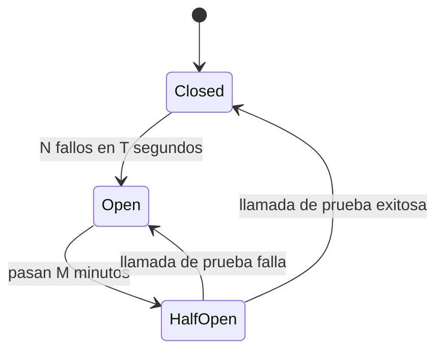

*Lectura: 20-25 min · Con práctica: unos 200 min (los dos retos de construcción se llevan buena parte), mejor en dos sesiones (la primera hasta el diagnóstico; la segunda, de la Microlección 3 al final). La primera vez, cuenta entre una vez y media y el doble.*

### 🎯 Objetivo
Aplicar patrones de diseño reconocidos en implementaciones de Power Platform: Repository Pattern, Command Pattern, Observer Pattern con plugins, Saga Pattern para transacciones distribuidas, y CQRS para separar lecturas de escrituras.

> **Cómo está organizado este módulo (patrón del Módulo 13, aplicado a código de servidor):** vas a **decidir** qué patrón resuelve cada problema antes de escribir código, vas a **refactorizar** el plugin del Lab 23 para que su lógica se pruebe sin Dataverse, vas a **diagnosticar** un plugin que bloquea a los usuarios cuando una API externa se cae, vas a **construir** una saga con compensaciones en tu ambiente y vas a cerrar con un **reto de transferencia** donde uno de los pasos ya no se puede deshacer.
>
> **Antes de empezar, necesitas:**
> - El proyecto de Visual Studio del [Lab 23](/labs/lab-23-plugin-csharp) (`SIT.Plugins`, firmado, y `SIT.Plugins.Tests`, .NET Framework 4.8) con `SolicitudPreCreatePlugin` (dos steps de Create: PreValidation y PreOperation) y `SolicitudPostUpdatePlugin` (Update de `sit_estado` con Pre Image) registrados en tu DEV. Si aún no hiciste el Lab 23, hazlo antes: este módulo parte de su código.
> - El Módulo 11 (Scope, Run After y Try/Catch en Power Automate) y el Módulo 23 (plugins C#).
> - Tu ambiente **DEV** con la tabla `Categoría` del Lab 02 (la Microlección 3 crea y borra una fila de prueba en ella).

### 📖 Conceptos Clave
Un mapa rápido; los patrones marcados con microlección se practican abajo.

- **Repository Pattern** *(Microlección 1)***:** patrón de diseño que introduce una capa de abstracción entre la lógica de negocio y el acceso a datos. En plugins C#, en lugar de llamar directamente a `IOrganizationService` desde la lógica del negocio, se define una interfaz (por ejemplo `ISolicitudRepository`) con métodos de dominio y una implementación concreta que usa `IOrganizationService`. La ventaja principal es la testeabilidad: en unit tests se inyecta un repositorio falso (o un mock) sin necesitar un entorno de Dataverse real. Una buena interfaz habla el idioma del negocio (`Registrar(cambio)`), no el de Dataverse: si sus métodos reciben `Entity` o `QueryExpression`, la lógica sigue atada al SDK.
- **Command Pattern:** patrón que encapsula una operación de negocio completa (con sus datos, validaciones y efectos secundarios) en un objeto independiente llamado Command. Ejemplo: en lugar de tener lógica dispersa, se crea la clase `AprobarSolicitudCommand` con los datos necesarios y una clase `AprobarSolicitudCommandHandler` que ejecuta toda la lógica. Facilita el logging uniforme de todas las operaciones, la validación previa, y el registro de auditoría sin repetir código.
- **Observer Pattern:** patrón donde los objetos observadores son notificados automáticamente cuando el objeto observado cambia de estado. En Dataverse, el sistema de plugins es una implementación nativa del Observer Pattern: el plugin actúa como observer que reacciona a eventos (Create/Update/Delete) en la tabla observada. El reto es el diseño cuidadoso de qué plugins observan qué eventos y en qué orden se ejecutan cuando hay varios **steps** registrados para el mismo mensaje y la misma etapa: los ordena el campo **Execution Order** de cada step, de menor a mayor, y si dos tienen el mismo valor el orden no está garantizado ([Learn: registrar un plugin](https://learn.microsoft.com/power-apps/developer/data-platform/register-plug-in)).
- **Saga Pattern** *(Microlección 3 y reto de transferencia)***:** patrón para gestionar transacciones distribuidas que involucran múltiples sistemas sin soporte de transacciones ACID entre ellos. Una Saga es una secuencia de pasos locales donde cada paso **compensable** tiene una operación de compensación (rollback manual). Si el paso N falla, se ejecutan las compensaciones de los pasos N-1, N-2, ..., 1 para deshacer los cambios. Learn distingue tres tipos de paso: **compensables** (se pueden deshacer), el **pivote** (el punto de no retorno: si sale bien, ya no se compensa nada) y los **reintentables**, que van después del pivote y deben ser idempotentes ([Learn: patrón Saga](https://learn.microsoft.com/azure/architecture/patterns/saga)). En Power Platform se implementa con Power Automate usando Scopes con manejo de errores, o con Azure Durable Functions para mayor robustez.
- **CQRS (Command Query Responsibility Segregation):** patrón arquitectónico que separa el modelo de lectura del modelo de escritura. Las operaciones de escritura (Commands) pasan por plugins C# con toda la lógica de validación y enriquecimiento. Las operaciones de lectura (Queries) usan FetchXML o vistas optimizadas directamente, sin pasar por la lógica de escritura. En Power Platform: los Canvas Apps y reportes leen directamente con FetchXML optimizado, mientras que las escrituras siempre van por el plugin que centraliza las reglas de negocio.
- **Outbox Pattern** *(Microlección 2)***:** patrón de garantía de entrega at-least-once en integraciones. El plugin, en lugar de llamar directamente al sistema externo (arriesgando perder el mensaje si el sistema está caído), crea un registro en una tabla "Outbox" de Dataverse con el payload del mensaje y estado "Pendiente". Un proceso separado (Power Automate en polling cada 5 minutos, o Azure Function programada) lee los registros Pendientes, los envía al sistema externo, y los marca como "Enviado" o "Fallido" con el detalle del error. Como un mensaje puede enviarse más de una vez, el receptor debe ser idempotente.
- **Circuit Breaker** *(Microlección 2)***:** patrón que protege un sistema cuando llama a un servicio externo que falla repetidamente. Tiene tres estados ([Learn: Circuit Breaker](https://learn.microsoft.com/azure/architecture/patterns/circuit-breaker)): **Closed** (operación normal, cuenta los fallos recientes), **Open** (superado el umbral de fallos en un periodo, deja de intentar y falla de inmediato con un mensaje claro) y **Half-Open** (pasado un tiempo, deja pasar unas pocas llamadas de prueba: si salen bien vuelve a Closed, si alguna falla vuelve a Open). Necesita un **estado compartido** entre todas las llamadas, y ahí está la trampa en un plugin: Learn pide que los plugins sean **sin estado** ([Learn: plugins sin estado](https://learn.microsoft.com/power-apps/developer/data-platform/best-practices/business-logic/develop-iplugin-implementations-stateless)), así que un contador en un campo `static` del plugin no es un circuit breaker fiable. En un plugin síncrono, lo que sí protege al usuario es un **timeout corto**: el plugin tiene 2 minutos en total y el timeout por defecto de `HttpClient` es de 100 segundos ([Learn: timeout en llamadas externas](https://learn.microsoft.com/power-apps/developer/data-platform/best-practices/business-logic/set-timeout-for-external-calls-from-plug-ins)).
- **Retry Pattern:** patrón de reintento con backoff exponencial y jitter (variación aleatoria en el tiempo de espera). En lugar de reintentar inmediatamente al fallar (que causaría una avalancha de requests al sistema externo), se espera un tiempo creciente: intento 1 después de 1s, intento 2 después de 2s, intento 3 después de 4s, con jitter (una pequeña variación aleatoria) para evitar que múltiples instancias reintenten exactamente al mismo tiempo. Solo sirve para fallos **transitorios**: un dato inválido falla igual en cada intento. En Azure Functions hay dos mecanismos ([Learn: reintentos en Azure Functions](https://learn.microsoft.com/azure/azure-functions/functions-bindings-error-pages)): las **retry policies** del runtime, que se declaran **por función** con los atributos `[FixedDelayRetry]` o `[ExponentialBackoffRetry]` y solo existen para los triggers de Timer, Event Hubs, Kafka y Azure Cosmos DB; y los reintentos propios de cada extensión, como Service Bus (que reintenta la entrega del mensaje y, al agotarla, lo manda a la dead-letter queue) o Queue Storage. En Power Automate, cada acción tiene su **Retry Policy** en **Settings** (Módulo 5).

**Diagrama: estados del Circuit Breaker**



### 👨‍💻 Actividades Prácticas

## 🧩 Microlección 1 — Repository: probar la lógica del plugin sin Dataverse

**¿Qué vas a aprender?** A sacar la lógica de negocio de un plugin a una clase que recibe un repositorio, para probarla con un repositorio falso de diez líneas en lugar de simular `IServiceProvider`, `IPluginExecutionContext`, la fábrica de servicios e `IOrganizationService`.

**¿Por qué existe esto?** En el Lab 23, para probar la regla de auditoría de `SolicitudPostUpdatePlugin` (solo se audita si el estado cambió de verdad, con las etiquetas legibles y el usuario que originó el cambio) tuviste que montar con Moq el proveedor de servicios, el contexto, la colección de Pre Images, la fábrica y el servicio, y comprobar con `It.Is<Entity>` los nombres de las columnas de Dataverse. Cada test nuevo repite ese andamiaje y se rompe si cambias cómo el plugin lee el contexto. Con un repositorio, la regla se prueba sola contra una lista en memoria. Además, Learn pide que la clase del plugin no guarde estado en campos ([Learn: plugins sin estado](https://learn.microsoft.com/power-apps/developer/data-platform/best-practices/business-logic/develop-iplugin-implementations-stateless)): por eso aquí el repositorio y el servicio se crean **dentro** de cada ejecución, no en el constructor del plugin.

**Ahora haz algo — micropráctica (6 min):** antes de tocar código → **[Elegir el patrón para cada problema](/practica/ip-arq-004-elegir-patron-para-cada-problema)**. Cuatro problemas reales del equipo SIT; elige qué patrón resuelve cada uno y cuál de las tentaciones habituales los empeora.

**Práctica real (25 min, Visual Studio + tu DEV):**

1. En el proyecto `SIT.Plugins`, agrega la clase `AuditoriaEstado.cs` con este código. Solo usa tipos del SDK de Dataverse (`Microsoft.Xrm.Sdk`) que ya instalaste en el Lab 23, la clase `SolicitudValores` de ese lab y sintaxis de C# 7.3, la que usa por defecto un proyecto .NET Framework:

   ```csharp
   using System;
   using Microsoft.Xrm.Sdk;

   namespace SIT.Plugins
   {
       // 0) El dato que se audita, en el idioma del negocio
       public class CambioEstado
       {
           public Guid SolicitudId { get; set; }
           public string EstadoAnterior { get; set; }
           public string EstadoNuevo { get; set; }
           public Guid UsuarioId { get; set; }
       }

       // 1) Contrato: no menciona Entity ni IOrganizationService
       public interface IAuditoriaRepository
       {
           // Guarda el cambio y devuelve el id de la fila creada
           Guid Registrar(CambioEstado cambio);
       }

       // 2) La única clase que sabe cómo se llaman la tabla y sus columnas
       public class DataverseAuditoriaRepository : IAuditoriaRepository
       {
           private readonly IOrganizationService _service;

           public DataverseAuditoriaRepository(IOrganizationService service)
           {
               _service = service;
           }

           public Guid Registrar(CambioEstado cambio)
           {
               var auditoria = new Entity("sit_auditoriasolicitud");
               auditoria["sit_solicitud"] = new EntityReference("sit_solicitud", cambio.SolicitudId);
               auditoria["sit_estadoanterior"] = cambio.EstadoAnterior;
               auditoria["sit_estadonuevo"] = cambio.EstadoNuevo;
               auditoria["sit_usuario"] = new EntityReference("systemuser", cambio.UsuarioId);
               auditoria["sit_fecha"] = DateTime.UtcNow;
               return _service.Create(auditoria);
           }
       }

       // 3) La regla de negocio pura: no sabe que Dataverse existe
       public class AuditoriaEstadoService
       {
           private readonly IAuditoriaRepository _repo;

           public AuditoriaEstadoService(IAuditoriaRepository repo)
           {
               _repo = repo;
           }

           // Devuelve el id de la auditoría, o null si el estado no cambió de verdad
           public Guid? RegistrarCambio(Guid solicitudId, int? anterior, int? nuevo, Guid usuarioId)
           {
               // Filtering Attributes dispara el step aunque sit_estado llegue con el mismo valor
               if (anterior == nuevo) return null;

               return _repo.Registrar(new CambioEstado
               {
                   SolicitudId = solicitudId,
                   EstadoAnterior = SolicitudValores.NombreEstado(anterior),
                   EstadoNuevo = SolicitudValores.NombreEstado(nuevo),
                   UsuarioId = usuarioId
               });
           }
       }
   }
   ```

2. En `SolicitudPostUpdatePlugin.cs`, deja igual las guardas y las dos líneas que leen `anterior` (de la Pre Image) y `nuevo` (del Target). Reemplaza todo lo que va desde el comentario `// Filtering Attributes dispara el step…` (el que está justo encima de `if (anterior == nuevo)`) hasta el último `tracer.Trace` por esto. El comentario se va con el `if`, porque esa comparación ahora vive en `AuditoriaEstadoService`:

   ```csharp
               // El rol SIT Técnico TI solo tiene Read sobre sit_auditoriasolicitud (Lab 04): null = SYSTEM.
               // Repositorio y servicio se crean en cada ejecución: la clase del plugin sigue sin guardar estado
               var repo = new DataverseAuditoriaRepository(serviceFactory.CreateOrganizationService(null));

               // InitiatingUserId = quien hizo el cambio, aunque la fila la cree SYSTEM
               Guid? id = new AuditoriaEstadoService(repo).RegistrarCambio(
                   context.PrimaryEntityId, anterior, nuevo, context.InitiatingUserId);

               if (id.HasValue)
                   tracer.Trace("Auditoría {0}: {1} -> {2}", id.Value, anterior, nuevo);
               else
                   tracer.Trace("Estado sin cambio real ({0}): no se audita.", nuevo);
   ```

   El plugin conserva lo que solo él puede saber (el contexto, la Pre Image, con qué usuario se crea el servicio) y delega la decisión. Con `null`, `CreateOrganizationService` devuelve un servicio que actúa como SYSTEM ([Learn: CreateOrganizationService](https://learn.microsoft.com/dotnet/api/microsoft.xrm.sdk.iorganizationservicefactory.createorganizationservice)).

3. En el proyecto `SIT.Plugins.Tests`, agrega `AuditoriaEstadoServiceTests.cs`. Fíjate en que no usa Moq ni ningún tipo del contexto del plugin:

   ```csharp
   using System;
   using System.Collections.Generic;
   using Microsoft.VisualStudio.TestTools.UnitTesting;
   using SIT.Plugins;

   namespace SIT.Plugins.Tests
   {
       // Repositorio falso: guarda en una lista lo que el servicio le pide registrar
       internal class FakeAuditoriaRepository : IAuditoriaRepository
       {
           public readonly List<CambioEstado> Registros = new List<CambioEstado>();

           public Guid Registrar(CambioEstado cambio)
           {
               Registros.Add(cambio);
               return Guid.NewGuid();
           }
       }

       [TestClass]
       public class AuditoriaEstadoServiceTests
       {
           private static readonly Guid Solicitud = Guid.NewGuid();
           private static readonly Guid Usuario = Guid.NewGuid();

           [TestMethod]
           public void CambioReal_RegistraEtiquetasYUsuario()
           {
               var repo = new FakeAuditoriaRepository();
               Guid? id = new AuditoriaEstadoService(repo).RegistrarCambio(
                   Solicitud, SolicitudValores.ESTADO_NUEVA, SolicitudValores.ESTADO_EN_PROCESO, Usuario);

               Assert.IsTrue(id.HasValue);
               Assert.AreEqual(1, repo.Registros.Count);
               Assert.AreEqual("Nueva", repo.Registros[0].EstadoAnterior);
               Assert.AreEqual("En Proceso", repo.Registros[0].EstadoNuevo);
               Assert.AreEqual(Solicitud, repo.Registros[0].SolicitudId);
               Assert.AreEqual(Usuario, repo.Registros[0].UsuarioId);
           }

           [TestMethod]
           public void MismoEstado_NoRegistraNada()
           {
               var repo = new FakeAuditoriaRepository();
               Guid? id = new AuditoriaEstadoService(repo).RegistrarCambio(
                   Solicitud, SolicitudValores.ESTADO_NUEVA, SolicitudValores.ESTADO_NUEVA, Usuario);

               Assert.IsFalse(id.HasValue);
               Assert.AreEqual(0, repo.Registros.Count);
           }

           [TestMethod]
           public void SinEstadoAnterior_SeAuditaComoVacio()
           {
               // Una fila importada sin estado que luego recibe uno: es un cambio real
               var repo = new FakeAuditoriaRepository();
               new AuditoriaEstadoService(repo).RegistrarCambio(
                   Solicitud, null, SolicitudValores.ESTADO_EN_PROCESO, Usuario);

               Assert.AreEqual(1, repo.Registros.Count);
               Assert.AreEqual("(vacío)", repo.Registros[0].EstadoAnterior);
           }
       }
   }
   ```

4. **Build** > **Build Solution** y, en **Test Explorer**, **Run All**. **Qué deberías ver:** los 6 tests del Lab 23 y los 3 nuevos en verde. **Si falla `PostUpdate_CambioRealDeEstado_CreaAuditoriaComoSystem`** (del Lab 23), el repositorio de Dataverse no crea la misma fila que antes: compara el nombre de la tabla y de cada columna con el código original, y revisa que el servicio salga de `CreateOrganizationService(null)`, que es la única llamada a la que el mock del Lab 23 le devuelve un servicio. **Si `IAuditoriaRepository` no se encuentra** en el proyecto de tests, revisa que `SIT.Plugins.Tests` tiene la referencia al proyecto `SIT.Plugins` (Lab 23, Tarea 1.4).
5. Recompila y actualiza el ensamblado en el Plugin Registration Tool: selecciona **(Assembly) SIT.Plugins** > **Update**; en el diálogo **Update Assembly**, elige el `SIT.Plugins.dll` recién compilado con el botón de los puntos suspensivos (**…**), comprueba que el ensamblado y los plugins están marcados y pulsa **Update Selected Plugins** ([Learn: actualizar el ensamblado](https://learn.microsoft.com/power-apps/developer/data-platform/tutorial-update-plug-in#update-the-plug-in-assembly-registration)). Los steps y la Pre Image no se tocan: siguen registrados como en el Lab 23. Si al cerrar el Lab 23 dejaste el **Plug-in Trace Log** en **Exception**, ponlo en **All** mientras pruebas. Como ya tienes abierto el Plug-in Registration Tool, lo más rápido es su menú **Settings** > **Logging to Plug-in Trace Log**; también está en la configuración clásica del ambiente: **Settings** > **Administration** > **System Settings** > pestaña **Customization** > **Enable logging to plug-in trace log**. Los registros se consultan en la app Model-Driven, en **Settings** > **Plug-in Trace Log** ([Learn: tracing](https://learn.microsoft.com/power-apps/developer/data-platform/logging-tracing)). Después, en la app Model-Driven, cambia el **Estado** de una solicitud (por ejemplo, de En Proceso a Resuelta) y guarda. **Qué deberías ver:** una fila nueva en **Auditoria Solicitud** con las dos etiquetas y tu usuario en **Usuario**, y en el trace la línea `Auditoría <id>: <valor anterior> -> <valor nuevo>`. **Si el PRT rechaza el ensamblado**, revisa que el proyecto siga firmado (Lab 23, Tarea 1.3). **Si no aparece la fila**, busca en el trace "sin cambio real" o "Falta la Pre Image". Al terminar, vuelve a dejar el trace en **Exception**.

**Evidencia a reportar (el dato exacto, no un "sí/no"):**

| Campo | Tu valor |
|---|---|
| Número de tests en verde (Lab 23 + nuevos) y tiempo total que mostró **Test Explorer** | ___ |
| ¿Algún test nuevo necesitó Moq o un tipo del contexto del plugin? Di qué tipos usa | ___ |
| Estado anterior → nuevo del cambio que hiciste en DEV y el **Usuario** que muestra la fila de **Auditoria Solicitud** | ___ |
| Línea del Plug-in Trace Log que empieza por `Auditoría` | ___ |

**🏗️ Reto de construcción (sin pasos):** la otra dependencia difícil de probar del plugin del Lab 23 no es Dataverse: es el **reloj**. `CalcularFechaVencimiento` (en `SolicitudPreCreatePlugin`, step de PreOperation) usa `DateTime.UtcNow`, por eso el test `PreOperation_Baja_VenceEn48Horas` del Lab 23 solo puede afirmar un rango y no la fecha exacta.

> **Requerimiento:** saca la regla de vencimiento a una clase `VencimientoSolicitudService` que reciba por el constructor una interfaz tuya que dé la hora actual, y prueba la regla con un reloj falso fijo.
> **Criterios de aceptación:** (1) Crítica → exactamente 4 horas después de la hora del reloj; (2) Alta → 8 horas; (3) Baja → 48 horas; (4) Media, o una solicitud sin prioridad → 24 horas; (5) cada caso tiene un test que afirma la fecha exacta, no un rango; (6) el plugin sigue calculando la fecha en DEV con el reloj real y los tests del Lab 23 siguen en verde.
> **Restricciones:** la clase del plugin no guarda el reloj en un campo; los valores de prioridad salen de `SolicitudValores`, no se escriben a mano.

Si te atascas, vuelve al `FakeAuditoriaRepository`: es el mismo truco con otra dependencia.

<details>
<summary>Segunda pista (ábrela solo si la primera no bastó)</summary>

La interfaz del reloj solo necesita una propiedad de solo lectura, por ejemplo `DateTime AhoraUtc { get; }`. Hacen falta dos implementaciones: la real (`RelojSistema`, que devuelve `DateTime.UtcNow`) y la de los tests (un reloj falso que devuelve la fecha que le pases en el constructor). El plugin crea `new VencimientoSolicitudService(new RelojSistema())` **en cada ejecución** (dentro de `Execute` o del método que calcula el vencimiento), nunca en un campo de la clase. En los tests, compara con `Assert.AreEqual(fechaFija.AddHours(4), resultado)`.
</details>

---

## 🧩 Microlección 2 — Llamadas externas: timeout, Circuit Breaker y Outbox

**¿Qué vas a aprender?** Dónde va cada patrón de resiliencia cuando hay una API externa de por medio: qué protege al usuario dentro de un plugin síncrono y qué tiene que salir del plugin.

**¿Por qué existe esto?** Un plugin síncrono que llama a una API caída deja al usuario esperando. Learn fija las reglas del sandbox:

- El plugin tiene **2 minutos** en total y `HttpClient` espera por defecto **100 segundos**: pon un timeout explícito y corto ([Learn: timeout](https://learn.microsoft.com/power-apps/developer/data-platform/best-practices/business-logic/set-timeout-for-external-calls-from-plug-ins)).
- Desactiva **KeepAlive**: los plugins son ejecuciones cortas y reutilizar una conexión que la red ya cerró alarga la espera hasta que se resetea ([Learn: KeepAlive](https://learn.microsoft.com/power-apps/developer/data-platform/best-practices/business-logic/set-keepalive-false-interacting-external-hosts-plugin)). Con `HttpClient` se hace con `DefaultRequestHeaders.ConnectionClose = true`.
- **Sin estado**: la plataforma cachea la instancia del plugin, la reinicializa cuando quiere y varios hilos pueden ejecutar la misma instancia a la vez ([Learn: sin estado](https://learn.microsoft.com/power-apps/developer/data-platform/best-practices/business-logic/develop-iplugin-implementations-stateless)).

Así queda una llamada externa correcta desde un plugin. Si al compilar `HttpClient` sale en rojo, añade la referencia a `System.Net.Http`: en **Solution Explorer**, clic derecho en **References** del proyecto `SIT.Plugins` > **Add Reference**; en **Reference Manager**, **Assemblies** > **Framework**, marca `System.Net.Http` y pulsa **OK** ([Learn: Reference Manager](https://learn.microsoft.com/visualstudio/ide/how-to-add-or-remove-references-by-using-the-reference-manager)):

```csharp
using System;
using System.Net.Http;
using System.Threading.Tasks;
using Microsoft.Xrm.Sdk;

namespace SIT.Plugins
{
    // Sin campos de instancia ni estáticos que cambien: todo vive dentro de la llamada
    public static class InventarioClient
    {
        public static string ConsultarStock(string url, ITracingService tracer)
        {
            using (var client = new HttpClient())
            {
                client.Timeout = TimeSpan.FromSeconds(15);           // fallar rápido: el plugin tiene 2 min
                client.DefaultRequestHeaders.ConnectionClose = true; // equivale a KeepAlive = false

                try
                {
                    HttpResponseMessage response = client.GetAsync(url).GetAwaiter().GetResult(); // síncrono
                    if (!response.IsSuccessStatusCode)
                    {
                        tracer.Trace("Inventario respondió {0}", (int)response.StatusCode);
                        throw new InvalidPluginExecutionException(
                            "El sistema de inventario no está disponible. Intenta de nuevo en unos minutos.");
                    }
                    return response.Content.ReadAsStringAsync().GetAwaiter().GetResult();
                }
                catch (TaskCanceledException)   // así avisa HttpClient de que se agotó el Timeout
                {
                    tracer.Trace("Inventario no respondió en 15 s");
                    throw new InvalidPluginExecutionException(
                        "El sistema de inventario no respondió a tiempo. Intenta de nuevo en unos minutos.");
                }
                catch (HttpRequestException ex) // DNS, conexión rechazada...
                {
                    tracer.Trace("Error de red con inventario: {0}", ex.Message);
                    throw new InvalidPluginExecutionException(
                        "No se pudo contactar con el sistema de inventario. Intenta de nuevo en unos minutos.");
                }
            }
        }
    }
}
```

Esto protege al usuario (espera como máximo 15 segundos y lee un mensaje claro), pero **no** reintenta ni recuerda que la API está caída. Esas dos cosas necesitan tiempo y estado compartido, y por eso salen del plugin síncrono:

| Necesidad | Dónde va | Por qué |
|---|---|---|
| Que el usuario no espere a la API | Timeout corto, o mejor: que el plugin no llame a la API | Un plugin síncrono bloquea el guardado mientras espera |
| Que ningún aviso se pierda si la API está caída | **Outbox**: el plugin (o un flujo) escribe una fila "Pendiente"; otro proceso la envía | El aviso queda guardado en Dataverse aunque la API esté caída; si lo escribe un plugin síncrono, en la misma transacción que la solicitud |
| Reintentar con backoff | En el proceso asíncrono: Retry Policy de la acción en Power Automate, o los reintentos de Service Bus en una Azure Function | Reintentar dentro del plugin consume sus 2 minutos y bloquea al usuario |
| No golpear una API que lleva 20 minutos caída | **Circuit Breaker** en el proceso asíncrono, con el estado guardado fuera de la memoria (por ejemplo, una fila de configuración) | Un contador en memoria de un plugin no es compartido ni persistente |

Learn añade un matiz: en arquitecturas basadas en mensajes, la dead-letter queue y los reintentos de la plataforma muchas veces ya bastan, y un circuit breaker propio añade complejidad ([Learn: Circuit Breaker](https://learn.microsoft.com/azure/architecture/patterns/circuit-breaker)).

**Práctica (15 min) — revisión de código con evidencia:** este es el "circuit breaker" que muchos equipos escriben dentro de un plugin. Encuentra **cuatro** problemas con ayuda de los tres enlaces de Learn de arriba y copia la línea de código donde está cada uno. Hay más de cuatro defectos posibles: con cuatro bien justificados basta.

```csharp
public class ExternalApiService
{
    private static int _failureCount = 0;
    private static DateTime _lastFailureTime = DateTime.MinValue;
    private static readonly object _lock = new object();

    public string CallExternalApi(string url, ITracingService tracer)
    {
        lock (_lock)
        {
            if (_failureCount >= 3 && DateTime.UtcNow - _lastFailureTime < TimeSpan.FromMinutes(5))
                throw new InvalidPluginExecutionException("Servicio no disponible.");
        }
        try
        {
            var client = new System.Net.Http.HttpClient();
            var result = client.GetStringAsync(url).Result;
            lock (_lock) { _failureCount = 0; }
            return result;
        }
        catch (Exception ex)
        {
            lock (_lock) { _failureCount++; _lastFailureTime = DateTime.UtcNow; }
            tracer.Trace("External API failure #{0}: {1}", _failureCount, ex.Message);
            throw;
        }
    }
}
```

**Evidencia a reportar:**

| Campo | Tu valor |
|---|---|
| Problema 1: la línea copiada y la regla de Learn que incumple | ___ |
| Problema 2: la línea copiada y la regla de Learn que incumple | ___ |
| Problema 3: la línea copiada y la regla de Learn que incumple | ___ |
| Problema 4: la línea copiada y qué ve el usuario por culpa de ese `throw;` | ___ |
| Dónde pondrías el circuit breaker en la integración de inventario de SIT y dónde guardarías su estado | ___ |

---

## 🔧 Diagnosticar — el plugin congela el formulario cuando la API se cae

Antes de construir la saga, resuelve este caso con evidencia, no con la tabla de errores:

**[Diagnosticar: el guardado tarda casi dos minutos y el circuito nunca se abre](/practica/ip-arq-005-plugin-bloquea-con-api-caida)**

Síntoma: cuando la API de inventario está caída, cada guardado de una `Solicitud TI` deja al técnico esperando casi dos minutos y termina en un error genérico; y el circuit breaker, que debía abrirse al tercer fallo, "nunca se abre" aunque la API lleva veinte minutos caída. Formula tu hipótesis antes de ver la causa: ¿por qué la espera es tan larga y por qué el contador no llega a 3?

---

## 🧩 Microlección 3 — Saga con compensaciones en Power Automate

**¿Qué vas a aprender?** A construir una saga de dos pasos en un cloud flow: si el segundo paso falla, el flujo deshace el primero y termina marcado como fallido.

**¿Por qué existe esto?** En el Módulo 11 construiste un Try/Catch que **avisaba** del error. Una saga va un paso más allá: cada paso que ya escribió algo tiene su **compensación**, y si un paso posterior falla, las compensaciones se ejecutan en orden inverso. Escenario de referencia: crear una orden requiere 1) verificar inventario (WMS), 2) reservar crédito (ERP) y 3) crear la orden en Dataverse:

```
Saga: CrearOrden
  Paso 1: VerificarInventario(WMS)
    Compensación: LiberarInventario(WMS)
  
  Paso 2: ReservarCredito(ERP)
    Compensación: LiberarCredito(ERP)
  
  Paso 3: CrearOrdenDataverse
    Compensación: CancelarOrdenDataverse

Si Paso 2 falla:
  → Ejecutar compensación Paso 1 (LiberarInventario)
  → Lanzar error al usuario

Si Paso 3 falla:
  → Ejecutar compensación Paso 2 (LiberarCredito)
  → Ejecutar compensación Paso 1 (LiberarInventario)
  → Lanzar error al usuario
```

En Power Automate, cada paso va en su Scope, y el Scope de compensación se configura con **Run after** para que corra solo si el paso falló. En producción, cada paso suele ser un Child Flow (Módulo 11) y, si la saga es crítica, se lleva a un orquestador que guarde el estado de cada paso, como Azure Durable Functions en el caso real de abajo: es el enfoque de **orquestación** que describe Learn, frente a la **coreografía**, donde cada servicio publica eventos sin un coordinador central ([Learn: patrón Saga](https://learn.microsoft.com/azure/architecture/patterns/saga)).

**Ahora haz algo — micropráctica de repaso (2 min):** → **[Retry vs Scope/Try-Catch](/practica/ip-pa-004-retry-scope-try-catch)** (Módulo 11). Distingue qué fallo se arregla reintentando y cuál necesita compensación.

**Práctica real en tu entorno (30 min) — una saga de dos pasos que se deshace sola:** para no tocar datos reales, el "paso 1" crea una fila de prueba en el catálogo `Categorías` y el "paso 2" simula un sistema externo que falla cuando se lo pides.

1. En [make.powerautomate.com](https://make.powerautomate.com), ambiente **DEV**, abre tu solución `SIT Solicitudes Internas` → **New** → **Automation** → **Cloud flow** → **Instant**. Nombre `SIT — Saga de práctica`, trigger **Manually trigger a flow** → **Create**.
2. En el trigger, **Add an input** → **Text**, con el nombre `Simular` (escribirás `ok` o `fallar`).
3. **+** → **Add an action** → **Scope**. Nombre: `Paso 1 Reservar`. Dentro de él, la acción **Add a new row** (Microsoft Dataverse) ([Learn: Add a new row](https://learn.microsoft.com/power-automate/dataverse/create)): **Table name** `Categorías`, **Nombre** `SAGA-PRUEBA`, **SLA Horas** `1`. Renombra la acción a `Paso1 Crear` (en las expresiones se llamará `Paso1_Crear`).
4. Debajo de `Paso 1 Reservar` (fuera de él), otro **Scope**: `Paso 2 Sistema externo`. Dentro, una **Condition**: `Simular` **is equal to** `fallar`.
   - En la rama **True**: acción **Get a row by ID** (Dataverse), **Table name** `Categorías`, **Row ID** `00000000-0000-0000-0000-000000000001`. Esa fila no existe, así que la acción falla: es tu sistema externo caído.
   - En la rama **False**: una acción **Compose** con el texto `Sistema externo OK`.
5. Debajo de `Paso 2 Sistema externo`, un tercer **Scope**: `Compensar Paso 1`. Con él seleccionado → **Settings** → **Run after**: despliega `Paso 2 Sistema externo`, marca **Has failed** y **Has timed out**, y después desmarca **Is successful** (primero marca otro estado: siempre debe quedar al menos uno marcado).
6. Dentro de `Compensar Paso 1`:
   - Acción **Delete a row** (Dataverse) ([Learn: Delete a row](https://learn.microsoft.com/power-automate/dataverse/delete-row)): **Table name** `Categorías`; en **Row ID** inserta con **fx** `outputs('Paso1_Crear')?['body/sit_categoriaid']` (el identificador de la fila que creó el paso 1: el nombre lógico de la tabla, `sit_categoria`, seguido de `id`). También puedes elegirlo en el contenido dinámico de `Paso1 Crear`: es el campo de identificador único de la fila.
   - Acción **Terminate**, **Status** **Failed**, **Message** `Saga compensada: falló el Paso 2`. Así el historial muestra la ejecución como fallida aunque la compensación haya ido bien.
7. **Save** → **Test** → **Manually** → **Test** → escribe `ok` → **Run flow**. **Qué deberías ver:** los dos primeros Scopes en verde y `Compensar Paso 1` como omitido (**Skipped**); en **Tables** → `Categoría` → filas, existe `SAGA-PRUEBA`. Bórrala a mano antes del paso siguiente.
8. Vuelve a probar con `fallar`. **Qué deberías ver:** `Paso 1 Reservar` en verde, `Paso 2 Sistema externo` en rojo, `Compensar Paso 1` en verde y la ejecución en estado **Failed** con tu mensaje; y `SAGA-PRUEBA` ya **no** existe. **Si `Compensar Paso 1` aparece como Skipped**, revisa el **Run after** del paso 5. **Si Delete a row falla** con un error del identificador, comprueba el nombre de la acción (`Paso1_Crear`) o elige el identificador desde el contenido dinámico. **Si `Add a new row` te pide más columnas obligatorias**, tu `Categoría` tiene otras columnas **Business required**: rellénalas con valores de prueba.

**Evidencia a reportar:**

| Campo | Tu valor |
|---|---|
| Estado de cada Scope en la ejecución con `ok` | ___ |
| Estado de cada Scope en la ejecución con `fallar` y estado final de la ejecución | ___ |
| Mensaje de error exacto de **Get a row by ID** en la ejecución con `fallar` | ___ |
| ¿Existe `SAGA-PRUEBA` después de la ejecución con `fallar`? ¿Cómo lo comprobaste? | ___ |
| Qué pasaría si la compensación también fallara (y qué harías en producción) | ___ |

**🏗️ Reto de construcción (sin pasos):** amplía la saga a **tres** pasos.

> **Requerimiento:** añade un `Paso 3` que también pueda fallar a voluntad (por ejemplo, con `Simular` = `fallar3`) y su compensación.
> **Criterios de aceptación:** (1) si falla el Paso 2, solo se compensa el Paso 1; (2) si falla el Paso 3, se compensa primero el 2 y después el 1, en ese orden; (3) si todo sale bien, no corre ninguna compensación; (4) toda ejecución con fallo termina en **Failed** con un mensaje que dice qué paso falló; (5) después de cada prueba no queda ninguna fila `SAGA-PRUEBA` huérfana.
> **Restricciones:** el "Paso 2" ahora debe escribir algo que se pueda deshacer (por ejemplo, con **Update a row**, cambiar **SLA Horas** de la fila del Paso 1 de `1` a `2`; su compensación lo devuelve a `1`) para que su compensación tenga sentido.

<details>
<summary>Pista 1: los estados de Run after</summary>

Cuando un Scope falla, los que van detrás con el **Run after** por defecto (**Is successful**) no se ejecutan: quedan como **Skipped**. Ese estado también se puede marcar en **Run after** (**Is skipped**), junto con **Is successful**, **Has failed** y **Has timed out**, y puedes marcar varios a la vez ([Learn: Run after](https://learn.microsoft.com/power-automate/guidance/coding-guidelines/error-handling#configure-run-after-settings)). Antes de configurar nada, apunta qué estado tendrá cada Scope en las tres pruebas (`ok`, `fallar`, `fallar3`).
</details>

<details>
<summary>Pista 2: la trampa del "Is skipped"</summary>

La solución intuitiva (poner `Compensar Paso 1` detrás de `Compensar Paso 2` con **Is successful** e **Is skipped**) **también compensa cuando todo sale bien**, porque en esa prueba `Compensar Paso 2` queda Skipped. Tienes que distinguir *por qué* se omitió. Dos caminos válidos:

- Dentro de `Compensar Paso 1`, una **Condition** que solo borre la fila si falló el Paso 2 o el Paso 3. En la condición, con **fx**: `actions('Paso_2_Sistema_externo')?['status']` **is equal to** `Failed` (y otra fila **Or** igual para el Paso 3). `actions()` devuelve, entre otros datos, el estado de la acción, y `result('<Scope>')` devuelve el de cada acción de primer nivel dentro de un Scope ([Learn: funciones de expresión](https://learn.microsoft.com/azure/logic-apps/workflow-definition-language-functions-reference#result)).
- Un bloque de compensación por cada punto de fallo: uno que corre si falla el Paso 2 y compensa el 1; otro que corre si falla el Paso 3 y compensa el 2 y después el 1. Repite una acción, pero cada bloque se lee solo.
</details>

---

## 🔁 Reto de transferencia — cuando un paso ya no se puede deshacer

Tu saga de práctica asume que todos los pasos son compensables. El requerimiento cambia: en la orden B2B, el **cobro con tarjeta** no se compensa automáticamente (el negocio no quiere disparar reembolsos sin revisión), y la API del transportista acepta crear el mismo envío dos veces sin duplicarlo si le mandas el mismo número de orden.

Esto ya no es "compensar en orden inverso": es decidir **dónde va el punto de no retorno**. Learn lo llama **pivote**: los pasos compensables van antes, y los que van después deben poder reintentarse sin duplicar ([Learn: patrón Saga](https://learn.microsoft.com/azure/architecture/patterns/saga)). No es un concepto nuevo: es tu saga de la Microlección 3 más la idempotencia del Outbox de la Microlección 2.

**[Transferir: la saga con un paso que no se puede deshacer](/practica/ip-arq-006-transferir-saga-con-pivote)** — decide el orden de los pasos, qué hacer si falla cada uno y dónde guardar el estado de la saga. Si solo memorizaste "si algo falla, se deshace todo", este reto te lo va a mostrar.

Si tienes tiempo, aplícalo a tu flujo de práctica: convierte el Paso 2 en el pivote (sin compensación) y el Paso 3 en un paso que se reintenta con la **Retry Policy** de la acción en lugar de compensar.

**Evidencia a reportar:**

| Campo | Tu valor |
|---|---|
| Orden final de los cuatro pasos de la orden B2B y cuál es el pivote | ___ |
| Qué hace la saga si falla el envío después del cobro | ___ |
| Dónde guardarías qué paso se completó, y por qué no en memoria | ___ |

---

### 💼 Caso Real de Negocio
**Empresa:** Marketplace B2B con órdenes de compra multi-proveedor  
**Problema:** Una orden que involucraba 3 sistemas podía quedar en estado inconsistente si uno de los sistemas fallaba a mitad del proceso. Inventario reservado pero orden no creada.  
**Solución:** Saga Pattern implementado en Azure Durable Functions con compensaciones. Si cualquier paso falla, los pasos anteriores se deshacen automáticamente. Estado de la saga persistido en Azure Storage.  
**Resultado:** Cero órdenes en estado inconsistente. Auditoría completa de cada intento y compensación.

### ✅ Buenas Prácticas
- Repository Pattern hace los plugins mucho más fáciles de probar: la regla se prueba contra un repositorio falso, sin simular el contexto del plugin
- Circuit Breaker previene que un sistema externo caído cause avalanchas de errores
- En una saga, decidir desde el diseño qué es cada paso: compensable, pivote o reintentable
- Si un paso no se puede compensar, conviértelo en el pivote: los compensables antes, los reintentables (idempotentes) después
- Plugins sin estado: nada de contadores, servicios ni contexto guardados en campos de la clase
- Toda llamada externa desde un plugin con timeout explícito y `ConnectionClose = true`; lo que necesita reintentos, fuera del plugin síncrono

### ⚠️ Errores Comunes
| Error | Causa | Solución |
|-------|-------|----------|
| Circuit breaker que nunca se recupera (sigue en Open aunque la API ya volvió) | Falta el estado **Half-Open**, o el estado vive en memoria y no se comparte entre llamadas | Implementar **Half-Open** con llamadas de prueba pasado un tiempo, en el proceso asíncrono y con el estado guardado fuera de la memoria (por ejemplo, una fila de configuración), nunca en un `static` del plugin |
| Circuit breaker de un plugin que "nunca se abre" o se abre a destiempo | El contador vive en un campo `static`: no es un estado compartido ni persistente, y Learn pide plugins sin estado | Llevar los reintentos y el circuit breaker al proceso asíncrono, con el estado guardado fuera de la memoria |
| El formulario se queda casi dos minutos esperando cuando la API se cae | `HttpClient` sin `Timeout` (100 s por defecto) y con KeepAlive | `Timeout` corto, `ConnectionClose = true` y, mejor, sacar la llamada a un Outbox o una cola |
| Saga queda incompleta sin compensar | Power Automate no ejecuta el Catch si el Scope no tiene Run After configurado | Siempre verificar "has failed" en el Run After del Scope Catch |
| La compensación borra la fila equivocada o falla por el identificador | El Row ID de **Delete a row** no sale de la salida del paso que creó la fila | Tomar el identificador de la salida de ese paso (`outputs('Paso1_Crear')`), no de un valor fijo |
| Tests del plugin que se rompen al cambiar cómo se lee el contexto | La lógica de negocio vive en `Execute` y solo se prueba simulando todo el `IServiceProvider` | Sacar la regla a una clase que reciba un repositorio y probarla con un repositorio falso |

### 🧪 Criterios de Validación
- [ ] Resolví la micropráctica de elegir patrón antes de refactorizar el plugin
- [ ] El plugin usa Repository Pattern: la regla de auditoría del PostUpdate (solo un cambio real de estado, con etiquetas y el usuario que lo originó) se prueba con un repositorio falso, sin Moq ni Dataverse, y los tests del Lab 23 siguen en verde
- [ ] El plugin refactorizado sigue creando la auditoría en DEV como SYSTEM y con mi usuario en **Usuario**, con la línea `Auditoría …` del Plug-in Trace Log como evidencia
- [ ] Construí sin pasos `VencimientoSolicitudService` con un reloj falso y un test por plazo (4, 8, 48 y 24 h) que afirma la fecha exacta
- [ ] Encontré los cuatro problemas del circuit breaker en un plugin con la línea exacta y la regla de Learn de cada uno
- [ ] Diagnostiqué el plugin que bloquea el formulario formulando una hipótesis antes de ver la causa
- [ ] Mi saga de práctica compensa el Paso 1 cuando falla el Paso 2 y termina en **Failed**, con la evidencia de que la fila de prueba ya no existe
- [ ] Amplié la saga a tres pasos sin pasos guiados, con las compensaciones en orden inverso
- [ ] Completé el reto de transferencia del pivote: orden de pasos, qué pasa si falla el envío y dónde se guarda el estado

---
