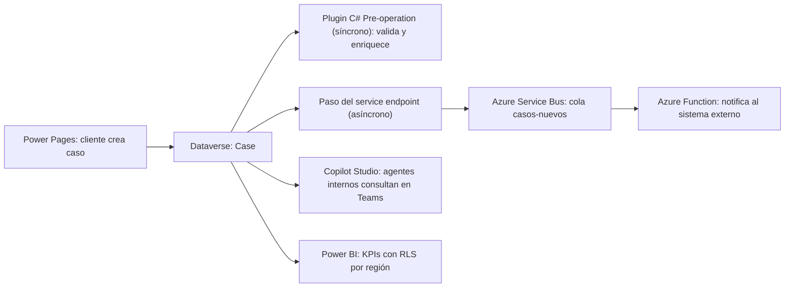

### 🎯 Objetivo
Construir una solución enterprise completa integrando todos los conceptos del Nivel 3: arquitectura multi-solución, CI/CD automatizado, D365 Customer Service, Portal para clientes, Copilot Studio con SSO, Plugin C# para lógica de negocio, integración con Azure Service Bus, y PCF Dataset avanzado.

> **Cómo está organizado este proyecto:** cada **hito** es una microlección: qué vas a construir, una micropráctica corta para decidir bien antes de hacerlo, la construcción en tu entorno y una tabla de **evidencia** con el dato exacto que observaste (no un "sí/no"). Como en el Módulo 17, aquí casi no hay clic a clic: cada hito remite al módulo del Nivel 3 donde aprendiste esa pieza (18 a 29). Si te atoras, vuelve a ese módulo. Después de desplegar viene un **incidente que cruza capas** para diagnosticar, y el cierre es un **reto de transferencia**: el mismo diseño para otro requisito.
>
> **Duración realista:** unas 22 horas para la entrega completa (la suma de los hitos), repartidas en tres o cuatro semanas; en la ruta B, adaptar el plugin a tu tabla y sacar el sitio fuera de Developer puede sumar algo más. Cierra cada hito con su evidencia antes de pasar al siguiente: el Hito 7 (despliegue) depende de todo lo anterior.
>
> **Antes de empezar:**
> - **Dos entornos con Dynamics 365 Customer Service** (DEV y TEST): la tabla **Case** (`incident`) no existe en un entorno Developer, porque ahí no se pueden instalar apps de Dynamics 365. Ver [Entornos y trials](/recursos/entornos-y-trials). Si no consigues los dos, sigue la **ruta B** (abajo).
> - **Una suscripción de Azure** para Service Bus y Azure Functions (Módulo 24), y una organización de **Azure DevOps** o un repositorio de **GitHub** para el pipeline (Módulo 19). Antes del Hito 7, comprueba que tu organización puede ejecutar pipelines: ver Módulo 19, agentes.
> - **Herramientas de código:** Visual Studio con .NET Framework 4.6.2 para el plugin (Módulo 23), Node.js y Power Platform CLI (`pac`) para el PCF (Módulo 27).
> - **Licencias:** Power Pages (Módulo 21) y Copilot Studio (Módulo 22). Si tu licencia de Copilot Studio no permite publicar, prueba el agente en el panel **Test**.
> - **Si sigues la ruta Developer:** el [LAB-63](/labs/lab-63-capstone-developer-solucion-tecnica-avanzada) (capstone Developer) pide lo mismo con otro escenario: plugin con unit tests, componente de interfaz con estado de error visible, pipeline de al menos 2 ambientes con validación, plan de despliegue y rollback, y documento técnico con un *Technical summary* en inglés. La evidencia de este proyecto te sirve de base para ese lab.

**Ruta A o ruta B:**

| Ruta | Para quién | Qué cambia |
|---|---|---|
| **A — con Customer Service** | Tienes DEV y TEST con Dynamics 365 Customer Service | El caso es la tabla estándar **Case** (`incident`); haces el Hito 4 completo |
| **B — sin Dynamics 365** | Solo tienes entornos Developer o Trial de Power Apps | Creas en `SIT_Foundation` una tabla propia **Caso de Soporte** con Título, Descripción, Prioridad (Choice Alta, Normal, Baja), Cliente (Lookup a Account) y Número de Ticket; el Hito 4 se entrega como diseño (matriz de SLA y colas) y desplegarás 5 soluciones en vez de 6 |

### 🪜 Tres niveles de entrega

| Nivel | Qué incluye | Para qué sirve |
|---|---|---|
| **Mínima** (≈11 h) | Hitos 1, 2 (solo CasoPreCreate y sus 2 tests), 5 y 7 (pipeline a TEST) | Demuestra el núcleo técnico: regla de servidor, integración asíncrona y despliegue reproducible |
| **Completa** (≈22 h) | Los 7 hitos y el diagnóstico del incidente, de DEV a TEST (2 ambientes); en la ruta B, el Hito 4 en papel | Es la que exigen los Criterios de Validación del Proyecto Final y los Criterios de Graduación |
| **Excelente** (≈27 h) | Completa + PROD con 2 aprobadores + el reto de transferencia construido + presentación al sponsor (como la extensión del LAB-63) | Es la que conviene mostrar en un portafolio y en una entrevista técnica |

### 📖 Conceptos Clave
Este módulo aplica y consolida todo el Nivel 3 en un proyecto cohesivo. Los conceptos clave son los patrones de integración y de ejecución de proyecto que conectan todos los módulos anteriores:

- **Integration testing de extremo a extremo:** verificación de que todos los componentes del sistema funcionan juntos correctamente en el entorno de prueba. Va más allá de testear cada componente aislado: valida que el caso creado en Power Pages pasa por el Plugin C#, que Dataverse publica el evento en Service Bus, que la Azure Function lo procesa y que el agente de Copilot Studio y el dashboard reflejan el nuevo estado. Debe ejecutarse con datos realistas en un entorno de TEST/UAT antes de cada despliegue a PROD.
- **Dependency management en multi-solution deployments:** gestión del orden de despliegue de soluciones con dependencias entre sí. Si `SIT_CustomerService` depende de `SIT_Foundation`, primero se despliega Foundation y luego CustomerService. El pipeline CD debe definir explícitamente el orden de importación de soluciones y verificar que cada solución importó correctamente antes de continuar con la siguiente. Un error en SIT_Foundation debe bloquear todos los despliegues dependientes.
- **Environment Variable management entre ambientes:** estrategia para gestionar los valores de las Environment Variables que cambian entre entornos (URLs de APIs externas, IDs de configuración). En DEV apuntan a sistemas de prueba; en PROD, a sistemas reales. En un pipeline, los valores de cada entorno (y las conexiones de las Connection References) se guardan en un **deployment settings file** (JSON) que se genera con `pac solution create-settings` y se pasa a la tarea de importación con **Use deployment settings file** (`UseDeploymentSettingsFile`) ([Learn: deployment settings file](https://learn.microsoft.com/power-platform/alm/conn-ref-env-variables-build-tools)). Power Platform Build Tools no tiene una tarea aparte para fijar Environment Variables después de importar.
- **Blue-Green deployment en Power Platform:** estrategia general de despliegue sin downtime en la que conviven la versión anterior y la nueva y se cambia el tráfico cuando la nueva está verificada. Learn no describe un mecanismo blue-green nativo para un entorno de Dataverse. Lo que sí ofrece la plataforma es la importación **Stage for Upgrade** (o `HoldingSolution: true` en el pipeline, seguida de **Apply Solution Upgrade**): la versión vieja y la nueva quedan instaladas a la vez para migrar datos antes de completar la actualización ([Learn: actualizar una solución](https://learn.microsoft.com/power-apps/maker/data-platform/update-solutions)). Para el portal y la Azure Function, el blue-green se resuelve con las herramientas propias de cada servicio.
- **Rollback plan:** plan documentado y probado para revertir un despliegue fallido en PROD. Para soluciones de Power Platform: mantener el artifact de la versión anterior en el pipeline (y su código en el control de versiones), documentar los pasos manuales adicionales (restaurar datos modificados por plugins, revertir configuraciones de D365), y tener un checklist de verificación post-rollback. Ojo: una actualización de una solución administrada debe tener un número de versión **mayor** que la instalada, así que el rollback habitual es **hacia adelante**: reconstruyes la versión anterior con un número nuevo (por ejemplo 1.0.2.0 con el contenido de 1.0.0.0) y la importas como **Upgrade**, que elimina los componentes que ya no están. Borrar la solución administrada elimina también sus datos, y restaurar una copia de seguridad del entorno pierde lo creado después de la copia (Lab 115, Nivel 4) ([Learn: actualizar una solución](https://learn.microsoft.com/power-apps/maker/data-platform/update-solutions)). El rollback debe poder ejecutarse en menos de 30 minutos para minimizar el impacto en usuarios.
- **Monitoreo y observabilidad en producción:** instrumentación del sistema para detectar problemas antes de que los usuarios los reporten. Incluye: alertas de Azure Monitor sobre mensajes acumulados en la Dead Letter Queue de Service Bus y sobre la cola activa que crece sin consumirse, alertas sobre fallos de la Azure Function (tasa de error > 1%), Plugin Trace Log en modo **Exception** solo mientras investigas (los registros se borran a las 24 horas y consumen almacenamiento) ([Learn: logging and tracing](https://learn.microsoft.com/power-apps/developer/data-platform/logging-tracing)), Analytics de Copilot Studio con revisión semanal de tasa de resolución, y Power BI con métricas de SLA para el equipo de management.

**Diagrama: flujo end-to-end del sistema de soporte técnico**



**Escenario:** Sistema de soporte técnico enterprise con autoservicio

---

## 🧩 Microlección 1 — Hito 1: arquitectura, soluciones y ADR (≈90 min)

**Qué vas a construir:** el mapa de capas antes que cualquier componente (Módulos 18 y 25). Si cambias después qué solución contiene qué, rehaces dependencias, pipeline y permisos.

**Ahora haz algo — micropráctica (8 min):** decide dónde vive cada regla y en qué orden se despliegan las soluciones → **[Dónde va cada regla y en qué orden se despliega](/practica/ip-arq-007-donde-va-cada-regla-y-orden-de-despliegue)**.

**Construye en DEV:**

1. Crea las soluciones con tu publisher `sit` (Módulo 2). Esta es la arquitectura de referencia:

   ```
   SIT_Foundation (base)
     ├── Catálogos comunes y la Choice global "Nivel de Contrato" (Estándar, Premium)
     ├── Columnas nuevas de Account: Nivel de Contrato, Región
     ├── Security Roles base
     └── Environment Variables

   SIT_CustomerService (D365 CE, ruta A)
     ├── Columnas nuevas de Case: Número de Ticket (Autonumber), Nivel de Servicio
     ├── SLA, Queues, reglas de Unified Routing
     ├── Knowledge Base
     └── Canales digitales (opcional, Módulo 20)

   SIT_Dev (Plugins + PCF)
     ├── C# Plugin: CasoPreCreate (validación + nivel de servicio)
     ├── C# Plugin: CasoPostUpdate (escalamiento automático)
     └── PCF: TimelineEnhanced (dataset de casos mejorado)

   SIT_Integration (Azure)
     └── Service endpoint de Service Bus y su paso: nuevos casos → sistema externo
         (la Azure Function y el namespace de Service Bus viven en Azure y se despliegan aparte)

   SIT_Portal (Power Pages)
     ├── Proveedor de identidad: Microsoft Entra External ID (o el Azure AD B2C que ya tenga la organización)
     ├── Web Templates
     ├── Table Permissions y Web Roles
     └── Web APIs

   SIT_Bot (Copilot Studio)
     ├── Autenticación con Microsoft Entra ID (SSO para usuarios internos en Teams)
     └── Topics, Knowledge Sources y agent flows

   Reportes (Power BI) — no es una solución de Dataverse
     └── .pbix en el repositorio + workspace por entorno, con RLS por región
   ```

   El informe de Power BI no viaja dentro de una solución: su origen de datos se cambia aparte, como ya viste en el Módulo 17.
2. Escribe en el repositorio `docs/orden-de-despliegue.md` con el orden de importación y la razón de cada dependencia: Foundation → CustomerService → Dev → Integration → Portal → Bot.
3. Escribe **ADR-001 "Dónde vive cada regla"** (plantilla del Módulo 18: contexto, opciones, decisión, consecuencias). Debe responder al menos: por qué la validación del caso es un plugin y no JavaScript del portal, por qué el número de ticket es una columna Autonumber y no código, y por qué la notificación al sistema externo es asíncrona.

**Evidencia a reportar:**

| Campo | Tu valor |
|---|---|
| Ruta elegida (A o B) y nombre de tus dos entornos | ___ |
| Nombre único (unique name) de cada solución y su número de versión | ___ |
| Una dependencia concreta entre dos soluciones (qué componente de cuál necesita a cuál) | ___ |
| Decisión de ADR-001 sobre la validación del caso, en una frase | ___ |

---

## 🧩 Microlección 2 — Hito 2: la regla de servidor — CasoPreCreate con unit tests (≈240 min)

**Qué vas a construir:** la validación que no se puede saltar desde ningún canal (portal, app, flujo, agente o API) y el enriquecimiento del caso con el nivel de contrato del cliente (Módulos 23, 25 y 26).

**Antes del código, el modelo** (en `SIT_CustomerService`; en la ruta B, en tu tabla Caso de Soporte):

1. En **Case**, columna **Número de Ticket** de tipo **Autonumber** con formato personalizado `TKT-{DATETIMEUTC:yyyy}-{SEQNUM:5}` ([Learn: autonumber columns](https://learn.microsoft.com/power-apps/maker/data-platform/autonumber-fields) y [formatos](https://learn.microsoft.com/power-apps/developer/data-platform/create-auto-number-attributes)). La secuencia la genera la base de datos y garantiza números únicos; por defecto empieza en 1000, así que el primer ticket se verá como `TKT-2026-01000`. Puede haber huecos si una fila se empieza y se cancela, y la semilla no viaja en la solución. Un plugin que lee "el último número y suma 1" puede repetir números cuando dos casos se crean a la vez: por eso este proyecto no numera con código.
2. En **Case**, columna Choice **Nivel de Servicio** que usa la misma Choice global **Nivel de Contrato** que Account: así el plugin copia el valor sin traducirlo.

**El plugin** (proyecto de .NET Framework 4.6.2, Módulo 23). Regístralo en el mensaje **Create** de `incident`, etapa **PreOperation**, modo **Synchronous**:

```csharp
using System;
using Microsoft.Xrm.Sdk;
using Microsoft.Xrm.Sdk.Query;

namespace Sit.Soporte.Plugins
{
    // Paso: Create · incident · PreOperation · Synchronous.
    // Ruta B: cambia TODAS las constantes de abajo por los nombres lógicos y valores de tu tabla Caso de Soporte.
    // Los nombres solo aparecen aquí: el cuerpo y los tests usan estas constantes.
    public class CasoPreCreatePlugin : IPlugin
    {
        public const string TablaCaso = "incident";            // Ruta B: p. ej. "sit_casodesoporte"
        public const string ColPrioridad = "prioritycode";     // Ruta B: p. ej. "sit_prioridad"
        public const string ColDescripcion = "description";    // Ruta B: p. ej. "sit_descripcion"
        public const string ColCliente = "customerid";         // Ruta B: p. ej. "sit_cliente" (Lookup a Account)
        public const string ColNivelServicio = "sit_nivelservicio";
        public const string ColNivelContratoCuenta = "sit_nivelcontrato"; // columna de Account (igual en las dos rutas)
        public const int PrioridadAlta = 1;     // incident.prioritycode: 1 = High, 2 = Normal, 3 = Low
        public const int PrioridadNormal = 2;   // solo la usan los tests; ruta B: el valor de Normal de tu Choice
        public const int LongitudMinimaDescripcion = 100;

        public void Execute(IServiceProvider serviceProvider)
        {
            var context = (IPluginExecutionContext)serviceProvider.GetService(typeof(IPluginExecutionContext));
            var tracing = (ITracingService)serviceProvider.GetService(typeof(ITracingService));
            tracing.Trace("CasoPreCreate: Depth {0}", context.Depth);

            if (!context.InputParameters.Contains("Target")) return;
            var caso = context.InputParameters["Target"] as Entity;
            if (caso == null || caso.LogicalName != TablaCaso) return;

            // 1. Validación de servidor: un caso de prioridad alta necesita una descripción útil.
            // Ojo: si un nombre de columna está mal, GetAttributeValue devuelve null sin avisar y la regla no se aplica.
            var prioridad = caso.GetAttributeValue<OptionSetValue>(ColPrioridad);
            var descripcion = caso.GetAttributeValue<string>(ColDescripcion) ?? string.Empty;
            tracing.Trace("CasoPreCreate: prioridad {0}", prioridad == null ? "(vacía)" : prioridad.Value.ToString());
            if (prioridad != null && prioridad.Value == PrioridadAlta
                && descripcion.Trim().Length < LongitudMinimaDescripcion)
            {
                // En Pre-operation la excepción cancela la creación y el usuario ve este mensaje.
                throw new InvalidPluginExecutionException(
                    $"Un caso de prioridad alta necesita una descripción de al menos {LongitudMinimaDescripcion} caracteres.");
            }

            // 2. Enriquecimiento: copiar el Nivel de Contrato de la cuenta del cliente.
            var cliente = caso.GetAttributeValue<EntityReference>(ColCliente);   // ruta A: Customer (account o contact); ruta B: Lookup a Account
            if (cliente == null) return;

            var factory = (IOrganizationServiceFactory)serviceProvider.GetService(typeof(IOrganizationServiceFactory));
            var service = factory.CreateOrganizationService(context.UserId);

            EntityReference cuentaRef = null;
            if (cliente.LogicalName == "account")
            {
                cuentaRef = cliente;
            }
            else if (cliente.LogicalName == "contact")   // solo ruta A: los casos del portal llegan a nombre del contacto
            {
                var contacto = service.Retrieve("contact", cliente.Id, new ColumnSet("parentcustomerid"));
                var empresa = contacto.GetAttributeValue<EntityReference>("parentcustomerid");
                if (empresa != null && empresa.LogicalName == "account") cuentaRef = empresa;
            }
            if (cuentaRef == null) return;

            var cuenta = service.Retrieve("account", cuentaRef.Id, new ColumnSet(ColNivelContratoCuenta));
            var nivel = cuenta.GetAttributeValue<OptionSetValue>(ColNivelContratoCuenta);
            if (nivel != null)
            {
                // Se escribe en Target: Dataverse lo guarda en la misma operación, sin otro Update.
                caso[ColNivelServicio] = new OptionSetValue(nivel.Value);
            }
        }
    }
}
```

Los nombres `sit_nivelcontrato` y `sit_nivelservicio` son ejemplos: usa los nombres lógicos que veas en tus columnas. **Ruta B:** cambia **todas** las constantes del principio (tabla, Prioridad, Descripción, Cliente, Nivel de Servicio y los valores de Alta y Normal de tu Choice); el cuerpo y los tests no llevan ningún nombre escrito. Si una constante queda mal, `GetAttributeValue` devuelve null sin avisar y el plugin **nunca** valida: si al crear un caso Alta con descripción corta no ves el error, revisa las constantes y la traza `prioridad` en el Plugin Trace Log. Tu Cliente es un Lookup a Account, así que la rama `contact` no se ejecuta. Fíjate en que este plugin **no** corta por `context.Depth`: en Pre-operation modifica `Target` en vez de llamar a `Update`, así que no puede dispararse a sí mismo, y cortar por Depth dejaría sin validar los casos que cree otro plugin. El control de recursión sí es obligatorio en el Hito 2b.

**Los unit tests** (proyecto de prueba MSTest con Moq, como en el Lab 23): uno de caso de error y uno de caso feliz.

```csharp
using System;
using Microsoft.VisualStudio.TestTools.UnitTesting;
using Microsoft.Xrm.Sdk;
using Microsoft.Xrm.Sdk.Query;
using Moq;
using Sit.Soporte.Plugins;

[TestClass]
public class CasoPreCreatePluginTests
{
    private static IServiceProvider CrearProveedor(Entity caso, IOrganizationService service = null)
    {
        var context = new Mock<IPluginExecutionContext>();
        context.Setup(c => c.Depth).Returns(1);
        context.Setup(c => c.InputParameters).Returns(new ParameterCollection { { "Target", caso } });

        var factory = new Mock<IOrganizationServiceFactory>();
        factory.Setup(f => f.CreateOrganizationService(It.IsAny<Guid?>()))
               .Returns(service ?? new Mock<IOrganizationService>().Object);

        var provider = new Mock<IServiceProvider>();
        provider.Setup(p => p.GetService(typeof(IPluginExecutionContext))).Returns(context.Object);
        provider.Setup(p => p.GetService(typeof(ITracingService))).Returns(new Mock<ITracingService>().Object);
        provider.Setup(p => p.GetService(typeof(IOrganizationServiceFactory))).Returns(factory.Object);
        return provider.Object;
    }

    [TestMethod]
    public void CasoAlto_ConDescripcionCorta_LanzaExcepcion()
    {
        var caso = new Entity(CasoPreCreatePlugin.TablaCaso);
        caso[CasoPreCreatePlugin.ColPrioridad] = new OptionSetValue(CasoPreCreatePlugin.PrioridadAlta);
        caso[CasoPreCreatePlugin.ColDescripcion] = "No funciona";

        Assert.ThrowsException<InvalidPluginExecutionException>(
            () => new CasoPreCreatePlugin().Execute(CrearProveedor(caso)));
    }

    [TestMethod]
    public void CasoDeCuentaPremium_CopiaNivelDeServicio()
    {
        var cuentaId = Guid.NewGuid();
        var service = new Mock<IOrganizationService>();
        service.Setup(s => s.Retrieve("account", cuentaId, It.IsAny<ColumnSet>()))
               .Returns(new Entity("account", cuentaId) { [CasoPreCreatePlugin.ColNivelContratoCuenta] = new OptionSetValue(100000001) });

        var caso = new Entity(CasoPreCreatePlugin.TablaCaso);
        caso[CasoPreCreatePlugin.ColPrioridad] = new OptionSetValue(CasoPreCreatePlugin.PrioridadNormal); // no exige descripción larga
        caso[CasoPreCreatePlugin.ColCliente] = new EntityReference("account", cuentaId);

        new CasoPreCreatePlugin().Execute(CrearProveedor(caso, service.Object));

        // 100000001 es un valor de ejemplo: el real depende del prefijo de opciones de tu publisher
        Assert.AreEqual(100000001, caso.GetAttributeValue<OptionSetValue>(CasoPreCreatePlugin.ColNivelServicio).Value);
    }
}
```

**Hito 2b — CasoPostUpdate, sin pasos (solo entrega completa):** cuando la prioridad de un caso pasa a High, marca el caso como escalado (una columna `Escalado el` con la fecha) y crea una tarea para el supervisor de la cola. Hazlo primero en **PostOperation** con un `Update` del propio caso y mira en el Plugin Trace Log qué valor de Depth aparece en la segunda ejecución. Después decide: ¿basta con `context.Depth` y **Filtering attributes** = `prioritycode`, o conviene mover la marca a un paso Pre-operation de Update que escriba en `Target`? Escribe la decisión en ADR-002.

**Evidencia a reportar:**

| Campo | Tu valor |
|---|---|
| Resultado de los 2 tests (nombre y estado, copiado del Test Explorer) | ___ |
| Mensaje exacto que viste al crear un caso High con descripción corta, y desde qué canal lo probaste | ___ |
| Número de Ticket y Nivel de Servicio de un caso creado para una cuenta Premium | ___ |
| (Completa) Valor de Depth en la segunda ejecución de CasoPostUpdate y tu decisión de ADR-002 | ___ |

---

## 🧩 Microlección 3 — Hito 3: el portal de clientes (≈150 min)

**Qué vas a construir:** el autoservicio donde cada cliente registra y consulta solo sus casos (Módulos 21 y 29).

> **El sitio tiene que poder ser público:** un cliente externo no entra a un sitio privado, y Learn indica que los sitios de ambientes **Developer** no pueden hacerse públicos. Crea el sitio del portal en un ambiente que lo permita (Trial o producción), como en el Módulo 29; si tu administrador lo bloquea (**Access restricted** en **Site visibility**), prueba con usuarios de tu organización y documenta el registro externo en papel.

1. **Identidad:** Azure AD B2C dejó de venderse a clientes nuevos el 1 de mayo de 2025 ([Learn: Azure AD B2C](https://learn.microsoft.com/azure/active-directory-b2c/overview)). En un proyecto nuevo usa **Microsoft Entra External ID**: en el estudio de diseño de Power Pages, **Security** > **Identity providers** > **Microsoft Entra External ID** > **Configure**, y sigue el registro de la app y el user flow en el Microsoft Entra admin center ([Learn: External ID con Power Pages](https://learn.microsoft.com/power-pages/security/authentication/entra-external-id)). Si tu organización ya tiene un tenant B2C, puedes usarlo como en el Módulo 29.
2. **Table Permissions** sobre Case con acceso de tipo **Contact** (solo los casos del contacto autenticado), privilegios de lectura y creación, asignadas al web role **Authenticated Users** (Módulo 21). Un formulario para crear el caso que asocie al contacto actual y una lista "Mis casos" que muestre el Número de Ticket.
3. **Al ALM desde el principio:** el sitio debe usar el modelo de datos mejorado (*enhanced data model*). En `SIT_Portal`, **Add existing** > **Site** > **Site**. Cada componente que crees después (otra Table Permission, otro web role) **no** se agrega solo: añádelo con **Add existing** > **Site** > **Site Component** ([Learn: soluciones con Power Pages](https://learn.microsoft.com/power-pages/configure/power-pages-solutions)). Si **Site** no aparece en **Add existing**, el sitio no usa el modelo de datos mejorado.

**Evidencia a reportar:**

| Campo | Tu valor |
|---|---|
| Proveedor de identidad configurado y nombre del botón que ve el cliente | ___ |
| Número de Ticket de un caso creado desde el portal y Nivel de Servicio que le puso el plugin | ___ |
| Qué ve un segundo cliente en "Mis casos" (debe ser solo lo suyo) | ___ |
| Lista de componentes de sitio de `SIT_Portal` relacionados con Case (permisos, roles) | ___ |

---

## 🧩 Microlección 4 — Hito 4: la operación de servicio en Customer Service (≈90 min)

**Qué vas a construir:** que cada caso llegue a la cola correcta con su SLA (Módulo 20). Ruta B: entrega este hito como diseño.

1. Dos colas: **Soporte Estándar** y **Soporte Premium**, y una regla de Unified Routing que use **Nivel de Servicio** (lo pone el plugin) para elegir la cola.
2. Un SLA con los KPI de primera respuesta y resolución, con tiempos distintos por nivel (por ejemplo 4 h Premium y 24 h Estándar) y una acción de advertencia que notifique al supervisor.
3. Un artículo de Knowledge Base que el agente de Copilot Studio podrá usar en el Hito 6.

**Evidencia a reportar:**

| Campo | Tu valor |
|---|---|
| Cola a la que llegó un caso Premium creado desde el portal, y cuánto tardó en aparecer | ___ |
| Tiempo de vencimiento del KPI de primera respuesta que muestra ese caso | ___ |
| (Ruta B) Matriz de SLA por nivel y árbol de decisión de colas | ___ |

---

## 🧩 Microlección 5 — Hito 5: integración asíncrona con Azure (≈150 min)

**Qué vas a construir:** que cada caso nuevo llegue al sistema externo sin que el usuario espere y sin perder mensajes (Módulo 24).

1. En Azure: un namespace de Service Bus por entorno (por ejemplo `sb-sit-test` y `sb-sit-prod`) con una cola `casos-nuevos`, configurado con SAS para Dataverse ([Learn: Service Bus y Dataverse](https://learn.microsoft.com/power-apps/developer/data-platform/azure-integration)).
2. Con el Plug-in Registration Tool, un **service endpoint** de tipo cola (en **Message Format** elige **JSON**, para que la Function lea el cuerpo como texto; con **.NETBinary** no puede) y un paso en el mensaje **Create** de `incident` ([Learn: formatos del mensaje](https://learn.microsoft.com/power-apps/developer/data-platform/write-listener-application-azure-solution)). El post lo hace un trabajo del sistema asíncrono: no bloquea al usuario, y en el ejemplo de Learn el mensaje puede tardar unos minutos en llegar ([Learn: registrar el paso del service endpoint](https://learn.microsoft.com/power-apps/developer/data-platform/walkthrough-register-azure-aware-plug-in-using-plug-in-registration-tool)). Si Service Bus no está disponible, Dataverse reintenta y el trabajo queda en espera.
3. Una Azure Function con trigger de Service Bus que lee la cola y notifica al sistema externo (puede ser un mock). El trigger toma la conexión de un **app setting** cuyo nombre indica `Connection` ([Learn: Service Bus trigger](https://learn.microsoft.com/azure/azure-functions/functions-bindings-service-bus-trigger)):

   ```csharp
   // Fragmento de la clase de la función (modelo isolated worker); _logger es un ILogger inyectado por el constructor.
   [Function("ProcesarCasoNuevo")]
   public void Run(
       [ServiceBusTrigger("casos-nuevos", Connection = "ServiceBusConnection")] ServiceBusReceivedMessage mensaje)
   {
       _logger.LogInformation("Caso recibido. MessageId: {id}. ContentType: {tipo}", mensaje.MessageId, mensaje.ContentType);
       // Con Message Format = JSON en el service endpoint, el cuerpo es el contexto de ejecución en JSON
       // (ContentType "application/json"); con .NETBinary no se puede leer como texto.
       string contextoJson = mensaje.Body.ToString();
       _logger.LogInformation("Contexto recibido: {len} caracteres", contextoJson.Length);
       // Aquí: extraer del JSON los datos del caso que necesitas y llamar al sistema externo.
   }
   ```

   `ServiceBusConnection` es el **nombre** del app setting; su valor (la cadena de conexión del namespace de ese entorno) se edita en la Function App, en **Settings** > **Environment variables** > pestaña **App settings** ([Learn: app settings](https://learn.microsoft.com/azure/azure-functions/functions-how-to-use-azure-function-app-settings)).
4. Fuerza un fallo en la Function (por ejemplo, que lance una excepción para un caso con un asunto concreto) y mira qué pasa con ese mensaje: cuando supera el número máximo de entregas (10 por defecto) pasa a la **dead-letter queue**, donde se queda hasta que alguien lo saca ([Learn: dead-letter queues](https://learn.microsoft.com/azure/service-bus-messaging/service-bus-dead-letter-queues)). Crea una alerta de Azure Monitor sobre esa cola.

**Evidencia a reportar:**

| Campo | Tu valor |
|---|---|
| Estado del trabajo del sistema (System Job) del post de un caso nuevo y cuánto tardó | ___ |
| `MessageId` que registró la Function para ese caso | ___ |
| Contador de mensajes en la dead-letter queue tras el fallo forzado y su `DeadLetterReason` | ___ |
| Valor del app setting `ServiceBusConnection` en TEST (solo el nombre del namespace, nunca la clave) | ___ |

---

## 🧩 Microlección 6 — Hito 6: las capas de experiencia — PCF, agente y dashboard (≈300 min)

**Qué vas a construir:** las tres formas en que distintas personas ven el mismo caso. Este hito va sin pasos: cada pieza ya la construiste en su módulo.

1. **PCF Dataset `TimelineEnhanced`** (Módulo 27): reemplaza la subcuadrícula de casos en el formulario de Account, usa Fluent UI y muestra un **estado de error visible** si el dataset no carga (no falla en silencio: es lo que pide el LAB-63).
2. **Agente de Copilot Studio para usuarios internos** (Módulo 22): agentes de soporte y gerentes de cuenta, en Teams, con autenticación de Microsoft Entra ID para que el agente sepa quién pregunta. Un topic "Estado de un caso" que reciba el Número de Ticket y responda estado, cola y vencimiento del SLA con un agent flow, y respuestas generativas desde la Knowledge Base del Hito 4. Los 10.000 clientes externos **no** usan este agente: no tienen cuenta de la organización y consultan sus casos en el portal.
3. **Dashboard de Power BI con RLS por región** (Módulo 12): casos abiertos, vencidos y tasa de cumplimiento del SLA por región, con una tabla de seguridad usuario-región y `USERPRINCIPALNAME()`. Prueba con **View as**.

**Evidencia a reportar:**

| Campo | Tu valor |
|---|---|
| Mensaje que muestra el PCF cuando forzaste un error de carga, y cómo lo forzaste | ___ |
| Respuesta del agente a "estado del TKT-…" con un ticket real, y si coincide con el caso | ___ |
| Número de casos abiertos que ve un usuario de una región con **View as**, frente al total | ___ |

---

## 🧩 Microlección 7 — Hito 7: pipeline CI/CD, despliegue y prueba de punta a punta (≈300 min)

**Qué vas a construir:** el paso de DEV a TEST (y a PROD en la entrega excelente) sin pasos manuales (Módulo 19).

**Ahora haz algo — microprácticas (12 min):** repasa qué se parametriza antes de mover la solución → **[Qué parametrizar antes de mover la solución a TEST](/practica/ip-dv-015-parametrizar-antes-de-mover)** y qué pasa cuando algo apunta al entorno equivocado → **[Entorno incorrecto](/practica/ip-trb-002-entorno-incorrecto)**.

1. **Branch strategy:**

   ```
   main → solo merges desde develop, protegida
   develop → dispara el pipeline CI
   feature/xxx → PRs hacia develop
   ```
2. **CI:** instalar las herramientas → export de cada solución (unmanaged y managed) → Solution Checker sobre el **managed** como compuerta → publicar el artifact. El Checker analiza los `*_managed.zip`, así que va **después** del export. El inicio del job y la compuerta, con las tareas de Power Platform Build Tools ([Learn: tareas de Build Tools](https://learn.microsoft.com/power-platform/alm/devops-build-tool-tasks)):

   ```yaml
   - task: microsoft-IsvExpTools.PowerPlatform-BuildTools.tool-installer.PowerPlatformToolInstaller@2   # primera tarea de cada job
   # ...aquí van las tareas de export de cada solución (unmanaged y managed) a $(Build.ArtifactStagingDirectory), Módulo 19
   - task: microsoft-IsvExpTools.PowerPlatform-BuildTools.checker.PowerPlatformChecker@2
     displayName: 'Solution Checker (compuerta)'
     inputs:
       PowerPlatformSPN: 'SIT-DEV'                         # service connection de tipo Power Platform
       FilesToAnalyze: '$(Build.ArtifactStagingDirectory)/**/*_managed.zip'
       RuleSet: '0ad12346-e108-40b8-a956-9a8f95ea18c9'     # valor del ejemplo de Learn; confírmalo eligiendo "Solution checker" en el asistente de la tarea
       ErrorLevel: 'HighIssueCount'                        # severidad que se cuenta
       ErrorThreshold: '0'                                 # cero incidencias High o peores para pasar
       FailOnPowerAppsCheckerAnalysisError: true
   ```
3. **Deployment settings por entorno:** genera un archivo por solución con `pac solution create-settings --solution-zip SIT_Foundation_managed.zip --settings-file settings/test/SIT_Foundation.json`, rellena `Value` de cada Environment Variable y `ConnectionId` de cada Connection Reference con los de TEST, y guárdalo en el repositorio (los secretos no van ahí: van en el service connection o en Azure Key Vault).
4. **CD:** un stage por entorno con un deployment job y, dentro, una importación por solución **en el orden de `docs/orden-de-despliegue.md`**. Los pasos corren en serie: si falla Foundation, no se importa nada de lo que depende de ella.

   ```yaml
   - stage: DeployTest
     dependsOn: Build
     jobs:
     - deployment: ImportarSoluciones
       environment: 'SIT-TEST'          # aprobaciones y checks se configuran en este environment de Azure DevOps
       strategy:
         runOnce:
           deploy:
             steps:
             - task: microsoft-IsvExpTools.PowerPlatform-BuildTools.tool-installer.PowerPlatformToolInstaller@2
             - task: microsoft-IsvExpTools.PowerPlatform-BuildTools.import-solution.PowerPlatformImportSolution@2
               displayName: 'Importar SIT_Foundation'
               inputs:
                 authenticationType: PowerPlatformSPN
                 PowerPlatformSPN: 'SIT-TEST'
                 SolutionInputFile: '$(Pipeline.Workspace)/drop/SIT_Foundation_managed.zip'
                 AsyncOperation: true
                 MaxAsyncWaitTime: 60
                 UseDeploymentSettingsFile: true
                 DeploymentSettingsFile: '$(Pipeline.Workspace)/drop/settings/test/SIT_Foundation.json'
             - task: microsoft-IsvExpTools.PowerPlatform-BuildTools.import-solution.PowerPlatformImportSolution@2
               displayName: 'Importar SIT_CustomerService'
               inputs:
                 authenticationType: PowerPlatformSPN
                 PowerPlatformSPN: 'SIT-TEST'
                 SolutionInputFile: '$(Pipeline.Workspace)/drop/SIT_CustomerService_managed.zip'
                 AsyncOperation: true
                 MaxAsyncWaitTime: 60
                 UseDeploymentSettingsFile: true
                 DeploymentSettingsFile: '$(Pipeline.Workspace)/drop/settings/test/SIT_CustomerService.json'
             # ...y lo mismo para SIT_Dev, SIT_Integration, SIT_Portal y SIT_Bot, en ese orden
   ```

   Entorno de UAT con una aprobación y PROD con dos aprobadores (entrega excelente): las aprobaciones se definen en el environment de Azure DevOps (`SIT-UAT`, `SIT-PROD`), no en el YAML. Si usas GitHub Actions, el equivalente está en el Módulo 19. Fuera del pipeline de Power Platform quedan la Azure Function (su propio despliegue, con sus app settings por entorno), la reactivación del sitio en el entorno destino la primera vez (Módulo 21) y el informe de Power BI (cambio de origen, como en el Módulo 17).
5. **Plan de rollback** en `docs/rollback.md`: qué versión reconstruyes y con qué número, qué pasos manuales hay (datos que tocaron los plugins, configuración de Customer Service, app settings de la Function), quién decide y el checklist de verificación posterior. Ensáyalo una vez en TEST y cronométralo.
6. **Prueba de punta a punta en TEST**, anotando la hora de cada paso:
   1. Cliente se registra en el portal (External ID o B2C existente)
   2. Crea un caso desde el portal → recibe su Número de Ticket (`TKT-2026-…`) y el plugin le pone el Nivel de Servicio
   3. Caso entra a la cola correcta por Unified Routing, con su SLA
   4. Agente responde → email automático al cliente
   5. Un agente interno consulta el caso en el agente de Teams → SSO lo identifica y responde con el estado real
   6. Si el SLA llega a la advertencia → notificación al supervisor; si la prioridad pasa a High → CasoPostUpdate escala
   7. El caso nuevo llegó a la cola de Service Bus → la Azure Function notificó al sistema externo
   8. Power BI muestra los KPIs del día con RLS
7. **Documento técnico** con ADR-001 y ADR-002, el orden de despliegue y el plan de rollback, y al final un *Technical summary* de 3 a 5 líneas en inglés (qué construiste, la decisión más importante y por qué, qué quedó fuera de alcance), como pide el LAB-63.

**Evidencia a reportar:**

| Campo | Tu valor |
|---|---|
| Incidencias del Solution Checker por gravedad en la última ejecución de CI | ___ |
| Duración de cada importación en el run de CD a TEST, en orden | ___ |
| Valor de cada Environment Variable en TEST tras el pipeline (sin tocar nada a mano) | ___ |
| Hora de cada uno de los 8 pasos de la prueba de punta a punta y dónde lo comprobaste | ___ |
| Tiempo del ensayo de rollback en TEST y número de versión que importaste | ___ |

---

## 🔧 Diagnosticar — incidente que cruza capas

Una semana después del despliegue a PROD (o a TEST, si no llegaste a PROD), Operaciones reporta: "desde el lunes, el sistema externo no recibe casos nuevos, aunque los clientes los siguen creando en el portal sin problemas". Antes de abrir nada, escribe **tres hipótesis** en capas distintas (plugin, publicación de Dataverse, Service Bus, Azure Function) y qué evidencia confirmaría o descartaría cada una. Después resuelve el caso con la evidencia por capa:

**[Diagnosticar: los casos no llegan al sistema externo](/practica/ip-arq-008-casos-no-llegan-al-sistema-externo)**

| Campo | Tu valor |
|---|---|
| Tus tres hipótesis y la evidencia que revisarías para cada una | ___ |
| La primera capa donde la evidencia contradice "todo funciona" | ___ |
| Causa raíz, corrección y una medida de prevención (una alerta, un check del pipeline…) | ___ |

---

## 🔁 Reto de transferencia — El mismo diseño, otro requisito, sin pasos

**Requisito nuevo:** un fabricante de equipos médicos quiere el mismo diseño para **reclamos de garantía**. Quien reporta es un **distribuidor** (una empresa), y cualquier persona del distribuidor debe ver los reclamos de su empresa, no solo los suyos. Un reclamo solo es válido si la fecha de compra está dentro de los 24 meses de garantía, venga de donde venga. El ERP debe recibir cada reclamo **cuando se aprueba** (no al crearlo), sin perder ninguno, y ahora hay **dos** sistemas que lo necesitan: el ERP de repuestos y el sistema de calidad.

**Micropráctica de transferencia (8 min):** decide qué se reutiliza y qué cambia → **[Transferir: reclamos de garantía para distribuidores](/practica/ip-arq-009-transferir-reclamos-de-garantia)**.

**Después, sin pasos:** escribe en una página el diseño (soluciones y su orden, tipo de acceso de la Table Permission, mensaje, etapa y modo de cada paso, tipo de entidad de Service Bus) como ADR-003, y construye **solo** el plugin de validación con sus 2 tests y el paso del service endpoint en una solución nueva `SIT_Garantias`.

> **Coste:** los topics no existen en el tier **Basic** de Service Bus (solo admite colas); hacen falta **Standard** o Premium, que tienen coste ([Learn: tiers de Service Bus](https://learn.microsoft.com/azure/service-bus-messaging/service-bus-premium-messaging)). Si tu namespace es Basic, crea uno **Standard** solo para este reto, mira el precio en la página de precios antes de crearlo y bórralo al terminar; o entrega el topic en papel.

| Campo | Tu valor |
|---|---|
| Tipo de acceso de la Table Permission y por qué no es Contact | ___ |
| Mensaje, etapa, modo y filtering attributes del paso que publica en Service Bus | ___ |
| Cola o topic, y cuántas suscripciones | ___ |
| Resultado de los 2 tests del plugin de garantía | ___ |

---

### 💼 Caso Real de Negocio
**Este módulo ES el caso real** — implementar el sistema completo para una empresa de servicios de 1,000 empleados con 10,000 clientes externos. El proyecto integra todos los componentes del Nivel 3 en un sistema de producción real.

### ✅ Buenas Prácticas
- Empezar por el modelo de datos y la arquitectura antes de escribir código
- CI/CD desde el día 1 — no después
- Probar la integración de extremo a extremo semanalmente durante el desarrollo
- Documentar el orden de despliegue de las soluciones en el README del repositorio — cuando haya urgencia o un desarrollador nuevo, el orden correcto no debería ser recordado, debe estar escrito
- Definir los criterios de aceptación del test E2E en el sprint de arquitectura — qué flujos exactos se deben probar y cuáles son las condiciones de aprobación
- Las reglas que deben cumplirse desde cualquier canal van en el servidor (plugin Pre-operation o regla de negocio con scope Entity), nunca solo en el JavaScript del portal o del formulario
- Lo que llama a sistemas externos va asíncrono (service endpoint o Azure Function): un plugin síncrono que llama por HTTP deja al usuario esperando y falla si el externo cae
- Lo que cambia entre entornos va en Environment Variables y en el deployment settings file del pipeline; las cadenas de conexión de Azure, en los app settings de cada Function App o en Key Vault, nunca en el código
- Ensayar el rollback en TEST antes de necesitarlo en PROD, y cronometrarlo

### ⚠️ Errores Comunes
| Error | Causa | Solución |
|-------|-------|----------|
| Importación falla porque SIT_CustomerService no encuentra componentes de SIT_Foundation | Se importó CustomerService antes que Foundation en el pipeline | Ordenar explícitamente los stages de despliegue en el YAML: Foundation → CustomerService → Portal → Bot |
| Plugin funciona en DEV pero falla en TEST con "Object reference" | Una Environment Variable usada en el plugin tiene valor vacío en TEST | Configurar todas las Environment Variables en TEST antes de ejecutar el pipeline CD |
| Bot Copilot Studio no responde con datos del usuario en TEST | El Service Connection del bot apunta al entorno DEV, no TEST | Reconfigurar la integración del bot con el entorno TEST al importar la solución |
| Power Pages no crea casos desde el portal en PROD | Table Permission fue configurado en DEV pero no exportado en la solución SIT_Portal | Agregar Table Permissions a la solución antes del export — son componentes exportables |
| Azure Function no procesa mensajes de Service Bus en PROD | El Connection String del Service Bus en la Function App apunta a DEV | Actualizar la variable de entorno `ServiceBusConnection` en la Azure Function de PROD con el string de PROD |
| Tras el pipeline, las Environment Variables de TEST tienen el valor de DEV o están vacías | La importación no usó un deployment settings file | Generarlo con `pac solution create-settings`, rellenarlo por entorno y activar **Use deployment settings file** en la tarea de importación |
| El rollback falla: la importación rechaza el artifact de la versión anterior | Una actualización debe tener un número de versión mayor que la solución instalada | Reconstruir la versión anterior con un número nuevo e importarla como **Upgrade** |
| Se repiten números de ticket cuando dos casos se crean a la vez | Un plugin calcula "último número + 1" | Usar una columna Autonumber: la secuencia la genera la base de datos |
| Los casos se crean, pero su trabajo del sistema de publicación queda en espera | Service Bus o el endpoint no están disponibles (por ejemplo, se rotó la clave SAS) | Revisar el System Job y la configuración SAS del service endpoint; Dataverse reintenta y publica al recuperarse |
| El Plugin Trace Log no muestra nada aunque el plugin falló | El registro está en **Off**, pasaron más de 24 horas, o quien lo mira no es System Administrator (los mensajes salen vacíos) | Activar **Exception** mientras investigas, revisar a tiempo y hacerlo con un usuario System Administrator |

### 🧪 Criterios de Validación del Proyecto Final
- [ ] Desplegué 6 soluciones (5 en la ruta B) en el orden documentado, y la importación en TEST no tuvo errores de dependencias
- [ ] El pipeline CI/CD lleva las soluciones de DEV a TEST sin pasos manuales, con Solution Checker como compuerta y aprobaciones en los entornos posteriores
- [ ] Las Environment Variables y Connection References de TEST llegan por deployment settings file, no a mano
- [ ] El Plugin C# rechaza un caso High con descripción corta desde cualquier canal y pone el Nivel de Servicio; sus 2 unit tests pasan
- [ ] El Número de Ticket `TKT-AAAA-NNNNN` lo genera una columna Autonumber
- [ ] El portal de Power Pages con Microsoft Entra External ID (o el B2C existente de la organización) permite registrarse, crear casos y ver solo los propios
- [ ] El agente de Copilot Studio con SSO responde a usuarios internos con datos reales del caso
- [ ] Service Bus recibe los casos nuevos de forma asíncrona, la Azure Function los procesa, y comprobé qué pasa con un mensaje que falla (dead-letter queue)
- [ ] El PCF Dataset reemplaza la subcuadrícula nativa y muestra un estado de error visible
- [ ] Power BI con RLS muestra a cada usuario solo su región
- [ ] Prueba de punta a punta en TEST con la hora de cada paso, plan de rollback ensayado y documento técnico con ADRs y *Technical summary* en inglés

**Rúbrica de cierre:** evalúa este proyecto con la rúbrica *Desarrollo Técnico* de [Rúbricas y
Plantillas de Evaluación](/recursos/rubricas-plantillas). Aprobación: ≥70/100 sin ningún criterio
en 0. Nivel profesional/excelencia: ≥90/100.

---

## Criterios de Graduación — Nivel 3

Para avanzar al Nivel 4, debes cumplir **todos** los siguientes criterios con la entrega **Completa** (ruta A o ruta B). Lo marcado como *Excelente* suma, pero no es obligatorio.

### Criterios Técnicos
- [ ] Pipeline CI/CD con Solution Checker como compuerta que despliega de DEV a TEST (2 ambientes) sin pasos manuales; *Excelente:* PROD como tercer ambiente con aprobaciones
- [ ] Plugin C# Pre-operation (CasoPreCreate) con sus 2 unit tests que pasan, y CasoPostUpdate (Post-operation) con su control de recursión decidido en ADR-002
- [ ] PCF Dataset control desplegado y funcional en el formulario de Account (en la app de Customer Service en la ruta A, o en tu app model-driven en la ruta B)
- [ ] Integración Dataverse → Service Bus → Azure Function funcionando
- [ ] Portal Power Pages con identidad externa para clientes (Microsoft Entra External ID, o Azure AD B2C si la organización ya lo tiene)
- [ ] Copilot Studio con SSO y Generative Answers desde una base de conocimiento (la Knowledge Base del Hito 4 en la ruta A; en la ruta B, otra fuente de conocimiento)
- [ ] Customer Service con SLA, Unified Routing y Knowledge Base: construido en la ruta A; en la ruta B, entregado como diseño (matriz de SLA y árbol de colas del Hito 4)
- [ ] Dashboard Power BI con RLS por región y las medidas DAX del Hito 6 (casos abiertos, vencidos y cumplimiento del SLA)

### Criterios de Calidad
- [ ] Ningún plugin que escriba sobre la tabla que lo dispara sin control de recursión (`context.Depth`, filtering attributes o escribir en `Target` en Pre-operation)
- [ ] Pipeline falla automáticamente si Solution Checker detecta errores críticos
- [ ] PCF usa Fluent UI y tiene consistencia visual con D365
- [ ] Portal carga en < 3 segundos (verificado con Lighthouse)

### Auto-evaluación de Dominio
Califica cada tema del 1 al 5:

- Arquitectura multi-solución: ___/5
- ALM y CI/CD: ___/5
- D365 CE (Customer Service; en la ruta B, el diseño del Hito 4): ___/5
- Power Pages con identidad externa (External ID / B2C): ___/5
- Copilot Studio avanzado: ___/5
- C# Plugins con unit tests: ___/5
- Integraciones Azure (Service Bus, Functions): ___/5
- PCF Dataset avanzado: ___/5
- Performance y optimización: ___/5

**Promedio ≥ 3.5 en todos → Puedes avanzar al Nivel 4**

---

*Siguiente nivel: [Nivel 4 — Arquitecto](/nivel/arquitecto) — Enterprise Architecture, CoE, Multi-tenant, Azure AI, Gobernanza*
