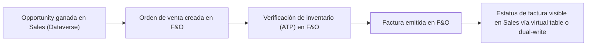

*Lectura: 20-25 min · Con práctica: unos 150 min, mejor en dos sesiones (la primera hasta el diagnóstico; la segunda, la Microlección 3 y el reto de transferencia). La primera vez, cuenta entre una vez y media y el doble.*

### 🎯 Objetivo
Diseñar una integración responsable entre Dynamics 365 Customer Engagement y Finance & Operations definiendo sistema dueño, patrón de integración, dirección de datos, seguridad, ALM y riesgos operativos, produciendo una matriz de ownership completa y un diagrama de flujo end-to-end defendibles frente a un arquitecto F&O real.

> **Cómo está organizado este módulo:** primero decides **quién es dueño de cada dato** y con qué patrón viaja (Microlección 1); después diseñas cómo se **opera** la sincronización cuando algo falla (Microlección 2); diagnosticas una "guerra de sobrescrituras" empezando por el síntoma; en la Microlección 3 **decides y defiendes** sin pasos cómo llega el estatus de factura a Sales, contrastado con una rúbrica; y cierras con un reto de transferencia en otro negocio. No hay una única respuesta correcta: la evidencia es tu decisión escrita con sus razones.
>
> **Antes de empezar, necesitas:**
> - Ningún nivel de certificación: este módulo es transversal. Si ya hiciste el [Módulo 60](/nivel/d365/modulo/finance-operations-procesos-erp) (F&O Awareness), ya conoces el criterio dual-write / DMF / virtual tables y el modelo de seguridad de F&O; aquí se aplican y se operan. Si no, lee al menos sus Conceptos Clave.
> - **No necesitas un ambiente de Finance & Operations.** Para dual-write hace falta un ambiente de finance and operations **enlazado** a un ambiente de Power Platform (la Power Platform integration, obligatoria en todo ambiente de F&O desde el 1 de mayo de 2025 — [Learn](https://learn.microsoft.com/dynamics365/fin-ops-core/dev-itpro/power-platform/overview)) o un ambiente unificado creado con una plantilla de F&O, donde F&O y Dataverse viven en el mismo ambiente y las soluciones de dual-write y de virtual entities vienen preinstaladas (los mapas igual hay que activarlos) ([Learn: Unified environment types and templates](https://learn.microsoft.com/power-platform/admin/unified-experience/unified-environment-types-and-templates)). Un ambiente Developer de Power Platform no sirve: Learn indica que ese tipo no admite ninguna carga de Dynamics 365. Una trial de F&O la crea el administrador de un tenant de trabajo o escuela, como ambiente nuevo (ver el aviso de ambiente del [Lab 93](/labs/lab-93-fo-finance-setup-walkthrough)). Por eso el núcleo de cada práctica es **en papel** (matrices, runbooks, decisiones con rúbrica). Si tienes una trial o un sandbox de F&O con dual-write ya configurado, hay pasos de **solo lectura** marcados "trial si la tienes"; no cambies nada en ellos.
> - Una hoja de cálculo o un documento para las matrices.
> - Los casos de este módulo son **ilustrativos**: sus cifras sirven para razonar, no son datos de empresas reales.

### 📖 Conceptos Clave
- **System of record:** sistema dueño de un dato — quién puede escribirlo, quién solo lo consume. Customer, Product, Order, Invoice e Inventory no deben tener ownership ambiguo; si dos sistemas pueden editar el mismo campo sin una regla de prioridad, la integración generará conflictos silenciosos tarde o temprano. El dueño se decide **por grupo de campos**, no solo por tabla: en un mismo cliente, los datos comerciales pueden ser de Sales y los fiscales y de crédito de F&O.
- **Dual-write:** integración **acoplada (tightly coupled), casi en tiempo real y bidireccional** entre las apps de finance and operations y Dataverse: un cambio en un lado escribe en el otro, así que el dato **se copia** en los dos ([Learn: Dual-write overview](https://learn.microsoft.com/dynamics365/fin-ops-core/dev-itpro/data-entities/dual-write/dual-write-overview)). Learn lo reserva para el subconjunto de entidades que ya tienen mucha lógica en los dos lados y por eso deben existir en ambas bases, como Account/Customer, Company, Product y Sales order ([Learn: Power Platform integration](https://learn.microsoft.com/dynamics365/fin-ops-core/dev-itpro/power-platform/overview)). Se instala como soluciones en Dataverse que añaden conceptos como *company* y *party*. Cada **table map** tiene **tablas dependientes** (por ejemplo, un mapa de clientes depende de grupos de clientes y monedas) y, antes de activarlo, el sistema te lista las relacionadas que deberías activar: activar un mapa sin sus dependencias es la causa más común de errores de sincronización en proyectos reales ([Learn: Enable table maps](https://learn.microsoft.com/dynamics365/fin-ops-core/dev-itpro/data-entities/dual-write/enable-entity-map)).
- **Data Management Framework (DMF) y batch data API:** import/export **por lotes y asíncrono** para migración inicial o cargas periódicas (por ejemplo, una actualización nocturna de un catálogo), no sincronización transaccional continua. Learn da una regla orientativa: si el volumen supera unos cientos de miles de registros, usa la batch data API (recurring integrations o Data management package REST API) ([Learn: Integration patterns](https://learn.microsoft.com/dynamics365/fin-ops-core/dev-itpro/data-entities/integration-overview)). Usar DMF para lo que dual-write resuelve mejor genera retrabajo; usar dual-write para una carga puntual es sobre-ingeniería.
- **Virtual tables (virtual entities de F&O):** exponen entidades de F&O en Dataverse **sin copiar el dato**: sigue viviendo en F&O y cada operación se ejecuta contra F&O en ese momento, con la lógica de negocio de la entidad y en el contexto del usuario de F&O asociado. **No son de solo lectura:** Learn indica que permiten create, read, update y delete (CRUD) desde Dataverse y Power Platform ([Learn: Virtual entities overview](https://learn.microsoft.com/dynamics365/fin-ops-core/dev-itpro/power-platform/virtual-entities-overview)). Encajan cuando Power Platform necesita **trabajar sobre el dato de F&O sin duplicarlo** (por ejemplo, mostrar el saldo de inventario en una Opportunity); como no hay copia, F&O sigue siendo el único dueño y no hay nada que sincronizar ni reconciliar.
- **Business events y eventos e integración custom:** los **business events** de F&O notifican a sistemas externos que ocurrió algo en un proceso (por ejemplo, la confirmación de una orden de compra) y se consumen con Power Automate, Azure Service Bus, Azure Event Grid u otros endpoints. Learn advierte que **no son un mecanismo de exportación de datos** (son ligeros), que el orden de entrega no está garantizado y que traen un número de control para detectar duplicados. Su catálogo está en **System administration** > **Set up** > **Business events**, y ningún evento está activo hasta que lo activas y le asignas un endpoint ([Learn: Business events overview](https://learn.microsoft.com/dynamics365/fin-ops-core/dev-itpro/business-events/home-page)). Los **data events** son su pariente: avisan cuando se crea, actualiza o borra un registro, no cuando ocurre un paso de un proceso ([Learn: Power Platform integration](https://learn.microsoft.com/dynamics365/fin-ops-core/dev-itpro/power-platform/overview)). APIs REST/OData, servicios custom o un middleware (un iPaaS) aplican cuando nada de lo anterior cubre el proceso.
- **Lo que ya no conviene usar para un diseño nuevo:** el **Data Integrator** (proyectos y plantillas como Prospect to Cash en el Power Platform admin center) sigue documentado, pero Learn recomienda pasar a dual-write para integrar F&O con Dataverse ([Learn: Data Integrator](https://learn.microsoft.com/power-platform/admin/data-integrator)). Y **Lifecycle Services** deja de ser la puerta de entrada: desde el 16 de febrero de 2026 los clientes nuevos de Finance, Supply Chain Management y Project Operations no pueden crear proyectos ahí y administran sus ambientes en el Power Platform admin center ([Learn](https://learn.microsoft.com/dynamics365/fin-ops-core/dev-itpro/lifecycle-services/lcs-project-creation-freeze)); si un documento o un runbook dice "configúralo en LCS", verifica primero qué tipo de ambiente tiene el cliente.
- **Matriz de ownership:** documento obligatorio que define, por entidad: dueño (F&O o Dataverse), consumidores, dirección del dato (unidireccional o bidireccional), frecuencia, patrón de integración elegido y regla explícita de resolución de conflicto si ambos sistemas intentan escribir. En dual-write, la dirección se puede fijar **por columna**: el mapeo de cada columna puede ser bidireccional o unidireccional en cualquiera de los dos sentidos ([Learn: Customize table and column mappings](https://learn.microsoft.com/dynamics365/fin-ops-core/dev-itpro/data-entities/dual-write/customizing-mappings)). Ojo: la opción **Master for initial sync** solo resuelve conflictos durante la sincronización inicial; Learn aclara que **no controla la dirección** en que se mueven los datos después.
- **Seguridad cruzada:** los roles de seguridad de Dataverse (Security Roles) y los roles/duties/privileges de F&O no son equivalentes ni se mapean 1:1 — un "Sales Manager" en Dataverse no corresponde automáticamente a ningún duty de F&O; el mapeo debe hacerse por proceso de negocio (¿qué necesita hacer esta persona en cada sistema?) y quedar documentado como evidencia de diseño de seguridad. El detalle está en la Microlección 4 del Módulo 60.
- **Operación — controles mínimos:** monitoreo de errores de sincronización, política de reintentos, reconciliación periódica (comparar conteos/totales entre sistemas), ventana de mantenimiento acordada y un plan de rollback explícito si una sincronización masiva falla a mitad de proceso. Dual-write ayuda con estados de mapa (**Running**, **Paused**...), registro de actividad, errores de la sincronización inicial y de la puesta al día, y alertas; la reconciliación de negocio la diseñas tú (Microlección 2).
- **Requisitos reales de práctica:** construir la matriz de ownership, elegir patrones y diagramar el flujo puede hacerse sin tenant. Configurar dual-write real, mapas de entidades, validar dependencias y ejecutar reconciliación requiere entornos F&O y Dataverse conectados, permisos de administración en ambos, y datos maestros reales.

### 👨‍💻 Actividades Prácticas

## 🧩 Microlección 1 — Dueño por campo y patrón por entidad

**¿Qué vas a aprender?** A construir la matriz de ownership campo a campo, a elegir el patrón de cada entidad con un criterio explícito y a saber con qué pieza se hace cumplir el dueño (dirección del mapeo y edición en el sistema que no es dueño).

**¿Por qué existe esto?** El Caso Real de este módulo no falló por la tecnología: dual-write hizo exactamente lo que estaba configurado (copiar en las dos direcciones). Falló porque nadie decidió **quién es dueño de qué campo** antes de activarlo. "El cliente es de F&O" no basta: el vendedor necesita corregir el nombre comercial y Finanzas el fiscal, y los dos viven en el mismo registro.

**El criterio de patrón (el del Módulo 60, más dos preguntas):**

| Pregunta | Si la respuesta es sí → |
|---|---|
| ¿El dato debe **existir en los dos sistemas** y mantenerse sincronizado con continuidad operativa? | Dual-write |
| ¿Es una **carga masiva o migración** puntual, o lotes periódicos de gran volumen? | DMF / batch data API |
| ¿Basta con **trabajar sobre el dato de F&O desde Power Platform sin copiarlo**? | Virtual tables |
| ¿Solo hay que **avisar** que algo ocurrió en F&O para que otro sistema reaccione? | Business events |
| ¿Nada de lo anterior calza? | Integración custom (API, middleware) |

**Ejemplo resuelto — Account/Customer (una fila de la matriz):**

| Grupo de campos | Dueño | Consumidor | Patrón | Dirección | Regla de conflicto | Dónde se hace cumplir |
|---|---|---|---|---|---|---|
| Nombre comercial, contacto principal, ejecutivo asignado | Sales (Dataverse) | F&O | Dual-write | Dataverse → F&O | Gana Sales; F&O no lo edita | Mapeo de columna unidireccional + campo de solo lectura en F&O |
| Nombre fiscal, identificación tributaria, límite de crédito | F&O | Sales | Dual-write | F&O → Dataverse | Gana F&O; Sales no lo edita | Mapeo de columna unidireccional + campo de solo lectura en el formulario de Sales |

**Ahora haz algo — micropráctica (6 min):** → **[Decidir dueño y patrón para cada dato de una distribuidora](/practica/ip-d365-028-dueno-y-patron-por-entidad)**. Selecciona las decisiones que defenderías y mira la consecuencia de cada una.

**Práctica en papel (25 min) — la matriz de 5 entidades.**

1. Copia la tabla del ejemplo resuelto y añade filas para **Product**, **Sales Order**, **Invoice** e **Inventory** (puedes partir una entidad en grupos de campos como en el ejemplo).
2. Para cada fila decide el patrón con la tabla del criterio y escribe **una frase** que lo justifique ("Inventory → virtual table porque cambia a cada minuto y Sales solo necesita verlo").
3. En la columna "Dónde se hace cumplir", di qué pieza impide que el sistema que no es dueño escriba: dirección del mapeo, campo de solo lectura en el formulario, rol de seguridad, o "no hay copia" (virtual table).
4. Marca con un asterisco las filas que **no** puedes defender todavía y anota qué te falta saber (por ejemplo, "¿Finanzas acepta que Sales cambie el límite de crédito?").

**Trial si la tienes (10 min, solo lectura):** en tu app de finance and operations, ve a **Workspaces** > **Data management** y selecciona el mosaico **Dual Write** ([Learn](https://learn.microsoft.com/dynamics365/fin-ops-core/dev-itpro/data-entities/dual-write/enable-entity-map)). Busca el table map de clientes (su nombre empieza por **Customers V3**), anota su estado y abre sus mapeos de columnas: anota qué símbolo de dirección (bidireccional o unidireccional) tiene la columna del nombre ([Learn: Customize table and column mappings](https://learn.microsoft.com/dynamics365/fin-ops-core/dev-itpro/data-entities/dual-write/customizing-mappings) muestra la tabla de símbolos). **No lo detengas ni lo edites.** Si no ves los mapas o la página sale en blanco, Learn indica que faltan por aplicar las soluciones de dual-write o que el ambiente no tiene dual-write configurado; no lo arregles tú: quédate con la variante en papel.

**Evidencia a reportar:**

| Campo | Tu valor |
|---|---|
| Entidad o grupo de campos con dueño F&O y el campo que Sales solo puede ver | ___ |
| Patrón elegido para Inventory y la frase que lo justifica | ___ |
| Una entidad que partiste en dos grupos de campos y por qué | ___ |
| Pieza que hace cumplir el dueño en tu fila de Invoice | ___ |
| Fila marcada con asterisco y qué te falta saber | ___ |
| (Trial) Estado del mapa de clientes y dirección de la columna del nombre, o "variante en papel" | ___ |

---

## 🧩 Microlección 2 — Operar la sincronización: estados, pausa, errores y reconciliación

**¿Qué vas a aprender?** A leer el ciclo de vida de un table map, a saber dónde aparece cada tipo de error y a diseñar los cinco controles operativos con dueño, frecuencia y acción.

**¿Por qué existe esto?** Una integración no termina el día que se activa. Lo que Learn documenta sobre la operación de dual-write ([Learn: Enable table maps](https://learn.microsoft.com/dynamics365/fin-ops-core/dev-itpro/data-entities/dual-write/enable-entity-map), [Learn: Error management and alert notifications](https://learn.microsoft.com/dynamics365/fin-ops-core/dev-itpro/data-entities/dual-write/errors-and-alerts), [Learn: Live synchronization limits](https://learn.microsoft.com/dynamics365/fin-ops-core/dev-itpro/data-entities/dual-write/sync-limits)):

- **Estados del table map:** **Not running** → **Initializing** (copia inicial de los datos que ya existen) → **Running**. Con **Running** puedes **Pause**: los cambios nuevos se encolan y, al volver a **Run**, el mapa pasa por **Resuming** y reproduce la cola. Para editar los mapeos de un mapa hay que **detenerlo** antes; si no, los cambios no se guardan.
- **Sincronización inicial:** al activar un mapa, un cuadro de diálogo lista las tablas dependientes (**Show related table map(s)**). Si el mismo registro existe en los dos lados con valores distintos, decides el **Master for initial sync** de cada mapa (por defecto, Dataverse). Los errores de esa copia aparecen en la pestaña **Initial sync details**; corregida la causa, vuelve a ejecutar la sincronización desde esa pestaña (Learn dice "rerun the execution", sin dar el nombre del botón), y si no quieres copiar los datos previos puedes saltarla (**Skip initial sync**). Para que el mapa enlace registros, la clave de F&O tiene que coincidir con una clave alternativa en Dataverse (en clientes, **CustomerAccount** ↔ **accountnumber**).
- **Errores al reanudar:** los registros que fallan al salir de una pausa quedan en la pestaña **Catch-up errors**, donde puedes reintentarlos. **La cola guarda los registros con error un día**; después se purgan. Un runbook que diga "lo revisamos el lunes" pierde datos.
- **Alertas:** con **Create alert settings** defines umbrales (por ejemplo, 10 errores de aplicación en 15 minutos) que avisan por correo y pueden **pausar** o detener dual-write por ti. Hay que reiniciar los mapas para que una alerta tenga efecto.
- **Límites:** cada transacción tiene **dos minutos**; si no termina, dual-write la revierte en los dos lados. Desde F&O hacia Dataverse el límite es de 1.000 registros por transacción; desde Dataverse hacia F&O lo limita el tamaño del mensaje (unos 116 MB), no un número fijo de registros. Los plug-ins lentos en Dataverse cuentan dentro de ese tiempo. La sincronización inicial admite como máximo 40 legal entities (la sincronización en vivo, 250 por transacción).

Lo que dual-write **no** te da es la reconciliación de negocio: comparar conteos, totales y campos críticos entre los dos sistemas es un control que diseñas tú.

**Práctica en papel (25 min) — los 5 controles y el runbook.** Para la integración de la Microlección 1, completa esta tabla:

| Control | Qué mide u observa | Owner | Frecuencia | Acción si falla |
|---|---|---|---|---|
| Monitoreo de errores | ___ | ___ | ___ | ___ |
| Alerta con umbral (qué hace dual-write solo) | ___ | ___ | ___ | ___ |
| Revisión de **Catch-up errors** tras una pausa | ___ | ___ | Antes de que pase un día | ___ |
| Reconciliación (conteos y campos críticos) | ___ | ___ | ___ | ___ |
| Criterio de rollback o de pausa ante fallo masivo | ___ | ___ | ___ | ___ |

Después escribe un **runbook de 5 líneas** para este incidente: "la ventana de mantenimiento de F&O se alargó dos horas y el mapa de pedidos quedó en pausa".

**Trial si la tienes (10 min, solo lectura):** en la página **Dual Write**, selecciona un mapa y mira su registro de actividad, la pestaña **Initial sync details** y la pestaña **Catch-up errors**. Anota cuántos errores muestra cada una. No reintentes ni borres nada.

**Evidencia a reportar:**

| Campo | Tu valor |
|---|---|
| Umbral de tu alerta y qué acción toma dual-write al alcanzarlo | ___ |
| Quién revisa **Catch-up errors** y en qué plazo | ___ |
| Campos críticos de tu reconciliación de clientes | ___ |
| Tu criterio para pausar en vez de detener un mapa | ___ |
| Primera y última línea de tu runbook | ___ |
| (Trial) Errores en **Initial sync details** y en **Catch-up errors**, o "variante en papel" | ___ |

---

## 🔧 Diagnosticar — el nombre fiscal que cambia solo

Antes de la Microlección 3, resuelve este caso empezando por el síntoma:

**[Diagnosticar: el nombre fiscal de F&O se sobrescribe desde Sales](/practica/ip-d365-029-nombre-fiscal-sobrescrito)**

Síntoma: un equipo ya tiene una matriz de ownership que dice "nombre fiscal: dueño F&O". Aun así, una factura sale con el nombre comercial que un vendedor escribió en Sales. Formula tu hipótesis antes de ver la causa, en este orden (es también la respuesta a la pregunta de entrevista "el nombre del cliente en Sales no coincide con el de F&O, ¿cómo lo diagnosticas?"): (1) ¿qué dice la matriz de ownership sobre quién puede editar ese campo?, (2) ¿qué hace el mapeo de dual-write con esa columna (dirección)?, (3) solo después, ¿hay un error de sincronización real?

---

## 🧩 Microlección 3 — El estatus de factura en Sales: decidir y defender (sin pasos)

**¿Qué vas a aprender?** A elegir entre opciones que **todas** pueden funcionar, con criterios explícitos, y a dejar escrito qué aceptas perder.

**¿Por qué existe esto?** Este es el flujo CE + F&O del módulo. Complétalo indicando qué sistema es dueño en cada paso:

El último paso es el que más se discute: ¿cómo ve el vendedor si su orden ya se facturó?

**🏗️ Reto (sin pasos): elige una opción y defiéndela.**

- **A. Dual-write** de las facturas (el escenario prospect-to-cash de dual-write incluye facturas): la factura existe también en Dataverse.
- **B. Virtual table** sobre la entidad de facturas de F&O: Sales la consulta sin copia.
- **C. Business event** "factura registrada" + un cloud flow de Power Automate que actualiza una columna de estatus en la orden de Sales.
- **D. Exportación nocturna por lotes** (DMF) a una tabla de Dataverse.

> **Restricciones:** unas 3.000 facturas al día; Finanzas exige que **nadie fuera de F&O** pueda modificar una factura; los vendedores quieren ver el estatus "en el momento" desde la orden y, además, un reporte semanal de facturación por vendedor en Power BI; el equipo de integración es una persona; la empresa ya paga Power Automate para otros flujos.
> **Escribe:** la opción elegida, la restricción que descarta cada una de las otras, cómo se cumple la regla de Finanzas con tu opción y qué riesgo operativo aceptas.

Contrasta tu decisión con esta rúbrica:

| Criterio | Qué demuestra que lo cumples |
|---|---|
| Descartas por restricción, no por preferencia | Cada opción descartada tiene escrita la restricción que viola |
| La afirmación técnica está respaldada | Lo que dices de cada patrón (copia o no, CRUD, orden de eventos, lotes) tiene su enlace de Learn |
| La regla de Finanzas se cumple de verdad | Dices qué pieza impide editar la factura fuera de F&O (no hay copia, mapeo unidireccional, rol de seguridad, solo lectura en el formulario) |
| La operación tiene dueño | Dices qué pasa cuando tu opción falla (evento no entregado, mapa pausado, lote fallido) y quién lo ve |
| El reporte también cuenta | Tu decisión explica de dónde sale el reporte semanal, que no tiene por qué ser la misma pieza que el estatus en tiempo real |

**Para cerrar (5 min):** marca qué de tu decisión requiere ambiente real: entornos F&O y Dataverse conectados, dual-write configurado, mapas habilitados, usuarios con permisos y datos maestros.

**Evidencia a reportar:**

| Campo | Tu valor |
|---|---|
| Opción elegida | ___ |
| Restricción que descarta cada una de las otras tres | ___ |
| Pieza que impide editar facturas fuera de F&O | ___ |
| Qué pasa cuando falla y quién se entera | ___ |
| De dónde sale el reporte semanal | ___ |
| Dueño de cada paso del diagrama (A a E) | ___ |

---

## 🔁 Reto de transferencia — una distribuidora de alimentos refrigerados

El mismo método en otro negocio. Una **distribuidora de alimentos refrigerados** usa Sales y Customer Service en Dataverse y Supply Chain Management y Finance (F&O). Los precios por cliente cambian cada semana y los aprueba Finanzas; los pedidos entran desde Sales y desde un portal de terceros que envía unas 200.000 líneas por hora en los picos de la mañana; el transportista debe recibir un aviso cuando un pedido se confirma; los representantes de servicio necesitan ver el lote y la fecha de vencimiento disponibles de un producto mientras atienden un reclamo; y hay que migrar 15 años de clientes históricos del sistema anterior.

**[Transferir: la distribuidora de alimentos refrigerados](/practica/ip-d365-030-distribuidora-alimentos-refrigerados)** — decide patrón y dueño de cada necesidad. Si solo memorizaste "todo por dual-write", este reto te lo va a mostrar.

Cierra el reto con **una fila de matriz por necesidad** (dueño, patrón, dirección, regla de conflicto) y un **ADR de media página** (Contexto, Opciones, Decisión, Consecuencias) para la necesidad que te pareció más difícil, contrastado con la rúbrica de la Microlección 3.

**Evidencia a reportar:**

| Campo | Tu valor |
|---|---|
| Patrón para los precios por cliente y quién es dueño | ___ |
| Patrón para las 200.000 líneas por hora y por qué no dual-write | ___ |
| Cómo recibe el aviso el transportista y qué haces con eventos duplicados o fuera de orden | ___ |
| Cómo ve servicio el lote y el vencimiento sin copiar el inventario | ___ |
| Patrón para la migración histórica | ___ |
| Necesidad de tu ADR y la consecuencia que aceptas | ___ |

---

### 💼 Casos Reales de Negocio
Un cliente activó sincronización de clientes sin decidir si el dueño era Sales o F&O. Ventas corregía nombres comerciales en Dataverse, Finanzas corregía datos fiscales en F&O, y dual-write propagaba ambos cambios en direcciones opuestas — generando una guerra silenciosa de sobrescrituras que nadie notó hasta que un reporte fiscal mostró un nombre de cliente incorrecto en una factura oficial. La solución fue una matriz de ownership explícita: Sales dueño de datos comerciales (nombre de contacto, cuenta asignada), F&O dueño de datos fiscales y de crédito, reglas de edición por rol en cada sistema, y reconciliación semanal para detectar discrepancias antes de que llegaran a un documento fiscal. La integración dejó de ser "conectar sistemas" y pasó a ser gobierno de datos con reglas explícitas.

### ✅ Buenas Prácticas
- Crear la matriz de ownership antes de configurar dual-write, nunca después de los primeros conflictos.
- Decidir el dueño por grupo de campos y hacerlo cumplir con piezas concretas: dirección del mapeo de columna, solo lectura en el sistema que no es dueño y roles de seguridad.
- No usar dual-write para todo: elegir el patrón según necesidad real de escritura, frecuencia y criticidad del dato.
- Activar cada table map con sus tablas dependientes y en el orden que propone el sistema.
- Mapear seguridad por proceso de negocio, no por nombre de rol — un rol con el mismo nombre en ambos sistemas puede significar permisos completamente distintos.
- Diseñar monitoreo y reconciliación como parte del alcance inicial del proyecto, no como una mejora post-go-live; revisar los errores de la cola antes de que se purguen.
- Probar errores de sincronización intencionales (dato inválido, dependencia faltante) antes de go-live, no esperar a que ocurran en producción.

### ⚠️ Errores Comunes
| Error | Causa | Solución |
|-------|-------|----------|
| Ownership ambiguo | Ambos sistemas editan el mismo dato sin regla de prioridad | Matriz de ownership explícita y regla de resolución de conflicto |
| La matriz dice un dueño, pero el dato se sigue sobrescribiendo | El mapeo de la columna quedó bidireccional y el campo es editable en los dos sistemas | Detener el mapa, poner la columna unidireccional desde el dueño y dejar el campo de solo lectura en el otro sistema |
| Creer que **Master for initial sync** define al dueño | Se confunde la regla de conflictos de la copia inicial con la dirección de la sincronización | Learn aclara que solo resuelve conflictos de la sincronización inicial; la dirección se fija en el mapeo de columnas |
| Dual-write usado para lectura simple | Se busca "integración moderna" sin necesidad real de escritura bidireccional | Usar virtual tables o un reporte si el caso es solo de consulta |
| Descartar virtual tables "porque son de solo lectura" | Información desactualizada | Las virtual tables de F&O admiten CRUD; la diferencia con dual-write es que no copian el dato |
| Usar business events para exportar datos | Se confunde una notificación con una integración de datos | Learn: los business events son ligeros y no sirven para exportar datos; para volumen, batch data API |
| Sin reconciliación | Se asume que la sincronización siempre funciona sin fallos silenciosos | Reporte periódico de diferencias con owner operativo asignado |
| Registros con error perdidos tras una pausa | Nadie revisó **Catch-up errors** a tiempo | La cola guarda los errores un día: el runbook asigna dueño y plazo |
| Roles CE/F&O mapeados por nombre | Los modelos de seguridad de ambos sistemas son estructuralmente distintos | Matriz rol-proceso-permiso específica por sistema, no por coincidencia de nombre |

### 🧪 Criterios de Validación
- [ ] Construí una matriz de ownership CE + F&O para 5 entidades, con al menos una partida por grupos de campos y la pieza que hace cumplir cada dueño
- [ ] Elegí patrón de integración por entidad con el criterio de decisión explícito y una frase de justificación
- [ ] Diseñé los 5 controles operativos (monitoreo, alerta, revisión de la cola, reconciliación y rollback) y un runbook de pausa
- [ ] Diagnostiqué la sobrescritura del nombre fiscal siguiendo el orden ownership → mapeo → error de sincronización
- [ ] Decidí y defendí cómo llega el estatus de factura a Sales con la rúbrica, e indiqué el dueño de cada paso del flujo Opportunity→Orden→Factura→Estatus
- [ ] Completé el reto de transferencia de la distribuidora con su matriz y un ADR
- [ ] Identifiqué dependencias de ambiente real para dual-write
- [ ] Relacioné este módulo con el [Lab 70](/labs/lab-70-ce-fo-integration-architecture) (CE + F&O integration architecture) y el [Lab 88](/labs/lab-88-ce-fo-dual-write-ownership-matrix) (dual-write ownership matrix)
