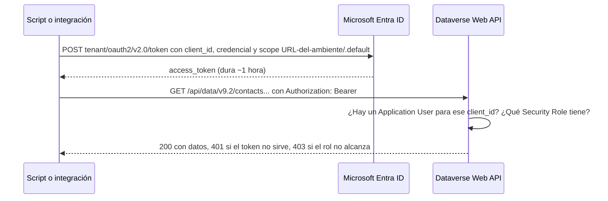

*Lectura: 20-22 min · Práctica: unas 3 horas la primera vez, mejor en dos sesiones (la primera, Microlecciones 1 y 2 con tu ambiente; la segunda, la Microlección 3, la decisión y el reto de transferencia).*

> **📌 Primera vez viendo términos como API, HTTP o token?** Este módulo asume que sabes qué es una petición a un servidor. Mini-glosario rápido: **API** = la forma en que un programa le pide datos a otro programa (en vez de que un humano use un formulario, un script hace la misma pregunta). **HTTP** = el protocolo/idioma con el que viajan esas peticiones por internet (GET para leer, POST para crear). **Token** = una credencial temporal que demuestra "tengo permiso" sin mandar tu contraseña en cada petición. Si estos tres términos son nuevos, no hace falta dominarlos hoy — solo entiende que este módulo describe cómo un script (no una persona) le habla a Dataverse. Si además nunca has programado nada, revisa primero la sección "Si es tu primera vez programando" en el [Anexo de Lenguajes de Programación](/recursos/lenguajes-programacion) y el [Módulo 56](/nivel/ia/modulo/fundamentos-javascript-para-power-platform) (fundamentos de JavaScript).

### 🎯 Objetivo
Entender cómo se conecta una aplicación o script externo a Dataverse/Dynamics 365 mediante la Web API, qué mecanismo de autenticación usa (OAuth vía Microsoft Entra ID), y cómo diagnosticar los errores de permisos más comunes — todo esto como contexto indispensable antes de pedirle a un asistente de IA que genere código de integración. Al terminar, habrás hecho peticiones reales de solo lectura contra tu ambiente de práctica y habrás corregido, con evidencia, un script de integración generado por IA.

> **Cómo está organizado este módulo:** cada microlección trae un concepto breve, una micropráctica con feedback inmediato y una práctica con **evidencia** (el dato exacto que observaste). La Microlección 3 es una actividad de **fallo y corrección**: recibes un script de Node.js generado por IA con errores plausibles, los detectas ejecutándolo, probando sus URL en el navegador y contrastando con Microsoft Learn. Cierras **decidiendo y defendiendo** con qué identidad y qué permisos corre la integración del caso, y con un **reto de transferencia** en el que la integración ya no lee: escribe.
>
> **Antes de empezar, necesitas:**
> - Un ambiente **Developer** o **Sandbox** de práctica (nunca producción) y un navegador con la sesión iniciada en [Power Apps](https://make.powerapps.com). Para la Microlección 2, ser administrador de ese ambiente (en un ambiente Developer propio lo eres).
> - **Node.js LTS** para la Microlección 3 (`node --version` en una terminal debe responder `v20` o superior). Si hiciste el Módulo 52 ya lo tienes; si no, [nodejs.org](https://nodejs.org), versión LTS. No hace falta saber programar en Node: vas a ejecutar y leer, no a escribir desde cero.
> - **No necesitas** crear una app registration: en todo el módulo la parte que la requiere es opcional y trae variante en papel. Este módulo es transversal: no exige ningún nivel de certificación.

### 📖 Conceptos Clave
- **Dynamics 365 sobre Dataverse:** las aplicaciones de primera parte (Sales, Customer Service, Field Service, Project Operations) son, técnicamente, soluciones de Power Platform construidas sobre las mismas tablas de Dataverse a las que accede cualquier Canvas App, plugin o integración externa — no hay una "API distinta" para D365 y otra para Power Apps.
- **Dataverse Web API:** una API REST estándar (OData v4) que permite crear, leer, actualizar y eliminar registros de cualquier tabla mediante peticiones HTTP normales (GET, POST, PATCH, DELETE). La URL de tu ambiente la copias en Power Apps, en **Settings** (el engranaje, arriba a la derecha) > **Developer resources** > **Web API endpoint**; tiene la forma `https://<ambiente>.<región>.dynamics.com/api/data/v9.2/` y `v9.2` es la versión actual ([Learn: Compose HTTP requests](https://learn.microsoft.com/power-apps/developer/data-platform/webapi/compose-http-requests-handle-errors)).
- **EntitySet, nombre lógico y nombre visible:** la parte final de la URL es el **EntitySet** de la tabla (`accounts`, `contacts`), no su nombre lógico (`account`) ni su nombre visible. Suele ser el plural, pero no siempre: Learn pide confirmarlo en el **service document** (`GET` al endpoint) ([Learn: service documents](https://learn.microsoft.com/power-apps/developer/data-platform/webapi/web-api-service-documents)).
- **Propiedades en minúsculas:** cada columna es una propiedad cuyo nombre es el nombre lógico, siempre en minúsculas (`fullname`, no `FullName`); las búsquedas son lookup properties con la forma `_<nombre>_value`. Las columnas Choice y de estado llegan como **número** (`statecode: 0`); la etiqueta ("Active") es un valor formateado aparte ([Learn: Web API properties](https://learn.microsoft.com/power-apps/developer/data-platform/webapi/web-api-properties), [Learn: select columns](https://learn.microsoft.com/power-apps/developer/data-platform/webapi/query/select-columns)).
- **Encabezados de toda petición:** `Accept: application/json`, `OData-MaxVersion: 4.0`, `OData-Version: 4.0` e `If-None-Match: null`; si mandas JSON en el cuerpo, también `Content-Type: application/json`. Las filas vuelven en un array `value`; sin `$top`, hasta 5.000 filas por página, y si hay más llega un `@odata.nextLink` que se sigue **tal cual** (la Web API no admite `$skip`) ([Learn: page results](https://learn.microsoft.com/power-apps/developer/data-platform/webapi/query/page-results)).
- **Microsoft Entra ID (antes Azure AD):** el proveedor de identidad que emite los tokens de acceso (OAuth 2.0) que la Web API exige en cada petición mediante el header `Authorization: Bearer <token>`. Sin un token válido emitido por el tenant correcto y **para el recurso correcto** (tu ambiente), cualquier llamada devuelve error. Un token dura alrededor de una hora ([Learn: OAuth con Dataverse](https://learn.microsoft.com/power-apps/developer/data-platform/authenticate-oauth)).
- **App registration:** el "registro" de una aplicación dentro de Microsoft Entra ID que le da una identidad propia (`Application (client) ID`) para poder solicitar tokens, independiente de cualquier usuario humano. Es el primer paso obligatorio para cualquier integración o script que no use un login interactivo de usuario.
- **Application user:** un usuario especial dentro de Dataverse (no un empleado real) que se vincula a una app registration y le da permisos concretos sobre las tablas, mediante un Security Role, igual que a un usuario humano. Sin este vínculo, la app registration puede autenticarse contra Entra ID pero Dataverse la rechazará por no tener un usuario asociado. No consume una licencia de pago, y en un ambiente solo puede haber uno por app registration ([Learn: application users](https://learn.microsoft.com/power-platform/admin/manage-application-users)).
- **Service principal:** el término genérico para "una identidad no humana" (la combinación de app registration + credencial) que se autentica para actuar en nombre de una aplicación, no de una persona — es el mecanismo recomendado para integraciones automatizadas, pipelines de ALM y scripts. El flujo OAuth que usa se llama **client credentials**: pide el token con `scope=<URL de tu ambiente>/.default` ([Learn: client credentials](https://learn.microsoft.com/entra/identity-platform/v2-oauth2-client-creds-grant-flow)).
- **Client secret vs. certificado:** dos formas de que un service principal demuestre su identidad. Un **client secret** es una contraseña generada por Entra ID, con fecha de expiración, que viaja en cada petición de token; un **certificado** es un par de llaves criptográficas: la llave privada nunca sale de tu servidor, y Entra ID lo considera un nivel de garantía más alto. Ambos expiran y se rotan. Para integraciones de producción de largo plazo, un certificado es preferible; para scripts de corta duración o pruebas, un client secret bien gestionado es aceptable. Learn recomienda además usar el flujo más seguro disponible, como **managed identities**, cuando sea viable.
- **Permisos mínimos:** el Security Role asignado al Application User debe otorgar solo el acceso estrictamente necesario (ej. lectura/escritura sobre 2-3 tablas específicas), nunca el rol de System Administrator "para que funcione más rápido".
- **401 vs. 403:** Learn agrupa los errores de token (vencido, inválido, ausente) en `401 Unauthorized` y los de privilegios en `403 Forbidden`. Un 401 es **autenticación** (¿quién eres?) y ningún Security Role lo arregla; un 403 es **autorización** (¿qué puedes hacer?) y se resuelve en el rol.

### 👨‍💻 Actividades Prácticas

## 🧩 Microlección 1 — Anatomía de una petición: lo pruebas en tu navegador

**¿Qué vas a aprender?** A leer y escribir una petición GET a la Web API parte por parte, y a comprobar cada parte contra tu ambiente sin escribir código ni crear credenciales.

**¿Por qué existe esto?** Si le pides a una IA "un script que lea los contactos", te devolverá una URL que parece correcta. Para revisarla necesitas saber qué va en cada parte y tener una forma de probarla. Learn documenta que puedes enviar peticiones `GET` desde el navegador: usa tu sesión, así que no hace falta token.

**La anatomía, con un ejemplo de Learn:**

```http
GET [Organization URI]/api/data/v9.2/accounts?$select=name,statecode&$orderby=name&$top=1
Accept: application/json
OData-MaxVersion: 4.0
OData-Version: 4.0
Prefer: odata.include-annotations="OData.Community.Display.V1.FormattedValue"
```

| Parte | En el ejemplo | Qué la define |
|---|---|---|
| Endpoint | `[Organization URI]/api/data/v9.2/` | Lo copias de **Developer resources** |
| Recurso | `accounts` | El EntitySet, confirmado en el service document |
| Opciones de consulta | `$select`, `$orderby`, `$top`, `$filter` | Nombres de propiedades en minúsculas; los nombres de las opciones distinguen mayúsculas |
| Encabezados | `Accept`, `OData-*`, `Prefer` | Learn los pide en toda petición; `Prefer` añade las etiquetas formateadas |
| Autorización | `Authorization: Bearer <token>` | En el navegador no lo escribes: usa tu sesión |

**Ahora haz algo — micropráctica (6 min):** **[Armar una petición GET correcta a la Web API](/practica/ip-ia-040-armar-peticion-web-api)**. Si quieres calentar con `$select`, `$orderby` y `$top` sobre datos ficticios, haz también **[OData select/orderby/top](/practica/ip-qry-002-odata-select-top)**.

**Práctica real en tu ambiente de práctica (35 min):**

1. En [Power Apps](https://make.powerapps.com), elige tu ambiente de práctica arriba a la derecha. Selecciona **Settings** (el engranaje) > **Developer resources** y copia el **Web API endpoint**. **Qué deberías ver:** una URL que termina en `/api/data/v9.2/`. **Si no ves Developer resources**, comprueba que elegiste el ambiente correcto y que tiene Dataverse.
2. En una pestaña nueva del **mismo navegador**, pega el endpoint y agrega `WhoAmI` al final: `<tu endpoint>WhoAmI`. Pulsa Enter. **Qué deberías ver:** un JSON con `BusinessUnitId`, `UserId` y `OrganizationId` (Learn muestra la misma forma). **Si te pide iniciar sesión**, hazlo con tu cuenta del ambiente. Si lo ves todo en una sola línea, es normal: Learn sugiere una extensión de formato JSON, pero no la necesitas.
3. Abre el **service document**: solo el endpoint, sin nada después. Busca con **Ctrl+F** la palabra `contacts` y anota el valor de `"name"` de esa entrada. Ese es el EntitySet de la tabla Contact.
4. Pide tres contactos con solo el nombre: `<tu endpoint>contacts?$select=fullname&$top=3`. **Qué deberías ver:** `@odata.context`, un array `value` y, por cada fila, `@odata.etag`, `fullname` y `contactid` (la clave primaria siempre vuelve aunque no la pidas). **Si `value` viene vacío (`[]`)**, tu ambiente no tiene contactos: crea dos en cualquier app basada en modelo que lo use, o sigue con el resto y anótalo.
5. Ahora prueba, una por una, las dos URL que una IA podría escribir, y copia el **primer renglón del mensaje de error** que devuelve tu ambiente (no lo adivines: cópialo):
   - `<tu endpoint>contact?$select=fullname&$top=3` (nombre lógico en vez del EntitySet)
   - `<tu endpoint>contacts?$select=FullName&$top=3` (mayúsculas)
6. Filtra los activos: `<tu endpoint>contacts?$select=fullname,statecode&$filter=statecode eq 0&$top=3`. Después cambia el filtro por `statecode eq 'Active'` y anota qué pasa.

**Evidencia a reportar:**

| Campo | Tu valor |
|---|---|
| Web API endpoint de tu ambiente de práctica (puedes ocultar el nombre del ambiente) | ___ |
| Propiedades que devolvió `WhoAmI` (solo los nombres, no los GUID) | ___ |
| `"name"` de la entrada de Contact en el service document | ___ |
| Cuántas filas devolvió `contacts?$select=fullname&$top=3` y qué propiedades trae cada una | ___ |
| Código o primer renglón del error con `contact` (singular) | ___ |
| Código o primer renglón del error con `FullName` | ___ |
| Qué pasó con `statecode eq 'Active'` frente a `statecode eq 0` | ___ |

---

## 🧩 Microlección 2 — Quién llama: app registration, Application User y permisos mínimos

**¿Qué vas a aprender?** A ubicar dónde vive cada pieza de la identidad de una integración, a leer qué Security Role tiene un Application User y a diagnosticar un 401 antes de tocar permisos.

**¿Por qué existe esto?** En el navegador eres tú. Un script que corre solo, de noche, no tiene a nadie que inicie sesión: necesita su propia identidad (app registration + credencial) y su propio usuario en Dataverse (Application User) con un rol acotado. Si confundes las piezas, terminas "arreglando" un problema de token con más permisos, que es justo cómo empezó el caso real de este módulo.

**Las piezas, en orden:**



**Práctica real en tu ambiente de práctica (30 min):**

1. Entra al [Power Platform admin center](https://admin.powerplatform.microsoft.com) y selecciona **Manage** > **Environments** > tu ambiente de práctica > **Settings** > **Users + permissions** > **Application users** ([Learn](https://learn.microsoft.com/power-platform/admin/manage-application-users)). **Qué deberías ver:** la lista de application users del ambiente (puede estar vacía si nadie creó uno). **Si no ves Settings**, no eres administrador de ese ambiente: usa la variante en papel.
2. En la barra de comandos selecciona **Filter** > **Platform**. Learn documenta que así se ven los application users que el sistema crea en cada ambiente. Elige uno, selecciona **Details** y anota su **App type**, su **Business unit** y sus **Assigned security roles**. Cierra con **Close** sin cambiar nada.
3. Vuelve a la lista sin filtro y mira el botón **+ New app user**: abre el panel **Create a new app user** y fíjate en que pide **+ Add an app** (la app registration), **Business Unit** y los security roles. **No lo completes** salvo que vayas a hacer la parte opcional; cierra el panel.
4. **Opcional, solo si tienes permisos en Microsoft Entra ID y un ambiente de práctica:** crea una app registration de prueba en el [Microsoft Entra admin center](https://entra.microsoft.com) (**Entra ID** > **App registrations** > **New registration**, con **Supported account types** en la opción de un solo tenant), agrégale un client secret en **Manage** > **Certificates & secrets** (Learn: el valor solo se muestra una vez; guárdalo en un gestor de contraseñas, nunca en un archivo del repositorio) y crea su Application User con un rol propio de **solo lectura sobre Contact** ([Learn: crear un rol personalizado](https://learn.microsoft.com/power-platform/admin/database-security#create-or-configure-a-custom-security-role)). Para el flujo client credentials Learn indica que no hace falta el permiso delegado **Access Dynamics 365 as organization users**. Lo usarás en la Microlección 3.
5. **Diagnosticar antes de seguir — micropráctica (8 min):** **[Diagnosticar: el script falla con TypeError y la IA propone System Administrator](/practica/ip-ia-041-diagnosticar-401-escondido)**. Formula tu hipótesis antes de abrir las pistas.

**Variante en papel (sin permisos de administrador):** con la página [Manage application users](https://learn.microsoft.com/power-platform/admin/manage-application-users) abierta, escribe qué datos pide el panel **Create a new app user** y qué propiedades muestra **Details**. Después completa la tabla con el caso de la integración de facturación.

**Evidencia a reportar:**

| Campo | Tu valor |
|---|---|
| ¿Cuántos application users "Custom" tiene tu ambiente? | ___ |
| Un application user de **Platform**: App type, Business unit y Assigned security roles | ___ |
| Datos que pide **Create a new app user** | ___ |
| Rol que le darías a una integración que solo lee contactos (privilegio y tabla, no un nombre de rol genérico) | ___ |
| Si hiciste la parte opcional: Application (client) ID de prueba (puedes dejar solo los 4 primeros caracteres) y dónde guardaste el secret | ___ |
| En la micropráctica: ¿qué hipótesis escribiste antes de ver las pistas? | ___ |

---

## 🧩 Microlección 3 — Fallo y corrección: el script de integración que generó la IA

**¿Qué vas a aprender?** A revisar línea por línea un script de integración generado por IA, detectar sus errores con tres tipos de evidencia (lo que imprime al ejecutarlo, lo que responde tu ambiente y lo que dice Learn) y dejar una versión corregida.

**¿Por qué existe esto?** El script que te entrega una IA tiene buena estructura, nombres razonables y comentarios convincentes. Puede tener a la vez un secreto escrito en el código, un token pedido para el recurso equivocado y una URL que tu ambiente rechaza. Ninguna de esas cosas se ve leyéndolo "por encima".

**La salida de la IA.** Alguien pidió "un script de Node.js que liste todos los contactos activos de Dataverse con client credentials" y obtuvo esto (el secreto es inventado):

```js
// listar-contactos.mjs: salida tal como la entregó el asistente de IA (contiene errores a propósito)
import { readFile } from "node:fs/promises";

const TENANT_ID = "{{TENANT_ID}}";
const CLIENT_ID = "{{CLIENT_ID}}";
const CLIENT_SECRET = "Xq8~9fake-secret-value";
const ORG_URL = "https://{{ORG}}.crm.dynamics.com";

async function obtenerToken() {
  const respuesta = await fetch(`https://login.microsoftonline.com/${TENANT_ID}/oauth2/v2.0/token`, {
    method: "POST",
    headers: { "Content-Type": "application/x-www-form-urlencoded" },
    body: new URLSearchParams({
      grant_type: "client_credentials",
      client_id: CLIENT_ID,
      client_secret: CLIENT_SECRET,
      scope: "https://graph.microsoft.com/.default",
    }),
  });
  const datos = await respuesta.json();
  return datos.access_token;
}

export function procesar(datos) {
  return datos.entities.map((c) => c.FullName);
}

async function main() {
  if (process.argv.includes("--prueba")) {
    const datos = JSON.parse(await readFile("respuesta-ejemplo.json", "utf8"));
    console.log(procesar(datos));
    return;
  }
  const token = await obtenerToken();
  const respuesta = await fetch(`${ORG_URL}/api/data/v9.2/contact?$select=FullName&$filter=statecode eq 'Active'`, {
    headers: { Authorization: `Bearer ${token}` },
  });
  console.log(procesar(await respuesta.json())); // "con esto ya traes todos los contactos"
}

main();
```

Y este es `respuesta-ejemplo.json`, copiado del ejemplo de paginación de Learn ([Page results](https://learn.microsoft.com/power-apps/developer/data-platform/webapi/query/page-results)), que el script usa en su modo de prueba:

```json
{
    "@odata.context": "[Organization URI]/api/data/v9.2/$metadata#contacts(fullname)",
    "value": [
        {
            "@odata.etag": "W/\"72201545\"",
            "fullname": "Yvonne McKay (sample)",
            "contactid": "49b0be2e-d01c-ed11-b83e-000d3a572421"
        },
        {
            "@odata.etag": "W/\"80648695\"",
            "fullname": "Susanna Stubberod (sample)",
            "contactid": "70bf4d48-34cb-ed11-b596-0022481d68cd"
        }
    ],
    "@odata.nextLink": "[Organization URI]/api/data/v9.2/contacts?$select=fullname&$skiptoken=%3Ccookie%20pagenumber=%222%22%20pagingcookie=%22%253ccookie%2520page%253d%25221%2522%253e%253ccontactid%2520last%253d%2522%257bD5026A4D-D01C-ED11-B83E-000D3A572421%257d%2522%2520first%253d%2522%257b49B0BE2E-D01C-ED11-B83E-000D3A572421%257d%2522%2520%252f%253e%253c%252fcookie%253e%22%20istracking=%22False%22%20/%3E"
}
```

**Práctica (50 min, sin tenant salvo el paso 4):**

1. Crea una carpeta de práctica (fuera de cualquier repositorio de trabajo), guarda los dos archivos con esos nombres exactos y abre una terminal en ella. Ejecuta el modo de prueba:
   ```bash
   node listar-contactos.mjs --prueba
   ```
   **Qué deberías ver:** un error `TypeError: Cannot read properties of undefined (reading 'map')` que apunta a la línea de `procesar`. Ese es el primer hallazgo: ¿dónde vienen las filas en el JSON?
2. Corrige **solo** esa propiedad y vuelve a ejecutar. **Qué deberías ver:** `[ undefined, undefined ]`. El script ya no falla, pero sigue mal: compara el nombre de la propiedad que lee con el que trae el JSON. Corrígelo y ejecuta de nuevo hasta ver `[ 'Yvonne McKay (sample)', 'Susanna Stubberod (sample)' ]`. Fíjate en lo que el modo de prueba no te dice: el JSON trae `@odata.nextLink`.
3. Recorre el resto del script **línea por línea** con dos preguntas: ¿esto coincide con Learn? Y, si coincide, ¿es seguro? Para la URL de la Web API usa lo que comprobaste en la Microlección 1 (puedes pegar la URL de la IA, sin el `{{ORG}}`, en tu navegador con tu endpoint). Para el token, [Learn: OAuth con Dataverse](https://learn.microsoft.com/power-apps/developer/data-platform/authenticate-oauth) (busca "confidential client") y [Learn: client credentials](https://learn.microsoft.com/entra/identity-platform/v2-oauth2-client-creds-grant-flow). Para los encabezados y la paginación, [Compose HTTP requests](https://learn.microsoft.com/power-apps/developer/data-platform/webapi/compose-http-requests-handle-errors) y [Page results](https://learn.microsoft.com/power-apps/developer/data-platform/webapi/query/page-results).
4. **Escribe tu versión corregida** sin mirar la de referencia. Criterios de aceptación: (1) ningún secreto en el código: los valores salen de variables de entorno; (2) el token se pide para tu ambiente; (3) URL con el EntitySet, propiedades en minúsculas y `statecode` como número; (4) los encabezados de Learn en cada petición; (5) se comprueba `respuesta.ok` (o el código HTTP) antes de procesar, y el error se muestra; (6) sigue `@odata.nextLink` hasta que no venga, sin `$top` ni `$skip`. **Si hiciste la parte opcional de la Microlección 2**, ejecútala contra tu ambiente de práctica (nunca producción) con las variables definidas solo en esa terminal; en PowerShell, por ejemplo, `$env:ORG_URL = "https://<tu ambiente>.crm.dynamics.com"`, y lo mismo con `TENANT_ID`, `CLIENT_ID` y `CLIENT_SECRET`. Si no, la evidencia es el modo `--prueba` y la tabla.

**Evidencia a reportar (una fila por línea que cambiaste):**

| Línea o parte del script de la IA | Qué estaba mal | Cómo lo comprobaste (salida de `node`, respuesta de tu ambiente o Learn) | Tu corrección |
|---|---|---|---|
| ___ | ___ | ___ | ___ |
| ___ | ___ | ___ | ___ |
| ___ | ___ | ___ | ___ |
| ___ | ___ | ___ | ___ |
| ___ | ___ | ___ | ___ |
| ___ | ___ | ___ | ___ |

| Campo | Tu valor |
|---|---|
| Salida exacta de `node listar-contactos.mjs --prueba` con tu versión | ___ |
| Cuántos errores encontraste en total y cuáles no se veían en el modo `--prueba` | ___ |
| Si lo ejecutaste contra tu ambiente: código HTTP y número de contactos, o el primer error exacto | ___ |

**Contrasta tu versión (solo después de llenar la tabla).** Una corrección posible, que se ejecutó con `node` en modo `--prueba` y, contra un `fetch` simulado con respuestas de la forma que muestra Learn, siguiendo dos páginas:

```js
// listar-contactos.mjs: una versión corregida posible
import { readFile } from "node:fs/promises";

// Los valores salen de variables de entorno de la terminal, nunca del código ni de Git
const { TENANT_ID, CLIENT_ID, CLIENT_SECRET, ORG_URL } = process.env;

const ENCABEZADOS = {
  Accept: "application/json",
  "OData-MaxVersion": "4.0",
  "OData-Version": "4.0",
  "If-None-Match": "null",
  Prefer: "odata.maxpagesize=500", // páginas de 500; no se mezcla con $top
};

async function obtenerToken() {
  const respuesta = await fetch(`https://login.microsoftonline.com/${TENANT_ID}/oauth2/v2.0/token`, {
    method: "POST",
    headers: { "Content-Type": "application/x-www-form-urlencoded" },
    body: new URLSearchParams({
      grant_type: "client_credentials",
      client_id: CLIENT_ID,
      client_secret: CLIENT_SECRET,
      scope: `${ORG_URL}/.default`, // el recurso es tu ambiente de Dataverse, no Microsoft Graph
    }),
  });
  const datos = await respuesta.json();
  if (!respuesta.ok) throw new Error(`Token: ${datos.error} - ${datos.error_description}`);
  return datos.access_token;
}

export function procesar(datos) {
  return datos.value.map((c) => c.fullname); // la Web API devuelve las filas en "value"
}

async function leerTodas(url, token) {
  const nombres = [];
  while (url) {
    const respuesta = await fetch(url, { headers: { ...ENCABEZADOS, Authorization: `Bearer ${token}` } });
    const datos = await respuesta.json();
    if (!respuesta.ok) throw new Error(`HTTP ${respuesta.status}: ${datos.error?.message}`);
    nombres.push(...procesar(datos));
    url = datos["@odata.nextLink"]; // se usa tal cual; si no viene, no hay más páginas
  }
  return nombres;
}

async function main() {
  if (process.argv.includes("--prueba")) {
    const datos = JSON.parse(await readFile("respuesta-ejemplo.json", "utf8"));
    console.log(procesar(datos));
    console.log("¿Hay más páginas?", datos["@odata.nextLink"] ? "sí" : "no");
    return;
  }
  const token = await obtenerToken();
  const url = `${ORG_URL}/api/data/v9.2/contacts?$select=fullname&$filter=statecode eq 0&$orderby=fullname,contactid`;
  const nombres = await leerTodas(url, token);
  console.log(`${nombres.length} contactos activos`, nombres);
}

main().catch((error) => {
  console.error(error.message);
  process.exitCode = 1;
});
```

Notas para defender tu versión si difiere:
- Es **una** corrección posible. Ordenar por una columna única (`contactid`) además del nombre sigue la recomendación de Learn para paginar de forma estable; usar **MSAL** en lugar de pedir el token a mano también es válido, y es lo que Learn recomienda para código de producción.
- La variable de entorno sirve para practicar. En producción el secreto vive en un almacén de secretos (por ejemplo Azure Key Vault) y, mejor aún, se reemplaza por un certificado o una managed identity.
- Si tu ambiente responde **403** con el token correcto, no amplíes el rol a ciegas: revisa qué privilegio pide la operación (aquí, lectura de Contact) y agrega solo ese.

---

### 🏗️ Decidir y defender (sin pasos) — ¿con qué identidad y qué permisos corre la integración de facturación?

> **Situación:** SIT va a rehacer la integración del caso real de este módulo. El sistema de facturación corre en un servidor propio (no en Azure), lee las solicitudes de gasto y actualiza su estado de pago, todas las noches, durante varios años. Infraestructura propone tres opciones: (A) usar la cuenta de un empleado con licencia "que ya tiene permisos"; (B) app registration con client secret de 24 meses y un Application User con System Administrator "para no repetir el incidente de permisos insuficientes"; (C) app registration con certificado, Application User con un rol propio de lectura y escritura solo sobre las 2 tablas, y una revisión antes de que venza el certificado.
> **Entrega:** tu decisión (una de las tres o una variante tuya), qué cambiarías de las otras dos y cómo detectarías a tiempo el próximo 401 y el próximo 403 antes de que lo descubra el área de finanzas.

Si hiciste la parte opcional de la Microlección 2, puedes reproducir la diferencia entre un rol de solo lectura y uno con escritura en tu ambiente de práctica; si no, decide sobre el caso escrito. Contrasta tu decisión con esta rúbrica:

| Criterio | Qué demuestra que lo cumples |
|---|---|
| Identidad no humana | Descartas la cuenta de un empleado y citas por qué (Learn: requiere licencia de pago y no se recomienda) |
| Credencial defendida | Justificas secret o certificado con el plazo de vida de la integración y dices dónde se guarda y quién la rota |
| Permisos mínimos verificables | Tu rol nombra tablas y privilegios concretos (Read, Write), no "un rol limitado" |
| 401 y 403 separados | Explicas qué revisarías ante cada código y por qué ninguno se arregla con System Administrator |
| Vuelta atrás | Dices cómo se desactiva la integración sin borrar nada (por ejemplo, **Deactivate** del Application User) |

**Evidencia a reportar:**

| Campo | Tu valor |
|---|---|
| Tu decisión y su razón principal | ___ |
| Privilegios y tablas del rol que propones | ___ |
| Qué harías ante el próximo 401 y ante el próximo 403 | ___ |
| Qué parte de tu decisión cambiaría si el sistema corriera en Azure | ___ |

---

## 🔁 Reto de transferencia — La integración ahora escribe

Cambia el requisito y comprueba si entendiste el patrón: la integración de facturación ya no solo lee; ahora debe **marcar como pagada** una solicitud que ya existe, de la que tiene el GUID.

1. **Micropráctica (7 min):** **[Transferir: ahora la integración actualiza una fila](/practica/ip-ia-042-transferir-actualizar-con-patch)**. Las pistas se desbloquean de una en una, después de cada intento.
2. **En papel:** con [Update and delete table rows](https://learn.microsoft.com/power-apps/developer/data-platform/webapi/update-delete-table-rows) abierta, escribe la petición completa (método, URL con placeholders, encabezados y cuerpo) para cambiar una sola columna, la respuesta que esperas si sale bien y qué privilegio nuevo necesita el rol de la integración. Usa placeholders (`{{ORG}}`, `<entityset>`, `<GUID>`), nunca valores reales.
3. **Sin pasos, si tienes ambiente:** en tu ambiente de práctica, con tu sesión, abre `<tu endpoint>contacts(<GUID de un contacto>)?$select=fullname` en el navegador (el GUID lo copias de la respuesta de la Microlección 1). Es el mismo direccionamiento `<entityset>(<GUID>)` que usará tu PATCH; el navegador solo envía GET, así que no cambia nada.

**Evidencia a reportar:**

| Campo | Tu valor |
|---|---|
| Tu petición PATCH completa (con placeholders) | ___ |
| Qué evita `If-Match: *` y qué pasaría sin él (cita corta de Learn) | ___ |
| Código HTTP de éxito esperado | ___ |
| Privilegio nuevo del rol y por qué no hace falta ninguno más | ___ |
| Si hiciste el paso 3: propiedades que devolvió la fila | ___ |

### 💼 Casos Reales de Negocio
Un desarrollador de SIT integró un sistema de facturación externo con Dataverse usando un Application User al que, por rapidez, le asignaron el Security Role de System Administrator "para no tener que depurar permisos". Meses después, un bug en el sistema externo generó una actualización masiva accidental sobre tablas que no debía tocar (contactos y oportunidades, no solo facturas), porque el service principal tenía acceso a todo el entorno. La corrección fue crear un Security Role específico con acceso de lectura/escritura únicamente a las 2 tablas que la integración realmente necesitaba, aplicando el principio de permisos mínimos que debió aplicarse desde el diseño inicial.

### ✅ Buenas Prácticas
- Usar siempre un service principal (app registration + Application User) para integraciones automatizadas, nunca las credenciales de un usuario humano real.
- Asignar al Application User el Security Role más restrictivo posible que cumpla el caso de uso — nunca System Administrator por defecto.
- Preferir certificados sobre client secrets para integraciones de producción de largo plazo; si se usa client secret, rotarlo periódicamente y nunca hardcodearlo en el código. Cuando la integración corre donde una managed identity es viable, considerarla primero.
- Documentar siempre con placeholders (`{{CLIENT_ID}}`, `{{TENANT_ID}}`) al pedir ayuda a un asistente de IA sobre autenticación — nunca pegar IDs, secrets ni tokens reales en un prompt.
- Probar primero en el navegador, con tu sesión y en un ambiente de práctica, cada URL de consulta que proponga una IA, antes de meterla en un script.
- Confirmar el EntitySet en el service document y los nombres de columnas en `$metadata` o con `?$top=1`, en vez de deducirlos.
- Comprobar el código HTTP antes de procesar la respuesta: un JSON de error no trae `value`, y el síntoma (un `TypeError`) esconde la causa (un 401 o un 403).
- En actualizaciones, usar `PATCH` con `If-Match: *` y enviar solo las columnas que cambian.

### ⚠️ Errores Comunes
| Error | Causa | Solución |
|-------|-------|----------|
| `401 Unauthorized` | El token no se generó, expiró, o se solicitó contra el tenant/audience incorrecto | Verificar que el token se solicite contra el `Directory (tenant) ID` correcto, con `scope=<URL del ambiente>/.default`, y no haya expirado |
| `403 Forbidden` | El token es válido pero el Application User no tiene Security Role o no tiene permiso sobre la tabla/operación solicitada | Revisar el Security Role asignado al Application User y sus privilegios sobre la tabla específica |
| Conectar al tenant incorrecto | Copiar/pegar un `tenant ID` de otro cliente o entorno por error | Validar siempre `tenant ID` y URL del entorno antes de generar el token, igual que con `pac org who` |
| Asignar System Administrator "para que funcione" | Evitar depurar permisos específicos | Definir el Security Role mínimo necesario desde el diseño, antes de la primera prueba |
| El script falla con `TypeError ... reading 'map'` contra el ambiente, pero funciona con el JSON de ejemplo | No comprueba el código HTTP: llegó un 401 o 403 y el JSON de error no trae `value` | Comprobar `respuesta.ok` y mostrar `error.message` antes de procesar |
| Error al pedir `/contact` o `/Contacts` | Se usó el nombre lógico o el nombre visible en vez del EntitySet | Buscar el EntitySet en el service document (Ctrl+F) y usar ese nombre exacto |
| `$select=FullName` falla | Los nombres de propiedades distinguen mayúsculas y son nombres lógicos en minúsculas | Copiar el nombre desde una respuesta con `?$top=1` o desde `$metadata` |
| `statecode eq 'Active'` falla | Las columnas Choice y de estado se guardan como enteros | Comparar con el valor (`statecode eq 0`); pedir la etiqueta con `Prefer: odata.include-annotations` si la necesitas |
| "Trae todos los registros", pero faltan filas | No sigue `@odata.nextLink`; o intenta paginar con `$skip`, que la Web API no admite | Recorrer `@odata.nextLink` tal cual hasta que no venga, con `Prefer: odata.maxpagesize` |
| Un PATCH crea una fila que no existía | Sin `If-Match: *`, el PATCH a un GUID inexistente es un upsert | Agregar `If-Match: *` en las actualizaciones |
| Ubicar los Application Users en **Advanced settings** | Ruta del cliente web antiguo; Learn indica que la gestión de application users se está trasladando al admin center | Usar el Power Platform admin center: **Settings** > **Users + permissions** > **Application users** |

### 🧪 Criterios de Validación
- [ ] Explico la diferencia entre app registration, service principal y Application User
- [ ] Hice en mi ambiente de práctica las peticiones GET de la Microlección 1 (WhoAmI, service document y contactos) y anoté el error real de las dos URL incorrectas
- [ ] Explico qué es el EntitySet, por qué las propiedades van en minúsculas y por qué `statecode` se filtra con un número
- [ ] Ubiqué en el Power Platform admin center los application users de mi ambiente y leí los roles de uno de ellos, o hice la variante en papel
- [ ] Identifico qué Security Role asignaría a una integración de solo lectura/escritura sobre 2 tablas específicas
- [ ] Distingo cuándo usar client secret vs. certificado para una integración
- [ ] Diagnostico correctamente si un error 401 o 403 es de autenticación o de autorización
- [ ] Diagnostiqué el `TypeError` escondido formulando una hipótesis antes de ver la causa
- [ ] Ejecuté con `node` el script generado por IA, encontré sus errores con evidencia (salida, respuesta del ambiente o Learn) y escribí una versión corregida que cumple los 6 criterios de aceptación
- [ ] Decidí y defendí con la rúbrica la identidad y los permisos de la integración de facturación
- [ ] En el reto de transferencia escribí la petición PATCH con `If-Match: *` y el privilegio mínimo nuevo, citando Learn
- [ ] Relaciono este módulo con el Lab 54 (conectar app externa a Dataverse) y el Lab 91 (Custom API)

### 📸 Evidencia para guardar
- Las tablas de evidencia de las tres microlecciones, de la decisión y del reto de transferencia.
- Tu `listar-contactos.mjs` corregido (sin secretos) y la salida de `node listar-contactos.mjs --prueba`.

> **Siguiente paso:** el [Lab 54](/labs/lab-54-conectar-app-externa-dataverse) lleva este módulo a un diseño documentado completo (app registration, Application User, rol mínimo y diagnóstico 401/403). Si quieres ver la misma Web API desde JavaScript de formulario, el [Módulo 56](/nivel/ia/modulo/fundamentos-javascript-para-power-platform) compara `value` (Web API) con `entities` (`Xrm.WebApi`).
